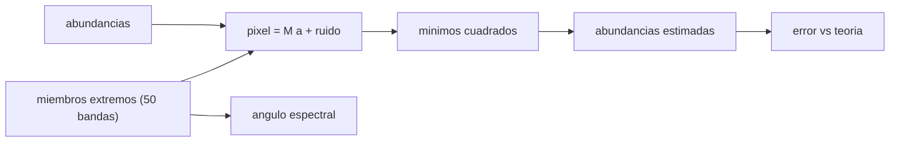

# B53-C29 — Imágenes hiperespectrales de superficies planetarias

<!-- nav:top -->
[🏠 Programa](../../../../README.md) · [📚 Bloque B53](../../../tronco-comun/B53-astrogeologia-y-geodesia-planetaria.md) · [← Anterior: B53-C28 — Inversión gravimétrica y modelos de densidad](../B53-C28-inversion-gravimetrica-y-modelos-de-densidad/CLASE.md) · [Siguiente: B53-C30 — Radar de penetración subsuperficial en cuerpos planetarios →](../B53-C30-radar-de-penetracion-subsuperficial-en-cuerpos-planetarios/CLASE.md)
<!-- /nav -->

## 1. Ubicación, nivel y alcance

Clase 29 del bloque B53. Nivel N3. Un cubo hiperespectral guarda un espectro de muchas bandas en cada píxel. Si la superficie es una mezcla lineal de unos pocos minerales («miembros extremos»), cada píxel es la suma ponderada de sus espectros, y se pueden estimar las abundancias por mínimos cuadrados. Aquí generas un cubo **sintético** de `20 × 20` píxeles y `50` bandas con tres miembros extremos inventados, estimas las abundancias con y sin la restricción de suma uno, comparas su error con la predicción teórica y calculas el ángulo espectral entre miembros extremos. Un espectrómetro de imágenes de Mars Reconnaissance Orbiter se menciona en la página de NASA consultada, sin detalle; no se usa ningún dato.

## 2. Por qué esta clase existe

Un píxel gris puede ser una mezcla de tres minerales. La decisión central: **¿qué abundancias explican el espectro de un píxel y con qué error, dado el ruido y la similitud entre miembros extremos?**

## 3. Lo que podrás hacer al terminar

1. Plantear el modelo de mezcla lineal.
2. Estimar abundancias por mínimos cuadrados.
3. Imponer la suma uno y compararla.
4. Predecir el error con `σ √(tr((MᵀM)⁻¹)/3)`.
5. Calcular el ángulo espectral entre miembros extremos.
6. Detectar abundancias negativas como señal de ruido o modelo incompleto.

La evidencia es la **ficha del desmezclado espectral** del ejercicio 12 (sección 20).

## 4. Con qué llegas y cómo comprobarlo

1. ¿Qué es una mezcla lineal?
2. ¿Qué es una abundancia?
3. ¿Qué son mínimos cuadrados?
4. ¿Qué es un ángulo entre vectores?
5. ¿Qué es un dato sintético?

<details>
<summary>Ver respuestas</summary>

1. Un espectro que es suma ponderada de otros. 2. La fracción de cada componente en el píxel. 3. Un ajuste que minimiza la suma de cuadrados de los residuos. 4. `arccos` del producto escalar normalizado. 5. Uno generado por el modelo.
</details>

Con cuatro o cinco aciertos, sigue; si no, repasa los prerrequisitos.

## 5. Un caso de contexto y casos de referencia

Tres miembros extremos sintéticos de 50 bandas entre `0,4` y `2,5 µm`, ruido de `0,005`. El error RMS de las abundancias es `0,0086` sin restricción (teórico `0,0086`) y `0,0071` con suma uno (teórico `0,0070`). El `2,5 %` de los píxeles tiene alguna abundancia estimada negativa. Los ángulos espectrales entre miembros son `11,3°`, `13,6°` y `9,3°`. Es el **ejemplo conductor**. Todo es **sintético o ilustrativo** y así se rotula.

## 6. Vocabulario

El **miembro extremo** es el espectro de un material puro. La **abundancia** es su fracción. La **mezcla lineal** supone `y = M a + ruido`. El **ángulo espectral (SAM)** es `arccos(u·v/(|u||v|))`.

## 7. Modelo mental

Analogía: mezclar tres pinturas: el color final es la suma ponderada de los colores puros, y se puede adivinar la receta, con más dificultad si dos pinturas se parecen.



*Descripción textual:* Los miembros extremos y las abundancias forman el espectro del píxel; los mínimos cuadrados las recuperan y se compara su error con la teoría.

Límite de la analogía: las mezclas reales no son siempre lineales: dependen del tamaño de grano y de la geometría.

## 8. La explicación, paso a paso

### 8,1 Mínimos cuadrados

`â = (MᵀM)⁻¹ Mᵀ y`. Su covarianza es `σ² (MᵀM)⁻¹`. Con la suma uno, `â_c = â + G⁻¹1 (1 − 1ᵀâ)/(1ᵀG⁻¹1)` con `G = MᵀM`.

| Estimador | RMS medido | RMS teórico |
|---|---|---|
| sin restricción | 0,00862 | 0,00860 |
| con suma uno | 0,00710 | 0,00701 |

### 8,2 Ángulo espectral

| Par | SAM [°] |
|---|---|
| 1–2 | 11,32 |
| 1–3 | 13,65 |
| 2–3 | 9,27 |

### 8,3 Lectura

La restricción de suma uno reduce el error. Miembros con ángulo pequeño son difíciles de separar: la matriz `MᵀM` se acerca a la singular y el error crece. El `2,5 %` de píxeles con abundancias negativas muestra que el ruido produce estimaciones físicamente imposibles.

## 9. Magnitudes, símbolos y unidades

| Símbolo | Qué es | Unidad | Valor / nota |
|---|---|---|---|
| `M` | matriz de miembros extremos | 50 × 3 | sintética |
| `a` | abundancias | — | suma 1 |
| `σ` | ruido | — | 0,005 (sintético) |
| bandas | número de bandas | — | 50 (0,4 a 2,5 µm) |
| píxeles | cubo | — | 20 × 20 |

## 10. Convenciones y referencias

Cubo sintético, abundancias con distribución de Dirichlet uniforme; semilla `20261109`; reflectancia adimensional; tolerancias: RMS medido dentro de 10 % del teórico.

## 11. De dónde sale lo que afirmamos

| ID | Fuente | Localizador | Respalda | Estado |
|---|---|---|---|---|
| S1 | NASA Science, Mars Reconnaissance Orbiter | https://science.nasa.gov/mission/mars-reconnaissance-orbiter/ | contexto: se menciona un espectrómetro de imágenes sin detalle técnico | Página consultada el 2026-11-09 (SHARAD no aparece) |

Límites: la página no describe el instrumento como hiperespectral ni da bandas; todo el cubo es sintético.

## 12. Cómo ver el resultado

| Magnitud | Valor |
|---|---|
| RMS sin restricción | 0,0086 |
| teórico | 0,0086 |
| RMS con suma uno | 0,0071 |
| píxeles con abundancia negativa | 2,5 % |
| SAM 1–2 | 11,3° |

Descripción larga: el error medido coincide con la predicción y la restricción lo reduce.

## 13. Ejemplo trabajado

**Paso 1.** Cubo: 400 píxeles × 50 bandas.

**Paso 2.** Estimador: `(MᵀM)⁻¹ Mᵀ y`.

**Paso 3.** Teoría: `σ √(tr((MᵀM)⁻¹)/3) = 0,0086`.

**Paso 4.** Medido: `0,0086`.

## 14. Distintas formas de describirlo

**Por fórmula:** mínimos cuadrados. **Por restricción:** suma uno. **Por ángulo:** SAM. **Por tabla:** errores.

## 15. Práctica guiada

**Ejercicio 1 · con los pasos indicados.** ¿Cuántas incógnitas hay por píxel?

<details><summary>Solución comentada</summary>

3 (2 si se impone la suma uno).
</details>

**Ejercicio 2 · con una pista.** ¿Cuántas ecuaciones?

<details><summary>Solución comentada</summary>

50.
</details>

**Ejercicio 3 · casi autónomo.** Calcula el error teórico sin restricción.

<details><summary>Solución comentada</summary>

`0,0086`.
</details>

## 16. Práctica autónoma, transferencia e integrador

**Ejercicio 4 · autónomo.** ¿Por qué la restricción reduce el error?

<details><summary>Solución comentada</summary>

Elimina un grado de libertad.
</details>

**Ejercicio 5 · autónomo.** ¿Qué indica un ángulo pequeño entre miembros?

<details><summary>Solución comentada</summary>

Espectros parecidos: difícil separar.
</details>

**Ejercicio 6 · autónomo.** ¿Qué indica una abundancia negativa?

<details><summary>Solución comentada</summary>

Ruido o un modelo incompleto.
</details>

**Ejercicio 7 · autónomo.** ¿Qué pasa si el ruido se duplica?

<details><summary>Solución comentada</summary>

El error se duplica.
</details>

**Ejercicio 8 · autónomo.** ¿Qué pasa si se agrega un miembro redundante?

<details><summary>Solución comentada</summary>

La matriz es casi singular y el error crece mucho.
</details>

**Ejercicio 9 · transferencia.** Un cubo real tiene mezcla no lineal. ¿Qué haces?

<details><summary>Solución comentada</summary>

Uso modelos que consideran el tamaño de grano; aquí no.
</details>

**Ejercicio 10 · transferencia.** ¿Cuántas bandas hacen falta?

<details><summary>Solución comentada</summary>

Más bandas que miembros, bien repartidas.
</details>

**Ejercicio 11 · transferencia.** ¿Qué entregas con el desmezclado?

<details><summary>Solución comentada</summary>

Abundancias con incertidumbre y el ajuste residual.
</details>

**Ejercicio 12 · integrador.** Elabora tu *ficha del desmezclado espectral*: modelo, estimadores, error, SAM y límites.

<details><summary>Solución modelo</summary>

Secciones 8,1 a 8,3.
</details>

## 17. Laboratorio: desmezclado lineal y ángulo espectral

El script [hiperespectral.py](hiperespectral.py) genera 400 píxeles mezclados con ruido y estima abundancias con y sin la restricción (**comprueba** RMS medido dentro de 10 % del teórico).

**Datos:** cubo **sintético**; semilla `20261109`. **Predice antes de ejecutar:** ¿qué estimador tendrá menor error, el restringido o el libre? (el restringido). **Ejecución del 2026-11-09 (Python 3,12,9):**

```text
Python 3.12.9 (biblioteca estandar)
RMS de abundancias sin restriccion = 0.00862 (teorico 0.00860) ; con suma uno = 0.00710 (teorico 0.00701)
pixeles con alguna abundancia negativa = 2.5 %
SAM entre miembros: 1-2 11.32 ; 1-3 13.65 ; 2-3 9.27 grados
Pruebas superadas.
```

```bash
python programa/clases/B53/B53-C29-imagenes-hiperespectrales-de-superficies-planetarias/hiperespectral.py
```

**Límites:** mezcla lineal, ruido blanco, tres miembros.

## 18. Errores frecuentes y cómo corregirlos

**Ignorar la singularidad de la matriz.** se corrige con 8,3

**Interpretar abundancias negativas como reales.** se corrige con 8,3

**Presentar el cubo como observado.** se corrige con la sección 10

## 19. Cómo sabrás que vas bien

Tras la sección 8: ¿qué resultado esperabas y cuál obtuviste? Si dudas, repasa el ejemplo de la sección 13. Tras el laboratorio: ¿qué comprueba? (ver la sección 17).

## 20. Qué entregas y cómo se evalúa

El producto es tu **ficha del desmezclado espectral** (ejercicio 12).

| Criterio | Inicial | En desarrollo | Logrado | Destacado |
|---|---|---|---|---|
| Conceptos | Los confunde | Parciales | Conceptos de la clase | Explica los límites |
| Cálculo | Sin unidades | Con errores | Tablas completas | Calcula casos nuevos |
| Numérico | Sin comprobar | Un caso | Contraste con el análisis | Interpreta las diferencias |
| Fuentes | Sin fuente | Sin fecha | Fuentes con fecha | Declara lo sintético |
| Límites | No los nombra | Uno | Tres | Discute qué falta del modelo |

**Condiciones críticas (no se compensan con promedio):** rotular el cubo como sintético; no atribuir miembros a minerales reales; citar solo lo consultado.

## 21. Ética, seguridad y límites

Clase educativa: los modelos son simplificados y no sustituyen a los productos de una misión ni a la literatura primaria. Ningún dato simulado se presenta como observado. Accesibilidad: tablas equivalentes a las gráficas, fórmulas en texto, ejercicios sin conexión.

## 22. Para cerrar y seguir

El error medido (`0,009`) coincide con la predicción (`0,009`) y la restricción lo baja a `0,007`. Queda una pregunta: ¿cómo se sondea el subsuelo con radar?

**Glosario español–inglés.** miembro extremo · *endmember*; desmezclado · *unmixing*; ángulo espectral · *spectral angle*; cubo hiperespectral · *hyperspectral cube*.

**Continuidad.** [B53-C30](../B53-C30-radar-de-penetracion-subsuperficial-en-cuerpos-planetarios/CLASE.md) estudia el radar de penetración subsuperficial.

**Referencias:** ver sección 11.

<!-- nav:bottom -->
---

[← Anterior: B53-C28 — Inversión gravimétrica y modelos de densidad](../B53-C28-inversion-gravimetrica-y-modelos-de-densidad/CLASE.md) · [📚 Bloque B53](../../../tronco-comun/B53-astrogeologia-y-geodesia-planetaria.md) · [Siguiente: B53-C30 — Radar de penetración subsuperficial en cuerpos planetarios →](../B53-C30-radar-de-penetracion-subsuperficial-en-cuerpos-planetarios/CLASE.md)
<!-- /nav -->
