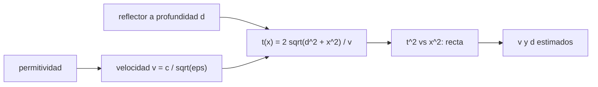

# B53-C30 — Radar de penetración subsuperficial en cuerpos planetarios

<!-- nav:top -->
[🏠 Programa](../../../../README.md) · [📚 Bloque B53](../../../tronco-comun/B53-astrogeologia-y-geodesia-planetaria.md) · [← Anterior: B53-C29 — Imágenes hiperespectrales de superficies planetarias](../B53-C29-imagenes-hiperespectrales-de-superficies-planetarias/CLASE.md) · [Siguiente: B54-C01 — Estructura vertical de atmósferas →](../../B54/B54-C01-estructura-vertical-de-atmosferas/CLASE.md)
<!-- /nav -->

## 1. Ubicación, nivel y alcance

Clase 30 del bloque B53. Nivel N3. Un radar de penetración subsuperficial emite pulsos y registra reflexiones en interfaces donde cambia la permitividad. Un reflector puntual enterrado produce en el perfil una **hipérbola de difracción** cuyo vértice da el retardo y cuya curvatura da la velocidad. Aquí calculas el coeficiente de reflexión entre dos capas con permitividades **ilustrativas**, simulas una hipérbola con ruido de tiempo, ajustas velocidad y profundidad por regresión lineal sobre `t²` frente a `x²`, estimas su incertidumbre por Monte Carlo y muestras el error de profundidad si se supone una permitividad errónea. Es complementaria de la clase 24 (hielo): aquí se trata un subsuelo de regolito y roca. La página de MRO consultada no menciona SHARAD; no se usan datos.

## 2. Por qué esta clase existe

Sin conocer la velocidad, un retardo no da profundidad. La decisión central: **¿se puede estimar la velocidad del medio con los propios datos y qué error de profundidad produce suponerla mal?**

## 3. Lo que podrás hacer al terminar

1. Calcular el coeficiente de reflexión entre dos capas.
2. Escribir el retardo de un reflector puntual.
3. Linealizar la hipérbola con `t²` frente a `x²`.
4. Estimar velocidad y profundidad con su incertidumbre.
5. Calcular el error de profundidad por una permitividad supuesta.
6. Distinguir una hipérbola de una reflexión plana.

La evidencia es la **ficha del radar de subsuelo** del ejercicio 12 (sección 20).

## 4. Con qué llegas y cómo comprobarlo

1. ¿Qué es la permitividad relativa?
2. ¿Qué es una reflexión?
3. ¿Qué es una hipérbola?
4. ¿Qué es una regresión lineal?
5. ¿Qué es un dato sintético?

<details>
<summary>Ver respuestas</summary>

1. La razón entre la permitividad del medio y la del vacío. 2. Parte de la onda que vuelve en una interfaz. 3. Una curva `t² = a + b x²`. 4. El ajuste de una recta por mínimos cuadrados. 5. Uno generado por el modelo.
</details>

Con cuatro o cinco aciertos, sigue; si no, repasa los prerrequisitos.

## 5. Un caso de contexto y casos de referencia

Entre regolito de `ε₁ = 3,0` y roca de `ε₂ = 7,0` (ilustrativas) el coeficiente de reflexión es `-0,209` (`-13,6 dB` en potencia). Un reflector puntual a `3 m` en un medio con `v = 1,731 × 10⁸ m/s` produce una hipérbola; con ruido de `0,5 ns` en 41 trazas se estima `v = 1,731 × 10⁸ ± 3,1 × 10⁵ m/s` y `d = 2,999 ± 0,021 m`. Si se supone `ε = 4` en lugar de `3`, la profundidad sale `2,598 m`. Es el **ejemplo conductor**. Todo es **sintético o ilustrativo** y así se rotula.

## 6. Vocabulario

El **coeficiente de reflexión** es `(√ε₁ − √ε₂)/(√ε₁ + √ε₂)`. La **hipérbola de difracción** es `t(x) = 2√(d² + x²)/v`. La **linealización** es `t² = 4x²/v² + 4d²/v²`: pendiente `4/v²`, intercepto `4d²/v²`.

## 7. Modelo mental

Analogía: el eco de una pared lejana al caminar a lo largo de ella: el tiempo del eco es mínimo frente al punto más cercano y crece a ambos lados.



*Descripción textual:* La permitividad fija la velocidad; con la profundidad del reflector da la hipérbola, que se linealiza para estimar velocidad y profundidad.

Límite de la analogía: los medios reales son heterogéneos y con pérdidas, y la velocidad cambia con la profundidad.

## 8. La explicación, paso a paso

### 8,1 Reflexión

`R = (√ε₁ − √ε₂)/(√ε₁ + √ε₂)` y potencia reflejada `R²`.

| Magnitud | Valor |
|---|---|
| `R` | -0,2087 |
| `R²` | 0,0436 |
| pérdida de reflexión [dB] | -13,61 |

### 8,2 Hipérbola

`v = c/√ε₁ = 1,7309 × 10⁸ m/s`. Retardo en el vértice: `t₀ = 2d/v = 34,66 ns`.

Ajuste de `t²` frente a `x²` con 41 trazas (−10 a 10 m cada 0,5 m), ruido de `0,5 ns`, 500 repeticiones:

| Magnitud | verdadera | media | dispersión |
|---|---|---|---|
| `v` [m/s] | 1,7309 × 10⁸ | 1,7307 × 10⁸ | 3,12 × 10⁵ |
| `d` [m] | 3,000 | 2,9987 | 0,0212 |
| ajuste sin ruido, error de `v` | — | 0,0 × 10⁰ | — |

### 8,3 Permitividad supuesta

Si se supone `ε = 4`, `v' = 1,499 × 10⁸ m/s` y `d' = v' t₀/2 = 2,598 m`: error de `-13,4 %`.

### 8,4 Lectura

La hipérbola permite estimar la velocidad solo con reflectores puntuales y buena cobertura lateral; para interfaces planas se necesita otra información.

## 9. Magnitudes, símbolos y unidades

| Símbolo | Qué es | Unidad | Valor / nota |
|---|---|---|---|
| `ε₁`, `ε₂` | permitividades relativas | — | 3,0 y 7,0 (ilustrativas) |
| `c` | velocidad de la luz | m/s | 299 792 458 (exacta) |
| `d` | profundidad del reflector | m | 3 (sintética) |
| `σ_t` | ruido de tiempo | ns | 0,5 (sintético) |
| `x` | posición de la traza | m | −10 a 10 |

## 10. Convenciones y referencias

Medio homogéneo sin pérdidas; reflector puntual; semilla `20261109`; 500 repeticiones; regresión lineal sin pesos; tolerancias: velocidad media dentro de 3 errores típicos y recuperación sin ruido 10⁻⁹.

## 11. De dónde sale lo que afirmamos

| ID | Fuente | Localizador | Respalda | Estado |
|---|---|---|---|---|
| S1 | NASA Science, Mars Reconnaissance Orbiter | https://science.nasa.gov/mission/mars-reconnaissance-orbiter/ | contexto: la página no menciona un radar de subsuelo | Página consultada el 2026-11-09 (SHARAD no aparece) |

Límites: no se consultó ninguna fuente de radar de subsuelo; permitividades y geometría son ilustrativas.

## 12. Cómo ver el resultado

| Magnitud | Valor |
|---|---|
| `R` | -0,209 |
| pérdida de reflexión | -13,6 dB |
| `v` estimada | 1,731 × 10⁸ m/s |
| `d` estimada | 2,999 m |
| `d` con `ε = 4` | 2,598 m |

Descripción larga: la velocidad y la profundidad se recuperan dentro de su incertidumbre y suponer mal la permitividad sesga la profundidad.

## 13. Ejemplo trabajado

**Paso 1.** Velocidad: `c/√3 = 1,7309 × 10⁸ m/s`.

**Paso 2.** Vértice: `t₀ = 2·3/v = 34,66 ns`.

**Paso 3.** Recta: `t² = 4x²/v² + 4d²/v²`.

**Paso 4.** Ajuste: `v = 1,731 × 10⁸`, `d = 2,999`.

## 14. Distintas formas de describirlo

**Por fórmula:** `R` y `t(x)`. **Por regresión:** `t²` frente a `x²`. **Por tabla:** estimaciones. **Por error:** permitividad supuesta.

## 15. Práctica guiada

**Ejercicio 1 · con los pasos indicados.** Calcula `R` entre `ε = 3` y `ε = 7`.

<details><summary>Solución comentada</summary>

`-0,209`.
</details>

**Ejercicio 2 · con una pista.** ¿Qué fracción de potencia se refleja?

<details><summary>Solución comentada</summary>

`0,044`.
</details>

**Ejercicio 3 · casi autónomo.** Calcula `v` para `ε = 4`.

<details><summary>Solución comentada</summary>

`1,499 × 10⁸ m/s`.
</details>

## 16. Práctica autónoma, transferencia e integrador

**Ejercicio 4 · autónomo.** Calcula `t₀` para `d = 3 m`.

<details><summary>Solución comentada</summary>

`34,66 ns`.
</details>

**Ejercicio 5 · autónomo.** ¿Qué pendiente tiene la recta `t²` frente a `x²`?

<details><summary>Solución comentada</summary>

`4/v²`.
</details>

**Ejercicio 6 · autónomo.** ¿Qué error de `d` da suponer `ε = 4`?

<details><summary>Solución comentada</summary>

`-13,4 %`.
</details>

**Ejercicio 7 · autónomo.** ¿Qué pasa con la incertidumbre si el ruido se duplica?

<details><summary>Solución comentada</summary>

Se duplica.
</details>

**Ejercicio 8 · autónomo.** ¿Por qué las trazas laterales ayudan?

<details><summary>Solución comentada</summary>

Aumentan la curvatura visible.
</details>

**Ejercicio 9 · transferencia.** Una interfaz plana no da hipérbola. ¿Qué haces?

<details><summary>Solución comentada</summary>

Uso otra técnica para la velocidad, como varios radares o modelos.
</details>

**Ejercicio 10 · transferencia.** ¿Qué distingue el regolito seco de la roca?

<details><summary>Solución comentada</summary>

Su permitividad, que cambia la reflexión.
</details>

**Ejercicio 11 · transferencia.** ¿Qué más limita la profundidad de sondeo?

<details><summary>Solución comentada</summary>

La atenuación y la dispersión.
</details>

**Ejercicio 12 · integrador.** Elabora tu *ficha del radar de subsuelo*: reflexión, hipérbola, ajuste, error por permitividad y límites.

<details><summary>Solución modelo</summary>

Secciones 8,1 a 8,4.
</details>

## 17. Laboratorio: reflexión, hipérbola de difracción y velocidad

El script [gpr.py](gpr.py) simula 500 radargramas sintéticos con ruido de tiempo, ajusta la hipérbola por regresión y evalúa el error de suponer otra permitividad (**comprueba** `v` dentro de 3 errores típicos).

**Datos:** parámetros **ilustrativos**; semilla `20261109`. **Predice antes de ejecutar:** ¿recuperará el ajuste la velocidad verdadera? (sí, con pequeña dispersión). **Ejecución del 2026-11-09 (Python 3,12,9):**

```text
Python 3.12.9 (biblioteca estandar)
R = -0.20871 ; R^2 = 0.04356 ; perdida de reflexion = -13.609 dB
v verdadera = 1.73085e+08 m/s ; t0 = 34.665 ns ; error del ajuste sin ruido = 0.00e+00
500 radargramas: v = 1.73074e+08 +- 3.12e+05 m/s ; d = 2.9987 +- 0.0212 m
con eps = 4 supuesto: v = 1.4990e+08 m/s ; d = 2.5981 m (-13.4 %)
Pruebas superadas.
```

```bash
python programa/clases/B53/B53-C30-radar-de-penetracion-subsuperficial-en-cuerpos-planetarios/gpr.py
```

**Límites:** medio homogéneo, un solo reflector, sin pérdidas.

## 18. Errores frecuentes y cómo corregirlos

**Suponer la permitividad sin comprobarla.** se corrige con 8,3

**Confundir hipérbola con interfaz plana.** se corrige con 8,4

**Presentar el radargrama como medido.** se corrige con la sección 10

## 19. Cómo sabrás que vas bien

Tras la sección 8: ¿qué resultado esperabas y cuál obtuviste? Si dudas, repasa el ejemplo de la sección 13. Tras el laboratorio: ¿qué comprueba? (ver la sección 17).

## 20. Qué entregas y cómo se evalúa

El producto es tu **ficha del radar de subsuelo** (ejercicio 12).

| Criterio | Inicial | En desarrollo | Logrado | Destacado |
|---|---|---|---|---|
| Conceptos | Los confunde | Parciales | Conceptos de la clase | Explica los límites |
| Cálculo | Sin unidades | Con errores | Tablas completas | Calcula casos nuevos |
| Numérico | Sin comprobar | Un caso | Contraste con el análisis | Interpreta las diferencias |
| Fuentes | Sin fuente | Sin fecha | Fuentes con fecha | Declara lo sintético |
| Límites | No los nombra | Uno | Tres | Discute qué falta del modelo |

**Condiciones críticas (no se compensan con promedio):** rotular el radargrama como sintético; declarar la permitividad supuesta; citar solo lo consultado.

## 21. Ética, seguridad y límites

Clase educativa: los modelos son simplificados y no sustituyen a los productos de una misión ni a la literatura primaria. Ningún dato simulado se presenta como observado. Accesibilidad: tablas equivalentes a las gráficas, fórmulas en texto, ejercicios sin conexión.

## 22. Para cerrar y seguir

La hipérbola da `v = 1,731 × 10⁸ m/s` y `d = 3,00 m`, y suponer `ε = 4` sesga la profundidad `-13,4 %`. Con esta clase se cierra el bloque de astrogeología y geodesia planetaria.

**Glosario español–inglés.** radar de penetración subsuperficial · *ground-penetrating radar*; hipérbola de difracción · *diffraction hyperbola*; coeficiente de reflexión · *reflection coefficient*.

**Continuidad.** Cierra el bloque B53; cierra el bloque B53.

**Referencias:** ver sección 11.

<!-- nav:bottom -->
---

[← Anterior: B53-C29 — Imágenes hiperespectrales de superficies planetarias](../B53-C29-imagenes-hiperespectrales-de-superficies-planetarias/CLASE.md) · [📚 Bloque B53](../../../tronco-comun/B53-astrogeologia-y-geodesia-planetaria.md) · [Siguiente: B54-C01 — Estructura vertical de atmósferas →](../../B54/B54-C01-estructura-vertical-de-atmosferas/CLASE.md)
<!-- /nav -->
