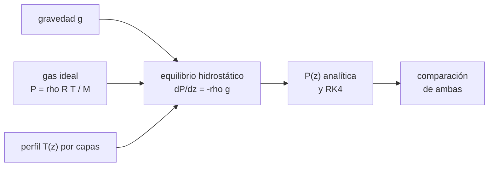

# B54-C01 — Estructura vertical de atmósferas

<!-- nav:top -->
[🏠 Programa](../../../../README.md) · [📚 Bloque B54](../../../tronco-comun/B54-atmosferas-y-climatologia-planetaria.md) · [← Anterior: B53-C30 — Radar de penetración subsuperficial en cuerpos planetarios](../../B53/B53-C30-radar-de-penetracion-subsuperficial-en-cuerpos-planetarios/CLASE.md) · [Siguiente: B54-C02 — Composición química atmosférica →](../B54-C02-composicion-quimica-atmosferica/CLASE.md)
<!-- /nav -->

## 1. Ubicación, nivel y alcance

Clase 1 del bloque B54 y primera del área A05 en el tramo de atmósferas. Nivel N3. Aquí construyes el esqueleto de toda atmósfera: la presión que decrece con la altura por **equilibrio hidrostático** y la temperatura que cambia por capas. Usas [B10](../../../tronco-comun/B10-algebra-lineal-y-matematicas-geometricas.md) solo para el álgebra básica; el resto se define en la clase. El perfil es **ilustrativo**: sus gradientes son parámetros del modelo y no se comprobaron contra el texto de la atmósfera estándar.

## 2. Por qué esta clase existe

Todo lo que sigue en el bloque (balance de energía, convección, nubes, escape) ocurre en una columna de gas con una presión y una temperatura que dependen de la altura. La pregunta motivadora: **¿cómo cae la presión con la altura cuando la temperatura también cambia?** La decisión central: elegir, para cada tramo, entre una solución isoterma y una con gradiente de temperatura constante.

## 3. Lo que podrás hacer al terminar

1. Plantear el equilibrio hidrostático `dP/dz = −ρ g` con la ley de gas ideal.
2. Calcular la altura de escala `H = R T /(M g)` de una atmósfera.
3. Obtener la presión analítica en una capa isoterma y en una capa con gradiente constante.
4. Integrar numéricamente (RK4) el perfil por capas y contrastarlo con la solución analítica.
5. Identificar la tropopausa y el máximo y mínimo de temperatura de un perfil por capas.
6. Reconocer los límites de un perfil de aire seco con `g` constante.

La evidencia es la **ficha del perfil vertical** del ejercicio 12 (sección 20).

## 4. Con qué llegas y cómo comprobarlo

1. ¿Qué dice la ley de gas ideal?
2. ¿Qué es una derivada?
3. ¿Qué es el equilibrio de fuerzas sobre una porción de gas?
4. ¿Qué es un valor ilustrativo?
5. ¿Qué es una verificación?

<details>
<summary>Ver respuestas</summary>

1. Que `P = ρ R T / M`. 2. La razón de cambio de una magnitud respecto de otra. 3. Que el peso se compensa con la diferencia de presión. 4. Un valor propuesto para el ejemplo, no medido. 5. Comparar un cálculo con un caso independiente.
</details>

Con cuatro o cinco aciertos, sigue; si no, repasa los prerrequisitos.

## 5. Un caso de contexto y casos de referencia

Tomas una columna de aire seco con `M = 28,9647 g/mol`, `g = 9,820 m/s²` (ficha NASA de la Tierra, S1), presión superficial `101 325 Pa` y temperatura `288,15 K` (ambas **ilustrativas**), y un perfil de siete capas con gradientes `−6,5; 0; +1; +2,8; 0; −2,8; −2,0 K/km`. Es el **ejemplo conductor**: calculas `T` y `P` hasta 85 km.

## 6. Vocabulario

El **equilibrio hidrostático** iguala el peso de una capa de gas con la diferencia de presión que la sostiene. La **altura de escala** `H` es la distancia en que la presión cae un factor `e` en una capa isoterma. El **gradiente de temperatura** (`dT/dz`) es el cambio de `T` con la altura. La **tropopausa** es el techo de la capa donde `T` desciende con la altura. Una **capa isoterma** tiene `T` constante.

## 7. Modelo mental: una pila de colchones

Imagina una pila de colchones: el de abajo soporta el peso de todos los de arriba, así que está más comprimido.



*Descripción textual:* la gravedad y la ley de gas ideal juntas dan la ecuación diferencial de la presión; con el perfil de temperatura por capas se obtiene `P(z)` por fórmula y por integración numérica, y ambas se comparan.

Analogía: la pila de colchones. Límite: los colchones no se comprimen según la temperatura ni cambian de masa; el gas sí cambia de densidad con `T` y `P`.

## 8. La explicación, paso a paso

### 8.1 La ecuación de partida

Sobre una lámina de gas de espesor `dz` actúan el peso `ρ g dz` y la diferencia de presión `dP`. En equilibrio `dP/dz = −ρ g`. Con gas ideal `ρ = P M/(R T)`, de modo que `d ln P/dz = −M g/(R T) = −1/H`, con `H = R T/(M g)`. Con `R = k N_A = 8,314 463 J/(mol K)` (S2, S3; exactas) y `T = 288,15 K`, la altura de escala vale `H = 8,423 km`.

### 8.2 Dos tipos de capa

En una capa **isoterma**, `H` es constante y `P = P_b exp(−(z − z_b)/H)`. En una capa con gradiente constante `L = dT/dz`, `T = T_b + L (z − z_b)` y la integral da `P = P_b (T/T_b)^(−g M/(R L))`. Para la primera capa, el exponente es `g M/(R L) = 5,2631` con `L = 6,5 K/km`.

### 8.3 Resultado del perfil

La integración RK4 con 20 000 pasos reproduce la solución analítica con una diferencia relativa de `6,2 × 10⁻¹⁰` como máximo:

| `z` (km) | `T` (K) | `P` analítica (Pa) | `P` RK4 (Pa) |
|---|---|---|---|
| 0 | 288,15 | 101 325,0000 | 101 325,0000 |
| 5 | 255,65 | 53 973,9087 | 53 973,9087 |
| 11 | 216,65 | 22 586,1591 | 22 586,1591 |
| 20 | 216,65 | 5 453,2908 | 5 453,2908 |
| 32 | 228,65 | 862,4403 | 862,4403 |
| 47 | 270,65 | 109,8869 | 109,8869 |
| 51 | 270,65 | 66,2782 | 66,2782 |
| 71 | 214,65 | 3,9024 | 3,9024 |
| 85 | 186,65 | 0,3573 | 0,3573 |

### 8.4 Lectura

La presión cae unas 284 000 veces (≈ `e^12,6`) entre el suelo y 85 km (de `101 325` a `0,357 Pa`), y lo hace más despacio donde `T` es mayor. La temperatura baja hasta `216,65 K` a 11 km (la **tropopausa** del modelo), sube con el gradiente positivo de las capas superiores hasta `270,65 K` a 47 km y vuelve a bajar. El modelo termina en 85 km con `T` aún en descenso; el laboratorio informa el mínimo en el borde del dominio, que no debe leerse como la mesopausa real.

## 9. Magnitudes, símbolos y unidades

| Símbolo | Qué es | Unidad | Valor / nota |
|---|---|---|---|
| `H` | altura de escala | km | 8,423 (a 288,15 K) |
| `R` | constante de los gases `k N_A` | J mol⁻¹ K⁻¹ | 8,314 463 |
| `M` | masa molar del aire seco | kg/mol | 0,028 964 7 (ilustrativa) |
| `g` | gravedad | m/s² | 9,820 (S1) |
| `L` | gradiente de temperatura | K/m | −6,5 × 10⁻³ … +2,8 × 10⁻³ |
| `P` | presión | Pa | ver 8.3 |

## 10. Convenciones y referencias

Altura `z` medida desde la superficie, hacia arriba; `P` en Pa y `T` en K. `g` constante (no decae con la altura: error pequeño hasta 85 km, no cuantificado en esta clase). Aire seco sin humedad. Datos ilustrativos; ninguna cifra se presenta como observación.

## 11. De dónde sale lo que afirmamos

| ID | Fuente | Localizador | Respalda | Estado |
|---|---|---|---|---|
| S1 | NASA/NSSDC, *Earth Fact Sheet* | https://nssdc.gsfc.nasa.gov/planetary/factsheet/earthfact.html | presión, densidad, altura de escala, composición, albedo, irradiancia, T de cuerpo negro, gravedad, masa, radio y velocidad de escape de la Tierra | Consultada; datos de ficha; consulta 2026-11-09 |
| S2 | NIST, *CODATA 2022: constante de Boltzmann k* | https://physics.nist.gov/cgi-bin/cuu/Value?k | k = 1,380 649 × 10⁻²³ J K⁻¹ (exacta) | Consultada; consulta 2026-11-09 |
| S3 | NIST, *CODATA 2022: constante de Avogadro N_A* | https://physics.nist.gov/cgi-bin/cuu/Value?na | N_A = 6,022 140 76 × 10²³ mol⁻¹ (exacta) | Consultada; consulta 2026-11-09 |
| S4 | NOAA/NASA/USAF, *U.S. Standard Atmosphere, 1976 (NASA-TM-X-74335)* | https://ntrs.nasa.gov/citations/19770009539 | existencia y alcance del modelo estándar por capas hasta 1000 km | Solo el resumen de NTRS; el texto no se leyó; consulta 2026-11-09 |

Límites: de la atmósfera estándar solo se consultó el resumen; sus gradientes por capa **no** se comprobaron contra el texto (no consultado) y se usan como parámetros del modelo. `M = 28,9647 g/mol` y `P₀ = 101 325 Pa` son valores estándar no consultados en esta clase.

## 12. Cómo ver el perfil vertical

| Magnitud | Valor |
|---|---|
| `H` a 288,15 K | 8,423 km |
| `T` en la tropopausa del modelo (11 km) | 216,65 K |
| `P` a 11 km | 22 586,2 Pa |
| `P` a 85 km | 0,357 Pa |
| diferencia máxima RK4–analítica | 6,2 × 10⁻¹⁰ (relativa) |

Descripción larga: en una gráfica de `P` (escala logarítmica) frente a `z`, el perfil es casi una recta con ligeras curvaturas en cada cambio de capa; la tabla 8.3 contiene los mismos puntos.

## 13. Ejemplo trabajado: la presión a 5 km

**Paso 1 · Temperatura.** `T = 288,15 − 6,5 × 5 = 255,65 K`.

**Paso 2 · Exponente.** `g M/(R L) = 5,2631`.

**Paso 3 · Razón.** `(255,65/288,15)^5,2631 = 0,5327`.

**Paso 4 · Presión.** `101 325 × 0,5327 = 53 974 Pa`, que coincide con la tabla 8.3.

## 14. Distintas formas de describir la presión

**Por capa isoterma:** exponencial con `H`. **Por capa con gradiente:** potencia de `T/T_b`. **Por integración numérica:** RK4 sobre `dP/dz`. Las tres coinciden dentro de `6 × 10⁻¹⁰` en esta clase; la numérica es la única que sirve cuando el perfil de `T` no es por tramos lineales.

## 15. Práctica guiada

**Ejercicio 1 · con los pasos indicados.** Calcula `H` para `T = 250 K` con `M = 0,0289647 kg/mol`, `g = 9,820 m/s²` y `R = 8,3145 J/(mol K)`. *Pasos:* aplica `H = R T/(M g)` (sección 8.1).

<details><summary>Solución comentada</summary>

`H = 7.308 km`.
</details>

**Ejercicio 2 · con una pista.** ¿Cuánto vale `dP/dz` en el suelo? *Pista:* `dP/dz = −P/H` y la `H` de la sección 8.1 (`8,423 km`).

<details><summary>Solución comentada</summary>

`−101 325/8423 = -12.03 Pa/m`: la presión baja unos 12 Pa por metro cerca del suelo.
</details>

**Ejercicio 3 · casi autónomo.** Con `L = −6,5 K/km` y 11 km de capa, ¿cuánto vale `T` arriba? Compáralo con la tabla 8.3.

<details><summary>Solución comentada</summary>

`288,15 − 6,5 × 11 = 216,65 K`, igual que la tabla.
</details>

## 16. Práctica autónoma, transferencia e integrador

**Ejercicio 4 · autónomo.** Calcula el exponente `g M/(R L)` para `L = 6,5 K/km`.

<details><summary>Solución comentada</summary>

`5.2630` (sección 8.2).
</details>

**Ejercicio 5 · autónomo.** En la capa isoterma de 11 a 20 km a `216,65 K`, calcula `P` a 20 km partiendo de `22 586,16 Pa`.

<details><summary>Solución comentada</summary>

`H = 6.333 km`; `P = 22 586,16 × exp(−9/H) = 5453.3 Pa`, con el valor de la tabla `5 453,3 Pa` (diferencias de redondeo de `R`, `M` y `g` en el tercer decimal).
</details>

**Ejercicio 6 · autónomo.** ¿Por qué `P` cae unas 284 000 veces hasta 85 km aunque `T` cambie poco?

<details><summary>Solución comentada</summary>

Porque la presión es una exponencial de la altura con `H` de unos 6 a 8 km; 85 km equivalen a unas 12,6 alturas de escala (`ln(101 325/0,3573) = 12,56`).
</details>

**Ejercicio 7 · autónomo.** Si la temperatura de todas las capas fuera `288,15 K`, ¿cuánto valdría `P` a 11 km?

<details><summary>Solución comentada</summary>

`P = 101 325 exp(−11/8,423) = 27451 Pa`, mayor que la `22 586 Pa` del perfil real porque el aire frío es más denso y por eso `P` cae más deprisa.
</details>

**Ejercicio 8 · autónomo.** El laboratorio informa el mínimo de `T` en 85 km. ¿Es la mesopausa?

<details><summary>Solución comentada</summary>

No necesariamente: el dominio termina en 85 km y la temperatura sigue bajando en el último tramo; el mínimo está en el borde, no se ha observado un mínimo interior.
</details>

**Ejercicio 9 · transferencia.** **Transferencia.** Un colega usa `g = 9,8 m/s²` y obtiene `P(11 km) = 22 640 Pa`. ¿Es un error?

<details><summary>Solución comentada</summary>

No por sí solo: un `g` distinto cambia el exponente y por tanto `P`; la pregunta es si el `g` declarado coincide con el de la fuente. Hay que declarar `g` y compararlo.
</details>

**Ejercicio 10 · transferencia.** **Transferencia.** Se quiere aplicar el método a Marte (`M ≈ 43,5 g/mol`, `g = 3,73 m/s²`). ¿Qué cambia?

<details><summary>Solución comentada</summary>

`H` se calcula con otro `M` y `g`; con `T = 214 K` sale `H ≈ 11.0 km` (clase B54-C14). Las capas deben redefinirse.
</details>

**Ejercicio 11 · transferencia.** **Transferencia.** ¿Por qué el método por capas falla si hay humedad variable?

<details><summary>Solución comentada</summary>

Porque `M` deja de ser constante y la condensación libera calor; el gradiente ya no es constante en cada capa.
</details>

**Ejercicio 12 · integrador.** **Integrador.** Elabora tu *ficha del perfil vertical*: tabla de `T` y `P` hasta 85 km, `H` por capa y la diferencia RK4–analítica.

<details><summary>Solución comentada</summary>

Secciones 8.1–8.4 y la salida del laboratorio.
</details>

## 17. Laboratorio: perfil de presión y temperatura por capas

El script [estructura_vertical.py](estructura_vertical.py) calcula `T` y `P` por capas con la fórmula analítica y con RK4 (**comprueba** la diferencia relativa < 1e-6 y se detiene si falla).

**Datos:** constantes de NIST (S2, S3) y gravedad de la ficha NASA (S1); gradientes ilustrativos. **Predice antes de ejecutar:** ¿Cuánto vale la presión a 11 km? (≈ 22 586 Pa.) **Ejecución del 2026-11-09 (Python 3.12.9):**

```text
Python 3.12.9 (biblioteca estandar)
R = k N_A = 8.314463 J/(mol K) ; H(288.15 K) = 8.423 km
 z [km]   T [K]    P analitica [Pa]   P RK4 [Pa]   dif. rel.
    0.0   288.15      101325.0000    101325.0000  0.0e+00
    5.0   255.65       53973.9087     53973.9087  1.1e-14
   11.0   216.65       22586.1591     22586.1591  2.6e-14
   20.0   216.65        5453.2908      5453.2908  4.5e-15
   32.0   228.65         862.4403       862.4403  7.6e-14
   47.0   270.65         109.8869       109.8869  3.6e-10
   51.0   270.65          66.2782        66.2782  4.0e-10
   71.0   214.65           3.9024         3.9024  4.9e-10
   85.0   186.65           0.3573         0.3573  6.2e-10
Tropopausa modelo (11 km): T = 216.65 K ; P = 22586.2 Pa
Minimo de T en la mesopausa del modelo: z = 85 km ; T = 186.65 K
Pruebas superadas.
```

```bash
python programa/clases/B54/B54-C01-estructura-vertical-de-atmosferas/estructura_vertical.py
```

**Límites:** aire seco, `g` constante y perfil ilustrativo.

## 18. Errores frecuentes y cómo corregirlos

**Usar la fórmula isoterma en una capa con gradiente.** Se corrige con 8.2.

**Olvidar convertir km a m.** Se corrige con la sección 9.

**Creer que la atmósfera tiene un techo definido.** Se corrige con 8.4: la presión decae sin cortar.

**Presentar el perfil como datos reales.** Se corrige con la sección 10: es ilustrativo.

## 19. Cómo sabrás que vas bien

Tras la sección 8: ¿qué `P` esperabas a 20 km y cuál obtuviste? Si dudas, repasa el ejemplo 13. Tras el laboratorio: ¿qué comprueba? (ver la sección 17).

## 20. Qué entregas y cómo se evalúa

El producto es tu **ficha del perfil vertical** (ejercicio 12).

| Criterio | Inicial | En desarrollo | Logrado | Destacado |
|---|---|---|---|---|
| Conceptos | Los confunde | Parciales | Equilibrio hidrostático y altura de escala | Explica los límites |
| Cálculo | Sin unidades | Con errores | Tablas completas con unidades | Calcula casos nuevos |
| Numérico | Sin comprobar | Un caso | Contraste con el caso analítico o la ficha | Interpreta las diferencias |
| Fuentes | Sin fuente | Sin fecha | Fuentes con fecha | Declara lo sintético y lo no consultado |
| Límites | No los nombra | Uno | Tres | Discute qué falta del modelo |

**Condiciones críticas (no se compensan con promedio):** rotular el perfil como ilustrativo; no inferir el clima de ningún lugar real; citar solo lo consultado.

## 21. Ética, seguridad y límites

Clase educativa: el modelo es simplificado (aire seco, `g` constante). Accesibilidad: tablas equivalentes a las gráficas, fórmulas en texto, ejercicios sin conexión.

## 22. Para cerrar y seguir

La presión cae unas 284 000 veces entre el suelo y 85 km y la temperatura sube y baja según las capas. Queda una pregunta: ¿de qué gases está hecha la columna y cómo cambia eso su altura de escala?

**Glosario español–inglés.** equilibrio hidrostático · *hydrostatic equilibrium*; altura de escala · *scale height*; tropopausa · *tropopause*; gradiente de temperatura · *lapse rate*; capa isoterma · *isothermal layer*.

**Continuidad.** [B54-C02](../B54-C02-composicion-quimica-atmosferica/CLASE.md) estudia la composición y la masa molar media.

**Referencias:** ver sección 11.

<!-- nav:bottom -->
---

[← Anterior: B53-C30 — Radar de penetración subsuperficial en cuerpos planetarios](../../B53/B53-C30-radar-de-penetracion-subsuperficial-en-cuerpos-planetarios/CLASE.md) · [📚 Bloque B54](../../../tronco-comun/B54-atmosferas-y-climatologia-planetaria.md) · [Siguiente: B54-C02 — Composición química atmosférica →](../B54-C02-composicion-quimica-atmosferica/CLASE.md)
<!-- /nav -->
