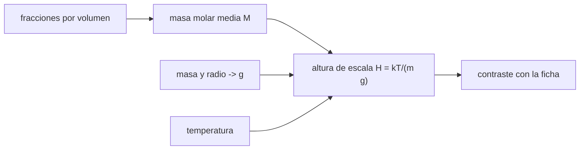

# B54-C02 — Composición química atmosférica

<!-- nav:top -->
[🏠 Programa](../../../../README.md) · [📚 Bloque B54](../../../tronco-comun/B54-atmosferas-y-climatologia-planetaria.md) · [← Anterior: B54-C01 — Estructura vertical de atmósferas](../B54-C01-estructura-vertical-de-atmosferas/CLASE.md) · [Siguiente: B54-C03 — Equilibrio radiativo →](../B54-C03-equilibrio-radiativo/CLASE.md)
<!-- /nav -->

## 1. Ubicación, nivel y alcance

Clase 2 del bloque B54. Nivel N3. De la composición de una atmósfera sale su **masa molar media**, y de esta, su altura de escala (B54-C01) y su calor específico. Aquí calculas `M` para cinco atmósferas (Tierra, Venus, Marte, Júpiter y Titán) a partir de fracciones por volumen publicadas y contrastas la altura de escala calculada con la de las fichas de la NASA.

## 2. Por qué esta clase existe

Dos atmósferas con la misma temperatura y gravedad tienen alturas de escala distintas si sus gases pesan distinto. La pregunta motivadora: **¿qué parte de la diferencia entre las atmósferas de los planetas viene solo de la composición?** La decisión central: cuánta precisión pedir a las fracciones y cuándo renormalizar.

## 3. Lo que podrás hacer al terminar

1. Calcular la masa molar media de una mezcla a partir de fracciones por volumen.
2. Calcular `g = G M/r²` y la altura de escala `H = k T/(m g)`.
3. Contrastar `H` calculada con la de una ficha y cuantificar la diferencia.
4. Explicar por qué una atmósfera de CO₂ tiene `H` distinta de una de N₂ a igual `T`.
5. Reconocer la renormalización de fracciones como una aproximación.
6. Decir qué datos del cálculo son de fuente y cuáles son estándar no consultados.

La evidencia es la **tabla de composición y altura de escala** del ejercicio 12 (sección 20).

## 4. Con qué llegas y cómo comprobarlo

1. ¿Qué es una fracción por volumen?
2. ¿Qué es la masa molar?
3. ¿Qué relación hay entre fracción por volumen y por número?
4. ¿Qué es un valor ilustrativo?
5. ¿Qué es una verificación?

<details>
<summary>Ver respuestas</summary>

1. Para un gas ideal, la fracción de moléculas de una especie. 2. La masa de un mol de sustancia, en kg/mol o g/mol. 3. Son iguales para un gas ideal. 4. Un valor propuesto para el ejemplo, no medido. 5. Comparar un cálculo con un caso independiente.
</details>

Con cuatro o cinco aciertos, sigue; si no, repasa los prerrequisitos.

## 5. Un caso de contexto y casos de referencia

Las fichas dan: Tierra 78,08 % N₂, 20,95 % O₂, 9340 ppm de Ar y 420 ppm de CO₂; Venus 96,5 % CO₂ y 3,5 % N₂; Marte 95,1 % CO₂ con N₂, Ar, O₂ y CO; Júpiter 89,8 % H₂ y 10,2 % He; Titán ~95 % N₂ y ~5 % CH₄ (S1–S5). Con temperaturas de ficha y la masa y el radio de cada cuerpo calculas `H`. Es el **ejemplo conductor**. Las masas atómicas redondeadas son valores estándar **no consultados**.

## 6. Vocabulario

La **masa molar media** `M` es el promedio de las masas molares ponderado por las fracciones. La **fracción por volumen** es la proporción de moléculas de una especie. Una **especie traza** es una con fracción mucho menor que 1. La **renormalización** reescala las fracciones para que sumen 1. La **altura de escala** `H = k T/(m g)` es la de B54-C01 con `m = M/N_A`.

## 7. Modelo mental: una receta con ingredientes de distinto peso

Una mezcla de gases es como una receta: el peso medio por moléculas depende de cuánto hay de cada ingrediente.



*Descripción textual:* las fracciones dan la masa molar media; con la gravedad (de la masa y el radio) y la temperatura se obtiene `H`, que se contrasta con la ficha.

Analogía: una receta con ingredientes de distinto peso. Límite: la receta no se estratifica; una atmósfera por encima de la homopausa sí puede separarse por especies (no se trata aquí).

## 8. La explicación, paso a paso

### 8.1 Masa molar media

`M = Σ x_i M_i`, con `x_i` renormalizadas para sumar 1 (las fichas omiten trazas). Con masas atómicas estándar redondeadas (no consultadas) resulta `28,967 g/mol` (Tierra), `43,449` (Venus), `43,486` (Marte), `2,219` (Júpiter) y `27,415` (Titán).

### 8.2 Gravedad y altura de escala

`g = G M_p/r²` con `G = 6,674 30 × 10⁻¹¹` (S9) reproduce la ficha de la Tierra (`9,820 m/s²`, comprobado por el laboratorio) y da `8,870` (Venus), `3,728` (Marte), `24,787` (Júpiter, con el radio de 1 bar) y `1,354 m/s²` (Titán). Con `m = M/N_A` y `H = k T/(m g)`:

| mundo | `T` (K) | `M` (g/mol) | `g` (m/s²) | `H` calculada (km) | `H` ficha (km) | dif. |
|---|---|---|---|---|---|---|
| Tierra | 288,0 | 28,967 | 9,820 | 8,42 | 8,5 | 1,0 % |
| Venus | 737,0 | 43,449 | 8,870 | 15,90 | 15,9 | 0,0 % |
| Marte | 214,0 | 43,486 | 3,728 | 10,98 | 11,0 | 0,2 % |
| Júpiter | 165,0 | 2,219 | 24,787 | 24,95 | 27,0 | 7,6 % |
| Titán | 94,15 | 27,415 | 1,354 | 21,08 | sin ficha | — |

### 8.3 Lectura

Venus tiene una `H` casi el doble de la terrestre sobre todo porque su `T` es 2,6 veces mayor, aunque su `M` sea 1,5 veces mayor. Titán, con `M` parecida a la terrestre pero `T` de 94 K, tiene `H` de 21 km porque su gravedad es solo un séptimo de la terrestre. En Júpiter la diferencia de 7,6 % aparece porque la ficha da `H = 27 km` sin declarar la `T` ni la `g` exactas con que se calculó; con la `g` de la ficha (`25,92 m/s²`) saldría `23,9 km`, más lejos. No se pretende explicar la diferencia: se informa.

## 9. Magnitudes, símbolos y unidades

| Símbolo | Qué es | Unidad | Valor / nota |
|---|---|---|---|
| `M` | masa molar media | g/mol | 2,2 … 43,5 |
| `x_i` | fracción por volumen | — | ver fichas |
| `g` | gravedad de superficie | m/s² | 1,35 … 24,8 |
| `H` | altura de escala | km | 8,4 … 25 |
| `m` | masa media de una molécula `M/N_A` | kg | — |

## 10. Convenciones y referencias

Fracciones por volumen de las fichas; temperatura de la ficha (promedio de superficie o nivel de 1 bar según el planeta); radio volumétrico medio (Júpiter: radio ecuatorial a 1 bar). Atmósfera bien mezclada, gas ideal. Titán: fracciones y temperatura de la página de NASA Science (aproximadas, «~»).

## 11. De dónde sale lo que afirmamos

| ID | Fuente | Localizador | Respalda | Estado |
|---|---|---|---|---|
| S1 | NASA/NSSDC, *Venus Fact Sheet* | https://nssdc.gsfc.nasa.gov/planetary/factsheet/venusfact.html | presión, densidad, altura de escala, T, composición, albedo, irradiancia, gravedad y masa de Venus | Consultada; datos de ficha; consulta 2026-11-09 |
| S2 | NASA/NSSDC, *Mars Fact Sheet* | https://nssdc.gsfc.nasa.gov/planetary/factsheet/marsfact.html | presión (y su rango estacional), densidad, altura de escala, T, composición, albedo, irradiancia, gravedad y masa de Marte | Consultada; datos de ficha; consulta 2026-11-09 |
| S3 | NASA/NSSDC, *Earth Fact Sheet* | https://nssdc.gsfc.nasa.gov/planetary/factsheet/earthfact.html | presión, densidad, altura de escala, composición, albedo, irradiancia, T de cuerpo negro, gravedad, masa, radio y velocidad de escape de la Tierra | Consultada; datos de ficha; consulta 2026-11-09 |
| S4 | NASA/NSSDC, *Jupiter Fact Sheet* | https://nssdc.gsfc.nasa.gov/planetary/factsheet/jupiterfact.html | T a 1 bar, altura de escala, composición, albedo, irradiancia, T de cuerpo negro, radio, masa, gravedad, velocidad de escape y rotación de Júpiter | Consultada; datos de ficha; consulta 2026-11-09 |
| S5 | NASA Science, *Titan Facts* | https://science.nasa.gov/saturn/moons/titan/facts/ | T de superficie (−179 °C), ~95 % N₂, ~5 % CH₄ y presión «60 % mayor que la terrestre» (sin valor absoluto) | Consultada; consulta 2026-11-09 |
| S6 | NASA/NSSDC, *Saturnian Satellite Fact Sheet* | https://nssdc.gsfc.nasa.gov/planetary/factsheet/saturniansatfact.html | radio, masa, densidad media, semieje y periodo orbital de Titán | Consultada; solo la fila de Titán; consulta 2026-11-09 |
| S7 | NIST, *CODATA 2022: constante de Boltzmann k* | https://physics.nist.gov/cgi-bin/cuu/Value?k | k = 1,380 649 × 10⁻²³ J K⁻¹ (exacta) | Consultada; consulta 2026-11-09 |
| S8 | NIST, *CODATA 2022: constante de Avogadro N_A* | https://physics.nist.gov/cgi-bin/cuu/Value?na | N_A = 6,022 140 76 × 10²³ mol⁻¹ (exacta) | Consultada; consulta 2026-11-09 |
| S9 | NIST, *CODATA 2022: constante de gravitación G* | https://physics.nist.gov/cgi-bin/cuu/Value?bg | G = 6,674 30(15) × 10⁻¹¹ m³ kg⁻¹ s⁻² | Consultada; consulta 2026-11-09 |

Límites: las masas atómicas (H 1,008; He 4,0026; C 12,011; N 14,007; O 15,999; Ar 39,948) son valores estándar **no consultados**; las fracciones de Titán son aproximadas («about 95 %» y «about 5 %»).

## 12. Cómo ver la composición

| Magnitud | Valor |
|---|---|
| `M` de Venus | 43,449 g/mol |
| `H` de la Tierra | 8,42 km (ficha 8,5) |
| `g` de la Tierra calculada | 9,820 m/s² |
| `H` de Titán | 21,08 km |

Descripción larga: un diagrama de barras de `H` por mundo mostraría a Júpiter y Titán por encima de Venus, y a la Tierra por debajo de todos; la tabla 8.2 lo da en números.

## 13. Ejemplo trabajado: M y H de Venus

**Paso 1 · Masa molar.** `0,965 × 44,009 + 0,035 × 28,014 = 43,449 g/mol`.

**Paso 2 · Gravedad.** `G M/r² = 8,870 m/s²`.

**Paso 3 · Altura de escala.** `H = 8,314 463 × 737/(0,043 449 × 8,870) = 15,90 km`, igual a la ficha (`15,9 km`).

## 14. Distintas formas de obtener H

**Por composición y gravedad calculada:** lo que hace el laboratorio. **Por la ficha:** `H` publicada, sin los datos de partida. **Por perfil observado de `P(z)`:** requiere un sondeo, no disponible aquí. La primera y la segunda se contrastan en esta clase.

## 15. Práctica guiada

**Ejercicio 1 · con los pasos indicados.** Calcula `M` para una mezcla 50 % N₂ y 50 % CO₂ con `28,014` y `44,009 g/mol`. *Pasos:* promedia (8.1).

<details><summary>Solución comentada</summary>

`0,5 × 28,014 + 0,5 × 44,009 = 36,01 g/mol`.
</details>

**Ejercicio 2 · con una pista.** Calcula `H` de Marte con `T = 214 K`, `M = 43,486 g/mol` y `g = 3,728 m/s²`. *Pista:* 8.2.

<details><summary>Solución comentada</summary>

`H = 10.98 km`.
</details>

**Ejercicio 3 · casi autónomo.** Las fracciones terrestres suman `100,006 %`. ¿Qué hace la renormalización?

<details><summary>Solución comentada</summary>

Divide cada fracción entre `100,006`, de modo que sumen 1; el cambio en `M` es del orden de `10⁻⁴` relativo.
</details>

## 16. Práctica autónoma, transferencia e integrador

**Ejercicio 4 · autónomo.** ¿Por qué `H` de Titán es 2,5 veces la terrestre si su `M` es similar?

<details><summary>Solución comentada</summary>

`H ∝ T/(M g)`: `T` es 3 veces menor pero `g` es 7,3 veces menor; el cociente `2.50` sale de ahí (94,15/288 × 9,820/1,354 ≈ 2,4 con `M` casi igual).
</details>

**Ejercicio 5 · autónomo.** ¿Qué fracción de la masa de la atmósfera de Marte es CO₂?

<details><summary>Solución comentada</summary>

`0,951 × 44,009/43,486 = 96.2 %` (fracción de masa mayor que la de volumen, porque el CO₂ es más pesado que el promedio).
</details>

**Ejercicio 6 · autónomo.** Con la `g` de la ficha de Júpiter (`25,92 m/s²`) en vez de `24,787`, ¿cuánto vale `H`?

<details><summary>Solución comentada</summary>

`24,95 × 24,787/25,92 = 23.9 km`.
</details>

**Ejercicio 7 · autónomo.** Si Titán tuviera 10 % de CH₄ (en vez de 5 %), ¿cuánto valdría `H`?

<details><summary>Solución comentada</summary>

`M = 0,9 × 28,014 + 0,1 × 16,043 = 26.82 g/mol`; `H = 21,08 × 27,415/26.82 = 21.55 km`.
</details>

**Ejercicio 8 · autónomo.** ¿Qué le pasa a `H` terrestre si se añade 3 % de vapor de agua (`18,015 g/mol`) a aire seco?

<details><summary>Solución comentada</summary>

`M = 0,97 × 28,967 + 0,03 × 18,015 = 28.64 g/mol`, es decir, `H` aumenta un 1.1 %.
</details>

**Ejercicio 9 · transferencia.** **Transferencia.** Un colega dice que la `H = 27 km` de Júpiter «prueba» que el modelo falla en 7,6 %. Respóndele.

<details><summary>Solución comentada</summary>

Una diferencia de 7,6 % no es un fallo: la ficha no declara la `T` ni la `g` con que obtuvo 27 km. Hay que reproducir sus datos antes de concluir.
</details>

**Ejercicio 10 · transferencia.** **Transferencia.** ¿Cómo cambiaría el método para un exoplaneta del que solo se conoce la masa molar media aproximada?

<details><summary>Solución comentada</summary>

`H` saldría con la incertidumbre de `M` (proporcional) y de `T` y `g`; se propagan las tres, como en B54-C17.
</details>

**Ejercicio 11 · transferencia.** **Transferencia.** ¿Por qué esta clase no sirve para la alta atmósfera?

<details><summary>Solución comentada</summary>

Porque por encima de la homopausa la mezcla se separa por especies y `M` varía con la altura; aquí `M` es constante.
</details>

**Ejercicio 12 · integrador.** **Integrador.** Elabora tu *tabla de composición y altura de escala*: `M`, `g`, `H` calculada y de ficha, y diferencia para los cinco mundos.

<details><summary>Solución comentada</summary>

Sección 8.2 y salida del laboratorio.
</details>

## 17. Laboratorio: masa molar media y altura de escala

El script [composicion.py](composicion.py) calcula `M`, `g` y `H` de cinco atmósferas y las compara con las fichas (**comprueba** `H` dentro del 20 % y `g` terrestre dentro de 0,03 m/s²).

**Datos:** fichas NASA/NSSDC y NASA Science (S1–S6) y constantes de NIST (S7–S9); masas atómicas estándar no consultadas. **Predice antes de ejecutar:** ¿Qué `M` tendrá Júpiter? (≈ 2,2 g/mol.) **Ejecución del 2026-11-09 (Python 3.12.9):**

```text
Python 3.12.9 (biblioteca estandar)
planeta   M [g/mol]   g [m/s2]   H calc [km]   H ficha [km]   dif.
Tierra      28.967      9.820         8.42          8.5     1.0 %
Venus       43.449      8.870        15.90         15.9     0.0 %
Marte       43.486      3.728        10.98         11.0     0.2 %
Jupiter      2.219     24.787        24.95         27.0     7.6 %
Titan       27.415      1.354        21.08  (sin ficha)
g calculada de la Tierra = 9.820 m/s2 (ficha: 9.820)
Pruebas superadas.
```

```bash
python programa/clases/B54/B54-C02-composicion-quimica-atmosferica/composicion.py
```

**Límites:** mezcla homogénea, gas ideal y fracciones renormalizadas.

## 18. Errores frecuentes y cómo corregirlos

**Sumar fracciones sin renormalizar.** Se corrige con 8.1.

**Usar masa molar en g/mol dentro de una fórmula en SI.** Se corrige con la sección 9.

**Confundir fracción por volumen con fracción por masa.** Se corrige con el ejercicio 5.

**Atribuir a la ficha un error sin conocer sus datos.** Se corrige con 8.3 y el ejercicio 9.

## 19. Cómo sabrás que vas bien

Tras la sección 8: ¿qué `M` esperabas para Venus y cuál obtuviste? Si dudas, repasa el ejemplo 13. Tras el laboratorio: ¿qué comprueba? (ver la sección 17).

## 20. Qué entregas y cómo se evalúa

El producto es tu **tabla de composición y altura de escala** (ejercicio 12).

| Criterio | Inicial | En desarrollo | Logrado | Destacado |
|---|---|---|---|---|
| Conceptos | Los confunde | Parciales | Masa molar media y altura de escala | Explica los límites |
| Cálculo | Sin unidades | Con errores | Tablas completas con unidades | Calcula casos nuevos |
| Numérico | Sin comprobar | Un caso | Contraste con el caso analítico o la ficha | Interpreta las diferencias |
| Fuentes | Sin fuente | Sin fecha | Fuentes con fecha | Declara lo sintético y lo no consultado |
| Límites | No los nombra | Uno | Tres | Discute qué falta del modelo |

**Condiciones críticas (no se compensan con promedio):** declarar qué masas son estándar no consultadas; no presentar la diferencia de Júpiter como error del método; citar solo lo consultado.

## 21. Ética, seguridad y límites

Clase educativa: gas ideal y mezcla homogénea. Accesibilidad: tablas equivalentes a las gráficas, fórmulas en texto, ejercicios sin conexión.

## 22. Para cerrar y seguir

Una atmósfera de CO₂ pesa 1,5 veces más por molécula que una de N₂, pero la temperatura pesa más que la composición en `H`. Queda una pregunta: ¿qué fija la temperatura de un mundo?

**Glosario español–inglés.** masa molar media · *mean molar mass*; fracción por volumen · *volume mixing ratio*; especie traza · *trace species*; altura de escala · *scale height*; gas ideal · *ideal gas*.

**Continuidad.** [B54-C03](../B54-C03-equilibrio-radiativo/CLASE.md) estudia el equilibrio radiativo.

**Referencias:** ver sección 11.

<!-- nav:bottom -->
---

[← Anterior: B54-C01 — Estructura vertical de atmósferas](../B54-C01-estructura-vertical-de-atmosferas/CLASE.md) · [📚 Bloque B54](../../../tronco-comun/B54-atmosferas-y-climatologia-planetaria.md) · [Siguiente: B54-C03 — Equilibrio radiativo →](../B54-C03-equilibrio-radiativo/CLASE.md)
<!-- /nav -->
