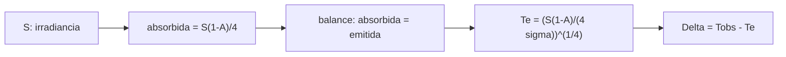

# B54-C03 — Equilibrio radiativo

<!-- nav:top -->
[🏠 Programa](../../../../README.md) · [📚 Bloque B54](../../../tronco-comun/B54-atmosferas-y-climatologia-planetaria.md) · [← Anterior: B54-C02 — Composición química atmosférica](../B54-C02-composicion-quimica-atmosferica/CLASE.md) · [Siguiente: B54-C04 — Presión y densidad →](../B54-C04-presion-y-densidad/CLASE.md)
<!-- /nav -->

## 1. Ubicación, nivel y alcance

Clase 3 del bloque B54. Nivel N3. La luz del Sol que un planeta absorbe tiene que salir de nuevo como radiación infrarroja; la temperatura a la que esos dos flujos se igualan es la **temperatura de equilibrio**. Aquí la calculas para Venus, la Tierra, Marte y Júpiter y la comparas con la temperatura de cuerpo negro de las fichas de la NASA y con la temperatura observada.

## 2. Por qué esta clase existe

La temperatura de un planeta no la fija solo lo que recibe sino cuánto absorbe y cómo se deshace de la energía. La pregunta motivadora: **¿cuánto más caliente es un mundo que su temperatura de equilibrio, y qué dice eso de su atmósfera?** La decisión central: tratar el planeta como esfera isoterma que redistribuye todo (factor 1/4).

## 3. Lo que podrás hacer al terminar

1. Plantear el balance entre la potencia absorbida y la emitida.
2. Calcular la temperatura de equilibrio `T_e = [S(1 − A)/(4σ)]^{1/4}`.
3. Contrastarla con la T de cuerpo negro de una ficha y explicar discrepancias.
4. Calcular el albedo implícito de un valor publicado.
5. Estimar la sensibilidad de `T_e` al albedo.
6. Distinguir equilibrio global de un límite sin redistribución.

La evidencia es la **tabla de equilibrio radiativo** del ejercicio 12 (sección 20).

## 4. Con qué llegas y cómo comprobarlo

1. ¿Qué es la irradiancia?
2. ¿Qué es el albedo de Bond?
3. ¿Qué dice la ley de Stefan–Boltzmann?
4. ¿Por qué el factor 4 entre disco y esfera?
5. ¿Qué es una verificación?

<details>
<summary>Ver respuestas</summary>

1. La potencia por unidad de área que llega perpendicular a los rayos, en W/m². 2. La fracción de la energía incidente total que el planeta refleja. 3. Que un cuerpo negro emite `σ T⁴` por unidad de área. 4. Porque el planeta intercepta `πR²` y emite por `4πR²`. 5. Comparar un cálculo con un caso independiente.
</details>

Con cuatro o cinco aciertos, sigue; si no, repasa los prerrequisitos.

## 5. Un caso de contexto y casos de referencia

Las fichas NASA dan para cada planeta la irradiancia solar `S`, el albedo de Bond `A` y la temperatura de cuerpo negro (S1–S4); σ viene de NIST (S5). El **ejemplo conductor**: Venus, `S = 2601,3 W/m²`, `A = 0,77`; Tierra, `S = 1361,0`, `A = 0,294`; Marte, `S = 586,2`, `A = 0,250`; Júpiter, `S = 50,26`, `A = 0,343`.

## 6. Vocabulario

La **temperatura de equilibrio** `T_e` es la que iguala la potencia absorbida con la emitida. El **albedo de Bond** es la fracción reflejada de toda la energía incidente. La **irradiancia** `S` es el flujo solar a la distancia del planeta. El **efecto de la atmósfera** `ΔT = T_obs − T_e` mide cuánto supera la temperatura observada a la de equilibrio.

## 7. Modelo mental: un grifo y un desagüe

La energía entra como el agua de un grifo y sale por un desagüe; el nivel se estabiliza cuando ambos caudales se igualan.



*Descripción textual:* la irradiancia y el albedo dan la potencia absorbida por unidad de superficie; igualarla a `σ T⁴` da `T_e`, y la diferencia con la temperatura observada mide el efecto atmosférico.

Analogía: el grifo y el desagüe. Límite: el desagüe de un planeta cambia con la temperatura (`T⁴`), no es fijo.

## 8. La explicación, paso a paso

### 8.1 El balance

El planeta intercepta `S π R²` y refleja la fracción `A`; emite `4 π R² σ T⁴`. Igualando: `T_e = [S (1 − A)/(4σ)]^{1/4}`. Con `σ = 5,670 374 419 × 10⁻⁸ W m⁻² K⁻⁴` (S5) el laboratorio comprueba que la potencia absorbida y la emitida coinciden (`240,216` frente a `240,217 W/m²` por unidad de superficie de la Tierra).

### 8.2 Resultados

| planeta | `T_e` calculada (K) | `T_bb` ficha (K) | dif. (K) | `T_obs` (K) | `T_obs − T_e` (K) |
|---|---|---|---|---|---|
| Venus | 226,63 | 226,6 | 0,03 | 737,0 | 510,4 |
| Tierra | 255,12 | 254,0 | 1,12 | 288,0 | 32,9 |
| Marte | 209,83 | 209,8 | 0,03 | 214,0 | 4,2 |
| Júpiter | 109,84 | 109,9 | −0,06 | 165,0 (a 1 bar) | 55,2 |

### 8.3 La discrepancia de la Tierra

Para Venus, Marte y Júpiter el cálculo coincide con la ficha en menos de 0,1 K. Para la Tierra difiere `1,12 K`: con la `T_bb = 254,0 K` de la ficha, el albedo que correspondería es `0,306`, no el `0,294` que la misma ficha lista. La clase no resuelve la causa; la informa y deja ambas cifras (el laboratorio admite 1,5 K en este caso y lo declara).

### 8.4 Sensibilidad y límite

Subir el albedo en `0,01` baja `T_e` terrestre `0,908 K` (analítico `0,903 K`: `T_e Δ A/(4(1 − A))`). Si no hubiera redistribución y se mirara el punto subsolar, la temperatura sería `√2 ≈ 1,414` veces mayor: `360,8 K` para la Tierra. Esto es un límite, no un resultado para ningún planeta.

## 9. Magnitudes, símbolos y unidades

| Símbolo | Qué es | Unidad | Valor / nota |
|---|---|---|---|
| `S` | irradiancia solar | W/m² | 50,26 … 2601,3 |
| `A` | albedo de Bond | — | 0,250 … 0,77 |
| `σ` | constante de Stefan–Boltzmann | W m⁻² K⁻⁴ | 5,670 374 419 × 10⁻⁸ |
| `T_e` | temperatura de equilibrio | K | 109,8 … 255,1 |
| `ΔT` | T observada − T_e | K | 4,2 … 510,4 |

## 10. Convenciones y referencias

Esfera isoterma, emisividad 1, sin calor interno (Júpiter tiene calor interno: se discute en B54-C15). `T_obs` es la temperatura media de superficie, salvo Júpiter (nivel de 1 bar).

## 11. De dónde sale lo que afirmamos

| ID | Fuente | Localizador | Respalda | Estado |
|---|---|---|---|---|
| S1 | NASA/NSSDC, *Venus Fact Sheet* | https://nssdc.gsfc.nasa.gov/planetary/factsheet/venusfact.html | presión, densidad, altura de escala, T, composición, albedo, irradiancia, gravedad y masa de Venus | Consultada; datos de ficha; consulta 2026-11-09 |
| S2 | NASA/NSSDC, *Earth Fact Sheet* | https://nssdc.gsfc.nasa.gov/planetary/factsheet/earthfact.html | presión, densidad, altura de escala, composición, albedo, irradiancia, T de cuerpo negro, gravedad, masa, radio y velocidad de escape de la Tierra | Consultada; datos de ficha; consulta 2026-11-09 |
| S3 | NASA/NSSDC, *Mars Fact Sheet* | https://nssdc.gsfc.nasa.gov/planetary/factsheet/marsfact.html | presión (y su rango estacional), densidad, altura de escala, T, composición, albedo, irradiancia, gravedad y masa de Marte | Consultada; datos de ficha; consulta 2026-11-09 |
| S4 | NASA/NSSDC, *Jupiter Fact Sheet* | https://nssdc.gsfc.nasa.gov/planetary/factsheet/jupiterfact.html | T a 1 bar, altura de escala, composición, albedo, irradiancia, T de cuerpo negro, radio, masa, gravedad, velocidad de escape y rotación de Júpiter | Consultada; datos de ficha; consulta 2026-11-09 |
| S5 | NIST, *CODATA 2022: constante de Stefan–Boltzmann σ* | https://physics.nist.gov/cgi-bin/cuu/Value?sigma | σ = 5,670 374 419 × 10⁻⁸ W m⁻² K⁻⁴ (exacta) | Consultada; consulta 2026-11-09 |

Límites: el desacuerdo terrestre de 1,12 K se atribuye solo a la inconsistencia interna aparente entre el albedo listado y la T de cuerpo negro; no se consultó cómo se calcula la ficha.

## 12. Cómo ver el equilibrio

| Magnitud | Valor |
|---|---|
| `T_e` de Venus | 226,63 K |
| `T_e` de la Tierra | 255,12 K |
| `ΔT` de Venus | 510,4 K |
| `ΔT` de Marte | 4,2 K |

Descripción larga: un diagrama de dos barras por planeta (`T_e` y `T_obs`) muestra la brecha enorme de Venus y la casi nula de Marte; la tabla 8.2 lo da en números.

## 13. Ejemplo trabajado: T_e de Marte

**Paso 1 · Absorbida.** `586,2 × (1 − 0,250)/4 = 109.91 W/m²`.

**Paso 2 · Cociente con σ.** `109.91/5,670 374 419 × 10⁻⁸ = 1.9384e+09 K⁴`.

**Paso 3 · Raíz cuarta.** `T_e = 209.83 K`, a `0,03 K` de la ficha (`209,8 K`).

## 14. Distintas formas de dar la temperatura de un planeta

**Equilibrio global (f = 1/4):** lo que se calcula aquí. **Hemisferio diurno (f = 1/2)** y **punto subsolar (f = 1):** límites con menos redistribución, de `T_e` multiplicada por `2^{1/4}` y `√2`. **Observada:** requiere mediciones directas. Ninguna sustituye a la otra.

## 15. Práctica guiada

**Ejercicio 1 · con los pasos indicados.** Calcula la potencia absorbida por unidad de superficie de Venus. *Pasos:* `S (1 − A)/4`.

<details><summary>Solución comentada</summary>

`2601,3 × 0,23/4 = 149.57 W/m²` (menos que la Tierra, a pesar de estar más cerca del Sol).
</details>

**Ejercicio 2 · con una pista.** Calcula `T_e` de Venus. *Pista:* 8.1.

<details><summary>Solución comentada</summary>

`226.63 K`.
</details>

**Ejercicio 3 · casi autónomo.** ¿Cuánto vale `ΔT` para Marte?

<details><summary>Solución comentada</summary>

`214,0 − 209,83 = 4,2 K` (sección 8.2).
</details>

## 16. Práctica autónoma, transferencia e integrador

**Ejercicio 4 · autónomo.** ¿Qué albedo daría `T_e = 254,0 K` con `S = 1361,0`?

<details><summary>Solución comentada</summary>

`A = 1 − 4σ T⁴/S = 0.306`.
</details>

**Ejercicio 5 · autónomo.** Calcula `T_e` de Júpiter y compárala con la ficha.

<details><summary>Solución comentada</summary>

`109.84 K` frente a `109,9 K`: diferencia `-0.06 K`.
</details>

**Ejercicio 6 · autónomo.** ¿Cuánto cambia `T_e` de Marte si su albedo pasa de 0,25 a 0,30?

<details><summary>Solución comentada</summary>

`T_e = 206.24 K`, es decir `-3.59 K` (cambio por unidad de albedo ≈ `−T_e/(4(1−A))`).
</details>

**Ejercicio 7 · autónomo.** ¿Por qué Venus absorbe menos energía por m² que la Tierra?

<details><summary>Solución comentada</summary>

Porque su albedo de Bond (0,77) deja pasar solo el 23 % frente al 70,6 % terrestre; el efecto del albedo supera al de la mayor irradiancia.
</details>

**Ejercicio 8 · autónomo.** Calcula `T` del punto subsolar de Marte sin redistribución.

<details><summary>Solución comentada</summary>

`296.7 K` (= `√2 T_e`).
</details>

**Ejercicio 9 · transferencia.** **Transferencia.** Un colega dice que la Tierra «tiene 33 K de efecto invernadero». ¿Qué matiz añades?

<details><summary>Solución comentada</summary>

Que es la diferencia entre `T_obs` y `T_e` con el albedo listado (255,12 K); con la `T_bb` de la ficha (254,0 K) saldría 34 K: la cifra depende del albedo adoptado.
</details>

**Ejercicio 10 · transferencia.** **Transferencia.** ¿Qué extra necesitas para aplicar el método a una luna que orbita un planeta gigante?

<details><summary>Solución comentada</summary>

Sumar el flujo reflejado y el calor interno del planeta anfitrión y las mareas; el balance solo-solar no basta.
</details>

**Ejercicio 11 · transferencia.** **Transferencia.** ¿Por qué el método subestima la temperatura de Júpiter?

<details><summary>Solución comentada</summary>

Porque Júpiter emite más de lo que absorbe del Sol (calor interno); la diferencia `55 K` con la `T` a 1 bar no es 'efecto invernadero' sin más.
</details>

**Ejercicio 12 · integrador.** **Integrador.** Elabora tu *tabla de equilibrio radiativo*: `T_e`, ficha, diferencia y `ΔT` para los cuatro planetas.

<details><summary>Solución comentada</summary>

Sección 8.2 y salida del laboratorio.
</details>

## 17. Laboratorio: temperatura de equilibrio de cuatro planetas

El script [equilibrio.py](equilibrio.py) calcula `T_e` de cuatro planetas y la compara con las fichas (**comprueba** el balance de potencias y la sensibilidad al albedo).

**Datos:** irradiancia, albedo y T de cuerpo negro de las fichas NASA/NSSDC (S1–S4) y σ de NIST (S5). **Predice antes de ejecutar:** ¿Qué `T_e` tendrá Marte? (≈ 209,8 K.) **Ejecución del 2026-11-09 (Python 3.12.9):**

```text
Python 3.12.9 (biblioteca estandar)
planeta   Te calc [K]   T_bb ficha [K]   dif [K]   T observada [K]   Delta = T_obs - Te [K]
Venus         226.63           226.6      0.03           737.0                510.4
Tierra        255.12           254.0      1.12           288.0                 32.9
Marte         209.83           209.8      0.03           214.0                  4.2
Jupiter       109.84           109.9     -0.06           165.0                 55.2
Albedo implicito en T_bb = 254.0 K para la Tierra: 0.306 (la ficha lista A = 0.294)
Balance Tierra: absorbida 240.216 W/m2 = emitida 240.217 W/m2 (por unidad de superficie)
Sensibilidad: +0.01 de albedo baja Te en 0.908 K (analitica 0.903 K)
Punto subsolar sin redistribucion (limite): 360.8 K (= sqrt(2) veces Te)
Pruebas superadas.
```

```bash
python programa/clases/B54/B54-C03-equilibrio-radiativo/equilibrio.py
```

**Límites:** esfera isoterma; la Tierra no es autoconsistente con su ficha (1,12 K).

## 18. Errores frecuentes y cómo corregirlos

**Olvidar el factor 4.** Se corrige con 8.1.

**Usar albedo geométrico en lugar del de Bond.** Se corrige con la sección 6.

**Tomar `ΔT` como 'el efecto invernadero' en Júpiter.** Se corrige con el ejercicio 11.

**Ocultar la discrepancia de la Tierra.** Se corrige con 8.3.

## 19. Cómo sabrás que vas bien

Tras la sección 8: ¿qué `T_e` esperabas para Venus y cuál obtuviste? Si dudas, repasa el ejemplo 13. Tras el laboratorio: ¿qué comprueba? (ver la sección 17).

## 20. Qué entregas y cómo se evalúa

El producto es tu **tabla de equilibrio radiativo** (ejercicio 12).

| Criterio | Inicial | En desarrollo | Logrado | Destacado |
|---|---|---|---|---|
| Conceptos | Los confunde | Parciales | Balance de energía y temperatura de equilibrio | Explica los límites |
| Cálculo | Sin unidades | Con errores | Tablas completas con unidades | Calcula casos nuevos |
| Numérico | Sin comprobar | Un caso | Contraste con el caso analítico o la ficha | Interpreta las diferencias |
| Fuentes | Sin fuente | Sin fecha | Fuentes con fecha | Declara lo sintético y lo no consultado |
| Límites | No los nombra | Uno | Tres | Discute qué falta del modelo |

**Condiciones críticas (no se compensan con promedio):** informar la discrepancia de la Tierra sin ocultarla; no presentar `T_e` como la temperatura real; citar solo lo consultado.

## 21. Ética, seguridad y límites

Clase educativa: esfera isoterma y sin calor interno. Accesibilidad: tablas equivalentes a las gráficas, fórmulas en texto, ejercicios sin conexión.

## 22. Para cerrar y seguir

Venus es 510 K más caliente que su equilibrio y Marte solo 4 K. Queda una pregunta: ¿cómo se transporta la energía dentro de la atmósfera?

**Glosario español–inglés.** temperatura de equilibrio · *equilibrium temperature*; albedo de Bond · *Bond albedo*; irradiancia · *irradiance*; ley de Stefan–Boltzmann · *Stefan–Boltzmann law*; cuerpo negro · *blackbody*.

**Continuidad.** [B54-C04](../B54-C04-presion-y-densidad/CLASE.md) estudia presión y densidad.

**Referencias:** ver sección 11.

<!-- nav:bottom -->
---

[← Anterior: B54-C02 — Composición química atmosférica](../B54-C02-composicion-quimica-atmosferica/CLASE.md) · [📚 Bloque B54](../../../tronco-comun/B54-atmosferas-y-climatologia-planetaria.md) · [Siguiente: B54-C04 — Presión y densidad →](../B54-C04-presion-y-densidad/CLASE.md)
<!-- /nav -->
