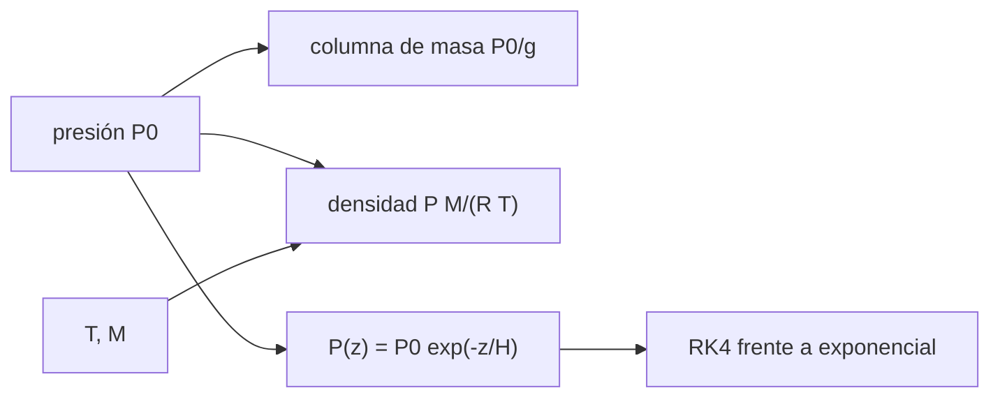

# B54-C04 — Presión y densidad

<!-- nav:top -->
[🏠 Programa](../../../../README.md) · [📚 Bloque B54](../../../tronco-comun/B54-atmosferas-y-climatologia-planetaria.md) · [← Anterior: B54-C03 — Equilibrio radiativo](../B54-C03-equilibrio-radiativo/CLASE.md) · [Siguiente: B54-C05 — Transporte convectivo →](../B54-C05-transporte-convectivo/CLASE.md)
<!-- /nav -->

## 1. Ubicación, nivel y alcance

Clase 4 del bloque B54. Nivel N3. Con la estructura vertical (B54-C01) y la composición (B54-C02) ya puedes pasar de la presión a la densidad con la ley de gas ideal, medir la **columna de masa** sobre una superficie y comprobar contra las fichas de la NASA la densidad de Venus, la Tierra y Marte.

## 2. Por qué esta clase existe

La densidad del gas fija el empuje, el arrastre, la opacidad y el peso de la atmósfera, y sale de una sola fórmula si el gas es ideal. La pregunta motivadora: **¿cuánto pesa la atmósfera de cada mundo sobre un metro cuadrado, y hasta dónde vale el gas ideal?** La decisión central: aceptar o no la ley de gas ideal a 92 bar y 737 K.

## 3. Lo que podrás hacer al terminar

1. Calcular la densidad con `ρ = P M/(R T)`.
2. Calcular la masa de la columna `P₀/g` sobre un metro cuadrado.
3. Integrar numéricamente la hidrostática isoterma y contrastarla con la exponencial.
4. Comparar densidades calculadas con las de las fichas de la NASA.
5. Estimar la altura a la que la presión cae a `1/e` y a `1/1000`.
6. Reconocer la limitación del gas ideal en Venus.

La evidencia es la **ficha de presión y densidad** del ejercicio 12 (sección 20).

## 4. Con qué llegas y cómo comprobarlo

1. ¿Qué dice la ley de gas ideal?
2. ¿Qué es una exponencial?
3. ¿Qué es la altura de escala?
4. ¿Qué es un valor ilustrativo?
5. ¿Qué es una verificación?

<details>
<summary>Ver respuestas</summary>

1. Que `P = ρ R T/M`. 2. Una función `e^{x}` con crecimiento o decaimiento proporcional. 3. La distancia en que `P` cae un factor `e`. 4. Un valor propuesto para el ejemplo, no medido. 5. Comparar un cálculo con un caso independiente.
</details>

Con cuatro o cinco aciertos, sigue; si no, repasa los prerrequisitos.

## 5. Un caso de contexto y casos de referencia

Las fichas dan presión superficial (Tierra 1014 mb, Venus 92 bar, Marte 6,36 mb), densidad superficial (1,217; ~65; ~0,016 kg/m³) y temperatura (288, 737 y 214 K) (S1–S3). Con `M` de B54-C02 calculas `ρ`. Es el **ejemplo conductor**. Para la Tierra se usa `P = 101 400 Pa` (1014 mb).

## 6. Vocabulario

La **densidad** `ρ` es la masa por unidad de volumen. La **columna de masa** es la masa de gas sobre una unidad de área y vale `P₀/g`. Un **gas ideal** cumple `P V = n R T`. El **factor de compresibilidad** `Z` mide la desviación de un gas real del ideal (no se calcula aquí). Una atmósfera **isoterma** tiene `T` constante.

## 7. Modelo mental: un colchón de aire

El aire sobre ti es como un colchón de aire: lo que pesa sobre cada metro cuadrado es lo que mide la presión.



*Descripción textual:* la presión de superficie da la columna de masa y, con `T` y `M`, la densidad; la hidrostática isoterma da `P(z)` y se verifica con RK4.

Analogía: un colchón de aire. Límite: un colchón real tiene borde; la atmósfera se diluye sin tope.

## 8. La explicación, paso a paso

### 8.1 Densidad por gas ideal

`ρ = P M/(R T)`, con `R = k N_A = 8,314 463` (S4, S5). Resultados del laboratorio:

| mundo | `ρ` calculada (kg/m³) | `ρ` ficha | dif. | `H` (km) | columna `P₀/g` (kg/m²) |
|---|---|---|---|---|---|
| Tierra | 1,2266 | 1,217 | 0,8 % | 8,42 | 10 325,9 |
| Venus | 65,2328 | ~65 | 0,4 % | 15,90 | 1 037 204,1 |
| Marte | 0,0155 | ~0,016 | 2,9 % | 10,97 | 170,5 |

### 8.2 Lectura

El acuerdo con las fichas es mejor que el 3 % en los tres casos. Que Venus coincida a 0,4 % con el gas ideal a 92 bar y 737 K es un resultado del cálculo, no una prueba de que el gas ideal valga en general: el factor `Z` real no se calculó y la ficha da «~65» (aproximado). La columna de Venus es unas 100 veces la terrestre, y la de Marte, 60 veces menor.

### 8.3 Integración numérica

Para una atmósfera isoterma de Marte (`H = R T/(M g)`), RK4 con 4000 pasos hasta 30 km da `P = 41,279279 Pa`, igual a la exponencial `P₀ e^{−z/H}`; la diferencia relativa es `5,7 × 10⁻¹⁵`. La presión cae a `P₀/e` en `z = H` y a `P₀/1000` en `H ln 1000`: para la Tierra (isoterma ilustrativa a 288 K) `8,42 km` y `58,1 km`.

## 9. Magnitudes, símbolos y unidades

| Símbolo | Qué es | Unidad | Valor / nota |
|---|---|---|---|
| `ρ` | densidad | kg/m³ | 0,0155 … 65,2 |
| `P₀` | presión superficial | Pa | 636 … 9,2 × 10⁶ |
| `M` | masa molar media | kg/mol | 0,0290 … 0,0435 |
| `R` | constante de los gases | J mol⁻¹ K⁻¹ | 8,314 463 |
| `P₀/g` | columna de masa | kg/m² | 170 … 1,04 × 10⁶ |

## 10. Convenciones y referencias

`P` en Pa (1 bar = 10⁵ Pa; 1 mb = 100 Pa), `T` en K, `g` de la ficha de cada planeta. Gas ideal bien mezclado. Atmósfera isoterma solo para las comprobaciones de la sección 8.3.

## 11. De dónde sale lo que afirmamos

| ID | Fuente | Localizador | Respalda | Estado |
|---|---|---|---|---|
| S1 | NASA/NSSDC, *Earth Fact Sheet* | https://nssdc.gsfc.nasa.gov/planetary/factsheet/earthfact.html | presión, densidad, altura de escala, composición, albedo, irradiancia, T de cuerpo negro, gravedad, masa, radio y velocidad de escape de la Tierra | Consultada; datos de ficha; consulta 2026-11-09 |
| S2 | NASA/NSSDC, *Venus Fact Sheet* | https://nssdc.gsfc.nasa.gov/planetary/factsheet/venusfact.html | presión, densidad, altura de escala, T, composición, albedo, irradiancia, gravedad y masa de Venus | Consultada; datos de ficha; consulta 2026-11-09 |
| S3 | NASA/NSSDC, *Mars Fact Sheet* | https://nssdc.gsfc.nasa.gov/planetary/factsheet/marsfact.html | presión (y su rango estacional), densidad, altura de escala, T, composición, albedo, irradiancia, gravedad y masa de Marte | Consultada; datos de ficha; consulta 2026-11-09 |
| S4 | NIST, *CODATA 2022: constante de Boltzmann k* | https://physics.nist.gov/cgi-bin/cuu/Value?k | k = 1,380 649 × 10⁻²³ J K⁻¹ (exacta) | Consultada; consulta 2026-11-09 |
| S5 | NIST, *CODATA 2022: constante de Avogadro N_A* | https://physics.nist.gov/cgi-bin/cuu/Value?na | N_A = 6,022 140 76 × 10²³ mol⁻¹ (exacta) | Consultada; consulta 2026-11-09 |

Límites: la ficha de Venus da la densidad como «~65»; el gas ideal a 92 bar es una aproximación cuya desviación no se calcula aquí.

## 12. Cómo ver presión y densidad

| Magnitud | Valor |
|---|---|
| `ρ` terrestre | 1,2266 kg/m³ |
| `ρ` de Venus | 65,2 kg/m³ |
| columna de Marte | 170,5 kg/m² |
| diferencia RK4–exponencial | 5,7 × 10⁻¹⁵ |

Descripción larga: una gráfica logarítmica de la densidad frente a la altura sería una recta de pendiente `−1/H`; la tabla 8.1 da los puntos de superficie.

## 13. Ejemplo trabajado: densidad de Marte

**Paso 1 · Datos.** `P = 636 Pa`, `T = 214 K`, `M = 0,043 486 kg/mol`.

**Paso 2 · Producto.** `P M = 27.657`.

**Paso 3 · Divisor.** `R T = 1779.30`.

**Paso 4 · Densidad.** `ρ = 0.0155 kg/m³`, a 2,9 % de la ficha (`~0,016`).

## 14. Distintas formas de obtener la densidad

**Gas ideal:** inmediata, con `P`, `T`, `M`. **Gas real con compresibilidad:** corrige a alta presión (no se hace aquí). **Medida in situ:** mediante sondas; aquí solo hay valores de ficha. En Marte y la Tierra el gas ideal basta; en Venus es una primera aproximación.

## 15. Práctica guiada

**Ejercicio 1 · con los pasos indicados.** Calcula `ρ` de la Tierra con `P = 101 400 Pa`, `T = 288 K` y `M = 0,028 967 kg/mol`. *Pasos:* 8.1.

<details><summary>Solución comentada</summary>

`ρ = 1.2266 kg/m³`.
</details>

**Ejercicio 2 · con una pista.** Calcula la columna de masa terrestre. *Pista:* `P₀/g`.

<details><summary>Solución comentada</summary>

`101 400/9,820 = 10325.9 kg/m²`.
</details>

**Ejercicio 3 · casi autónomo.** ¿A qué altura isoterma cae la presión terrestre a la mitad?

<details><summary>Solución comentada</summary>

`z = H ln 2 = 5.83 km`.
</details>

## 16. Práctica autónoma, transferencia e integrador

**Ejercicio 4 · autónomo.** Calcula la masa de la columna de Marte y compárala con la terrestre.

<details><summary>Solución comentada</summary>

`636/3,73 = 170,5 kg/m²`, es decir `1.7 %` de la terrestre.
</details>

**Ejercicio 5 · autónomo.** La ficha de Venus da `ρ ≈ 65 kg/m³`. ¿Cuánto vale el cociente `ρ_ficha/ρ_ideal`?

<details><summary>Solución comentada</summary>

`65/65,23 = 0.996`; implicaría `Z ≈ 1,004` (cociente de la presión real entre la ideal), por debajo de la precisión de «~65».
</details>

**Ejercicio 6 · autónomo.** ¿Por qué cae la presión más deprisa en la atmósfera marciana que en la venusiana?

<details><summary>Solución comentada</summary>

Porque `H` marciana (11 km) es menor que la de Venus (15,9 km): el CO₂ de Marte es tan pesado como el de Venus pero está mucho más frío.
</details>

**Ejercicio 7 · autónomo.** Calcula `ρ` a 10 km en una atmósfera isoterma terrestre a 288 K.

<details><summary>Solución comentada</summary>

`ρ = ρ₀ e^{−10/H} = 0.374 kg/m³`.
</details>

**Ejercicio 8 · autónomo.** ¿Qué pasa con `ρ` si `T` sube un 10 % a presión constante?

<details><summary>Solución comentada</summary>

`ρ` baja un `1 − 1/1,1 = 9,1 %`.
</details>

**Ejercicio 9 · transferencia.** **Transferencia.** Un colega usa `P = 1014 Pa` en vez de `1014 mb`. ¿Qué densidad obtiene?

<details><summary>Solución comentada</summary>

Un factor `100` menor: `0,0123 kg/m³`. Es el error de unidades típico: `1 mb = 100 Pa`.
</details>

**Ejercicio 10 · transferencia.** **Transferencia.** ¿Cómo estimarías la densidad en Titán con `P = 1,6` atmósferas y `T = 94 K`?

<details><summary>Solución comentada</summary>

`ρ = 5.68 kg/m³` con `M = 27,4 g/mol` (clase B54-C16): el frío compensa la poca masa molar.
</details>

**Ejercicio 11 · transferencia.** **Transferencia.** ¿Por qué el gas ideal falla más en el fondo de Júpiter que en la superficie de Marte?

<details><summary>Solución comentada</summary>

Porque a presiones de miles de bar las interacciones moleculares importan y `Z` se aleja de 1; en Marte `P` es de unas centésimas de bar.
</details>

**Ejercicio 12 · integrador.** **Integrador.** Elabora tu *ficha de presión y densidad*: `ρ`, columna y `H` de los tres mundos y la verificación RK4.

<details><summary>Solución comentada</summary>

Sección 8 y salida del laboratorio.
</details>

## 17. Laboratorio: presión, densidad y columna de tres atmósferas

El script [presion_densidad.py](presion_densidad.py) calcula `ρ`, `H` y la columna de tres atmósferas y verifica la hidrostática isoterma con RK4 (**comprueba** `ρ` dentro del 5 % de la ficha y RK4 con 1e-8).

**Datos:** presión, T y densidad de las fichas NASA/NSSDC (S1–S3) y constantes de NIST (S4, S5). **Predice antes de ejecutar:** ¿Cuánto pesa la columna de Marte? (≈ 170 kg/m².) **Ejecución del 2026-11-09 (Python 3.12.9):**

```text
Python 3.12.9 (biblioteca estandar)
planeta   rho calc [kg/m3]   rho ficha   dif.    H [km]   Z=P/(rho R T / M) implicito
Tierra           1.2266       1.2170    0.8 %      8.42
Venus           65.2328      65.0000    0.4 %     15.90
Marte            0.0155       0.0160    2.9 %     10.97
Marte a 30 km: RK4 = 41.279279 Pa ; analitica = 41.279279 Pa ; dif. rel. = 5.7e-15
Tierra   masa de columna = P0/g =      10325.9 kg/m2
Venus    masa de columna = P0/g =    1037204.1 kg/m2
Marte    masa de columna = P0/g =        170.5 kg/m2
Tierra: P = P0/e a 8.42 km ; P = P0/1000 a 58.1 km (isoterma)
Pruebas superadas.
```

```bash
python programa/clases/B54/B54-C04-presion-y-densidad/presion_densidad.py
```

**Límites:** gas ideal y atmósfera isoterma en la verificación.

## 18. Errores frecuentes y cómo corregirlos

**Mezclar milibares y pascales.** Se corrige con la sección 10.

**Usar la masa molar en g/mol en SI.** Se corrige con la sección 9.

**Creer que el gas ideal vale en cualquier presión.** Se corrige con 8.2.

**Leer la columna como 'espesor de la atmósfera'.** Se corrige con 8.3: la atmósfera no tiene techo.

## 19. Cómo sabrás que vas bien

Tras la sección 8: ¿qué `ρ` esperabas para Marte y cuál obtuviste? Si dudas, repasa el ejemplo 13. Tras el laboratorio: ¿qué comprueba? (ver la sección 17).

## 20. Qué entregas y cómo se evalúa

El producto es tu **ficha de presión y densidad** (ejercicio 12).

| Criterio | Inicial | En desarrollo | Logrado | Destacado |
|---|---|---|---|---|
| Conceptos | Los confunde | Parciales | Gas ideal, columna de masa y densidad | Explica los límites |
| Cálculo | Sin unidades | Con errores | Tablas completas con unidades | Calcula casos nuevos |
| Numérico | Sin comprobar | Un caso | Contraste con el caso analítico o la ficha | Interpreta las diferencias |
| Fuentes | Sin fuente | Sin fecha | Fuentes con fecha | Declara lo sintético y lo no consultado |
| Límites | No los nombra | Uno | Tres | Discute qué falta del modelo |

**Condiciones críticas (no se compensan con promedio):** declarar que la comprobación de Venus no valida el gas ideal en general; convertir bien las unidades; citar solo lo consultado.

## 21. Ética, seguridad y límites

Clase educativa: gas ideal sin compresibilidad. Accesibilidad: tablas equivalentes a las gráficas, fórmulas en texto, ejercicios sin conexión.

## 22. Para cerrar y seguir

El aire de la Tierra pesa 10 300 kg por metro cuadrado, el de Venus 100 veces más y el de Marte 60 veces menos. Queda una pregunta: ¿cómo se mezcla ese gas y se transporta la energía en él?

**Glosario español–inglés.** densidad · *density*; columna de masa · *column mass*; gas ideal · *ideal gas*; factor de compresibilidad · *compressibility factor*; atmósfera isoterma · *isothermal atmosphere*.

**Continuidad.** [B54-C05](../B54-C05-transporte-convectivo/CLASE.md) estudia el transporte convectivo.

**Referencias:** ver sección 11.

<!-- nav:bottom -->
---

[← Anterior: B54-C03 — Equilibrio radiativo](../B54-C03-equilibrio-radiativo/CLASE.md) · [📚 Bloque B54](../../../tronco-comun/B54-atmosferas-y-climatologia-planetaria.md) · [Siguiente: B54-C05 — Transporte convectivo →](../B54-C05-transporte-convectivo/CLASE.md)
<!-- /nav -->
