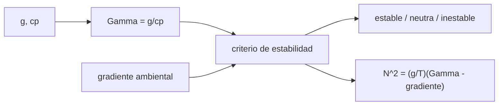

# B54-C05 — Transporte convectivo

<!-- nav:top -->
[🏠 Programa](../../../../README.md) · [📚 Bloque B54](../../../tronco-comun/B54-atmosferas-y-climatologia-planetaria.md) · [← Anterior: B54-C04 — Presión y densidad](../B54-C04-presion-y-densidad/CLASE.md) · [Siguiente: B54-C06 — Circulación general planetaria →](../../../tronco-comun/B54-atmosferas-y-climatologia-planetaria.md#b54-c06)
<!-- /nav -->

## 1. Ubicación, nivel y alcance

Clase 5 del bloque B54. Nivel N3. Si la temperatura baja con la altura más deprisa que cierto límite, el gas se vuelve inestable y sube en corrientes: esa es la convección. Aquí calculas el **gradiente adiabático seco** `g/c_p` de cuatro mundos, integras la adiabata y evalúas con el criterio de Schwarzschild si una capa es estable, neutra o inestable. Los calores específicos son **ilustrativos**.

## 2. Por qué esta clase existe

La convección decide cuánta de la energía sale por transporte de gas y no por radiación, y fija el perfil de temperatura de las capas bajas de Venus, Marte y los gigantes. La pregunta motivadora: **¿a partir de qué gradiente de temperatura una atmósfera se pone a hervir?** La decisión central: comparar el gradiente del ambiente con el adiabático.

## 3. Lo que podrás hacer al terminar

1. Calcular el gradiente adiabático seco `Γ = g/c_p`.
2. Integrar la adiabata `T = T₀(P/P₀)^κ` y contrastarla con su fórmula.
3. Aplicar el criterio de estabilidad comparando gradientes.
4. Calcular la frecuencia de flotabilidad `N²` y su periodo.
5. Estimar el enfriamiento de una parcela que asciende.
6. Reconocer cómo el `c_p` supuesto cambia `Γ`.

La evidencia es la **informe de estabilidad de una capa** del ejercicio 12 (sección 20).

## 4. Con qué llegas y cómo comprobarlo

1. ¿Qué es una adiabata?
2. ¿Qué es el calor específico a presión constante?
3. ¿Qué es el equilibrio hidrostático?
4. ¿Qué es un valor ilustrativo?
5. ¿Qué es una verificación?

<details>
<summary>Ver respuestas</summary>

1. Una evolución sin intercambio de calor con el entorno. 2. El calor por unidad de masa y de K a `P` constante. 3. El balance entre peso y gradiente de presión (B54-C01). 4. Un valor propuesto para el ejemplo, no medido. 5. Comparar un cálculo con un caso independiente.
</details>

Con cuatro o cinco aciertos, sigue; si no, repasa los prerrequisitos.

## 5. Un caso de contexto y casos de referencia

Una parcela de aire de la Tierra sube sin mezclarse ni intercambiar calor: su presión baja con el ambiente y se enfría. Con `g = 9,820 m/s²` (S1) y `c_p = 1004 J/(kg K)` (ilustrativo) resulta `Γ = 9,78 K/km`. Con `g` de Venus y Marte (S2, S3) y `c_p(CO₂) = 850` (ilustrativo, no consultado) y de Júpiter con `c_p = 12 000` (ilustrativo), se comparan los cuatro. Es el **ejemplo conductor**.

## 6. Vocabulario

El **gradiente adiabático seco** `Γ = g/c_p` es la tasa de enfriamiento de una parcela que asciende sin condensación. El **criterio de Schwarzschild** dice que una capa es inestable si su gradiente real `−dT/dz` supera `Γ`. La **frecuencia de Brunt–Väisälä** `N` mide la oscilación de una parcela desplazada en una capa estable (`N² > 0`). `κ = R/(M c_p)` es el exponente de la adiabata.

## 7. Modelo mental: una burbuja en agua

Una burbuja que sube se expande y se enfría; si el agua que la rodea se enfría más deprisa, la burbuja sigue más ligera y sube más.



*Descripción textual:* `g` y `c_p` dan el gradiente adiabático; se compara con el del ambiente y el signo de la diferencia decide la estabilidad y da `N²`.

Analogía: la burbuja de agua. Límite: la burbuja real se mezcla y el aire húmedo condensa; aquí se supone aire seco y parcela aislada.

## 8. La explicación, paso a paso

### 8.1 Gradiente adiabático

Una parcela adiabática cumple `dT/dz = −g/c_p`. Con las cifras ilustrativas de `c_p`:

| mundo | `Γ` (K/km) | `κ = R/(M c_p)` |
|---|---|---|
| Tierra | 9,78 | 0,2859 |
| Venus | 10,44 | 0,2251 |
| Marte | 4,39 | 0,2249 |
| Júpiter | 2,07 | 0,3122 |

La `Γ` de Venus depende mucho del `c_p` supuesto: con `1100` en vez de `850 J/(kg K)` (B54-C13) saldría `8,06 K/km`. La cifra de la tabla es una **ilustración**, no el gradiente real de Venus.

### 8.2 Adiabata y verificación

La forma integrada es `T = T₀ (P/P₀)^κ`. Integrando `dT/dP = κ T/P` con RK4 (20 000 pasos) de 100 a 50 kPa desde 300 K se obtiene `246,07086 K`, igual a la fórmula. La parcela se enfría 54 K al bajar la presión a la mitad.

### 8.3 Estabilidad

El laboratorio compara tres gradientes del ambiente terrestre con `Γ = 9,78 K/km`: `3,0 K/km` (estable), `9,78` (neutra) y `11,0` (inestable). Para `N² = (g/T)(Γ − gradiente)` con `T = 280 K`: gradiente `6,5 K/km`, `N² = 1,151 × 10⁻⁴ s⁻²` (periodo `9,8 min`); `3,0`, `2,378 × 10⁻⁴` (`6,8 min`); `0`, `3,430 × 10⁻⁴` (`5,7 min`). Una parcela seca que sube 3 km se enfría `29,3 K` en la Tierra y `13,2 K` en Marte (con los `c_p` ilustrativos).

## 9. Magnitudes, símbolos y unidades

| Símbolo | Qué es | Unidad | Valor / nota |
|---|---|---|---|
| `Γ` | gradiente adiabático seco | K/km | 2,07 … 10,44 (ilustrativo) |
| `c_p` | calor específico a P constante | J kg⁻¹ K⁻¹ | 850 … 12 000 (ilustrativo) |
| `κ` | exponente de la adiabata | — | 0,225 … 0,312 |
| `N²` | frecuencia de flotabilidad al cuadrado | s⁻² | 1,2 × 10⁻⁴ … 3,4 × 10⁻⁴ |
| `g` | gravedad | m/s² | ver fichas |

## 10. Convenciones y referencias

Aire seco o gas seco; `z` hacia arriba. Los valores de `c_p` son ilustrativos y no se consultaron. El gradiente se expresa en K/km; la conversión a K/m divide entre 1000.

## 11. De dónde sale lo que afirmamos

| ID | Fuente | Localizador | Respalda | Estado |
|---|---|---|---|---|
| S1 | NASA/NSSDC, *Earth Fact Sheet* | https://nssdc.gsfc.nasa.gov/planetary/factsheet/earthfact.html | presión, densidad, altura de escala, composición, albedo, irradiancia, T de cuerpo negro, gravedad, masa, radio y velocidad de escape de la Tierra | Consultada; datos de ficha; consulta 2026-11-09 |
| S2 | NASA/NSSDC, *Venus Fact Sheet* | https://nssdc.gsfc.nasa.gov/planetary/factsheet/venusfact.html | presión, densidad, altura de escala, T, composición, albedo, irradiancia, gravedad y masa de Venus | Consultada; datos de ficha; consulta 2026-11-09 |
| S3 | NASA/NSSDC, *Mars Fact Sheet* | https://nssdc.gsfc.nasa.gov/planetary/factsheet/marsfact.html | presión (y su rango estacional), densidad, altura de escala, T, composición, albedo, irradiancia, gravedad y masa de Marte | Consultada; datos de ficha; consulta 2026-11-09 |
| S4 | NASA/NSSDC, *Jupiter Fact Sheet* | https://nssdc.gsfc.nasa.gov/planetary/factsheet/jupiterfact.html | T a 1 bar, altura de escala, composición, albedo, irradiancia, T de cuerpo negro, radio, masa, gravedad, velocidad de escape y rotación de Júpiter | Consultada; datos de ficha; consulta 2026-11-09 |
| S5 | NIST, *CODATA 2022: constante de Boltzmann k* | https://physics.nist.gov/cgi-bin/cuu/Value?k | k = 1,380 649 × 10⁻²³ J K⁻¹ (exacta) | Consultada; consulta 2026-11-09 |
| S6 | NIST, *CODATA 2022: constante de Avogadro N_A* | https://physics.nist.gov/cgi-bin/cuu/Value?na | N_A = 6,022 140 76 × 10²³ mol⁻¹ (exacta) | Consultada; consulta 2026-11-09 |

Límites: ningún `c_p` se consultó; el CO₂ a la temperatura de Venus tiene un `c_p` distinto del supuesto y varía con la temperatura, y el de Júpiter depende de la mezcla orto/para del H₂. No se afirma el gradiente real de ningún mundo.

## 12. Cómo ver la estabilidad

| Magnitud | Valor |
|---|---|
| `Γ` terrestre | 9,78 K/km |
| enfriamiento de 3 km (Tierra) | 29,3 K |
| `N²` con 6,5 K/km | 1,151 × 10⁻⁴ s⁻² |
| RK4 frente a la adiabata | 246,07086 K en ambos |

Descripción larga: una gráfica de `T` frente a `z` con la adiabata como recta de pendiente `−9,78 K/km` mostraría los perfiles estables a su derecha (menos inclinados) y los inestables a su izquierda; la tabla 8.3 lo da en números.

## 13. Ejemplo trabajado: gradiente y enfriamiento en la Tierra

**Paso 1 · Gradiente.** `Γ = 9,820/1004 = 9.78 K/km`.

**Paso 2 · Subida de 3 km.** `ΔT = −29.3 K`.

**Paso 3 · Criterio.** Con un ambiente de `6,5 K/km` (menor que `Γ`), la capa es estable: la parcela, más fría que su entorno al subir, vuelve a bajar.

## 14. Distintas formas de describir la adiabata

**Por gradiente:** `Γ = g/c_p`. **Por presión:** `T = T₀(P/P₀)^κ`. **Por entropía:** una parcela adiabática conserva su entropía específica (no se desarrolla aquí). Las dos primeras se contrastan numéricamente en el laboratorio.

## 15. Práctica guiada

**Ejercicio 1 · con los pasos indicados.** Calcula `Γ` de Marte con `g = 3,73` y `c_p = 850`. *Pasos:* 8.1.

<details><summary>Solución comentada</summary>

`4.39 K/km`.
</details>

**Ejercicio 2 · con una pista.** ¿Cuánto vale `κ` terrestre con `M = 0,028 967` y `c_p = 1004`? *Pista:* `κ = R/(M c_p)`.

<details><summary>Solución comentada</summary>

`0.2859`.
</details>

**Ejercicio 3 · casi autónomo.** Una capa terrestre baja 8 K/km. ¿Es estable? *Pasos:* compara con `Γ`.

<details><summary>Solución comentada</summary>

Sí: `8 < 9,78 K/km`.
</details>

## 16. Práctica autónoma, transferencia e integrador

**Ejercicio 4 · autónomo.** Una parcela terrestre sube desde 1000 hPa a 800 hPa partiendo de 300 K. ¿Cuánto vale `T`?

<details><summary>Solución comentada</summary>

`T = 300 × 0,8^{0,2859} = 281.5 K`.
</details>

**Ejercicio 5 · autónomo.** Calcula el periodo de flotabilidad con `N² = 2,378 × 10⁻⁴ s⁻²`.

<details><summary>Solución comentada</summary>

`2π/√N² = 6.8 min`.
</details>

**Ejercicio 6 · autónomo.** ¿Cuánto vale `Γ` de Júpiter si `c_p` fuera 13 000?

<details><summary>Solución comentada</summary>

`24,79/13 000 × 1000 = 1.91 K/km`.
</details>

**Ejercicio 7 · autónomo.** ¿Por qué `Γ` de Marte es menos de la mitad de la terrestre?

<details><summary>Solución comentada</summary>

Porque `g` marciana (3,73) es 2,6 veces menor y el `c_p` supuesto (850) es solo 1,2 veces menor; `Γ ∝ g/c_p`.
</details>

**Ejercicio 8 · autónomo.** Si el ambiente terrestre baja 12 K/km, ¿cuánto vale `N²`? ¿Qué significa su signo?

<details><summary>Solución comentada</summary>

`N² = (9,82/280)(9,78 − 12)/1000 = -7.786e-05 s⁻²`: negativo, la parcela se aleja del punto de partida (inestabilidad).
</details>

**Ejercicio 9 · transferencia.** **Transferencia.** Un colega usa `c_p = 1004` para Venus. ¿Qué error comete?

<details><summary>Solución comentada</summary>

Usa el calor específico del aire en un gas de CO₂ a 737 K: `Γ` sale errónea; el `c_p` debe corresponder a la composición y a la temperatura.
</details>

**Ejercicio 10 · transferencia.** **Transferencia.** ¿Por qué el criterio seco falla si hay nubes?

<details><summary>Solución comentada</summary>

Porque la condensación libera calor y la parcela saturada se enfría menos (gradiente húmedo); la capa se vuelve inestable con gradientes menores.
</details>

**Ejercicio 11 · transferencia.** **Transferencia.** ¿Qué dice la `Γ` de Júpiter sobre el aspecto de su atmósfera?

<details><summary>Solución comentada</summary>

Que sus capas profundas se enfrían muy despacio con la altura (2 K/km con el `c_p` supuesto), de modo que la convección gobierna un volumen extenso (B54-C15).
</details>

**Ejercicio 12 · integrador.** **Integrador.** Elabora tu *informe de estabilidad de una capa*: `Γ`, la comparación con tres gradientes, `N²` y el periodo.

<details><summary>Solución comentada</summary>

Secciones 8.1–8.3 y salida del laboratorio.
</details>

## 17. Laboratorio: adiabata seca y criterio de estabilidad

El script [convectivo.py](convectivo.py) calcula `Γ` y `κ` de cuatro mundos, integra la adiabata con RK4 y evalúa la estabilidad (**comprueba** RK4 frente a la fórmula con 1e-6).

**Datos:** gravedades de las fichas NASA (S1–S4) y constantes de NIST (S5, S6); `c_p` ilustrativos; perfiles ambientales sintéticos. **Predice antes de ejecutar:** ¿Cuánto vale `Γ` en la Tierra? (≈ 9,8 K/km.) **Ejecución del 2026-11-09 (Python 3.12.9):**

```text
Python 3.12.9 (biblioteca estandar)
planeta   Gamma_ad [K/km]   kappa = R/(M cp)
Tierra             9.78          0.2859
Venus             10.44          0.2251
Marte              4.39          0.2249
Jupiter            2.07          0.3122
Tierra, 100 -> 50 kPa desde 300 K: RK4 = 246.07086 K ; analitica = 246.07086 K
capa estable (inversion -3 K/km)     gradiente ambiental  3.00 K/km frente a 9.78: estable
capa neutra (9.8 K/km)               gradiente ambiental  9.78 K/km frente a 9.78: neutra
capa inestable (11 K/km)             gradiente ambiental 11.00 K/km frente a 9.78: inestable
gradiente  6.5 K/km: N^2 = 1.151e-04 s^-2 ; periodo de flotabilidad = 9.8 min
gradiente  3.0 K/km: N^2 = 2.378e-04 s^-2 ; periodo de flotabilidad = 6.8 min
gradiente  0.0 K/km: N^2 = 3.430e-04 s^-2 ; periodo de flotabilidad = 5.7 min
Una parcela de la Tierra que sube 3 km se enfria 29.3 K (seca); en Marte 13.2 K
Pruebas superadas.
```

```bash
python programa/clases/B54/B54-C05-transporte-convectivo/convectivo.py
```

**Límites:** aire seco, parcela aislada y `c_p` ilustrativos.

## 18. Errores frecuentes y cómo corregirlos

**Comparar gradientes con signos distintos.** Se corrige con la sección 6: `−dT/dz` frente a `Γ`.

**Aplicar `Γ` seca en una capa con nubes.** Se corrige con el ejercicio 10.

**Tomar el `c_p` del aire para el CO₂.** Se corrige con el ejercicio 9.

**Presentar `Γ` de Venus como medida.** Se corrige con 8.1.

## 19. Cómo sabrás que vas bien

Tras la sección 8: ¿qué `Γ` esperabas para la Tierra y cuál obtuviste? Si dudas, repasa el ejemplo 13. Tras el laboratorio: ¿qué comprueba? (ver la sección 17).

## 20. Qué entregas y cómo se evalúa

El producto es tu **informe de estabilidad de una capa** (ejercicio 12).

| Criterio | Inicial | En desarrollo | Logrado | Destacado |
|---|---|---|---|---|
| Conceptos | Los confunde | Parciales | Gradiente adiabático y estabilidad | Explica los límites |
| Cálculo | Sin unidades | Con errores | Tablas completas con unidades | Calcula casos nuevos |
| Numérico | Sin comprobar | Un caso | Contraste con el caso analítico o la ficha | Interpreta las diferencias |
| Fuentes | Sin fuente | Sin fecha | Fuentes con fecha | Declara lo sintético y lo no consultado |
| Límites | No los nombra | Uno | Tres | Discute qué falta del modelo |

**Condiciones críticas (no se compensan con promedio):** rotular los `c_p` como ilustrativos; no dar el gradiente de Venus como medida; citar solo lo consultado.

## 21. Ética, seguridad y límites

Clase educativa: aire seco y parcelas aisladas. Accesibilidad: tablas equivalentes a las gráficas, fórmulas en texto, ejercicios sin conexión.

## 22. Para cerrar y seguir

Una parcela terrestre se enfría 9,8 K por km al subir; una capa que lo hace más deprisa se vuelve inestable. Queda una pregunta: ¿cómo organiza la rotación esos movimientos a escala planetaria?

**Glosario español–inglés.** gradiente adiabático · *adiabatic lapse rate*; estabilidad · *stability*; frecuencia de Brunt–Väisälä · *Brunt–Väisälä frequency*; parcela · *air parcel*; calor específico · *specific heat*.

**Continuidad.** [B54-C06](../B54-C06-circulacion-general-planetaria/CLASE.md) estudia la circulación general.

**Referencias:** ver sección 11.

<!-- nav:bottom -->
---

[← Anterior: B54-C04 — Presión y densidad](../B54-C04-presion-y-densidad/CLASE.md) · [📚 Bloque B54](../../../tronco-comun/B54-atmosferas-y-climatologia-planetaria.md) · [Siguiente: B54-C06 — Circulación general planetaria →](../../../tronco-comun/B54-atmosferas-y-climatologia-planetaria.md#b54-c06)
<!-- /nav -->
