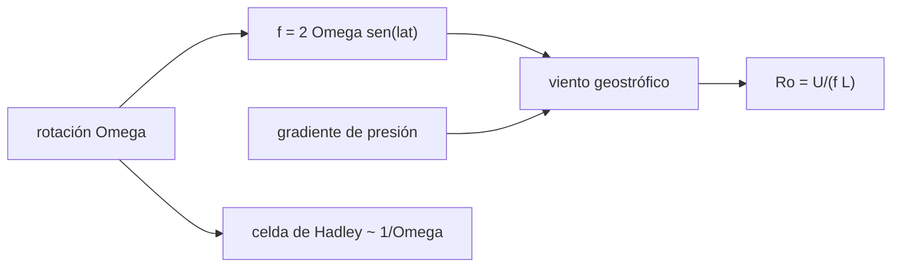

# B54-C06 — Circulación general planetaria

<!-- nav:top -->
[🏠 Programa](../../../../README.md) · [📚 Bloque B54](../../../tronco-comun/B54-atmosferas-y-climatologia-planetaria.md) · [← Anterior: B54-C05 — Transporte convectivo](../B54-C05-transporte-convectivo/CLASE.md) · [Siguiente: B54-C07 — Dinámica de tormentas →](../B54-C07-dinamica-de-tormentas/CLASE.md)
<!-- /nav -->

## 1. Ubicación, nivel y alcance

Clase 6 del bloque B54. Nivel N3. Los vientos a gran escala dependen de cuánto gira el planeta: aquí calculas la velocidad angular `Ω`, el **parámetro de Coriolis**, el **balance geostrófico** de un viento y el **número de Rossby** para cinco mundos, y haces una estimación de **escala** de la anchura de la celda de Hadley. Los periodos de rotación de la Tierra, Marte y Venus son valores estándar **no consultados**; el de Júpiter (9,9250 h) y el orbital de Titán (15,945421 d) sí proceden de las fichas.

## 2. Por qué esta clase existe

La rotación decide si el aire va de los polos al ecuador en una sola celda o se divide en bandas. La pregunta motivadora: **¿cuándo manda la rotación y cuándo no?** La decisión central: medir el número de Rossby `Ro = U/(f L)` y comparar con 1.

## 3. Lo que podrás hacer al terminar

1. Calcular `Ω`, `f = 2 Ω sen φ` y la velocidad ecuatorial de un planeta.
2. Calcular el número de Rossby global `Ro = U/(2 Ω a)`.
3. Calcular el viento geostrófico `v_g = (1/ρ f) ∂P/∂y` y verificarlo numéricamente.
4. Interpretar `Ro < 1` y `Ro > 1`.
5. Aplicar el escalado `φ_H ∝ 1/Ω` solo como orden de magnitud.
6. Decir qué periodos no se consultaron.

La evidencia es la **ficha de rotación y circulación** del ejercicio 12 (sección 20).

## 4. Con qué llegas y cómo comprobarlo

1. ¿Qué es la velocidad angular?
2. ¿Qué es la fuerza de Coriolis?
3. ¿Qué es un gradiente de presión?
4. ¿Qué es un valor sintético?
5. ¿Qué es una verificación?

<details>
<summary>Ver respuestas</summary>

1. El ángulo barrido por unidad de tiempo, `2π/T`. 2. Una fuerza aparente en un sistema que gira, perpendicular a la velocidad. 3. El cambio de presión por unidad de distancia. 4. Un valor inventado para el ejemplo, no medido. 5. Comparar un cálculo con un caso independiente.
</details>

Con cuatro o cinco aciertos, sigue; si no, repasa los prerrequisitos.

## 5. Un caso de contexto y casos de referencia

Para cada mundo: Tierra (23,9345 h), Marte (24,6229 h), Venus (5832,5 h, retrógrada) (no consultados), Júpiter (9,9250 h, S1) y Titán (rotación **supuesta** sincrónica con el periodo orbital de 15,945421 días, S2). Un viento sintético: gradiente de `1 hPa` por `100 km` a `45°` de latitud con `ρ = 1,2 kg/m³`. Es el **ejemplo conductor**.

## 6. Vocabulario

El **parámetro de Coriolis** `f = 2 Ω sen φ` mide la rotación local. El **viento geostrófico** equilibra el gradiente de presión con la fuerza de Coriolis. El **número de Rossby** `Ro = U/(f L)` compara la inercia con la rotación. La **celda de Hadley** es la circulación meridional que lleva aire del ecuador hacia latitudes medias. La **sincronía** es cuando la rotación de un cuerpo dura como su órbita.

## 7. Modelo mental: un carrusel con gente caminando

Si caminas en línea recta sobre un carrusel que gira, tu trayectoria parece curvarse; cuanto más rápido gira, más.



*Descripción textual:* la rotación da `f`; con el gradiente de presión resulta el viento geostrófico y con él el número de Rossby; la rotación también da la escala de la celda de Hadley.

Analogía: el carrusel. Límite: en un planeta la fuerza aparente depende de la latitud (`sen φ`), no es uniforme como en un carrusel.

## 8. La explicación, paso a paso

### 8.1 Rotación y Coriolis

Con `Ω = 2π/T`, `f(45°) = 2 Ω sen 45°` y `Ro = U/(2 Ω a)` para `U = 10 m/s`:

| mundo | `Ω` (rad/s) | `f(45°)` (1/s) | `v_ecuatorial` (m/s) | `Ro` global |
|---|---|---|---|---|
| Tierra | 7,292 × 10⁻⁵ | 1,031 × 10⁻⁴ | 464,58 | 1,08 × 10⁻² |
| Marte | 7,088 × 10⁻⁵ | 1,002 × 10⁻⁴ | 240,26 | 2,08 × 10⁻² |
| Venus | 2,992 × 10⁻⁷ | 4,232 × 10⁻⁷ | 1,81 | 2,76 |
| Júpiter | 1,759 × 10⁻⁴ | 2,487 × 10⁻⁴ | 12 572,00 | 3,98 × 10⁻⁴ |
| Titán | 4,561 × 10⁻⁶ | 6,450 × 10⁻⁶ | 11,74 | 0,426 |

### 8.2 Viento geostrófico

Con el gradiente sintético de `1 hPa/100 km` (`1 × 10⁻³ Pa/m`), `ρ = 1,2 kg/m³` y `f` a 45° de la Tierra, `v_g = (1/ρ f) ∂P/∂y = 8,081 m/s`, que el laboratorio reproduce por diferencias finitas. Con `L = 1000 km`, `Ro = U/(f L) = 0,078`: la rotación domina.

### 8.3 Lectura

Con `U = 10 m/s`, la Tierra, Marte y Júpiter tienen `Ro ≪ 1` globalmente: la rotación organiza su circulación. Venus tiene `Ro ≈ 2,8` y Titán `Ro ≈ 0,43`: la rotación es lenta frente al viento y la circulación puede ser de una sola celda o casi. Un escalado `φ_H ∝ 1/Ω` (ilustrativo, anclado en 30° para la Tierra y con tope en 90°) da `30,9°` para Marte, `12,4°` para Júpiter y `90°` para Venus y Titán. Este escalado **no consultado** es una relación de orden de magnitud y no pretende predecir celdas reales.

## 9. Magnitudes, símbolos y unidades

| Símbolo | Qué es | Unidad | Valor / nota |
|---|---|---|---|
| `Ω` | velocidad angular | rad/s | 3 × 10⁻⁷ … 1,8 × 10⁻⁴ |
| `f` | parámetro de Coriolis | s⁻¹ | 4 × 10⁻⁷ … 2,5 × 10⁻⁴ |
| `Ro` | número de Rossby | — | 4 × 10⁻⁴ … 2,8 |
| `v_g` | viento geostrófico | m/s | 8,081 (sintético) |
| `φ_H` | anchura de la celda de Hadley (escala) | grados | 12 … 90 |

## 10. Convenciones y referencias

Latitud `φ` positiva al norte; `Ω` positiva en rotación directa (la rotación retrógrada de Venus entra por el valor absoluto, que basta para `f` y `Ro` en módulo). Datos sintéticos rotulados. Rotación de Titán supuesta sincrónica.

## 11. De dónde sale lo que afirmamos

| ID | Fuente | Localizador | Respalda | Estado |
|---|---|---|---|---|
| S1 | NASA/NSSDC, *Jupiter Fact Sheet* | https://nssdc.gsfc.nasa.gov/planetary/factsheet/jupiterfact.html | T a 1 bar, altura de escala, composición, albedo, irradiancia, T de cuerpo negro, radio, masa, gravedad, velocidad de escape y rotación de Júpiter | Consultada; datos de ficha; consulta 2026-11-09 |
| S2 | NASA/NSSDC, *Saturnian Satellite Fact Sheet* | https://nssdc.gsfc.nasa.gov/planetary/factsheet/saturniansatfact.html | radio, masa, densidad media, semieje y periodo orbital de Titán | Consultada; solo la fila de Titán; consulta 2026-11-09 |
| S3 | NASA/NSSDC, *Earth Fact Sheet* | https://nssdc.gsfc.nasa.gov/planetary/factsheet/earthfact.html | presión, densidad, altura de escala, composición, albedo, irradiancia, T de cuerpo negro, gravedad, masa, radio y velocidad de escape de la Tierra | Consultada; datos de ficha; consulta 2026-11-09 |
| S4 | NASA/NSSDC, *Venus Fact Sheet* | https://nssdc.gsfc.nasa.gov/planetary/factsheet/venusfact.html | presión, densidad, altura de escala, T, composición, albedo, irradiancia, gravedad y masa de Venus | Consultada; datos de ficha; consulta 2026-11-09 |
| S5 | NASA/NSSDC, *Mars Fact Sheet* | https://nssdc.gsfc.nasa.gov/planetary/factsheet/marsfact.html | presión (y su rango estacional), densidad, altura de escala, T, composición, albedo, irradiancia, gravedad y masa de Marte | Consultada; datos de ficha; consulta 2026-11-09 |

Límites: los periodos de Tierra, Marte y Venus son estándar **no consultados**; la rotación de Titán es un supuesto; el escalado de Hadley es de orden de magnitud y no se consultó su derivación.

## 12. Cómo ver la rotación

| Magnitud | Valor |
|---|---|
| `f(45°)` terrestre | 1,031 × 10⁻⁴ s⁻¹ |
| `Ro` global de Venus | 2,76 |
| `v_g` sintético | 8,081 m/s |
| `Ro` regional (L = 1000 km) | 0,078 |

Descripción larga: un gráfico de `Ro` por mundo en escala logarítmica separa Júpiter, Tierra y Marte (muy por debajo de 1) de Venus (por encima); la tabla 8.1 contiene los valores.

## 13. Ejemplo trabajado: el viento geostrófico terrestre

**Paso 1 · Coriolis.** `f = 2 × 7,292 × 10⁻⁵ × sen 45° = 1,031 × 10⁻⁴ s⁻¹`.

**Paso 2 · Gradiente.** `∂P/∂y = 100 Pa/10⁵ m = 10⁻³ Pa/m`.

**Paso 3 · Viento.** `v_g = 10⁻³/(1,2 × 1,031 × 10⁻⁴) = 8,08 m/s`.

## 14. Distintas formas de describir un viento

**Geostrófico:** equilibrio entre gradiente de presión y Coriolis (alta rotación). **Ciclostrófico o gradiente:** incluye la fuerza centrífuga de un vórtice (no se desarrolla aquí). **Inercial:** sin gradiente. Esta clase solo calcula el primero.

## 15. Práctica guiada

**Ejercicio 1 · con los pasos indicados.** Calcula `Ω` de la Tierra con `T = 23,9345 h`. *Pasos:* `2π/T` en segundos.

<details><summary>Solución comentada</summary>

`7.2921e-05 rad/s`.
</details>

**Ejercicio 2 · con una pista.** Calcula `f` a 30° de latitud. *Pista:* `sen 30° = 0,5`.

<details><summary>Solución comentada</summary>

`7.2921e-05 s⁻¹`.
</details>

**Ejercicio 3 · casi autónomo.** Calcula la velocidad del ecuador marciano. *Pista:* `Ω a`.

<details><summary>Solución comentada</summary>

`7,088 × 10⁻⁵ × 3 389 500 = 240.2 m/s`, igual que la tabla.
</details>

## 16. Práctica autónoma, transferencia e integrador

**Ejercicio 4 · autónomo.** ¿Qué pasa con `v_g` si el gradiente de presión se duplica?

<details><summary>Solución comentada</summary>

Se duplica, porque `v_g ∝ ∂P/∂y`.
</details>

**Ejercicio 5 · autónomo.** ¿Y si `ρ` fuera `0,6 kg/m³` en altura?

<details><summary>Solución comentada</summary>

Se duplica a `16,2 m/s`, porque `v_g ∝ 1/ρ`.
</details>

**Ejercicio 6 · autónomo.** ¿Por qué el `Ro` de Júpiter es tan pequeño?

<details><summary>Solución comentada</summary>

Porque rota en 9,9 h y su radio es 11 veces el terrestre: `Ω a` es 27 veces mayor, y `Ro = U/(2 Ω a)` baja en esa proporción.
</details>

**Ejercicio 7 · autónomo.** ¿A qué latitud `f` es máximo?

<details><summary>Solución comentada</summary>

En los polos (`sen φ = 1`): `f = 2 Ω`; en el ecuador es 0.
</details>

**Ejercicio 8 · autónomo.** ¿Por qué no se aplica el balance geostrófico en el ecuador?

<details><summary>Solución comentada</summary>

Porque `f → 0` y `v_g → ∞`: el balance deja de valer cuando `Ro` no es pequeño.
</details>

**Ejercicio 9 · transferencia.** **Transferencia.** Un colega afirma que Titán rota igual que la Luna, 'porque está bloqueado'. ¿Qué responderías?

<details><summary>Solución comentada</summary>

Que la rotación sincrónica de Titán es aquí un **supuesto**; el periodo de 15,945421 d es su periodo orbital (S2), y la sincronía no se comprobó en esta clase.
</details>

**Ejercicio 10 · transferencia.** **Transferencia.** ¿Qué esperarías para un planeta con `Ω` el doble de la terrestre?

<details><summary>Solución comentada</summary>

`f` y `Ro⁻¹` se duplican y, en el escalado ilustrativo, la celda de Hadley se estrecha a la mitad (15°).
</details>

**Ejercicio 11 · transferencia.** **Transferencia.** ¿Por qué el escalado `1/Ω` no basta para decir cuántas bandas hay en Júpiter?

<details><summary>Solución comentada</summary>

Porque el escalado es de orden de magnitud para una celda; el número de bandas depende de otras escalas (como el parámetro `β` y la turbulencia), que no se tratan aquí.
</details>

**Ejercicio 12 · integrador.** **Integrador.** Elabora tu *ficha de rotación y circulación*: tabla 8.1, el cálculo del viento geostrófico y la lectura de `Ro`.

<details><summary>Solución comentada</summary>

Secciones 8.1–8.3 y salida del laboratorio.
</details>

## 17. Laboratorio: rotación, Coriolis y número de Rossby

El script [circulacion.py](circulacion.py) calcula `Ω`, `f`, `Ro` de cinco mundos y el viento geostrófico con verificación numérica (**comprueba** `v_g` por diferencias finitas).

**Datos:** periodo de Júpiter y radios de las fichas NASA (S1, S2); los demás periodos son estándar no consultados; viento y gradiente sintéticos. **Predice antes de ejecutar:** ¿Qué `Ro` global tendrá Venus? (> 1.) **Ejecución del 2026-11-09 (Python 3.12.9):**

```text
Python 3.12.9 (biblioteca estandar)
planeta   Omega [rad/s]   f(45 grados) [1/s]   v ecuatorial [m/s]   Ro global = U/(2 Omega a), U = 10 m/s
Tierra       7.292e-05          1.031e-04             464.58      1.076e-02
Marte        7.088e-05          1.002e-04             240.26      2.081e-02
Venus        2.992e-07          4.232e-07               1.81      2.761e+00
Jupiter      1.759e-04          2.487e-04           12572.00      3.977e-04
Titan        4.561e-06          6.450e-06              11.74      4.258e-01
v geostrofico (sintetico) = 8.081 m/s ; por diferencias finitas = 8.081 m/s
Ro = U/(f L) con L = 1000 km: 0.078 (Ro < 1: la rotacion domina)
Anchura de celda de Hadley (escala 1/Omega, referencia ilustrativa: Tierra = 30 grados, tope 90):
  Tierra     30.0 grados
  Marte      30.9 grados
  Venus      90.0 grados
  Jupiter    12.4 grados
  Titan      90.0 grados
Pruebas superadas.
```

```bash
python programa/clases/B54/B54-C06-circulacion-general-planetaria/circulacion.py
```

**Límites:** solo ordenes de magnitud; rotación de Titán supuesta.

## 18. Errores frecuentes y cómo corregirlos

**Usar grados en lugar de radianes en `sen φ`.** Se corrige con la sección 10.

**Aplicar el balance geostrófico cerca del ecuador.** Se corrige con el ejercicio 8.

**Dar por consultado el periodo de rotación de Venus.** Se corrige con la sección 11.

**Leer el escalado de Hadley como predicción.** Se corrige con 8.3.

## 19. Cómo sabrás que vas bien

Tras la sección 8: ¿qué `Ro` esperabas para Júpiter y cuál obtuviste? Si dudas, repasa el ejemplo 13. Tras el laboratorio: ¿qué comprueba? (ver la sección 17).

## 20. Qué entregas y cómo se evalúa

El producto es tu **ficha de rotación y circulación** (ejercicio 12).

| Criterio | Inicial | En desarrollo | Logrado | Destacado |
|---|---|---|---|---|
| Conceptos | Los confunde | Parciales | Coriolis, geostrofía y número de Rossby | Explica los límites |
| Cálculo | Sin unidades | Con errores | Tablas completas con unidades | Calcula casos nuevos |
| Numérico | Sin comprobar | Un caso | Contraste con el caso analítico o la ficha | Interpreta las diferencias |
| Fuentes | Sin fuente | Sin fecha | Fuentes con fecha | Declara lo sintético y lo no consultado |
| Límites | No los nombra | Uno | Tres | Discute qué falta del modelo |

**Condiciones críticas (no se compensan con promedio):** rotular lo sintético y lo no consultado; no tratar la sincronía de Titán como dato; citar solo lo consultado.

## 21. Ética, seguridad y límites

Clase educativa: planos de f constante y órdenes de magnitud. Accesibilidad: tablas equivalentes a las gráficas, fórmulas en texto, ejercicios sin conexión.

## 22. Para cerrar y seguir

Júpiter, la Tierra y Marte están dominados por la rotación (`Ro ≪ 1`) y Venus y Titán no. Queda una pregunta: ¿cuánta energía puede liberar una tormenta convectiva?

**Glosario español–inglés.** parámetro de Coriolis · *Coriolis parameter*; viento geostrófico · *geostrophic wind*; número de Rossby · *Rossby number*; celda de Hadley · *Hadley cell*; rotación sincrónica · *synchronous rotation*.

**Continuidad.** [B54-C07](../B54-C07-dinamica-de-tormentas/CLASE.md) estudia la dinámica de tormentas.

**Referencias:** ver sección 11.

<!-- nav:bottom -->
---

[← Anterior: B54-C05 — Transporte convectivo](../B54-C05-transporte-convectivo/CLASE.md) · [📚 Bloque B54](../../../tronco-comun/B54-atmosferas-y-climatologia-planetaria.md) · [Siguiente: B54-C07 — Dinámica de tormentas →](../B54-C07-dinamica-de-tormentas/CLASE.md)
<!-- /nav -->
