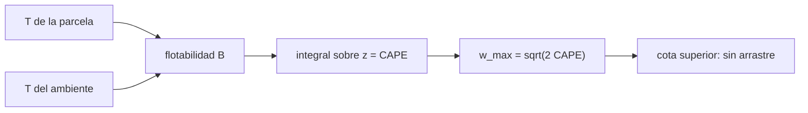

# B54-C07 — Dinámica de tormentas

<!-- nav:top -->
[🏠 Programa](../../../../README.md) · [📚 Bloque B54](../../../tronco-comun/B54-atmosferas-y-climatologia-planetaria.md) · [← Anterior: B54-C06 — Circulación general planetaria](../B54-C06-circulacion-general-planetaria/CLASE.md) · [Siguiente: B54-C08 — Nubes y aerosoles →](../B54-C08-nubes-y-aerosoles/CLASE.md)
<!-- /nav -->

## 1. Ubicación, nivel y alcance

Clase 7 del bloque B54. Nivel N3. Una tormenta es una corriente ascendente alimentada por la energía de flotabilidad que acumula una parcela más cálida que su entorno. Aquí calculas esa energía (**CAPE**) sobre un sondeo **sintético** y obtienes una cota de la velocidad ascendente. No se estudia ningún evento real.

## 2. Por qué esta clase existe

La energía convectiva disponible decide si una tormenta tiene vigor o no. La pregunta motivadora: **¿cuánta velocidad puede alcanzar el aire que sube si toda la flotabilidad se convierte en movimiento?** La decisión central: integrar la flotabilidad sobre la capa donde la parcela es más cálida que el ambiente.

## 3. Lo que podrás hacer al terminar

1. Definir la flotabilidad `B = g (T_p − T_e)/T_e`.
2. Integrar CAPE con la regla del trapecio.
3. Verificar la integración contra un caso analítico de flotabilidad constante.
4. Calcular `w_max = √(2 CAPE)` como cota superior.
5. Interpretar CAPE débil, moderada y fuerte con valores ilustrativos.
6. Reconocer por qué `w_max` sobreestima la velocidad real.

La evidencia es la **ficha de energía convectiva de un sondeo sintético** del ejercicio 12 (sección 20).

## 4. Con qué llegas y cómo comprobarlo

1. ¿Qué es la flotabilidad?
2. ¿Qué es una integral?
3. ¿Qué es la regla del trapecio?
4. ¿Qué es un valor sintético?
5. ¿Qué es una verificación?

<details>
<summary>Ver respuestas</summary>

1. La aceleración hacia arriba de una parcela más ligera que su entorno. 2. La suma de infinitas contribuciones pequeñas. 3. Una aproximación de la integral con tramos rectos. 4. Un valor inventado para el ejemplo, no medido. 5. Comparar un cálculo con un caso independiente.
</details>

Con cuatro o cinco aciertos, sigue; si no, repasa los prerrequisitos.

## 5. Un caso de contexto y casos de referencia

Con `g = 9,820 m/s²` (S1) y un ambiente sintético que baja `6,5 K/km` desde `300 K` hasta 11 km (isoterma después), una parcela sale del suelo con `303 K`, baja `9,8 K/km` hasta 1,5 km y luego `5 K/km` (condensación supuesta). Es el **ejemplo conductor**; no es el sondeo de ningún lugar.

## 6. Vocabulario

La **CAPE** (energía potencial convectiva disponible) es la integral de la flotabilidad en la capa donde `T_p > T_e`. La **flotabilidad** es `g (T_p − T_e)/T_e`. `w_max = √(2 CAPE)` es la velocidad ascendente máxima sin pérdidas. La **parcela** es una porción de aire que se supone sin mezcla. El **arrastre** (mezcla con el ambiente) reduce la velocidad real.

## 7. Modelo mental: un globo de aire caliente

Un globo de aire caliente acelera mientras es más ligero que el aire de alrededor y deja de acelerar cuando se iguala.



*Descripción textual:* la diferencia de temperatura entre parcela y ambiente da la flotabilidad; su integral es la CAPE y de ella sale la cota de velocidad.

Analogía: el globo de aire caliente. Límite: el globo es un objeto cerrado; la parcela se mezcla y pierde energía por arrastre y por el peso de las gotas.

## 8. La explicación, paso a paso

### 8.1 Prueba analítica

Con exceso constante `ΔT = 2 K` sobre `T_e = 280 K` entre 2 y 10 km, `CAPE = g (ΔT/T_e) H = 9,820 × (2/280) × 8000 = 561,1429 J/kg`. El trapecio numérico da `561,1429 J/kg`: coincide con la analítica a la precisión impresa (la tolerancia del laboratorio es `10⁻⁹` relativa).

### 8.2 Sondeo sintético

Para el ambiente y la parcela de la sección 5, el laboratorio obtiene `CAPE = 2479,8 J/kg` y `w_max = 70,4 m/s`. Valores de referencia ilustrativos: `500 J/kg` (31,6 m/s), `1500` (54,8) y `3000` (77,5). Con un ascenso medio igual a la mitad de `w_max`, una parcela tardaría `4,7 min` en llegar a 10 km.

### 8.3 Lectura

`w_max` es una **cota**: en tormentas reales la mezcla con el ambiente y la carga de hidrometeoros bajan la velocidad, por lo que este número sobreestima. La clase no pretende reproducir ninguna tormenta ni predecir ninguna; solo muestra cómo se calcula la energía disponible y cómo pasa de energía a velocidad.

## 9. Magnitudes, símbolos y unidades

| Símbolo | Qué es | Unidad | Valor / nota |
|---|---|---|---|
| `B` | flotabilidad | m/s² | −0,2 … +0,2 |
| CAPE | energía convectiva disponible | J/kg | 2479,8 (sintético) |
| `w_max` | velocidad ascendente máxima | m/s | 70,4 (cota) |
| `g` | gravedad terrestre | m/s² | 9,820 (S1) |
| `T_p`, `T_e` | temperatura de parcela y ambiente | K | ver sección 5 |

## 10. Convenciones y referencias

`z` hacia arriba en m; temperaturas en K; sin corrección de temperatura virtual (se usa la temperatura directa). Sondeo sintético; parcela sin arrastre.

## 11. De dónde sale lo que afirmamos

| ID | Fuente | Localizador | Respalda | Estado |
|---|---|---|---|---|
| S1 | NASA/NSSDC, *Earth Fact Sheet* | https://nssdc.gsfc.nasa.gov/planetary/factsheet/earthfact.html | presión, densidad, altura de escala, composición, albedo, irradiancia, T de cuerpo negro, gravedad, masa, radio y velocidad de escape de la Tierra | Consultada; datos de ficha; consulta 2026-11-09 |

Límites: no se consultó ningún sondeo ni artículo de tormentas; los valores de CAPE «débil, moderada y fuerte» (500, 1500 y 3000 J/kg) son ilustrativos y no una clasificación de una fuente.

## 12. Cómo ver la energía convectiva

| Magnitud | Valor |
|---|---|
| CAPE analítica de la prueba | 561,1429 J/kg |
| CAPE del sondeo sintético | 2479,8 J/kg |
| `w_max` (cota) | 70,4 m/s |
| tiempo de ascenso a 10 km | 4,7 min |

Descripción larga: una gráfica de `T_p` y `T_e` frente a `z` muestra el área entre ambas curvas, que es la CAPE; la tabla 8.2 resume los números.

## 13. Ejemplo trabajado: CAPE constante

**Paso 1 · Flotabilidad.** `B = 9,820 × 2/280 = 0.0701 m/s²`.

**Paso 2 · Espesor.** `8000 m`.

**Paso 3 · CAPE.** `B × 8000 = 561.14 J/kg`.

**Paso 4 · Velocidad.** `w_max = √(2 × 561.1) = 33.5 m/s`.

## 14. Distintas formas de acotar la velocidad

**Por CAPE:** cota sin pérdidas. **Por balance de momento con arrastre:** incluye mezcla (no se desarrolla aquí). **Por observación:** radar o aviones, no disponible. La primera es la única que se calcula.

## 15. Práctica guiada

**Ejercicio 1 · con los pasos indicados.** Calcula `B` para `ΔT = 1 K` sobre `T_e = 290 K`. *Pasos:* 8.1.

<details><summary>Solución comentada</summary>

`0.0339 m/s²`.
</details>

**Ejercicio 2 · con una pista.** ¿Cuánto vale `w_max` para `CAPE = 800 J/kg`? *Pista:* `√(2 CAPE)`.

<details><summary>Solución comentada</summary>

`40.0 m/s`.
</details>

**Ejercicio 3 · casi autónomo.** ¿Cuántas veces mayor es `w_max` si la CAPE se cuadruplica?

<details><summary>Solución comentada</summary>

Doble: `w_max ∝ √CAPE`.
</details>

## 16. Práctica autónoma, transferencia e integrador

**Ejercicio 4 · autónomo.** Calcula la CAPE de `ΔT = 3 K` sobre `T_e = 275 K` en 6 km.

<details><summary>Solución comentada</summary>

`642.8 J/kg`.
</details>

**Ejercicio 5 · autónomo.** ¿Qué pasa con la CAPE si el exceso de temperatura es negativo en parte de la columna?

<details><summary>Solución comentada</summary>

Esa parte no se suma (la parcela es más fría que el ambiente), por lo que el trapecio solo incluye tramos con flotabilidad positiva.
</details>

**Ejercicio 6 · autónomo.** ¿Cuánto tarda una parcela en subir 8 km a `w = 20 m/s`?

<details><summary>Solución comentada</summary>

`6.7 min`.
</details>

**Ejercicio 7 · autónomo.** ¿Qué le pasa a `w_max` si hay 20 % de pérdida de energía por arrastre?

<details><summary>Solución comentada</summary>

`√(0,8) = 0,894`: `w` baja un 10,6 %.
</details>

**Ejercicio 8 · autónomo.** ¿Por qué conviene declarar `w_max` como cota?

<details><summary>Solución comentada</summary>

Porque ignora el arrastre y la carga de hidrometeoros, de modo que la velocidad real es menor.
</details>

**Ejercicio 9 · transferencia.** **Transferencia.** Un colega dice que `CAPE = 2480 J/kg` 'garantiza' una tormenta fuerte. ¿Qué respondes?

<details><summary>Solución comentada</summary>

Que es un valor de un sondeo sintético y que la CAPE es una condición necesaria, no suficiente: falta un mecanismo de disparo y no hay arrastre en el cálculo.
</details>

**Ejercicio 10 · transferencia.** **Transferencia.** ¿Qué cambiaría para una tormenta en Júpiter?

<details><summary>Solución comentada</summary>

`g`, el gradiente adiabático y la condensación del agua cambian; habría que repetir con sus propios perfiles. No se trata aquí.
</details>

**Ejercicio 11 · transferencia.** **Transferencia.** ¿Qué papel cumple el nivel de condensación en el sondeo sintético?

<details><summary>Solución comentada</summary>

Cambia el gradiente de la parcela de 9,8 a 5 K/km a 1,5 km: libera calor y aumenta la flotabilidad, aumentando la CAPE.
</details>

**Ejercicio 12 · integrador.** **Integrador.** Elabora tu *ficha de energía convectiva*: la prueba analítica, la CAPE del sondeo, `w_max` y las referencias.

<details><summary>Solución comentada</summary>

Secciones 8.1–8.3 y salida del laboratorio.
</details>

## 17. Laboratorio: CAPE y velocidad ascendente de un sondeo sintético

El script [tormentas.py](tormentas.py) integra la flotabilidad con la regla del trapecio y calcula `w_max` (**comprueba** el trapecio frente a la CAPE analítica con 1e-9).

**Datos:** `g` de la ficha NASA (S1); sondeo sintético. **Predice antes de ejecutar:** ¿Cuánto vale la CAPE de la prueba analítica? (561,1 J/kg.) **Ejecución del 2026-11-09 (Python 3.12.9):**

```text
Python 3.12.9 (biblioteca estandar)
Prueba: CAPE constante = 561.1429 J/kg ; analitica g dT/T H = 561.1429 J/kg
Sondeo sintetico: CAPE = 2479.8 J/kg ; w_max (cota) = 70.4 m/s
  CAPE    500 J/kg (debil): w_max =  31.6 m/s
  CAPE   1500 J/kg (moderada): w_max =  54.8 m/s
  CAPE   3000 J/kg (fuerte): w_max =  77.5 m/s
Tiempo de ascenso a 10 km con 0.5 w_max: 4.7 min
Pruebas superadas.
```

```bash
python programa/clases/B54/B54-C07-dinamica-de-tormentas/tormentas.py
```

**Límites:** parcela sin arrastre y sondeo sintético.

## 18. Errores frecuentes y cómo corregirlos

**Sumar también los tramos de flotabilidad negativa.** Se corrige con el ejercicio 5.

**Presentar `w_max` como velocidad real.** Se corrige con 8.3.

**Olvidar el cociente `1/T_e` en la flotabilidad.** Se corrige con 8.1.

**Tomar el sondeo como real.** Se corrige con la sección 5: es sintético.

## 19. Cómo sabrás que vas bien

Tras la sección 8: ¿qué CAPE esperabas en la prueba y cuál obtuviste? Si dudas, repasa el ejemplo 13. Tras el laboratorio: ¿qué comprueba? (ver la sección 17).

## 20. Qué entregas y cómo se evalúa

El producto es tu **ficha de energía convectiva de un sondeo sintético** (ejercicio 12).

| Criterio | Inicial | En desarrollo | Logrado | Destacado |
|---|---|---|---|---|
| Conceptos | Los confunde | Parciales | Flotabilidad, CAPE y cota de velocidad | Explica los límites |
| Cálculo | Sin unidades | Con errores | Tablas completas con unidades | Calcula casos nuevos |
| Numérico | Sin comprobar | Un caso | Contraste con el caso analítico o la ficha | Interpreta las diferencias |
| Fuentes | Sin fuente | Sin fecha | Fuentes con fecha | Declara lo sintético y lo no consultado |
| Límites | No los nombra | Uno | Tres | Discute qué falta del modelo |

**Condiciones críticas (no se compensan con promedio):** rotular el sondeo como sintético; no presentar `w_max` como velocidad real; citar solo lo consultado.

## 21. Ética, seguridad y límites

Clase educativa: no pronostica tormentas. Accesibilidad: tablas equivalentes a las gráficas, fórmulas en texto, ejercicios sin conexión.

## 22. Para cerrar y seguir

Un sondeo sintético con 2480 J/kg de CAPE da una cota de 70 m/s. Queda una pregunta: ¿cómo se forman las gotas y los aerosoles que acompañan a esos movimientos?

**Glosario español–inglés.** energía potencial convectiva disponible · *convective available potential energy (CAPE)*; flotabilidad · *buoyancy*; parcela · *parcel*; arrastre · *entrainment*; corriente ascendente · *updraft*.

**Continuidad.** [B54-C08](../B54-C08-nubes-y-aerosoles/CLASE.md) estudia las nubes y los aerosoles.

**Referencias:** ver sección 11.

<!-- nav:bottom -->
---

[← Anterior: B54-C06 — Circulación general planetaria](../B54-C06-circulacion-general-planetaria/CLASE.md) · [📚 Bloque B54](../../../tronco-comun/B54-atmosferas-y-climatologia-planetaria.md) · [Siguiente: B54-C08 — Nubes y aerosoles →](../B54-C08-nubes-y-aerosoles/CLASE.md)
<!-- /nav -->
