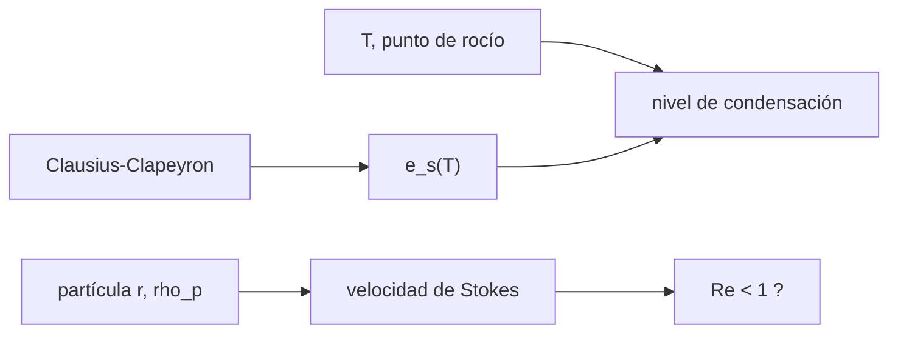

# B54-C08 — Nubes y aerosoles

<!-- nav:top -->
[🏠 Programa](../../../../README.md) · [📚 Bloque B54](../../../tronco-comun/B54-atmosferas-y-climatologia-planetaria.md) · [← Anterior: B54-C07 — Dinámica de tormentas](../B54-C07-dinamica-de-tormentas/CLASE.md) · [Siguiente: B54-C09 — Efecto invernadero →](../B54-C09-efecto-invernadero/CLASE.md)
<!-- /nav -->

## 1. Ubicación, nivel y alcance

Clase 8 del bloque B54. Nivel N3. Una nube aparece cuando el vapor de una especie supera su presión de saturación; los aerosoles son partículas suspendidas que caen despacio. Aquí calculas la **presión de saturación** con Clausius–Clapeyron, el **nivel de condensación** de una parcela y la **velocidad de sedimentación de Stokes** de partículas de 0,1 a 50 µm. Los calores latentes y la viscosidad son valores estándar **no consultados**; la densidad de partícula es **sintética**.

## 2. Por qué esta clase existe

La condensación libera calor, forma nubes que cambian el albedo y limita cuánto vapor admite el aire. La pregunta motivadora: **¿a qué altura se forma una nube y cuánto tarda una partícula en caer de ella?** La decisión central: decidir cuándo la ley de Stokes es aplicable (Reynolds ≪ 1).

## 3. Lo que podrás hacer al terminar

1. Calcular `e_s(T)` con Clausius–Clapeyron de calor latente constante.
2. Verificar numéricamente `d ln e_s/dT = L/(R_v T²)`.
3. Estimar el nivel de condensación de una parcela.
4. Calcular la velocidad de Stokes y el número de Reynolds.
5. Decidir cuándo falla la ley de Stokes.
6. Aplicar la ecuación a CO₂ en Marte como ejemplo ilustrativo.

La evidencia es la **ficha de condensación y sedimentación** del ejercicio 12 (sección 20).

## 4. Con qué llegas y cómo comprobarlo

1. ¿Qué es la presión de saturación?
2. ¿Qué es el calor latente?
3. ¿Qué es la viscosidad?
4. ¿Qué es un valor sintético?
5. ¿Qué es una verificación?

<details>
<summary>Ver respuestas</summary>

1. La presión parcial de vapor en equilibrio con el líquido o el sólido. 2. La energía por unidad de masa que se absorbe o libera al cambiar de fase. 3. La resistencia interna de un fluido a fluir. 4. Un valor inventado para el ejemplo, no medido. 5. Comparar un cálculo con un caso independiente.
</details>

Con cuatro o cinco aciertos, sigue; si no, repasa los prerrequisitos.

## 5. Un caso de contexto y casos de referencia

Una parcela terrestre a `303 K` con punto de rocío `293 K` sube; una partícula de `rho_p = 1500 kg/m³` (sintética) cae en aire de `rho = 1,2 kg/m³` y `μ = 1,8 × 10⁻⁵ Pa s` (estándar no consultado). Es el **ejemplo conductor**. En Marte se aplica la misma ecuación al CO₂ con la presión media de la ficha (`636 Pa`, ficha de Marte, S2).

## 6. Vocabulario

La **ecuación de Clausius–Clapeyron** relaciona la presión de saturación con la temperatura: `d ln e_s/dT = L/(R_v T²)`. El **nivel de condensación** es la altura en que una parcela ascendente alcanza la saturación. Un **aerosol** es una partícula sólida o líquida suspendida en el gas. La **velocidad de Stokes** es `v = 2 r² (ρ_p − ρ) g/(9 μ)`. El **número de Reynolds** de la partícula `Re = ρ v 2r/μ` debe ser menor que 1 para que valga Stokes.

## 7. Modelo mental: una toalla húmeda que se enfría

Un vaso frío 'suda' porque el aire que lo toca se enfría hasta saturarse; una parcela que sube hace lo mismo.



*Descripción textual:* Clausius–Clapeyron da la saturación; con la temperatura y el punto de rocío se obtiene el nivel de condensación; las partículas caen con velocidad de Stokes si el Reynolds es menor que 1.

Analogía: el vaso frío. Límite: el vaso mantiene su temperatura fija; la parcela se enfría con la altura, y L no es constante en un rango amplio.

## 8. La explicación, paso a paso

### 8.1 Saturación del agua

Con `R_v = R/0,018 015 = 461,5 J/(kg K)`, `L = 2,50 × 10⁶ J/kg` y la referencia del punto triple (`273,16 K`, `611,657 Pa`; no consultados):

| `T` (K) | `e_s` (Pa) |
|---|---|
| 253,15 | 127,58 |
| 273,16 | 611,66 |
| 288,15 | 1716,01 |
| 303,15 | 4349,92 |
| 373,15 | 124 226,32 |

A 373,15 K la fórmula da `124 226 Pa` frente a `101 325 Pa` de 1 atm: error de `22,6 %`, esperable porque `L` real disminuye al subir `T`. La derivada numérica `d ln e_s/dT` a 290 K es `6,440863 × 10⁻² K⁻¹`, igual a `L/(R_v T²)`.

### 8.2 Nivel de condensación y CO₂ en Marte

Con `T = 303 K`, `T_d = 293 K` y gradientes seco `9,76 K/km` y de rocío `1,8 K/km`, el nivel de condensación es `1256 m` (la regla empírica `125 m/K` daría `1250 m`). La misma ley con `L = 5,9 × 10⁵ J/kg` y una referencia de `194,7 K` a 1 atm (no consultadas) da una temperatura de escarcha del CO₂ de `147,9 K` a `636 Pa`; es un valor ilustrativo.

### 8.3 Sedimentación

| radio (µm) | `v` (m/s) | Reynolds | tiempo para caer 1 km |
|---|---|---|---|
| 0,1 | 1,817 × 10⁻⁶ | 2,4 × 10⁻⁸ | 6370 d |
| 1 | 1,817 × 10⁻⁴ | 2,4 × 10⁻⁵ | 63,7 d |
| 10 | 1,817 × 10⁻² | 2,4 × 10⁻² | 0,64 d |
| 50 | 0,4543 | 3,03 | 0,03 d |

Para 50 µm el Reynolds supera 1 y Stokes ya no es válida: el valor se muestra, pero no es una predicción.

## 9. Magnitudes, símbolos y unidades

| Símbolo | Qué es | Unidad | Valor / nota |
|---|---|---|---|
| `e_s` | presión de saturación | Pa | 128 … 124 226 |
| `L` | calor latente | J/kg | 2,50 × 10⁶ (agua, estándar no consultado) |
| `R_v` | constante del vapor `R/M_v` | J kg⁻¹ K⁻¹ | 461,5 |
| `v` | velocidad de Stokes | m/s | 1,8 × 10⁻⁶ … 0,45 |
| `Re` | número de Reynolds | — | 2,4 × 10⁻⁸ … 3,0 |

## 10. Convenciones y referencias

`T` en K, `r` en m (se tabula en µm). Aire seco como fluido de fondo; partícula esférica rígida. `L` constante: validez limitada. El CO₂ de Marte se calcula con valores ilustrativos.

## 11. De dónde sale lo que afirmamos

| ID | Fuente | Localizador | Respalda | Estado |
|---|---|---|---|---|
| S1 | NASA/NSSDC, *Earth Fact Sheet* | https://nssdc.gsfc.nasa.gov/planetary/factsheet/earthfact.html | presión, densidad, altura de escala, composición, albedo, irradiancia, T de cuerpo negro, gravedad, masa, radio y velocidad de escape de la Tierra | Consultada; datos de ficha; consulta 2026-11-09 |
| S2 | NASA/NSSDC, *Mars Fact Sheet* | https://nssdc.gsfc.nasa.gov/planetary/factsheet/marsfact.html | presión (y su rango estacional), densidad, altura de escala, T, composición, albedo, irradiancia, gravedad y masa de Marte | Consultada; datos de ficha; consulta 2026-11-09 |
| S3 | NIST, *CODATA 2022: constante de Boltzmann k* | https://physics.nist.gov/cgi-bin/cuu/Value?k | k = 1,380 649 × 10⁻²³ J K⁻¹ (exacta) | Consultada; consulta 2026-11-09 |
| S4 | NIST, *CODATA 2022: constante de Avogadro N_A* | https://physics.nist.gov/cgi-bin/cuu/Value?na | N_A = 6,022 140 76 × 10²³ mol⁻¹ (exacta) | Consultada; consulta 2026-11-09 |

Límites: `L` del agua y del CO₂, la viscosidad del aire, la temperatura de referencia del CO₂ y la presión del punto triple son valores estándar **no consultados**; `rho_p` es sintética. Las cifras de Marte son ilustrativas.

## 12. Cómo ver la condensación

| Magnitud | Valor |
|---|---|
| `e_s(288,15 K)` | 1716,0 Pa |
| error de C–C a 373,15 K | 22,6 % |
| nivel de condensación | 1256 m |
| `v` de una partícula de 1 µm | 1,817 × 10⁻⁴ m/s |

Descripción larga: una gráfica logarítmica de `e_s` frente a `1/T` sería casi recta; las tablas 8.1 y 8.3 dan los mismos números.

## 13. Ejemplo trabajado: velocidad de una partícula de 1 µm

**Paso 1 · Datos.** `r = 10⁻⁶ m`, `Δρ = 1500 − 1,2 = 1498,8 kg/m³`.

**Paso 2 · Numerador.** `2 r² Δρ g = 2.9436e-08`.

**Paso 3 · Divisor.** `9 μ = 1,62 × 10⁻⁴`.

**Paso 4 · Velocidad.** `v = 1.817e-04 m/s`, que equivale a 63,7 días por kilómetro.

## 14. Distintas formas de estimar la altura de una nube

**Por el nivel de condensación:** `(T − T_d)/(Γ_d − Γ_d')`. **Por la regla empírica:** `125 m` por kelvin de diferencia. **Por observación (lidar o satélite):** requiere instrumentos, no disponible aquí. Las dos primeras coinciden en `1256` y `1250 m`.

## 15. Práctica guiada

**Ejercicio 1 · con los pasos indicados.** Calcula `R_v` con `M_v = 0,018 015 kg/mol`. *Pasos:* `R/M_v`.

<details><summary>Solución comentada</summary>

`461.5 J/(kg K)`.
</details>

**Ejercicio 2 · con una pista.** ¿Cuánto vale `L/(R_v T²)` a 290 K con `L = 2,50 × 10⁶`? *Pista:* 8.1.

<details><summary>Solución comentada</summary>

`6.4409e-02 K⁻¹`.
</details>

**Ejercicio 3 · casi autónomo.** El nivel de condensación con `T − T_d = 6 K`. *Pasos:* `Δ/(9,76 − 1,8)` K/km.

<details><summary>Solución comentada</summary>

`754 m`.
</details>

## 16. Práctica autónoma, transferencia e integrador

**Ejercicio 4 · autónomo.** ¿Cuánto vale `v` para `r = 5 µm`?

<details><summary>Solución comentada</summary>

`4.543e-03 m/s`.
</details>

**Ejercicio 5 · autónomo.** ¿Cuántas veces más rápida cae una partícula de 10 µm que una de 1 µm?

<details><summary>Solución comentada</summary>

100 veces: `v ∝ r²`.
</details>

**Ejercicio 6 · autónomo.** ¿Cuánto tarda una partícula de 1 µm en caer 100 m?

<details><summary>Solución comentada</summary>

`100/1,817 × 10⁻⁴ = 6.4 días`.
</details>

**Ejercicio 7 · autónomo.** ¿Por qué `e_s` crece tan deprisa con `T`?

<details><summary>Solución comentada</summary>

Porque `e_s` es exponencial en `1/T`: entre 273 y 303 K, el factor es `7,1` (`4349,9/611,7`).
</details>

**Ejercicio 8 · autónomo.** Calcula `Re` para `r = 10 µm` y `v = 1,817 × 10⁻² m/s`.

<details><summary>Solución comentada</summary>

`Re = 1,2 × 1,817 × 10⁻² × 2 × 10⁻⁵/1,8 × 10⁻⁵ = 0.024`.
</details>

**Ejercicio 9 · transferencia.** **Transferencia.** Un colega usa Stokes para una gota de 100 µm. ¿Qué le dices?

<details><summary>Solución comentada</summary>

Que `Re` superaría 1 (a 50 µm ya es 3,0); la ley de Stokes deja de valer y hay que usar un coeficiente de arrastre.
</details>

**Ejercicio 10 · transferencia.** **Transferencia.** ¿Qué implica que la fórmula con `L` constante dé 22,6 % de error a 373 K?

<details><summary>Solución comentada</summary>

Que la ley con `L` fija sirve en rangos estrechos de `T` (decenas de K); para rangos amplios hay que usar `L(T)` o una referencia tabulada.
</details>

**Ejercicio 11 · transferencia.** **Transferencia.** ¿Por qué no se puede afirmar que Marte tenga nubes de CO₂ a 148 K con este cálculo?

<details><summary>Solución comentada</summary>

Porque el valor de 147,9 K es ilustrativo (constantes no consultadas) y falta la presión parcial y el perfil real de temperatura; indica un orden de magnitud.
</details>

**Ejercicio 12 · integrador.** **Integrador.** Elabora tu *ficha de condensación y sedimentación*: `e_s(T)`, nivel de condensación, tabla de Stokes y el límite de aplicabilidad.

<details><summary>Solución comentada</summary>

Secciones 8.1–8.3 y salida del laboratorio.
</details>

## 17. Laboratorio: saturación, nivel de condensación y sedimentación

El script [nubes.py](nubes.py) calcula `e_s(T)`, la temperatura de escarcha del CO₂ de Marte, el nivel de condensación y la velocidad de Stokes (**comprueba** la derivada de `ln e_s` y la fórmula de Stokes).

**Datos:** constantes de NIST (S3, S4); calores latentes, viscosidad y referencias estándar no consultados; densidad de partícula sintética. **Predice antes de ejecutar:** ¿A qué altura condensa una parcela con `T − T_d = 10 K`? (≈ 1250 m.) **Ejecución del 2026-11-09 (Python 3.12.9):**

```text
Python 3.12.9 (biblioteca estandar)
e_s( 253.15 K) =       127.58 Pa
e_s( 273.16 K) =       611.66 Pa
e_s( 288.15 K) =      1716.01 Pa
e_s( 303.15 K) =      4349.92 Pa
e_s( 373.15 K) =    124226.32 Pa
e_s en el punto de ebullicion frente a 1 atm: dif. rel. = 22.6 % (limite de L constante: L real disminuye al subir T)
d ln es/dT en 290 K: numerico = 6.440863e-02 1/K ; analitico = 6.440863e-02 1/K
CO2 en Marte (636 Pa): temperatura de escarcha ilustrativa = 147.9 K
Nivel de condensacion (T=303 K, Td=293 K): 1256 m (formula lineal; regla empirica ~125 m/K = 1250 m)
radio [um]   v Stokes [m/s]   Reynolds   tiempo para caer 1 km
      0.1        1.817e-06   2.42e-08      6369.66 dias
      1.0        1.817e-04   2.42e-05        63.70 dias
     10.0        1.817e-02   2.42e-02         0.64 dias
     50.0        4.543e-01   3.03e+00         0.03 dias
Pruebas superadas.
```

```bash
python programa/clases/B54/B54-C08-nubes-y-aerosoles/nubes.py
```

**Límites:** `L` constante y Stokes solo para Re < 1.

## 18. Errores frecuentes y cómo corregirlos

**Aplicar Stokes con Reynolds mayor que 1.** Se corrige con 8.3.

**Usar `L` constante en rangos amplios.** Se corrige con 8.1.

**Mezclar K y °C en Clausius–Clapeyron.** Se corrige con la sección 10.

**Dar el valor de Marte como dato.** Se corrige con la sección 11.

## 19. Cómo sabrás que vas bien

Tras la sección 8: ¿qué `e_s` esperabas a 288 K y cuál obtuviste? Si dudas, repasa el ejemplo 13. Tras el laboratorio: ¿qué comprueba? (ver la sección 17).

## 20. Qué entregas y cómo se evalúa

El producto es tu **ficha de condensación y sedimentación** (ejercicio 12).

| Criterio | Inicial | En desarrollo | Logrado | Destacado |
|---|---|---|---|---|
| Conceptos | Los confunde | Parciales | Condensación y sedimentación | Explica los límites |
| Cálculo | Sin unidades | Con errores | Tablas completas con unidades | Calcula casos nuevos |
| Numérico | Sin comprobar | Un caso | Contraste con el caso analítico o la ficha | Interpreta las diferencias |
| Fuentes | Sin fuente | Sin fecha | Fuentes con fecha | Declara lo sintético y lo no consultado |
| Límites | No los nombra | Uno | Tres | Discute qué falta del modelo |

**Condiciones críticas (no se compensan con promedio):** rotular los valores estándar como no consultados; no usar Stokes fuera de su validez; citar solo lo consultado.

## 21. Ética, seguridad y límites

Clase educativa: modelos de laboratorio, no de nubes reales. Accesibilidad: tablas equivalentes a las gráficas, fórmulas en texto, ejercicios sin conexión.

## 22. Para cerrar y seguir

Una partícula de 1 µm tarda unos 64 días en caer un kilómetro y una de 10 µm, menos de un día. Queda una pregunta: ¿cuánto calienta el planeta lo que absorbe en el infrarrojo?

**Glosario español–inglés.** presión de saturación · *saturation vapor pressure*; Clausius–Clapeyron · *Clausius–Clapeyron*; nivel de condensación · *condensation level*; aerosol · *aerosol*; velocidad de Stokes · *Stokes settling velocity*.

**Continuidad.** [B54-C09](../B54-C09-efecto-invernadero/CLASE.md) estudia el efecto invernadero.

**Referencias:** ver sección 11.

<!-- nav:bottom -->
---

[← Anterior: B54-C07 — Dinámica de tormentas](../B54-C07-dinamica-de-tormentas/CLASE.md) · [📚 Bloque B54](../../../tronco-comun/B54-atmosferas-y-climatologia-planetaria.md) · [Siguiente: B54-C09 — Efecto invernadero →](../B54-C09-efecto-invernadero/CLASE.md)
<!-- /nav -->
