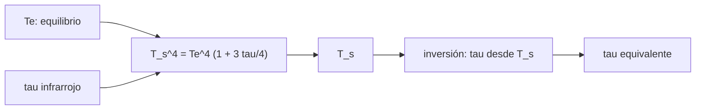

# B54-C09 — Efecto invernadero

<!-- nav:top -->
[🏠 Programa](../../../../README.md) · [📚 Bloque B54](../../../tronco-comun/B54-atmosferas-y-climatologia-planetaria.md) · [← Anterior: B54-C08 — Nubes y aerosoles](../B54-C08-nubes-y-aerosoles/CLASE.md) · [Siguiente: B54-C10 — Fotoquímica atmosférica →](../B54-C10-fotoquimica-atmosferica/CLASE.md)
<!-- /nav -->

## 1. Ubicación, nivel y alcance

Clase 9 del bloque B54. Nivel N3. Una atmósfera opaca al infrarrojo hace que la superficie tenga que calentarse más para que la energía pueda salir. Aquí usas una **atmósfera gris** para invertir la temperatura de superficie observada y obtener una profundidad óptica equivalente de Venus, la Tierra y Marte, y revisas el límite de una capa absorbente.

## 2. Por qué esta clase existe

La diferencia entre la temperatura de equilibrio (B54-C03) y la observada necesita una causa. La pregunta motivadora: **¿qué opacidad infrarroja hace falta para explicar la temperatura de superficie de cada mundo?** La decisión central: interpretar esa opacidad como una medida equivalente y no como una medición espectral.

## 3. Lo que podrás hacer al terminar

1. Plantear la atmósfera gris `T_s⁴ = T_e⁴ (1 + 3τ/4)`.
2. Invertir `T_s` observada para obtener `τ` equivalente.
3. Verificar los límites `τ = 0` y una capa isoterma opaca.
4. Calcular la emisividad de una sola capa que reproduce `T_s`.
5. Estimar el cambio de `T_s` ante un cambio de `τ`.
6. Decir qué NO prueba el cálculo (no es una medición espectral).

La evidencia es la **tabla de invernadero de tres planetas** del ejercicio 12 (sección 20).

## 4. Con qué llegas y cómo comprobarlo

1. ¿Qué es la profundidad óptica?
2. ¿Qué es el equilibrio radiativo?
3. ¿Qué es la emisividad?
4. ¿Qué es un modelo gris?
5. ¿Qué es una verificación?

<details>
<summary>Ver respuestas</summary>

1. El logaritmo de cuánto se atenúa un haz, `τ = −ln(I/I₀)`. 2. La igualdad entre energía absorbida y emitida (B54-C03). 3. La razón entre lo que emite una superficie y lo que emitiría un cuerpo negro. 4. Uno con la misma opacidad en todas las longitudes de onda. 5. Comparar un cálculo con un caso independiente.
</details>

Con cuatro o cinco aciertos, sigue; si no, repasa los prerrequisitos.

## 5. Un caso de contexto y casos de referencia

Con `S`, `A` y `T_s` de las fichas NASA (S1–S3) y σ de NIST (S4): Venus (`2601,3 W/m²`, `0,77`, `737 K`), Tierra (`1361,0`, `0,294`, `288 K`) y Marte (`586,2`, `0,250`, `214 K`). Es el **ejemplo conductor**.

## 6. Vocabulario

Una **atmósfera gris** tiene la misma opacidad infrarroja a todas las longitudes de onda. La **profundidad óptica infrarroja** `τ` mide cuán opaca es, de arriba abajo. La relación de **dos corrientes** `T_s⁴ = T_e⁴ (1 + 3τ/4)` es la solución gris en equilibrio radiativo. Una **capa isoterma** es una capa de temperatura uniforme que absorbe y emite.

## 7. Modelo mental: una manta sobre una estufa

Una manta sobre una estufa no añade energía: obliga a la estufa a calentarse más para que el calor pueda salir.



*Descripción textual:* el equilibrio radiativo y la opacidad infrarroja dan la temperatura de superficie; al invertir la relación con la temperatura observada se obtiene una opacidad equivalente.

Analogía: la manta sobre la estufa. Límite: una manta no tiene la misma opacidad en todas las longitudes de onda ni transporta calor por convección.

## 8. La explicación, paso a paso

### 8.1 Inversión de la atmósfera gris

`τ = (4/3)[(T_s/T_e)⁴ − 1]`. El laboratorio comprueba que reconstruir `T_s` desde `τ` da el valor de partida con error menor que `10⁻⁹ K`:

| mundo | `T_e` (K) | `T_s` (K) | `T_s/T_e` | `τ` equivalente | `σ T_s⁴` (W/m²) |
|---|---|---|---|---|---|
| Venus | 226,63 | 737,0 | 3,252 | 147,80 | 16 729,5 |
| Tierra | 255,12 | 288,0 | 1,129 | 0,83 | 390,1 |
| Marte | 209,83 | 214,0 | 1,020 | 0,11 | 118,9 |

### 8.2 Casos límite y una capa

Para `τ = 0`, `T_s = T_e`. Una capa isoterma opaca da `T_s = 2^{1/4} T_e = 1,1892 T_e` (`303,25 K` con `T_e = 255 K`). Con una capa de emisividad infrarroja `ε`: `T_s = T_e (2/(2 − ε))^{1/4}`; `ε = 0,5` da `274,02 K`, `ε = 0,78`, `288,54 K` y `ε = 1`, `303,25 K`. Para reproducir `T_s = 288 K` con `T_e` terrestre, `ε = 0,768`.

### 8.3 Sensibilidad y lectura

Un aumento de `0,01` en `τ` terrestre sube `T_s` unos `0,3325 K` (analítico) o `0,3319 K` (exacto). Los `τ` equivalentes (147,8 para Venus, 0,83 para la Tierra) indican órdenes de magnitud de la opacidad necesaria, no una opacidad medida: la atmósfera real no es gris y su convección, nubes y espectro modifican el resultado. El flujo `σ T_s⁴` de Venus (`16 730 W/m²`) no es un flujo que escape al espacio: la atmósfera lo absorbe y re-emite.

## 9. Magnitudes, símbolos y unidades

| Símbolo | Qué es | Unidad | Valor / nota |
|---|---|---|---|
| `τ` | profundidad óptica infrarroja equivalente | — | 0,11 … 147,8 |
| `T_s/T_e` | razón de temperaturas | — | 1,020 … 3,252 |
| `ε` | emisividad infrarroja de una capa | — | 0 … 1 |
| `σ` | constante de Stefan–Boltzmann | W m⁻² K⁻⁴ | 5,670 374 419 × 10⁻⁸ |
| `σ T_s⁴` | emisión de la superficie | W/m² | 118,9 … 16 729,5 |

## 10. Convenciones y referencias

Temperaturas en K, `τ` adimensional medido de arriba abajo. Modelo gris y plano-paralelo; sin conducción, convección ni nubes. `T_e` con los albedos de las fichas.

## 11. De dónde sale lo que afirmamos

| ID | Fuente | Localizador | Respalda | Estado |
|---|---|---|---|---|
| S1 | NASA/NSSDC, *Venus Fact Sheet* | https://nssdc.gsfc.nasa.gov/planetary/factsheet/venusfact.html | presión, densidad, altura de escala, T, composición, albedo, irradiancia, gravedad y masa de Venus | Consultada; datos de ficha; consulta 2026-11-09 |
| S2 | NASA/NSSDC, *Earth Fact Sheet* | https://nssdc.gsfc.nasa.gov/planetary/factsheet/earthfact.html | presión, densidad, altura de escala, composición, albedo, irradiancia, T de cuerpo negro, gravedad, masa, radio y velocidad de escape de la Tierra | Consultada; datos de ficha; consulta 2026-11-09 |
| S3 | NASA/NSSDC, *Mars Fact Sheet* | https://nssdc.gsfc.nasa.gov/planetary/factsheet/marsfact.html | presión (y su rango estacional), densidad, altura de escala, T, composición, albedo, irradiancia, gravedad y masa de Marte | Consultada; datos de ficha; consulta 2026-11-09 |
| S4 | NIST, *CODATA 2022: constante de Stefan–Boltzmann σ* | https://physics.nist.gov/cgi-bin/cuu/Value?sigma | σ = 5,670 374 419 × 10⁻⁸ W m⁻² K⁻⁴ (exacta) | Consultada; consulta 2026-11-09 |

Límites: la solución de dos corrientes se usa como relación de la clase, sin comprobar su derivación contra una fuente; los `τ` equivalentes no son mediciones.

## 12. Cómo ver el invernadero

| Magnitud | Valor |
|---|---|
| `τ` equivalente de Venus | 147,80 |
| `τ` equivalente de la Tierra | 0,83 |
| `T_s` con una capa opaca | 1,1892 `T_e` |
| `ε` terrestre de una capa | 0,768 |

Descripción larga: una gráfica de `T_s` frente a `τ` crece como `(1 + 3τ/4)^{1/4}`: sube rápido al principio y se aplana; la tabla 8.1 contiene los puntos.

## 13. Ejemplo trabajado: τ equivalente de la Tierra

**Paso 1 · Razón.** `T_s/T_e = 288/255,12 = 1.1289`.

**Paso 2 · Cuarta potencia.** `1.6240`.

**Paso 3 · Opacidad.** `τ = (4/3)(1.6240 − 1) = 0.83`.

## 14. Distintas formas de describir el invernadero

**Gris (dos corrientes):** una sola `τ`. **De una capa con emisividad:** `ε` única. **Espectral:** bandas de absorción de cada gas (no se hace aquí). Las dos primeras se relacionan: `ε = 2 − 2(T_e/T_s)⁴` y `τ` equivalente.

## 15. Práctica guiada

**Ejercicio 1 · con los pasos indicados.** Calcula `T_s` para `T_e = 255 K` y `τ = 1`. *Pasos:* 8.1.

<details><summary>Solución comentada</summary>

`T_s = 255 × (1,75)^{1/4} = 293.3 K`.
</details>

**Ejercicio 2 · con una pista.** ¿Qué `τ` hace falta para `T_s = 1,1 T_e`? *Pista:* `(4/3)(1,1⁴ − 1)`.

<details><summary>Solución comentada</summary>

`0.619`.
</details>

**Ejercicio 3 · casi autónomo.** Calcula la `ε` de una capa para `T_s/T_e = 1,1`.

<details><summary>Solución comentada</summary>

`ε = 2 − 2/1,1⁴ = 0.634`.
</details>

## 16. Práctica autónoma, transferencia e integrador

**Ejercicio 4 · autónomo.** Calcula `T_s` de Marte con `τ = 0,11` y `T_e = 209,83 K`.

<details><summary>Solución comentada</summary>

`214.03 K`, a 214 K.
</details>

**Ejercicio 5 · autónomo.** ¿Por qué `τ` de Venus es 178 veces la de la Tierra pero `T_s/T_e` solo 2,9 veces?

<details><summary>Solución comentada</summary>

Porque `T_s ∝ (1 + 3τ/4)^{1/4}`: la temperatura crece con la raíz cuarta de la opacidad.
</details>

**Ejercicio 6 · autónomo.** Si la atmósfera terrestre ganara `Δτ = 0,05`, ¿cuánto subiría `T_s`?

<details><summary>Solución comentada</summary>

`ΔT ≈ 288 × 0,75 × 0,05/(4 × (1 + 0,75 × 0,83)) = 1.66 K`.
</details>

**Ejercicio 7 · autónomo.** ¿Qué mide el flujo `σ T_s⁴` de la superficie y por qué no es el flujo que sale al espacio?

<details><summary>Solución comentada</summary>

Mide lo que la superficie emite; la mayor parte lo absorbe la atmósfera y vuelve a emitirse; lo que escapa es `σ T_e⁴`.
</details>

**Ejercicio 8 · autónomo.** Calcula `σ T_e⁴` de la Tierra.

<details><summary>Solución comentada</summary>

`240.2 W/m²`, igual a la absorbida (`240,2`).
</details>

**Ejercicio 9 · transferencia.** **Transferencia.** Un colega dice que el invernadero 'calienta el planeta añadiendo energía'. ¿Qué respondes?

<details><summary>Solución comentada</summary>

Que no añade energía: cambia el nivel desde el que se emite al espacio y obliga a la superficie a estar más caliente; la energía absorbida del Sol es la misma.
</details>

**Ejercicio 10 · transferencia.** **Transferencia.** ¿Por qué el `τ` de Marte no puede leerse como la opacidad de su CO₂?

<details><summary>Solución comentada</summary>

Porque Marte es tan delgado que su superficie tiene poca atmósfera sobre ella y la `ΔT` de 4,2 K depende también del polvo y del albedo; el `τ` es solo equivalente.
</details>

**Ejercicio 11 · transferencia.** **Transferencia.** ¿Cómo afecta un aumento del albedo a este análisis?

<details><summary>Solución comentada</summary>

Baja `T_e` y, a `T_s` fija, aumenta el `τ` necesario; la inversión depende del albedo adoptado.
</details>

**Ejercicio 12 · integrador.** **Integrador.** Elabora tu *tabla de invernadero*: `T_e`, `T_s`, `τ` y la capa equivalente para los tres mundos.

<details><summary>Solución comentada</summary>

Secciones 8.1–8.3 y salida del laboratorio.
</details>

## 17. Laboratorio: atmósfera gris y capa absorbente

El script [invernadero.py](invernadero.py) invierte la atmósfera gris para obtener `τ` de tres mundos y verifica los casos límite (**comprueba** la reconstrucción de `T_s` y la sensibilidad analítica).

**Datos:** irradiancia, albedo y T de superficie de las fichas NASA (S1–S3) y σ de NIST (S4). **Predice antes de ejecutar:** ¿Qué `τ` equivalente tendrá la Tierra? (≈ 0,8.) **Ejecución del 2026-11-09 (Python 3.12.9):**

```text
Python 3.12.9 (biblioteca estandar)
planeta   Te [K]   Ts obs [K]   Ts/Te   tau equivalente   flujo de superficie sigma Ts^4 [W/m2]
Venus     226.63      737.0   3.252         147.80                        16729.5
Tierra    255.12      288.0   1.129           0.83                          390.1
Marte     209.83      214.0   1.020           0.11                          118.9
Una capa isoterma opaca al IR: Ts = 303.25 K (2^(1/4) Te = 1.1892 Te)
  una capa con emisividad IR 0.00: Ts =  255.00 K  (Delta =   0.0 K)
  una capa con emisividad IR 0.50: Ts =  274.02 K  (Delta =  19.0 K)
  una capa con emisividad IR 0.78: Ts =  288.54 K  (Delta =  33.5 K)
  una capa con emisividad IR 1.00: Ts =  303.25 K  (Delta =  48.2 K)
Tierra: emisividad de la capa que reproduce Ts = 288.0 K: 0.768
+0.01 en tau: dTs analitico = 0.3325 K ; exacto = 0.3319 K
Pruebas superadas.
```

```bash
python programa/clases/B54/B54-C09-efecto-invernadero/invernadero.py
```

**Límites:** modelo gris, sin nubes ni convección.

## 18. Errores frecuentes y cómo corregirlos

**Interpretar `τ` como medida espectral.** Se corrige con 8.3.

**Olvidar que la emisión superficial no escapa al espacio.** Se corrige con 8.3.

**Cambiar el albedo sin recalcular `T_e`.** Se corrige con el ejercicio 11.

**Usar `T` en °C.** Se corrige con la sección 10.

## 19. Cómo sabrás que vas bien

Tras la sección 8: ¿qué `τ` esperabas para Venus y cuál obtuviste? Si dudas, repasa el ejemplo 13. Tras el laboratorio: ¿qué comprueba? (ver la sección 17).

## 20. Qué entregas y cómo se evalúa

El producto es tu **tabla de invernadero de tres planetas** (ejercicio 12).

| Criterio | Inicial | En desarrollo | Logrado | Destacado |
|---|---|---|---|---|
| Conceptos | Los confunde | Parciales | Atmósfera gris y opacidad infrarroja | Explica los límites |
| Cálculo | Sin unidades | Con errores | Tablas completas con unidades | Calcula casos nuevos |
| Numérico | Sin comprobar | Un caso | Contraste con el caso analítico o la ficha | Interpreta las diferencias |
| Fuentes | Sin fuente | Sin fecha | Fuentes con fecha | Declara lo sintético y lo no consultado |
| Límites | No los nombra | Uno | Tres | Discute qué falta del modelo |

**Condiciones críticas (no se compensan con promedio):** rotular `τ` como equivalente y no medida; no atribuir toda la ΔT al CO₂; citar solo lo consultado.

## 21. Ética, seguridad y límites

Clase educativa: modelo gris. Accesibilidad: tablas equivalentes a las gráficas, fórmulas en texto, ejercicios sin conexión.

## 22. Para cerrar y seguir

La Tierra necesita una opacidad equivalente de 0,83 y Venus de 148. Queda una pregunta: ¿qué reacciones químicas inducen los fotones en lo alto de la atmósfera?

**Glosario español–inglés.** atmósfera gris · *grey atmosphere*; profundidad óptica · *optical depth*; efecto invernadero · *greenhouse effect*; emisividad · *emissivity*; dos corrientes · *two-stream*.

**Continuidad.** [B54-C10](../B54-C10-fotoquimica-atmosferica/CLASE.md) estudia la fotoquímica.

**Referencias:** ver sección 11.

<!-- nav:bottom -->
---

[← Anterior: B54-C08 — Nubes y aerosoles](../B54-C08-nubes-y-aerosoles/CLASE.md) · [📚 Bloque B54](../../../tronco-comun/B54-atmosferas-y-climatologia-planetaria.md) · [Siguiente: B54-C10 — Fotoquímica atmosférica →](../B54-C10-fotoquimica-atmosferica/CLASE.md)
<!-- /nav -->
