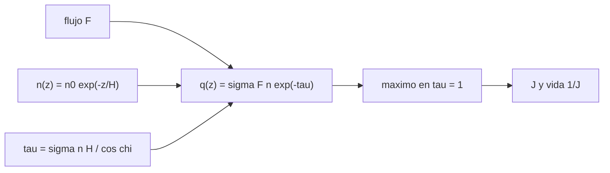

# B54-C10 — Fotoquímica atmosférica

<!-- nav:top -->
[🏠 Programa](../../../../README.md) · [📚 Bloque B54](../../../tronco-comun/B54-atmosferas-y-climatologia-planetaria.md) · [← Anterior: B54-C09 — Efecto invernadero](../B54-C09-efecto-invernadero/CLASE.md) · [Siguiente: B54-C11 — Escape atmosférico →](../B54-C11-escape-atmosferico/CLASE.md)
<!-- /nav -->

## 1. Ubicación, nivel y alcance

Clase 10 del bloque B54. Nivel N3. Los fotones solares rompen moléculas y producen especies reactivas a una altura bien definida: donde la atmósfera por encima absorbe lo justo. Aquí calculas la **capa de Chapman**, la tasa de fotólisis y la vida fotoquímica con parámetros **sintéticos**, y verificas el máximo contra la solución analítica. No se modela ninguna especie concreta.

## 2. Por qué esta clase existe

La capa de producción fotoquímica explica por qué hay capas de ozono, ionosferas y neblinas a ciertas alturas. La pregunta motivadora: **¿a qué altura se rompen más moléculas y cómo cambia con el ángulo del Sol?** La decisión central: ubicar el máximo donde la profundidad óptica vale 1.

## 3. Lo que podrás hacer al terminar

1. Definir la profundidad óptica `τ(z) = σ n(z) H/cos χ`.
2. Escribir la tasa de producción `q(z) = σ F n(z) e^{−τ}`.
3. Obtener la altura del máximo `z_m = H ln(σ n₀ H/cos χ)`.
4. Calcular la tasa de fotólisis `J` y la vida `1/J`.
5. Resolver el equilibrio `dn/dt = P − L n`.
6. Declarar que los parámetros son sintéticos.

La evidencia es la **ficha de una capa fotoquímica sintética** del ejercicio 12 (sección 20).

## 4. Con qué llegas y cómo comprobarlo

1. ¿Qué es una sección eficaz?
2. ¿Qué es la ley de Beer–Lambert?
3. ¿Qué es una atmósfera exponencial?
4. ¿Qué es un valor sintético?
5. ¿Qué es una verificación?

<details>
<summary>Ver respuestas</summary>

1. El área efectiva con que una molécula absorbe un fotón, en m². 2. Que la intensidad cae como `e^{−τ}`. 3. Una con `n(z) = n₀ e^{−z/H}`. 4. Un valor inventado para el ejemplo, no medido. 5. Comparar un cálculo con un caso independiente.
</details>

Con cuatro o cinco aciertos, sigue; si no, repasa los prerrequisitos.

## 5. Un caso de contexto y casos de referencia

Parámetros **sintéticos**: `H = 7 km`, `n₀ = 2,5 × 10²⁵ m⁻³`, `σ = 10⁻²³ m²`, flujo fotónico `F = 10¹⁸ fotones m⁻² s⁻¹`. Es el **ejemplo conductor**; no representa a ninguna especie ni banda real.

## 6. Vocabulario

La **capa de Chapman** es la capa donde la producción por fotólisis es máxima. El **ángulo cenital** `χ` es el ángulo del Sol con la vertical. La **tasa de fotólisis** `J = σ F e^{−τ}` es la probabilidad por segundo de romper una molécula. La **vida fotoquímica** es `1/J`. El **equilibrio fotoquímico** iguala producción y pérdida.

## 7. Modelo mental: una niebla que apaga una linterna

La luz de una linterna a través de la niebla se apaga a cierta profundidad; allí es donde la niebla 'se ilumina' más.



*Descripción textual:* el flujo, la densidad y la profundidad óptica determinan la producción; su máximo cae donde `τ = 1`, y de la tasa de fotólisis sale la vida fotoquímica.

Analogía: la niebla y la linterna. Límite: la niebla real dispersa la luz; aquí solo se absorbe.

## 8. La explicación, paso a paso

### 8.1 La capa

Con `n(z) = n₀ e^{−z/H}`, `q(z) = σ F n e^{−σ n H/cos χ}`. Su derivada se anula donde `σ n H/cos χ = 1`, es decir `z_m = H ln(σ n₀ H/cos χ)` y `q_m = F cos χ/(e H)`. El laboratorio busca el máximo en pasos de 1 m y lo compara:

| `χ` (°) | `z_m` analítico (km) | `z_m` numérico (km) | `q_m` (m⁻³ s⁻¹) |
|---|---|---|---|
| 0 | 100,626 | 100,626 | 5,2554 × 10¹³ |
| 30 | 101,633 | 101,633 | 4,5513 × 10¹³ |
| 60 | 105,478 | 105,478 | 2,6277 × 10¹³ |
| 70 | 108,136 | 108,136 | 1,7975 × 10¹³ |

La capa sube `7,51 km` entre `χ = 0` y `70°` y su producción máxima baja con `cos χ`.

### 8.2 Fotólisis y vida

Con `J = σ F e^{−τ}`: sobre la capa (`τ ≪ 1`), `J → σ F = 10⁻⁵ s⁻¹`. A 120 km, `τ = 0,0628` y `J = 9,39 × 10⁻⁶ s⁻¹` (vida `29,6 h`); a 100 km, `τ = 1,094`, `J = 3,35 × 10⁻⁶` (`82,9 h`); a 80 km, `τ = 19,0`, `J = 5,38 × 10⁻¹⁴` (`5,2 × 10⁹ h`). Más abajo, la molécula queda protegida.

### 8.3 Equilibrio

Con `P = 2 × 10⁹ m⁻³ s⁻¹` y `L = 10⁻⁴ s⁻¹`, `n_eq = P/L = 2 × 10¹³ m⁻³`. Tras 5 vidas, la integración numérica da `1,9866 × 10¹³` frente al exacto `1,9865 × 10¹³`. Todo es **sintético**: ningún número corresponde a una especie real.

## 9. Magnitudes, símbolos y unidades

| Símbolo | Qué es | Unidad | Valor / nota |
|---|---|---|---|
| `σ` | sección eficaz (sintética) | m² | 10⁻²³ |
| `F` | flujo fotónico (sintético) | m⁻² s⁻¹ | 10¹⁸ |
| `n₀` | densidad de la base (sintética) | m⁻³ | 2,5 × 10²⁵ |
| `J` | tasa de fotólisis | s⁻¹ | 10⁻¹⁴ … 10⁻⁵ |
| `z_m` | altura del máximo | km | 100,6 … 108,1 |

## 10. Convenciones y referencias

Altura `z` hacia arriba desde la base de la columna; `χ` en grados (se convierte a radianes en el cálculo). Atmósfera isoterma plano-paralela (válida para `χ` menor que unos 70°). Todos los parámetros sintéticos.

## 11. De dónde sale lo que afirmamos

| ID | Fuente | Localizador | Respalda | Estado |
|---|---|---|---|---|
| S1 | NIST, *CODATA 2022: constante de Boltzmann k* | https://physics.nist.gov/cgi-bin/cuu/Value?k | k = 1,380 649 × 10⁻²³ J K⁻¹ (exacta) | Consultada; consulta 2026-11-09 |
| S2 | NIST, *CODATA 2022: constante de Avogadro N_A* | https://physics.nist.gov/cgi-bin/cuu/Value?na | N_A = 6,022 140 76 × 10²³ mol⁻¹ (exacta) | Consultada; consulta 2026-11-09 |

Límites: no se consultó ninguna sección eficaz ni flujo real; la capa de Chapman se presenta con su solución analítica y se verifica numéricamente, sin citar una fuente para su derivación.

## 12. Cómo ver la capa fotoquímica

| Magnitud | Valor |
|---|---|
| `z_m` (χ=0) | 100,626 km |
| desplazamiento χ=0→70° | 7,51 km |
| `J` sobre la capa | 10⁻⁵ s⁻¹ |
| `n` tras 5 vidas | 1,9866 × 10¹³ m⁻³ |

Descripción larga: un gráfico de `q` frente a `z` tiene un único pico, más alto y más bajo para `χ` pequeño; la tabla 8.1 da sus coordenadas.

## 13. Ejemplo trabajado: altura del máximo

**Paso 1 · Producto.** `σ n₀ H = 10⁻²³ × 2,5 × 10²⁵ × 7000 = 1.750e+06`.

**Paso 2 · Logaritmo.** `ln(1.750e+06) = 14.3751`.

**Paso 3 · Altura.** `z_m = 7 km × 14.3751 = 100.626 km`.

## 14. Distintas formas de ubicar la capa

**Analítica:** `H ln(σ n₀ H/cos χ)`. **Numérica:** barrido de `q(z)`. **Por profundidad óptica:** donde `τ = 1`. Las tres coinciden en `100,626 km`.

## 15. Práctica guiada

**Ejercicio 1 · con los pasos indicados.** Calcula `σ n₀ H` con los parámetros sintéticos. *Pasos:* producto.

<details><summary>Solución comentada</summary>

`1.750e+06`.
</details>

**Ejercicio 2 · con una pista.** Calcula `z_m` para `χ = 0`.

<details><summary>Solución comentada</summary>

`100.626 km`.
</details>

**Ejercicio 3 · casi autónomo.** Calcula `q_m` para `χ = 60°`. *Pista:* `F cos χ/(e H)`.

<details><summary>Solución comentada</summary>

`2.6277e+13 m⁻³ s⁻¹`.
</details>

## 16. Práctica autónoma, transferencia e integrador

**Ejercicio 4 · autónomo.** ¿Cuánto sube la capa entre `χ = 0` y `χ = 60°`?

<details><summary>Solución comentada</summary>

`H ln 2 = 4.85 km`.
</details>

**Ejercicio 5 · autónomo.** ¿Cuánto vale `τ` en `z_m`?

<details><summary>Solución comentada</summary>

1, por definición del máximo.
</details>

**Ejercicio 6 · autónomo.** Calcula la vida fotoquímica sobre la capa.

<details><summary>Solución comentada</summary>

`1/J = 1/10⁻⁵ s = 27.8 h`.
</details>

**Ejercicio 7 · autónomo.** ¿Cuánto vale `n_eq` con `P = 5 × 10⁹` y `L = 2 × 10⁻⁴`?

<details><summary>Solución comentada</summary>

`2.50e+13 m⁻³`.
</details>

**Ejercicio 8 · autónomo.** ¿Cuántas vidas hacen falta para alcanzar el 99 % de `n_eq`?

<details><summary>Solución comentada</summary>

`−ln(0,01) = 4.61`.
</details>

**Ejercicio 9 · transferencia.** **Transferencia.** Si `σ` se duplica, ¿qué pasa con la altura de la capa?

<details><summary>Solución comentada</summary>

Sube `H ln 2 = 4.85 km`.
</details>

**Ejercicio 10 · transferencia.** **Transferencia.** ¿Por qué falla el modelo plano-paralelo con el Sol en el horizonte?

<details><summary>Solución comentada</summary>

Porque `cos χ → 0` y la curvatura de la atmósfera hace que la longitud de la trayectoria no sea `1/cos χ`; hace falta la función de Chapman esférica.
</details>

**Ejercicio 11 · transferencia.** **Transferencia.** Un colega usa estos números para 'calcular la capa de ozono'. ¿Qué respondes?

<details><summary>Solución comentada</summary>

Que los parámetros son sintéticos; para el ozono harían falta secciones eficaces y flujos medidos y un esquema químico completo, no incluidos aquí.
</details>

**Ejercicio 12 · integrador.** **Integrador.** Elabora tu *ficha de la capa fotoquímica*: tabla de `z_m` y `q_m` por `χ`, `J` con la altura y el equilibrio.

<details><summary>Solución comentada</summary>

Secciones 8.1–8.3 y salida del laboratorio.
</details>

## 17. Laboratorio: capa de Chapman y equilibrio fotoquímico

El script [fotoquimica.py](fotoquimica.py) busca el máximo de producción y lo contrasta con la solución analítica, y verifica el equilibrio (**comprueba** el máximo dentro de 0,5 % de `H`).

**Datos:** solo constantes; parámetros sintéticos; no se consultó ninguna sección eficaz. **Predice antes de ejecutar:** ¿A qué altura estará la capa para `χ = 0`? (≈ 100,6 km.) **Ejecución del 2026-11-09 (Python 3.12.9):**

```text
Python 3.12.9 (biblioteca estandar)
chi [grados]   z_m analitico [km]   z_m numerico [km]   q_m analitico [m^-3 s^-1]   q_m numerico
        0.0             100.626             100.626                  5.2554e+13       5.2554e+13
       30.0             101.633             101.633                  4.5513e+13       4.5513e+13
       60.0             105.478             105.478                  2.6277e+13       2.6277e+13
       70.0             108.136             108.136                  1.7975e+13       1.7975e+13
Desplazamiento de la capa entre chi=0 y 70 grados: 7.51 km
z [km]   tau (chi=0)   J [1/s]   vida 1/J [h]
    60    3.315e+02 1.050e-149   2.645e+145
    80    1.904e+01  5.382e-14    5.161e+09
   100    1.094e+00  3.350e-06    8.291e+01
   120    6.280e-02  9.391e-06    2.958e+01
Equilibrio: n tras 5 vidas = 1.9866e+13 ; exacto = 1.9865e+13 ; n_eq = 2.0000e+13 m^-3
Pruebas superadas.
```

```bash
python programa/clases/B54/B54-C10-fotoquimica-atmosferica/fotoquimica.py
```

**Límites:** plano-paralelo, haz monocromático, sin dispersión.

## 18. Errores frecuentes y cómo corregirlos

**Olvidar `1/cos χ`.** Se corrige con 8.1.

**Tomar los números sintéticos por reales.** Se corrige con la sección 5.

**Aplicar el modelo con el Sol en el horizonte.** Se corrige con el ejercicio 10.

**Confundir producción máxima con densidad máxima.** Se corrige con 8.1: `q` tiene pico, `n` decrece.

## 19. Cómo sabrás que vas bien

Tras la sección 8: ¿qué altura esperabas para `χ = 0` y cuál obtuviste? Si dudas, repasa el ejemplo 13. Tras el laboratorio: ¿qué comprueba? (ver la sección 17).

## 20. Qué entregas y cómo se evalúa

El producto es tu **ficha de una capa fotoquímica sintética** (ejercicio 12).

| Criterio | Inicial | En desarrollo | Logrado | Destacado |
|---|---|---|---|---|
| Conceptos | Los confunde | Parciales | Capa de Chapman y fotólisis | Explica los límites |
| Cálculo | Sin unidades | Con errores | Tablas completas con unidades | Calcula casos nuevos |
| Numérico | Sin comprobar | Un caso | Contraste con el caso analítico o la ficha | Interpreta las diferencias |
| Fuentes | Sin fuente | Sin fecha | Fuentes con fecha | Declara lo sintético y lo no consultado |
| Límites | No los nombra | Uno | Tres | Discute qué falta del modelo |

**Condiciones críticas (no se compensan con promedio):** rotular todo como sintético; no aplicarlo a una especie real; citar solo lo consultado.

## 21. Ética, seguridad y límites

Clase educativa: modelo plano-paralelo con parámetros inventados. Accesibilidad: tablas equivalentes a las gráficas, fórmulas en texto, ejercicios sin conexión.

## 22. Para cerrar y seguir

La producción máxima cae donde la profundidad óptica es 1 y sube unos 7,5 km si el Sol baja a 70° del cenit. Queda una pregunta: ¿qué gases se pierden hacia el espacio?

**Glosario español–inglés.** capa de Chapman · *Chapman layer*; fotólisis · *photolysis*; sección eficaz · *cross section*; ángulo cenital · *solar zenith angle*; equilibrio fotoquímico · *photochemical equilibrium*.

**Continuidad.** [B54-C11](../B54-C11-escape-atmosferico/CLASE.md) estudia el escape atmosférico.

**Referencias:** ver sección 11.

<!-- nav:bottom -->
---

[← Anterior: B54-C09 — Efecto invernadero](../B54-C09-efecto-invernadero/CLASE.md) · [📚 Bloque B54](../../../tronco-comun/B54-atmosferas-y-climatologia-planetaria.md) · [Siguiente: B54-C11 — Escape atmosférico →](../B54-C11-escape-atmosferico/CLASE.md)
<!-- /nav -->
