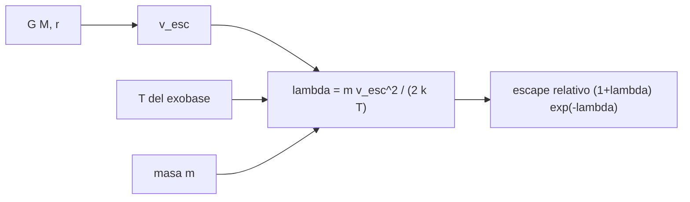

# B54-C11 — Escape atmosférico

<!-- nav:top -->
[🏠 Programa](../../../../README.md) · [📚 Bloque B54](../../../tronco-comun/B54-atmosferas-y-climatologia-planetaria.md) · [← Anterior: B54-C10 — Fotoquímica atmosférica](../B54-C10-fotoquimica-atmosferica/CLASE.md) · [Siguiente: B54-C12 — Interacción con radiación solar →](../B54-C12-interaccion-con-radiacion-solar/CLASE.md)
<!-- /nav -->

## 1. Ubicación, nivel y alcance

Clase 11 del bloque B54. Nivel N3. Una atmósfera se pierde cuando las moléculas más rápidas superan la velocidad de escape en lo alto. Aquí calculas la velocidad de escape de cuatro cuerpos, la contrastas con las fichas de la NASA y evalúas el **parámetro de Jeans** de H, He, N₂ y CO₂ con temperaturas de exobase **sintéticas**. Solo se trata el escape térmico.

## 2. Por qué esta clase existe

Por qué la Tierra retiene el N₂ pero pierde el H depende de una razón entre energías. La pregunta motivadora: **¿qué especies puede retener un planeta a cierta temperatura?** La decisión central: comparar la energía de escape con la energía térmica mediante `λ`.

## 3. Lo que podrás hacer al terminar

1. Calcular `v_esc = √(2GM/r)` y contrastarla con una ficha.
2. Calcular el parámetro de Jeans `λ = G M m/(k T r)`.
3. Comparar el escape relativo de varias especies con `(1 + λ) e^{−λ}/√m`.
4. Verificar que `λ` es proporcional a la masa molecular.
5. Comparar la velocidad térmica con la de escape.
6. Declarar que las temperaturas de exobase son sintéticas.

La evidencia es la **tabla de escape por especie** del ejercicio 12 (sección 20).

## 4. Con qué llegas y cómo comprobarlo

1. ¿Qué es la velocidad de escape?
2. ¿Qué es la energía cinética?
3. ¿Qué es una distribución de Maxwell?
4. ¿Qué es un valor sintético?
5. ¿Qué es una verificación?

<details>
<summary>Ver respuestas</summary>

1. La velocidad mínima para alejarse sin volver, `√(2GM/r)`. 2. `m v²/2`. 3. La distribución de velocidades de un gas en equilibrio térmico. 4. Un valor inventado para el ejemplo, no medido. 5. Comparar un cálculo con un caso independiente.
</details>

Con cuatro o cinco aciertos, sigue; si no, repasa los prerrequisitos.

## 5. Un caso de contexto y casos de referencia

Con `G` (S5), masas y radios de las fichas (S1–S4) y velocidades de escape publicadas de la Tierra (11,186 km/s) y Júpiter (59,5 km/s). Temperaturas de exobase **sintéticas**: 1000 K para la Tierra y 200 K para Marte y Venus. Es el **ejemplo conductor**.

## 6. Vocabulario

La **velocidad de escape** `v_esc` depende de la masa y el radio. El **exobase** es la altura sobre la cual las colisiones son raras. El **parámetro de Jeans** `λ = E_escape/(k T)` compara energías. El **escape de Jeans** es la pérdida de moléculas con velocidad mayor que `v_esc`. La **velocidad térmica más probable** es `√(2kT/m)`.

## 7. Modelo mental: una carrera sobre una colina

Las moléculas son corredores con velocidades dispersas; solo los más rápidos superan la colina.



*Descripción textual:* la masa y el radio dan la velocidad de escape; con la temperatura y la masa molecular se obtiene `λ`, y de él el escape térmico relativo.

Analogía: la carrera sobre la colina. Límite: los corredores no chocan entre sí; las moléculas del exobase casi no lo hacen, pero la atmósfera debajo sí.

## 8. La explicación, paso a paso

### 8.1 Velocidad de escape

`v_esc = √(2GM/r)` con `G = 6,674 30 × 10⁻¹¹` (S5): Tierra `11,186 km/s` (ficha 11,186; dif. 0,00 %), Júpiter `59,532` (ficha 59,5; dif. 0,05 %), Marte `5,027` y Venus `10,361 km/s`.

### 8.2 Parámetro de Jeans

| mundo | especie | `λ` | `e^{−λ}` |
|---|---|---|---|
| Tierra (1000 K) | H | 7,59 | 5,08 × 10⁻⁴ |
| Tierra | He | 30,12 | 8,3 × 10⁻¹⁴ |
| Tierra | N₂ | 210,80 | 2,8 × 10⁻⁹² |
| Marte (200 K) | H | 7,66 | 4,7 × 10⁻⁴ |
| Venus (200 K) | H | 32,54 | 7,4 × 10⁻¹⁵ |

El laboratorio verifica que `λ(N₂)/λ(H) = 28,014/1,008` y que `m v_esc²/2 = λ k T`. La velocidad térmica más probable del H a 1000 K es `4,06 km/s`, el `36,3 %` de `v_esc`.

### 8.3 Lectura

Con `λ ≈ 7,6` el H escapa con una fracción apreciable, mientras que el N₂ (`λ ≈ 211`) queda retenido de forma efectiva: la diferencia son decenas de órdenes de magnitud. Las temperaturas son sintéticas: el resultado muestra la mecánica, no la tasa de pérdida de ningún planeta. Los escapes no térmicos e hidrodinámicos no se modelan.

## 9. Magnitudes, símbolos y unidades

| Símbolo | Qué es | Unidad | Valor / nota |
|---|---|---|---|
| `v_esc` | velocidad de escape | km/s | 5,03 … 59,5 |
| `λ` | parámetro de Jeans | — | 7,6 … 1421 |
| `T` | temperatura del exobase (sintética) | K | 200 y 1000 |
| `m` | masa de la molécula | kg | — |
| `G` | constante de gravitación | m³ kg⁻¹ s⁻² | 6,674 30 × 10⁻¹¹ |

## 10. Convenciones y referencias

Radio medido desde el centro; temperaturas del exobase sintéticas; sin rotación ni campo magnético. Un flujo de Jeans solo se compara en forma relativa (misma densidad en el exobase).

## 11. De dónde sale lo que afirmamos

| ID | Fuente | Localizador | Respalda | Estado |
|---|---|---|---|---|
| S1 | NASA/NSSDC, *Earth Fact Sheet* | https://nssdc.gsfc.nasa.gov/planetary/factsheet/earthfact.html | presión, densidad, altura de escala, composición, albedo, irradiancia, T de cuerpo negro, gravedad, masa, radio y velocidad de escape de la Tierra | Consultada; datos de ficha; consulta 2026-11-09 |
| S2 | NASA/NSSDC, *Jupiter Fact Sheet* | https://nssdc.gsfc.nasa.gov/planetary/factsheet/jupiterfact.html | T a 1 bar, altura de escala, composición, albedo, irradiancia, T de cuerpo negro, radio, masa, gravedad, velocidad de escape y rotación de Júpiter | Consultada; datos de ficha; consulta 2026-11-09 |
| S3 | NASA/NSSDC, *Mars Fact Sheet* | https://nssdc.gsfc.nasa.gov/planetary/factsheet/marsfact.html | presión (y su rango estacional), densidad, altura de escala, T, composición, albedo, irradiancia, gravedad y masa de Marte | Consultada; datos de ficha; consulta 2026-11-09 |
| S4 | NASA/NSSDC, *Venus Fact Sheet* | https://nssdc.gsfc.nasa.gov/planetary/factsheet/venusfact.html | presión, densidad, altura de escala, T, composición, albedo, irradiancia, gravedad y masa de Venus | Consultada; datos de ficha; consulta 2026-11-09 |
| S5 | NIST, *CODATA 2022: constante de gravitación G* | https://physics.nist.gov/cgi-bin/cuu/Value?bg | G = 6,674 30(15) × 10⁻¹¹ m³ kg⁻¹ s⁻² | Consultada; consulta 2026-11-09 |
| S6 | NIST, *CODATA 2022: constante de Boltzmann k* | https://physics.nist.gov/cgi-bin/cuu/Value?k | k = 1,380 649 × 10⁻²³ J K⁻¹ (exacta) | Consultada; consulta 2026-11-09 |
| S7 | NIST, *CODATA 2022: constante de Avogadro N_A* | https://physics.nist.gov/cgi-bin/cuu/Value?na | N_A = 6,022 140 76 × 10²³ mol⁻¹ (exacta) | Consultada; consulta 2026-11-09 |

Límites: no se consultó ninguna temperatura de exobase; la comparación relativa de flujos no sustituye a una tasa de pérdida.

## 12. Cómo ver el escape

| Magnitud | Valor |
|---|---|
| `v_esc` terrestre | 11,186 km/s |
| `λ(H)` Tierra | 7,59 |
| `λ(N₂)` Tierra | 210,8 |
| `v_térmica(H)/v_esc` | 36,3 % |

Descripción larga: un gráfico de `e^{−λ}` frente a la masa molecular cae de forma casi vertical entre H y He; la tabla 8.2 lo da en números.

## 13. Ejemplo trabajado: λ del hidrógeno en la Tierra

**Paso 1 · Energía de escape.** `G M m/r` con `m = 1,008 u`.

**Paso 2 · Energía térmica.** `k T = 1.381e-20 J`.

**Paso 3 · Cociente.** `λ = 7.59`.

## 14. Distintas formas de comparar el escape

**Por `λ`:** compara energías. **Por velocidades:** `v_térmica/v_esc`. **Por flujo relativo:** `(1 + λ) e^{−λ}/√m`. Las tres ordenan las especies igual.

## 15. Práctica guiada

**Ejercicio 1 · con los pasos indicados.** Calcula `v_esc` de Marte con `M = 0,64169 × 10²⁴ kg` y `r = 3389,5 km`. *Pasos:* 8.1.

<details><summary>Solución comentada</summary>

`5.027 km/s`.
</details>

**Ejercicio 2 · con una pista.** ¿Cuánto vale `λ(He)` en la Tierra a 1000 K?

<details><summary>Solución comentada</summary>

`30.12`.
</details>

**Ejercicio 3 · casi autónomo.** ¿Cuántas veces mayor es `λ(CO₂)` que `λ(H)`? *Pista:* proporcional a la masa.

<details><summary>Solución comentada</summary>

`44,009/1,008 = 43.7`.
</details>

## 16. Práctica autónoma, transferencia e integrador

**Ejercicio 4 · autónomo.** Calcula `v_esc` de Júpiter y la diferencia con 59,5 km/s.

<details><summary>Solución comentada</summary>

`59.532 km/s`, dif. `0.05 %`.
</details>

**Ejercicio 5 · autónomo.** Si la temperatura del exobase terrestre fuera 2000 K, ¿cuánto valdría `λ(H)`?

<details><summary>Solución comentada</summary>

`3.79` (la mitad).
</details>

**Ejercicio 6 · autónomo.** ¿Qué `λ(H)` tendría Júpiter a 1000 K en su radio de 1 bar?

<details><summary>Solución comentada</summary>

`214.83`.
</details>

**Ejercicio 7 · autónomo.** ¿Por qué `e^{−λ}` cambia tanto con `λ`?

<details><summary>Solución comentada</summary>

Porque es una exponencial: pasar de 7,6 a 30 reduce el factor en diez órdenes de magnitud.
</details>

**Ejercicio 8 · autónomo.** ¿Qué fracción de `v_esc` es la velocidad térmica del N₂ a 1000 K?

<details><summary>Solución comentada</summary>

`√(2kT/m) = 0.77 km/s`, es decir `6.9 %`.
</details>

**Ejercicio 9 · transferencia.** **Transferencia.** Un colega concluye que Marte 'perdió' su atmósfera por Jeans con estos números. ¿Qué respondes?

<details><summary>Solución comentada</summary>

Que `T` es sintética y el escape de Jeans del CO₂ es despreciable (`λ ≫ 1`); la pérdida de Marte involucra otros procesos no tratados aquí.
</details>

**Ejercicio 10 · transferencia.** **Transferencia.** ¿Qué cambia si el gas tiene una cola de velocidades no maxwelliana?

<details><summary>Solución comentada</summary>

El escape sube respecto del cálculo de Jeans; el modelo es solo una referencia.
</details>

**Ejercicio 11 · transferencia.** **Transferencia.** ¿Por qué la Luna no retiene atmósfera aunque sea fría?

<details><summary>Solución comentada</summary>

Porque `v_esc` es pequeña y `λ` bajo para casi todas las especies; la retención exige `λ ≳ 30` a 1000 K con la composición del lugar.
</details>

**Ejercicio 12 · integrador.** **Integrador.** Elabora tu *tabla de escape por especie*: `v_esc`, `λ` y escape relativo para tres mundos.

<details><summary>Solución comentada</summary>

Secciones 8.1–8.3 y salida del laboratorio.
</details>

## 17. Laboratorio: velocidad de escape y parámetro de Jeans

El script [escape.py](escape.py) calcula `v_esc`, `λ` y el escape relativo (**comprueba** `v_esc` frente a las fichas con 0,2 % y la proporcionalidad de `λ`).

**Datos:** masas y velocidades de escape de las fichas NASA (S1–S4), G, k, N_A de NIST (S5–S7); temperaturas de exobase sintéticas. **Predice antes de ejecutar:** ¿Qué `λ(H)` tendrá la Tierra a 1000 K? (≈ 7,6.) **Ejecución del 2026-11-09 (Python 3.12.9):**

```text
Python 3.12.9 (biblioteca estandar)
Tierra   v_esc =  11.186 km/s (ficha 11.186 km/s, dif. 0.00 %)
Marte    v_esc =   5.027 km/s
Venus    v_esc =  10.361 km/s
Jupiter  v_esc =  59.532 km/s (ficha 59.5 km/s, dif. 0.05 %)
planeta  especie   lambda    exp(-lambda)      Jeans relativo a H
Tierra   H           7.59      5.080e-04      1.000e+00
Tierra   He         30.12      8.308e-14      2.975e-10
Tierra   N2        210.80      2.819e-92      2.597e-88
Tierra   CO2       331.16     1.508e-144     1.738e-140
Marte    H           7.66      4.716e-04      1.000e+00
Marte    He         30.41      6.185e-14      2.388e-10
Marte    N2        212.87      3.577e-93      3.553e-89
Marte    CO2       334.40     5.885e-146     7.315e-142
Venus    H          32.54      7.387e-15      1.000e+00
Venus    He        129.21      7.690e-57      2.028e-42
Venus    N2        904.32      0.000e+00      0.000e+00
Venus    CO2      1420.65      0.000e+00      0.000e+00
Tierra (T_exo sintetica 1000 K): lambda(H) = 7.59, lambda(N2) = 210.8
v_termica(H, 1000 K) = 4.06 km/s = 36.3 % de v_esc
Pruebas superadas.
```

```bash
python programa/clases/B54/B54-C11-escape-atmosferico/escape.py
```

**Límites:** solo escape térmico de Jeans; T sintéticas.

## 18. Errores frecuentes y cómo corregirlos

**Usar el radio de la superficie como si fuera el del exobase.** Se corrige con la sección 10: es una aproximación declarada.

**Tomar los T sintéticos como datos.** Se corrige con la sección 5.

**Comparar flujos absolutos entre planetas.** Se corrige con 8.3.

**Olvidar convertir u a kg.** Se corrige con la sección 9.

## 19. Cómo sabrás que vas bien

Tras la sección 8: ¿qué `λ` esperabas para el H y cuál obtuviste? Si dudas, repasa el ejemplo 13. Tras el laboratorio: ¿qué comprueba? (ver la sección 17).

## 20. Qué entregas y cómo se evalúa

El producto es tu **tabla de escape por especie** (ejercicio 12).

| Criterio | Inicial | En desarrollo | Logrado | Destacado |
|---|---|---|---|---|
| Conceptos | Los confunde | Parciales | Velocidad de escape y parámetro de Jeans | Explica los límites |
| Cálculo | Sin unidades | Con errores | Tablas completas con unidades | Calcula casos nuevos |
| Numérico | Sin comprobar | Un caso | Contraste con el caso analítico o la ficha | Interpreta las diferencias |
| Fuentes | Sin fuente | Sin fecha | Fuentes con fecha | Declara lo sintético y lo no consultado |
| Límites | No los nombra | Uno | Tres | Discute qué falta del modelo |

**Condiciones críticas (no se compensan con promedio):** rotular las temperaturas como sintéticas; no concluir historias de pérdida; citar solo lo consultado.

## 21. Ética, seguridad y límites

Clase educativa: escape térmico solamente. Accesibilidad: tablas equivalentes a las gráficas, fórmulas en texto, ejercicios sin conexión.

## 22. Para cerrar y seguir

El H tiene `λ ≈ 7,6` y el N₂ `λ ≈ 211` en una Tierra sintética de 1000 K. Queda una pregunta: ¿cuánta energía solar llega y cómo se atenúa?

**Glosario español–inglés.** velocidad de escape · *escape velocity*; parámetro de Jeans · *Jeans parameter*; exobase · *exobase*; escape térmico · *thermal escape*; velocidad térmica · *thermal speed*.

**Continuidad.** [B54-C12](../B54-C12-interaccion-con-radiacion-solar/CLASE.md) estudia la interacción con la radiación solar.

**Referencias:** ver sección 11.

<!-- nav:bottom -->
---

[← Anterior: B54-C10 — Fotoquímica atmosférica](../B54-C10-fotoquimica-atmosferica/CLASE.md) · [📚 Bloque B54](../../../tronco-comun/B54-atmosferas-y-climatologia-planetaria.md) · [Siguiente: B54-C12 — Interacción con radiación solar →](../B54-C12-interaccion-con-radiacion-solar/CLASE.md)
<!-- /nav -->
