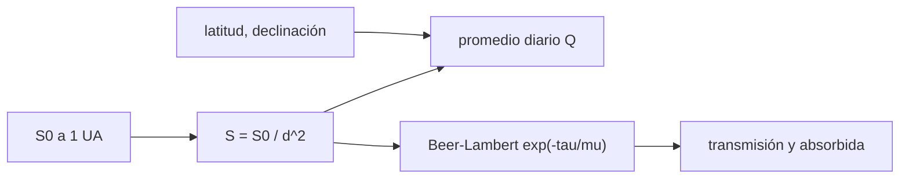

# B54-C12 — Interacción con radiación solar

<!-- nav:top -->
[🏠 Programa](../../../../README.md) · [📚 Bloque B54](../../../tronco-comun/B54-atmosferas-y-climatologia-planetaria.md) · [← Anterior: B54-C11 — Escape atmosférico](../B54-C11-escape-atmosferico/CLASE.md) · [Siguiente: B54-C13 — Atmósfera de Venus →](../B54-C13-atmosfera-de-venus/CLASE.md)
<!-- /nav -->

## 1. Ubicación, nivel y alcance

Clase 12 del bloque B54. Nivel N3. Calculas cuánta radiación solar llega a cada planeta (inverso del cuadrado), cuánta recibe una latitud en un día y cómo se atenúa al atravesar una atmósfera con opacidad `τ` (Beer–Lambert). Las irradiancias de Venus y Marte de las fichas sirven de contraste independiente. Incluye las medidas de seguridad para observar el Sol.

## 2. Por qué esta clase existe

La radiación solar es la fuente de energía de todo el bloque. La pregunta motivadora: **¿cuánta energía llega a un punto y cuánta alcanza el suelo?** La decisión central: elegir entre irradiancia instantánea, promedio diario y transmisión.

## 3. Lo que podrás hacer al terminar

1. Aplicar `S = S₀/d²` y contrastar con las fichas.
2. Calcular la insolación diaria media en función de la latitud y la declinación.
3. Verificar los casos límite: ecuador en el equinoccio y polo en el equinoccio.
4. Integrar Beer–Lambert numéricamente y contrastarla con `e^{−τ/μ}`.
5. Interpretar la transmisión y la fracción absorbida.
6. Enunciar la regla de seguridad para observar el Sol.

La evidencia es la **ficha de insolación y atenuación** del ejercicio 12 (sección 20).

## 4. Con qué llegas y cómo comprobarlo

1. ¿Qué es la irradiancia?
2. ¿Qué es la declinación solar?
3. ¿Qué es el ángulo cenital?
4. ¿Qué es la profundidad óptica?
5. ¿Qué es una verificación?

<details>
<summary>Ver respuestas</summary>

1. El flujo de potencia por unidad de área, en W/m². 2. La latitud del punto subsolar. 3. El ángulo del Sol con la vertical. 4. `τ = −ln(I/I₀)` a lo largo de un camino. 5. Comparar un cálculo con un caso independiente.
</details>

Con cuatro o cinco aciertos, sigue; si no, repasa los prerrequisitos.

## 5. Un caso de contexto y casos de referencia

Con `S₀ = 1361,0 W/m²` a 1 UA (S1) y los semiejes `0,72333199` (Venus, S2) y `1,52366231 UA` (Marte, S3) calculas `S` y lo comparas con las fichas (2601,3 y 586,2 W/m²). Opacidades `τ` **sintéticas**. Es el **ejemplo conductor**.

## 6. Vocabulario

La **irradiancia solar** cae con el cuadrado de la distancia. La **insolación diaria media** `Q` es el promedio de 24 h en una latitud. La **transmisión** `T = e^{−τ/μ}` con `μ = cos χ` es la fracción que atraviesa. La **fracción absorbida** es `1 − T`. La **masa de aire** relativa es `1/μ`.

## 7. Modelo mental: una linterna que se aleja

Una linterna ilumina menos una pared cuanto más lejos está, porque la luz se reparte en un área mayor.



*Descripción textual:* la irradiancia a 1 UA y la distancia dan `S`; con latitud y declinación se obtiene `Q`; con la opacidad y el ángulo cenital, la transmisión.

Analogía: la linterna que se aleja. Límite: la linterna tiene un haz dirigido; el Sol ilumina de forma casi paralela.

## 8. La explicación, paso a paso

### 8.1 Inverso del cuadrado

| mundo | `a` (UA) | `S` calculada (W/m²) | `S` ficha | dif. |
|---|---|---|---|---|
| Venus | 0,72333199 | 2601,25 | 2601,3 | 0,002 % |
| Tierra | 1,00000000 | 1361,00 | 1361,0 | 0,000 % |
| Marte | 1,52366231 | 586,25 | 586,2 | 0,008 % |

### 8.2 Insolación diaria media (Tierra, `S = 1361`)

| latitud | equinoccio (W/m²) | solsticio, δ = 23,44° (W/m²) |
|---|---|---|
| 0° | 433,22 | 397,47 |
| 30° | 375,18 | 490,41 |
| 60° | 216,61 | 492,45 |
| 90° | 0,00 | 541,39 |

El laboratorio comprueba `Q(0°, δ=0) = S/π` y `Q(90°, δ=0) = 0`.

### 8.3 Atenuación

La integral numérica de `dI = −I dτ/μ` con `τ = 0,3` y `χ = 60°` da `0,548811`, frente al analítico `0,548812`. Transmisión y fracción absorbida: `τ = 0,1`, `χ = 0°`: `0,9048` y `0,0952`; `τ = 1`, `χ = 60°`: `0,1353` y `0,8647`; `τ = 5`, `χ = 0°`: `0,0067` y `0,9933`. Los `τ` son sintéticos.

### 8.4 Seguridad

Mirar el Sol sin un filtro solar certificado puede dañar la retina de forma permanente. Para observar el Sol solo se usan filtros certificados en el frente del instrumento o proyección; nunca gafas improvisadas, ni binoculares o telescopios sin filtro.

## 9. Magnitudes, símbolos y unidades

| Símbolo | Qué es | Unidad | Valor / nota |
|---|---|---|---|
| `S` | irradiancia | W/m² | 586,2 … 2601,3 |
| `Q` | insolación diaria media | W/m² | 0 … 541,4 |
| `τ` | profundidad óptica (sintética) | — | 0,1 … 5 |
| `μ` | `cos χ` | — | 0,5 … 1 |
| `d` | distancia al Sol | UA | 0,723 … 1,524 |

## 10. Convenciones y referencias

Órbita circular al semieje; `S₀` a 1 UA de la ficha de la Tierra; atmósfera plano-paralela. Latitud positiva al norte; declinación en grados. Los `τ` son sintéticos.

## 11. De dónde sale lo que afirmamos

| ID | Fuente | Localizador | Respalda | Estado |
|---|---|---|---|---|
| S1 | NASA/NSSDC, *Earth Fact Sheet* | https://nssdc.gsfc.nasa.gov/planetary/factsheet/earthfact.html | presión, densidad, altura de escala, composición, albedo, irradiancia, T de cuerpo negro, gravedad, masa, radio y velocidad de escape de la Tierra | Consultada; datos de ficha; consulta 2026-11-09 |
| S2 | NASA/NSSDC, *Venus Fact Sheet* | https://nssdc.gsfc.nasa.gov/planetary/factsheet/venusfact.html | presión, densidad, altura de escala, T, composición, albedo, irradiancia, gravedad y masa de Venus | Consultada; datos de ficha; consulta 2026-11-09 |
| S3 | NASA/NSSDC, *Mars Fact Sheet* | https://nssdc.gsfc.nasa.gov/planetary/factsheet/marsfact.html | presión (y su rango estacional), densidad, altura de escala, T, composición, albedo, irradiancia, gravedad y masa de Marte | Consultada; datos de ficha; consulta 2026-11-09 |

Límites: el semieje orbital es de ficha; se omiten la excentricidad y la refracción; la fórmula de `Q` es estándar y su derivación no se contrastó con una fuente.

## 12. Cómo ver la radiación solar

| Magnitud | Valor |
|---|---|
| `S` de Venus | 2601,25 W/m² |
| `Q` ecuatorial en equinoccio | 433,22 W/m² |
| `Q` polar en el solsticio | 541,39 W/m² |
| transmisión `τ=1`, `χ=60°` | 0,1353 |

Descripción larga: un gráfico de `Q` frente a la latitud muestra un máximo ecuatorial en el equinoccio y uno polar en el solsticio; la tabla 8.2 da los números.

## 13. Ejemplo trabajado: S en Marte

**Paso 1 · Distancia al cuadrado.** `1,52366231² = 2.32155`.

**Paso 2 · Irradiancia.** `1361,0/2.32155 = 586.25 W/m²`.

**Paso 3 · Contraste.** La ficha da `586,2`: dif. `0,008 %`.

## 14. Distintas formas de dar la insolación

**Instantánea:** `S cos χ`. **Diaria media:** `Q`. **Anual media por latitud:** promedia `Q` sobre la órbita (no se hace aquí). Cada una responde a una pregunta distinta.

## 15. Práctica guiada

**Ejercicio 1 · con los pasos indicados.** Calcula `S` a 0,5 UA. *Pasos:* 8.1.

<details><summary>Solución comentada</summary>

`5444 W/m²`.
</details>

**Ejercicio 2 · con una pista.** ¿Cuántas veces más recibe Venus que la Tierra?

<details><summary>Solución comentada</summary>

`2601,3/1361 = 1.91`.
</details>

**Ejercicio 3 · casi autónomo.** Calcula la transmisión de `τ = 0,5` con el Sol en el cenit.

<details><summary>Solución comentada</summary>

`0.6065`.
</details>

## 16. Práctica autónoma, transferencia e integrador

**Ejercicio 4 · autónomo.** Calcula la transmisión de `τ = 0,5` con `χ = 60°`.

<details><summary>Solución comentada</summary>

`0.3679`.
</details>

**Ejercicio 5 · autónomo.** ¿Qué `τ` absorbe la mitad de la luz en el cenit?

<details><summary>Solución comentada</summary>

`ln 2 = 0.693`.
</details>

**Ejercicio 6 · autónomo.** Calcula `Q` a 45° en el equinoccio.

<details><summary>Solución comentada</summary>

`306.33 W/m²`.
</details>

**Ejercicio 7 · autónomo.** ¿Por qué `Q` polar del solsticio supera la ecuatorial?

<details><summary>Solución comentada</summary>

Porque en verano el Sol está sobre el horizonte las 24 h; la baja altura se compensa con el día continuo.
</details>

**Ejercicio 8 · autónomo.** ¿Qué `S` recibiría un planeta a 5,204 UA?

<details><summary>Solución comentada</summary>

`50.26 W/m²` (la ficha de Júpiter da 50,26).
</details>

**Ejercicio 9 · transferencia.** **Transferencia.** Un colega observa el Sol con unas gafas de sol 'muy oscuras'. ¿Qué le dices?

<details><summary>Solución comentada</summary>

Que no sirven: solo filtros solares certificados protegen la retina; la luz infrarroja y ultravioleta atraviesa gafas comunes.
</details>

**Ejercicio 10 · transferencia.** **Transferencia.** ¿Qué cambiaría para un planeta con órbita muy excéntrica?

<details><summary>Solución comentada</summary>

`S` varía con `d²` a lo largo de la órbita; habría que promediar sobre ella.
</details>

**Ejercicio 11 · transferencia.** **Transferencia.** ¿Por qué el `τ` sintético no permite afirmar cuánta luz llega al suelo de Venus?

<details><summary>Solución comentada</summary>

Porque `τ` no es medido; el cálculo muestra la mecánica de la atenuación, no el flujo real de la superficie.
</details>

**Ejercicio 12 · integrador.** **Integrador.** Elabora tu *ficha de insolación y atenuación*: `S` de tres mundos, tabla de `Q` y tabla de transmisión.

<details><summary>Solución comentada</summary>

Secciones 8.1–8.4 y salida del laboratorio.
</details>

## 17. Laboratorio: inverso del cuadrado, insolación y Beer–Lambert

El script [radiacion_solar.py](radiacion_solar.py) calcula `S`, `Q` y la transmisión (**comprueba** `S` frente a las fichas con 0,1 % y los casos límite de `Q`).

**Datos:** irradiancia y semiejes de las fichas NASA (S1–S3); `τ` sintéticos. **Predice antes de ejecutar:** ¿Qué `S` tendrá Marte? (≈ 586 W/m².) **Ejecución del 2026-11-09 (Python 3.12.9):**

```text
Python 3.12.9 (biblioteca estandar)
Venus   a = 0.72333199 UA: S =  2601.25 W/m2 (ficha 2601.3; dif. 0.002 %)
Tierra  a = 1.00000000 UA: S =  1361.00 W/m2 (ficha 1361.0; dif. 0.000 %)
Marte   a = 1.52366231 UA: S =   586.25 W/m2 (ficha 586.2; dif. 0.008 %)
Insolacion diaria media Q [W/m2] (S = 1361, Tierra, declinacion 0 y +23.44 grados):
  lat  0: equinoccio  433.22   solsticio  397.47
  lat 30: equinoccio  375.18   solsticio  490.41
  lat 60: equinoccio  216.61   solsticio  492.45
  lat 90: equinoccio    0.00   solsticio  541.39
Beer-Lambert (tau = 0.3, chi = 60.0 grados): numerico = 0.548811 ; analitico = 0.548812
tau   chi   transmision   fraccion absorbida
 0.1     0       0.9048         0.0952
 0.1    60       0.8187         0.1813
 1.0     0       0.3679         0.6321
 1.0    60       0.1353         0.8647
 5.0     0       0.0067         0.9933
Pruebas superadas.
```

```bash
python programa/clases/B54/B54-C12-interaccion-con-radiacion-solar/radiacion_solar.py
```

**Límites:** órbita circular y atmósfera plano-paralela.

## 18. Errores frecuentes y cómo corregirlos

**Confundir irradiancia con insolación diaria.** Se corrige con la sección 6.

**Olvidar el `1/μ` de la trayectoria.** Se corrige con 8.3.

**Usar grados en funciones que esperan radianes.** Se corrige con la sección 10.

**Observar el Sol sin filtro.** Se corrige con 8.4.

## 19. Cómo sabrás que vas bien

Tras la sección 8: ¿qué `S` esperabas para Venus y cuál obtuviste? Si dudas, repasa el ejemplo 13. Tras el laboratorio: ¿qué comprueba? (ver la sección 17).

## 20. Qué entregas y cómo se evalúa

El producto es tu **ficha de insolación y atenuación** (ejercicio 12).

| Criterio | Inicial | En desarrollo | Logrado | Destacado |
|---|---|---|---|---|
| Conceptos | Los confunde | Parciales | Inverso del cuadrado, insolación y Beer–Lambert | Explica los límites |
| Cálculo | Sin unidades | Con errores | Tablas completas con unidades | Calcula casos nuevos |
| Numérico | Sin comprobar | Un caso | Contraste con el caso analítico o la ficha | Interpreta las diferencias |
| Fuentes | Sin fuente | Sin fecha | Fuentes con fecha | Declara lo sintético y lo no consultado |
| Límites | No los nombra | Uno | Tres | Discute qué falta del modelo |

**Condiciones críticas (no se compensan con promedio):** rotular `τ` como sintético; respetar la seguridad al observar el Sol; citar solo lo consultado.

## 21. Ética, seguridad y límites

Seguridad: nunca mirar el Sol sin filtro solar certificado (ver 8.4). Clase educativa: órbita circular. Accesibilidad: tablas equivalentes a las gráficas, fórmulas en texto, ejercicios sin conexión.

## 22. Para cerrar y seguir

El inverso del cuadrado reproduce las fichas de Venus y Marte con menos de 0,01 %. Queda una pregunta: ¿cómo es la atmósfera de Venus?

**Glosario español–inglés.** irradiancia · *irradiance*; insolación · *insolation*; declinación solar · *solar declination*; Beer–Lambert · *Beer–Lambert law*; ángulo cenital · *zenith angle*.

**Continuidad.** [B54-C13](../B54-C13-atmosfera-de-venus/CLASE.md) estudia la atmósfera de Venus.

**Referencias:** ver sección 11.

<!-- nav:bottom -->
---

[← Anterior: B54-C11 — Escape atmosférico](../B54-C11-escape-atmosferico/CLASE.md) · [📚 Bloque B54](../../../tronco-comun/B54-atmosferas-y-climatologia-planetaria.md) · [Siguiente: B54-C13 — Atmósfera de Venus →](../B54-C13-atmosfera-de-venus/CLASE.md)
<!-- /nav -->
