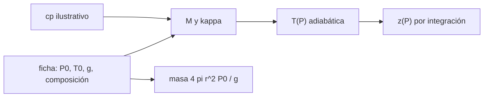

# B54-C13 — Atmósfera de Venus

<!-- nav:top -->
[🏠 Programa](../../../../README.md) · [📚 Bloque B54](../../../tronco-comun/B54-atmosferas-y-climatologia-planetaria.md) · [← Anterior: B54-C12 — Interacción con radiación solar](../B54-C12-interaccion-con-radiacion-solar/CLASE.md) · [Siguiente: B54-C14 — Atmósfera de Marte →](../B54-C14-atmosfera-de-marte/CLASE.md)
<!-- /nav -->

## 1. Ubicación, nivel y alcance

Clase 13 del bloque B54. Nivel N3. Venus tiene una atmósfera de CO₂ de 92 bar en superficie. Reúnes lo aprendido —hidrostática, gas ideal, adiabata— para estimar su estructura bajo el nivel de 1 bar con un `c_p` **ilustrativo**, su densidad de superficie y la masa de la atmósfera. No se afirma ninguna temperatura a una altura concreta como dato.

## 2. Por qué esta clase existe

Venus es el caso extremo de atmósfera densa y caliente. La pregunta motivadora: **¿cómo se enfría su atmósfera con la altura y cuánto pesa?** La decisión central: usar una adiabata de CO₂ con un `c_p` constante, sabiendo que es una aproximación.

## 3. Lo que podrás hacer al terminar

1. Calcular la masa molar y la altura de escala de Venus y contrastar con la ficha.
2. Integrar la adiabata y obtener `T(P)` y `z(P)`.
3. Verificar la integración numérica contra la fórmula cerrada.
4. Calcular la densidad de superficie por gas ideal.
5. Calcular la masa de la atmósfera `4πr²P₀/g`.
6. Declarar cómo depende el resultado del `c_p` supuesto.

La evidencia es la **ficha de la atmósfera de Venus** del ejercicio 12 (sección 20).

## 4. Con qué llegas y cómo comprobarlo

1. ¿Qué es una adiabata?
2. ¿Qué es la altura de escala?
3. ¿Qué es el equilibrio hidrostático?
4. ¿Qué es un valor ilustrativo?
5. ¿Qué es una verificación?

<details>
<summary>Ver respuestas</summary>

1. Una evolución sin intercambio de calor (B54-C05). 2. `H = R T/(M g)` (B54-C01). 3. El balance entre peso y presión. 4. Un valor propuesto para el ejemplo, no medido. 5. Comparar un cálculo con un caso independiente.
</details>

Con cuatro o cinco aciertos, sigue; si no, repasa los prerrequisitos.

## 5. Un caso de contexto y casos de referencia

Ficha de Venus (S1): `P₀ = 92 bar`, `T = 737 K`, `g = 8,87 m/s²`, radio `6051,8 km`, 96,5 % CO₂ y 3,5 % N₂, `H = 15,9 km`, `ρ ≈ 65 kg/m³`. Con `c_p = 1100 J/(kg K)` **ilustrativo** y no consultado. Es el **ejemplo conductor**.

## 6. Vocabulario

La **adiabata** `T = T₀ (P/P₀)^κ` con `κ = R/(M c_p)`. La **altura sobre la superficie** sigue de `dz = −(c_p/g) dT`. La **masa de la atmósfera** es la columna `P₀/g` por la superficie `4πr²`. El **CO₂ supercrítico** es un fluido por encima de su punto crítico (no se trata aquí; el gas ideal es una aproximación).

## 7. Modelo mental: una escalera de temperatura

Bajar por una atmósfera adiabática es bajar una escalera de temperatura regular: cada kilómetro sube la temperatura lo mismo.



*Descripción textual:* la ficha y el `c_p` ilustrativo dan `κ`; con él se obtiene `T(P)` y por integración `z(P)`; la ficha da también la masa de la atmósfera.

Analogía: la escalera. Límite: los peldaños no son regulares si `c_p` cambia con la temperatura, como ocurre con el CO₂.

## 8. La explicación, paso a paso

### 8.1 Parámetros

`M = 43,449 g/mol`, `κ = 0,1740`, `Γ = g/c_p = 8,06 K/km` y `H(737 K) = 15,90 km` (ficha 15,9 km; dif. 0,00 %). La `Γ` del ejemplo depende del `c_p`: con `850 J/(kg K)` sería `10,44 K/km` (B54-C05).

### 8.2 Adiabata

| `P` (bar) | `T` (K) | `z` numérica (km) | `z` analítica (km) |
|---|---|---|---|
| 92 | 737,0 | 0,00 | 0,00 |
| 50 | 662,8 | 9,20 | 9,20 |
| 10 | 501,0 | 29,27 | 29,27 |
| 1 | 335,6 | 49,78 | 49,78 |
| 0,1 | 224,8 | 63,51 | 63,51 |

La integración (Simpson, 200 000 pasos) coincide con la fórmula cerrada en todos los casos.

### 8.3 Densidad y masa

`ρ = P M/(R T) = 65,23 kg/m³` (ficha ~65). La masa de la atmósfera `4πr²P₀/g` es `4,774 × 10²⁰ kg`, unas 94 veces la terrestre si se toma `5,1 × 10¹⁸ kg` (valor estándar **no consultado**). Una atmósfera isoterma a 737 K llegaría a `1 bar` a `71,9 km`, más arriba que la adiabata (`49,8 km`): la diferencia se debe a que la adiabata es más fría con la altura.

### 8.4 Lectura

Las temperaturas y alturas son consecuencia de un `c_p` supuesto y del gas ideal a 92 bar; no son perfiles medidos de Venus.

## 9. Magnitudes, símbolos y unidades

| Símbolo | Qué es | Unidad | Valor / nota |
|---|---|---|---|
| `κ` | exponente adiabático | — | 0,1740 (con `c_p` = 1100) |
| `Γ` | gradiente adiabático | K/km | 8,06 (ilustrativo) |
| `z` | altura sobre la superficie | km | 0 … 63,5 |
| `M_atm` | masa de la atmósfera | kg | 4,774 × 10²⁰ |
| `ρ` | densidad de superficie | kg/m³ | 65,23 |

## 10. Convenciones y referencias

Superficie como origen de `z`; `P` en Pa (se tabula en bar); `T` en K. CO₂ ideal con `c_p` constante; sin nubes ni variación de `g`.

## 11. De dónde sale lo que afirmamos

| ID | Fuente | Localizador | Respalda | Estado |
|---|---|---|---|---|
| S1 | NASA/NSSDC, *Venus Fact Sheet* | https://nssdc.gsfc.nasa.gov/planetary/factsheet/venusfact.html | presión, densidad, altura de escala, T, composición, albedo, irradiancia, gravedad y masa de Venus | Consultada; datos de ficha; consulta 2026-11-09 |
| S2 | NIST, *CODATA 2022: constante de Boltzmann k* | https://physics.nist.gov/cgi-bin/cuu/Value?k | k = 1,380 649 × 10⁻²³ J K⁻¹ (exacta) | Consultada; consulta 2026-11-09 |
| S3 | NIST, *CODATA 2022: constante de Avogadro N_A* | https://physics.nist.gov/cgi-bin/cuu/Value?na | N_A = 6,022 140 76 × 10²³ mol⁻¹ (exacta) | Consultada; consulta 2026-11-09 |

Límites: el `c_p` de 1100 J/(kg K) y la masa atmosférica terrestre son valores no consultados; a 92 bar y 737 K el CO₂ no es ideal y su `c_p` varía.

## 12. Cómo ver la atmósfera de Venus

| Magnitud | Valor |
|---|---|
| `T` a 1 bar (adiabata) | 335,6 K |
| `z` a 1 bar | 49,78 km |
| `ρ` de superficie | 65,23 kg/m³ |
| masa de la atmósfera | 4,774 × 10²⁰ kg |

Descripción larga: una gráfica de `z` frente a `T` es casi una recta de pendiente `−1/Γ`; la tabla 8.2 da los puntos.

## 13. Ejemplo trabajado: temperatura a 10 bar

**Paso 1 · Razón.** `P/P₀ = 10/92 = 0.1087`.

**Paso 2 · Exponente.** `κ = 0.1740`.

**Paso 3 · Temperatura.** `737 × 0.1087^0.1740 = 501.0 K`.

## 14. Distintas formas de estimar la estructura

**Adiabata de gas ideal:** lo que hace la clase. **Con ecuación de estado real:** corrige el `c_p` y la densidad (no se hace). **Con perfiles medidos:** requieren datos de sondas, no consultados aquí. Los resultados son estimaciones.

## 15. Práctica guiada

**Ejercicio 1 · con los pasos indicados.** Calcula `Γ = g/c_p` con `g = 8,87` y `c_p = 1100`. *Pasos:* 8.1.

<details><summary>Solución comentada</summary>

`8.06 K/km`.
</details>

**Ejercicio 2 · con una pista.** Calcula `T` a 50 bar. *Pista:* 8.2.

<details><summary>Solución comentada</summary>

`662.8 K`.
</details>

**Ejercicio 3 · casi autónomo.** Calcula la altura a 50 bar con `(c_p T₀/g)(1 − (P/P₀)^κ)`.

<details><summary>Solución comentada</summary>

`9.20 km`.
</details>

## 16. Práctica autónoma, transferencia e integrador

**Ejercicio 4 · autónomo.** ¿Cuánto vale `H` si `T = 500 K`?

<details><summary>Solución comentada</summary>

`10.79 km`.
</details>

**Ejercicio 5 · autónomo.** ¿Cuántas veces es la columna de Venus la de la Tierra?

<details><summary>Solución comentada</summary>

`100`.
</details>

**Ejercicio 6 · autónomo.** Calcula la altura a 1 bar y compárala con la isoterma `H ln 92`.

<details><summary>Solución comentada</summary>

Adiabata `49.78 km`; isoterma `71.9 km`.
</details>

**Ejercicio 7 · autónomo.** Si `c_p` fuera 850, ¿cuál sería `κ`?

<details><summary>Solución comentada</summary>

`0.2251`.
</details>

**Ejercicio 8 · autónomo.** ¿Por qué la densidad de Venus por gas ideal coincide con la ficha?

<details><summary>Solución comentada</summary>

Porque a esos `P` y `T` la desviación del gas ideal es pequeña frente a la precisión de «~65»; no prueba que el gas ideal valga siempre.
</details>

**Ejercicio 9 · transferencia.** **Transferencia.** Un colega dice que 'Venus tiene 335,6 K a 1 bar'. ¿Qué le respondes?

<details><summary>Solución comentada</summary>

Que es un resultado de una adiabata con `c_p` supuesto, no una medición; el valor real depende de perfiles medidos no consultados.
</details>

**Ejercicio 10 · transferencia.** **Transferencia.** ¿Qué cambiaría si hubiera nubes que liberan calor latente?

<details><summary>Solución comentada</summary>

El gradiente dejaría de ser adiabático seco en esas capas y `T(P)` cambiaría.
</details>

**Ejercicio 11 · transferencia.** **Transferencia.** ¿Por qué se compara con la isoterma?

<details><summary>Solución comentada</summary>

Porque da una cota superior de la altura (la atmósfera real se enfría con la altura y su `H` decrece).
</details>

**Ejercicio 12 · integrador.** **Integrador.** Elabora tu *ficha de la atmósfera de Venus*: `M`, `κ`, tabla `T(P)`, `z(P)`, `ρ` y masa.

<details><summary>Solución comentada</summary>

Secciones 8.1–8.4 y salida del laboratorio.
</details>

## 17. Laboratorio: adiabata, densidad y masa de la atmósfera de Venus

El script [venus.py](venus.py) calcula la adiabata, `z(P)` por integración y la masa de la atmósfera (**comprueba** `H` dentro de 1 % de la ficha y `z` numérica frente a analítica).

**Datos:** ficha NASA/NSSDC de Venus (S1) y constantes de NIST (S2, S3); `c_p` ilustrativo. **Predice antes de ejecutar:** ¿Qué `T` tendrá la adiabata a 1 bar? (≈ 336 K.) **Ejecución del 2026-11-09 (Python 3.12.9):**

```text
Python 3.12.9 (biblioteca estandar)
M = 43.449 g/mol ; kappa = R/(M cp) = 0.1740 ; Gamma_ad = g/cp = 8.06 K/km
H(737 K) = 15.90 km (ficha 15.9 km, dif. 0.00 %)
P [bar]   T adiabatica [K]   z numerica [km]   z analitica [km]
   92.0             737.0            0.00             0.00
   50.0             662.8            9.20             9.20
   10.0             501.0           29.27            29.27
    1.0             335.6           49.78            49.78
    0.1             224.8           63.51            63.51
rho(superficie, gas ideal) = 65.23 kg/m3 (ficha ~65)
Masa de la atmosfera = 4 pi r^2 P0/g = 4.774e+20 kg ; relativa a la terrestre (5.1e18 kg, valor ilustrativo no consultado): 94
Altura isoterma ln(92) H = 71.9 km (cota: la adiabata es mas fria con la altura)
Pruebas superadas.
```

```bash
python programa/clases/B54/B54-C13-atmosfera-de-venus/venus.py
```

**Límites:** CO₂ ideal con `c_p` constante.

## 18. Errores frecuentes y cómo corregirlos

**Presentar la adiabata como perfil medido.** Se corrige con 8.4.

**Olvidar convertir bar a Pa.** Se corrige con la sección 10.

**Usar el `c_p` del aire.** Se corrige con la sección 5.

**Creer que el gas ideal basta en Venus.** Se corrige con la sección 11.

## 19. Cómo sabrás que vas bien

Tras la sección 8: ¿qué `T` esperabas a 10 bar y cuál obtuviste? Si dudas, repasa el ejemplo 13. Tras el laboratorio: ¿qué comprueba? (ver la sección 17).

## 20. Qué entregas y cómo se evalúa

El producto es tu **ficha de la atmósfera de Venus** (ejercicio 12).

| Criterio | Inicial | En desarrollo | Logrado | Destacado |
|---|---|---|---|---|
| Conceptos | Los confunde | Parciales | Adiabata y estructura de Venus | Explica los límites |
| Cálculo | Sin unidades | Con errores | Tablas completas con unidades | Calcula casos nuevos |
| Numérico | Sin comprobar | Un caso | Contraste con el caso analítico o la ficha | Interpreta las diferencias |
| Fuentes | Sin fuente | Sin fecha | Fuentes con fecha | Declara lo sintético y lo no consultado |
| Límites | No los nombra | Uno | Tres | Discute qué falta del modelo |

**Condiciones críticas (no se compensan con promedio):** rotular el `c_p` como ilustrativo; no presentar la adiabata como medición; citar solo lo consultado.

## 21. Ética, seguridad y límites

Clase educativa: CO₂ ideal. Accesibilidad: tablas equivalentes a las gráficas, fórmulas en texto, ejercicios sin conexión.

## 22. Para cerrar y seguir

La atmósfera de Venus pesa unas 94 veces la terrestre y, con un `c_p` supuesto, llega a 1 bar a unos 50 km. Queda una pregunta: ¿cómo es una atmósfera delgada como la de Marte?

**Glosario español–inglés.** adiabata · *adiabat*; altura de escala · *scale height*; densidad · *density*; masa atmosférica · *atmospheric mass*; gas real · *real gas*.

**Continuidad.** [B54-C14](../B54-C14-atmosfera-de-marte/CLASE.md) estudia la atmósfera de Marte.

**Referencias:** ver sección 11.

<!-- nav:bottom -->
---

[← Anterior: B54-C12 — Interacción con radiación solar](../B54-C12-interaccion-con-radiacion-solar/CLASE.md) · [📚 Bloque B54](../../../tronco-comun/B54-atmosferas-y-climatologia-planetaria.md) · [Siguiente: B54-C14 — Atmósfera de Marte →](../B54-C14-atmosfera-de-marte/CLASE.md)
<!-- /nav -->
