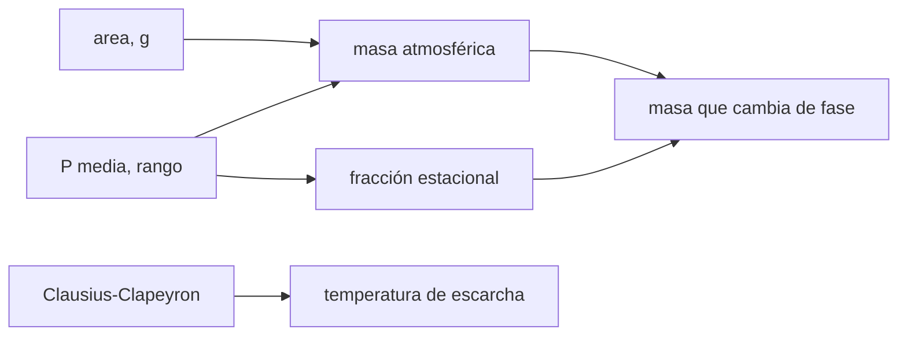

# B54-C14 — Atmósfera de Marte

<!-- nav:top -->
[🏠 Programa](../../../../README.md) · [📚 Bloque B54](../../../tronco-comun/B54-atmosferas-y-climatologia-planetaria.md) · [← Anterior: B54-C13 — Atmósfera de Venus](../B54-C13-atmosfera-de-venus/CLASE.md) · [Siguiente: B54-C15 — Atmósferas de gigantes gaseosos →](../B54-C15-atmosferas-de-gigantes-gaseosos/CLASE.md)
<!-- /nav -->

## 1. Ubicación, nivel y alcance

Clase 14 del bloque B54. Nivel N3. Marte tiene una atmósfera de CO₂ de unos 6 mb. Calculas su masa, el orden de magnitud de la fracción que cambia de fase con las estaciones, la temperatura de escarcha del CO₂ y una escala de tiempo radiativa, todo con las cifras de la ficha de la NASA y valores estándar **no consultados** donde se indica.

## 2. Por qué esta clase existe

La presión marciana varía unas decenas de por ciento durante el año porque parte del CO₂ se condensa en los casquetes polares. La pregunta motivadora: **¿cuánta masa de CO₂ participa en ese ciclo?** La decisión central: usar el rango de presión de la ficha como orden de magnitud.

## 3. Lo que podrás hacer al terminar

1. Calcular la masa de la atmósfera `4πr²P/g`.
2. Estimar la fracción estacional `(P_max − P_min)/P_media`.
3. Estimar el espesor de hielo seco equivalente sobre un casquete sintético.
4. Calcular la temperatura de escarcha del CO₂ con Clausius–Clapeyron.
5. Calcular `H` a distintas temperaturas.
6. Declarar los límites del rango de presión de la ficha.

La evidencia es la **ficha de la atmósfera de Marte** del ejercicio 12 (sección 20).

## 4. Con qué llegas y cómo comprobarlo

1. ¿Qué es una columna de masa?
2. ¿Qué es Clausius–Clapeyron?
3. ¿Qué es el hielo seco?
4. ¿Qué es un valor ilustrativo?
5. ¿Qué es una verificación?

<details>
<summary>Ver respuestas</summary>

1. `P/g`, la masa de gas por unidad de área. 2. La relación entre presión de saturación y temperatura (B54-C08). 3. CO₂ sólido. 4. Un valor propuesto para el ejemplo, no medido. 5. Comparar un cálculo con un caso independiente.
</details>

Con cuatro o cinco aciertos, sigue; si no, repasa los prerrequisitos.

## 5. Un caso de contexto y casos de referencia

Ficha de Marte (S1): presión `6,36 mb` (variable de `4,0` a `8,7 mb` según la estación), `T ≈ 214 K`, `g = 3,73 m/s²`, radio medio `3389,5 km`, 95,1 % CO₂. Calor latente y referencia de sublimación del CO₂ estándar **no consultados**. Es el **ejemplo conductor**.

## 6. Vocabulario

La **masa de la atmósfera** es `A P/g` con `A = 4πr²`. La **fracción estacional** compara el rango de presión con la media. La **temperatura de escarcha** es aquella en que el CO₂ se condensa a la presión dada. La **escala de tiempo radiativa** es `c_p P/(g 4σT³)`: cuánto tarda la atmósfera en ajustarse radiativamente.

## 7. Modelo mental: una esponja que se llena y se vacía

Los casquetes polares actúan como una esponja que absorbe CO₂ en invierno y lo libera en verano.



*Descripción textual:* la presión media y el área dan la masa; el rango de presión da la fracción que cambia de fase; Clausius–Clapeyron da la temperatura de escarcha.

Analogía: la esponja. Límite: la esponja real tiene una capacidad finita; el casquete también (la masa de hielo seco disponible no se trata aquí).

## 8. La explicación, paso a paso

### 8.1 Masa y fracción estacional

`A = 1,4437 × 10¹⁴ m²`; la masa de la atmósfera es `2,462 × 10¹⁶ kg` (columna `170,5 kg/m²`). Con el rango de la ficha (`400` a `870 Pa`), la fracción es `74 %` de la media, es decir `1,82 × 10¹⁶ kg` si fuese global; es una **cota**, porque la ficha no aclara si el rango es global o del sitio. Repartido en `10⁷ km²` con densidad sintética de `1500 kg/m³`, equivale a `1,21 m` de hielo seco.

### 8.2 Temperatura de escarcha

| `P` (Pa) | `T` de escarcha (K) |
|---|---|
| 400 | 144,75 |
| 636 | 147,93 |
| 870 | 150,16 |

La pendiente en 636 Pa es `1,151 K` por cada `100 Pa`. Son valores ilustrativos.

### 8.3 Altura de escala y respuesta radiativa

`H` vale `7,69 km` a 150 K, `10,97 km` a 214 K y `13,84 km` a 270 K. La escala radiativa `c_p P/(g 4σT³)` con `c_p = 850` (ilustrativo) es `0,75 d`: la atmósfera responde rápido al calentamiento.

## 9. Magnitudes, símbolos y unidades

| Símbolo | Qué es | Unidad | Valor / nota |
|---|---|---|---|
| `M_atm` | masa de la atmósfera | kg | 2,462 × 10¹⁶ |
| `P` | presión | Pa | 400 … 870 |
| `T_f` | temperatura de escarcha del CO₂ | K | 144,8 … 150,2 (ilustrativo) |
| `H` | altura de escala | km | 7,7 … 13,8 |
| `τ_rad` | escala radiativa | d | 0,75 (ilustrativo) |

## 10. Convenciones y referencias

`P` en Pa (1 mb = 100 Pa). El rango estacional se toma como orden de magnitud. CO₂ puro en la condensación.

## 11. De dónde sale lo que afirmamos

| ID | Fuente | Localizador | Respalda | Estado |
|---|---|---|---|---|
| S1 | NASA/NSSDC, *Mars Fact Sheet* | https://nssdc.gsfc.nasa.gov/planetary/factsheet/marsfact.html | presión (y su rango estacional), densidad, altura de escala, T, composición, albedo, irradiancia, gravedad y masa de Marte | Consultada; datos de ficha; consulta 2026-11-09 |
| S2 | NIST, *CODATA 2022: constante de Boltzmann k* | https://physics.nist.gov/cgi-bin/cuu/Value?k | k = 1,380 649 × 10⁻²³ J K⁻¹ (exacta) | Consultada; consulta 2026-11-09 |
| S3 | NIST, *CODATA 2022: constante de Avogadro N_A* | https://physics.nist.gov/cgi-bin/cuu/Value?na | N_A = 6,022 140 76 × 10²³ mol⁻¹ (exacta) | Consultada; consulta 2026-11-09 |

Límites: calor latente y referencia del CO₂ y `c_p` son no consultados; el rango de la ficha no se verificó como global; el espesor de hielo es de un casquete sintético.

## 12. Cómo ver la atmósfera de Marte

| Magnitud | Valor |
|---|---|
| masa de la atmósfera | 2,462 × 10¹⁶ kg |
| fracción estacional | 74 % |
| `T` de escarcha a 636 Pa | 147,93 K |
| `H` a 214 K | 10,97 km |

Descripción larga: un gráfico de la temperatura de escarcha frente a la presión crece despacio y casi lineal en el rango; la tabla 8.2 da los puntos.

## 13. Ejemplo trabajado: masa de la atmósfera

**Paso 1 · Área.** `4π(3,3895 × 10⁶)² = 1.4437e+14 m²`.

**Paso 2 · Columna.** `636/3,73 = 170.5 kg/m²`.

**Paso 3 · Masa.** `2.462e+16 kg`.

## 14. Distintas formas de acotar el ciclo

**Por rango de presión:** fracción de la media. **Por balance en el casquete:** masa de hielo condensada (no se hace). **Por modelo:** circulación completa. Solo se hace la primera como cota.

## 15. Práctica guiada

**Ejercicio 1 · con los pasos indicados.** Calcula la columna de masa con `P = 636 Pa`. *Pasos:* `P/g`.

<details><summary>Solución comentada</summary>

`170.5 kg/m²`.
</details>

**Ejercicio 2 · con una pista.** Calcula la fracción estacional con `P_min = 400` y `P_max = 870` frente a 636.

<details><summary>Solución comentada</summary>

`74 %`.
</details>

**Ejercicio 3 · casi autónomo.** ¿Qué masa equivale a un cambio de 100 Pa?

<details><summary>Solución comentada</summary>

`3.87e+15 kg`.
</details>

## 16. Práctica autónoma, transferencia e integrador

**Ejercicio 4 · autónomo.** Calcula `H` a `T = 190 K`.

<details><summary>Solución comentada</summary>

`9.74 km`.
</details>

**Ejercicio 5 · autónomo.** ¿A cuántos metros de hielo seco equivale la masa del ciclo repartida en `2 × 10⁷ km²`?

<details><summary>Solución comentada</summary>

`0.61 m`.
</details>

**Ejercicio 6 · autónomo.** ¿Cómo cambia la temperatura de escarcha si la presión se duplica a 1272 Pa?

<details><summary>Solución comentada</summary>

`152.95 K`, es decir `+5.02 K`.
</details>

**Ejercicio 7 · autónomo.** ¿Por qué es una cota la masa de 1,82 × 10¹⁶ kg?

<details><summary>Solución comentada</summary>

Porque el rango de la ficha no se verificó como global; si es de un sitio, la masa que cambia de fase es menor.
</details>

**Ejercicio 8 · autónomo.** Calcula `τ_rad` con `c_p = 850`, `P = 636`, `T = 214` y `g = 3,73`.

<details><summary>Solución comentada</summary>

`0.75 d`.
</details>

**Ejercicio 9 · transferencia.** **Transferencia.** Un colega dice que Marte 'pierde el 74 % de su atmósfera cada año'. ¿Qué respondes?

<details><summary>Solución comentada</summary>

Que no la pierde: el CO₂ cambia de fase y vuelve; además el 74 % es el rango de la ficha, no necesariamente global.
</details>

**Ejercicio 10 · transferencia.** **Transferencia.** ¿Qué extra necesitas para decir cuánto hielo seco hay en los casquetes?

<details><summary>Solución comentada</summary>

Mediciones del casquete (área, espesor, densidad); aquí el área y la densidad son sintéticas.
</details>

**Ejercicio 11 · transferencia.** **Transferencia.** ¿Por qué la `τ_rad` corta importa para el ciclo diario?

<details><summary>Solución comentada</summary>

Porque la atmósfera responde en menos de un día marciano a los cambios de insolación, así que el ciclo diario se ve en la temperatura.
</details>

**Ejercicio 12 · integrador.** **Integrador.** Elabora tu *ficha de la atmósfera de Marte*: masa, fracción estacional, tabla de escarcha y `H`.

<details><summary>Solución comentada</summary>

Secciones 8.1–8.3 y salida del laboratorio.
</details>

## 17. Laboratorio: masa, ciclo de CO₂ y escarcha en Marte

El script [marte.py](marte.py) calcula la masa, la fracción estacional, la temperatura de escarcha y `H` (**comprueba** la masa y la reversibilidad de Clausius–Clapeyron).

**Datos:** ficha NASA/NSSDC de Marte (S1) y constantes de NIST (S2, S3); calor latente y referencias no consultados. **Predice antes de ejecutar:** ¿Qué fracción de la media es el rango de presión? (≈ 74 %.) **Ejecución del 2026-11-09 (Python 3.12.9):**

```text
Python 3.12.9 (biblioteca estandar)
Area = 1.4437e+14 m2 ; masa de la atmosfera = 2.462e+16 kg ; columna = 170.5 kg/m2
Rango de presion 400-870 Pa: 74 % de la presion media -> masa de CO2 que cambiaria de fase (cota, si fuera global): 1.82e+16 kg
Espesor equivalente de hielo seco sobre 1e7 km2: 1.21 m
P =  400.0 Pa: temperatura de escarcha del CO2 = 144.75 K
P =  636.0 Pa: temperatura de escarcha del CO2 = 147.93 K
P =  870.0 Pa: temperatura de escarcha del CO2 = 150.16 K
dT/dP en 636 Pa: 1.151 K por 100 Pa
T =   150 K: H =  7.69 km
T =   214 K: H = 10.97 km
T =   270 K: H = 13.84 km
tau_rad (T=214 K, cp=850 J/kg/K) = 0.75 dias (estimacion; la atmosfera responde rapido al calentamiento)
Pruebas superadas.
```

```bash
python programa/clases/B54/B54-C14-atmosfera-de-marte/marte.py
```

**Límites:** rango de presión como orden de magnitud; CO₂ puro.

## 18. Errores frecuentes y cómo corregirlos

**Tomar el rango de presión como global sin aclararlo.** Se corrige con 8.1.

**Mezclar mb y Pa.** Se corrige con la sección 10.

**Presentar la escarcha como dato.** Se corrige con 8.2.

**Confundir condensación con pérdida.** Se corrige con el ejercicio 9.

## 19. Cómo sabrás que vas bien

Tras la sección 8: ¿qué masa esperabas para la atmósfera y cuál obtuviste? Si dudas, repasa el ejemplo 13. Tras el laboratorio: ¿qué comprueba? (ver la sección 17).

## 20. Qué entregas y cómo se evalúa

El producto es tu **ficha de la atmósfera de Marte** (ejercicio 12).

| Criterio | Inicial | En desarrollo | Logrado | Destacado |
|---|---|---|---|---|
| Conceptos | Los confunde | Parciales | Masa atmosférica y ciclo del CO₂ | Explica los límites |
| Cálculo | Sin unidades | Con errores | Tablas completas con unidades | Calcula casos nuevos |
| Numérico | Sin comprobar | Un caso | Contraste con el caso analítico o la ficha | Interpreta las diferencias |
| Fuentes | Sin fuente | Sin fecha | Fuentes con fecha | Declara lo sintético y lo no consultado |
| Límites | No los nombra | Uno | Tres | Discute qué falta del modelo |

**Condiciones críticas (no se compensan con promedio):** declarar que el rango de presión es orden de magnitud; rotular los valores no consultados; citar solo lo consultado.

## 21. Ética, seguridad y límites

Clase educativa: CO₂ puro y rango de ficha. Accesibilidad: tablas equivalentes a las gráficas, fórmulas en texto, ejercicios sin conexión.

## 22. Para cerrar y seguir

La atmósfera de Marte pesa unos 2,5 × 10¹⁶ kg y, según la ficha, una gran parte de ella participa en un ciclo estacional. Queda una pregunta: ¿cómo son las atmósferas sin superficie sólida?

**Glosario español–inglés.** temperatura de escarcha · *frost point*; casquete polar · *polar cap*; hielo seco · *dry ice*; ciclo estacional · *seasonal cycle*; escala radiativa · *radiative timescale*.

**Continuidad.** [B54-C15](../B54-C15-atmosferas-de-gigantes-gaseosos/CLASE.md) estudia las atmósferas de gigantes gaseosos.

**Referencias:** ver sección 11.

<!-- nav:bottom -->
---

[← Anterior: B54-C13 — Atmósfera de Venus](../B54-C13-atmosfera-de-venus/CLASE.md) · [📚 Bloque B54](../../../tronco-comun/B54-atmosferas-y-climatologia-planetaria.md) · [Siguiente: B54-C15 — Atmósferas de gigantes gaseosos →](../B54-C15-atmosferas-de-gigantes-gaseosos/CLASE.md)
<!-- /nav -->
