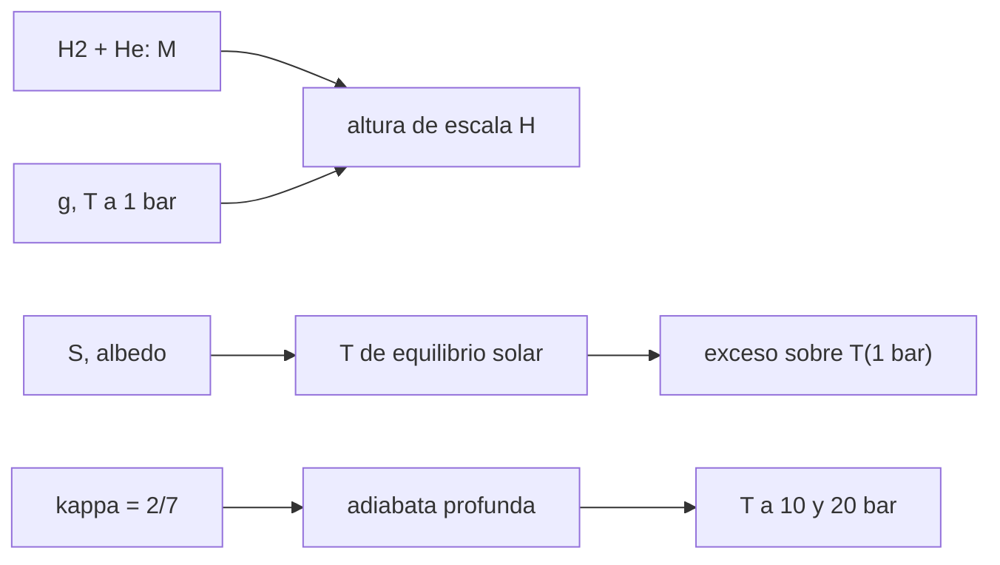

# B54-C15 — Atmósferas de gigantes gaseosos

<!-- nav:top -->
[🏠 Programa](../../../../README.md) · [📚 Bloque B54](../../../tronco-comun/B54-atmosferas-y-climatologia-planetaria.md) · [← Anterior: B54-C14 — Atmósfera de Marte](../B54-C14-atmosfera-de-marte/CLASE.md) · [Siguiente: B54-C16 — Atmósferas de Titán →](../../../tronco-comun/B54-atmosferas-y-climatologia-planetaria.md#b54-c16)
<!-- /nav -->

## 1. Ubicación, nivel y alcance

Clase 15 del bloque B54. Nivel N3. Un gigante gaseoso no tiene superficie sólida: se toma como referencia el nivel de 1 bar. Con la ficha de Júpiter calculas la altura de escala de una mezcla de H₂ y He, el balance solar y la adiabata profunda con `κ = 2/7`, un **supuesto** de la clase.

## 2. Por qué esta clase existe

La atmósfera de Júpiter es una capa convectiva muy profunda. La pregunta motivadora: **¿cuánto más caliente es el nivel de 1 bar que el equilibrio solar y cómo crece la temperatura hacia dentro?** La decisión central: elegir `κ` para la adiabata profunda.

## 3. Lo que podrás hacer al terminar

1. Calcular la masa molar de H₂/He y la altura de escala a 1 bar.
2. Contrastar con la ficha y cuantificar la diferencia.
3. Calcular la temperatura de equilibrio solar y el exceso del nivel de 1 bar.
4. Integrar la adiabata profunda y verificar la fórmula.
5. Calcular `Γ = g/c_p`.
6. Declarar que `κ = 2/7` es un supuesto.

La evidencia es la **ficha de la atmósfera de Júpiter** del ejercicio 12 (sección 20).

## 4. Con qué llegas y cómo comprobarlo

1. ¿Qué es un gigante gaseoso?
2. ¿Qué es la altura de escala?
3. ¿Qué es una adiabata?
4. ¿Qué es un valor ilustrativo?
5. ¿Qué es una verificación?

<details>
<summary>Ver respuestas</summary>

1. Un planeta sin superficie sólida, dominado por H₂ y He. 2. `H = R T/(M g)`. 3. Una evolución sin intercambio de calor. 4. Un valor propuesto para el ejemplo, no medido. 5. Comparar un cálculo con un caso independiente.
</details>

Con cuatro o cinco aciertos, sigue; si no, repasa los prerrequisitos.

## 5. Un caso de contexto y casos de referencia

Ficha de Júpiter (S1): `T = 165 K` a 1 bar, `H = 27 km`, `g = 25,92 m/s²`, 89,8 % H₂ y 10,2 % He, albedo de Bond `0,343`, `S = 50,26 W/m²`, `T_bb = 109,9 K`. Es el **ejemplo conductor**.

## 6. Vocabulario

El **nivel de 1 bar** es la referencia de altura de un gigante. El **calor interno** es el flujo que sale del interior. La **adiabata profunda** es `T = T₁ (P/P₁)^κ`. Para un gas diatómico rígido, `κ = 2/7` y `c_p = 7R/(2M)`; es un **supuesto** de la clase.

## 7. Modelo mental: una olla que hierve de abajo

Una olla caliente desde abajo mueve el líquido en corrientes; en Júpiter, el calor interno hace lo mismo con el gas.



*Descripción textual:* la composición y la gravedad dan `H`; el balance solar da `T_e` y el exceso del nivel de 1 bar; con `κ` se integra la adiabata hacia dentro.

Analogía: la olla. Límite: el gas no tiene fondo único ni paredes.

## 8. La explicación, paso a paso

### 8.1 Altura de escala

`M = 2,219 g/mol`. A `165 K` y `g = 25,92` sale `H = 23,86 km`, a `11,6 %` de la ficha (27 km). Con `g = 24,79` (calculada con masa y radio ecuatorial de 1 bar) sale `24,94 km`, a `7,6 %`. La ficha no dice con qué `T` y `g` obtuvo 27 km; la clase informa la diferencia y no la explica.

### 8.2 Balance solar

`T_e = 109,84 K` (ficha 109,9; dif. 0,06 K). La energía solar absorbida promedio es `8,255 W/m²` y `σ T⁴` a 165 K es `42,0 W/m²`. El nivel de 1 bar está `55,2 K` por encima de `T_e`; esa diferencia incluye calor interno (no medido en esta clase) y no es solo «invernadero».

### 8.3 Adiabata profunda

| `P` (bar) | `T` (K) | profundidad bajo 1 bar (km) |
|---|---|---|
| 1 | 165,0 | 0,0 |
| 2 | 201,1 | 18,3 |
| 5 | 261,3 | 48,7 |
| 10 | 318,6 | 77,7 |
| 20 | 388,3 | 113,0 |

RK4 hasta 10 bar da `318,5651 K`, igual a la fórmula. El gradiente adiabático a 1 bar es `g/c_p = 1,98 K/km` (con `c_p = 13 116 J/(kg K)` por `κ = 2/7`). Los valores de la tabla dependen del supuesto `κ = 2/7`.

## 9. Magnitudes, símbolos y unidades

| Símbolo | Qué es | Unidad | Valor / nota |
|---|---|---|---|
| `M` | masa molar de H₂/He | g/mol | 2,219 |
| `H` | altura de escala | km | 23,9 … 24,9 |
| `T_e` | equilibrio solar | K | 109,84 |
| `κ` | exponente adiabático (supuesto) | — | 2/7 |
| `Γ` | gradiente adiabático | K/km | 1,98 |

## 10. Convenciones y referencias

Altura medida desde el nivel de 1 bar, hacia abajo para la profundidad. Mezcla ideal de H₂ y He; se ignoran condensados y variación de `c_p`.

## 11. De dónde sale lo que afirmamos

| ID | Fuente | Localizador | Respalda | Estado |
|---|---|---|---|---|
| S1 | NASA/NSSDC, *Jupiter Fact Sheet* | https://nssdc.gsfc.nasa.gov/planetary/factsheet/jupiterfact.html | T a 1 bar, altura de escala, composición, albedo, irradiancia, T de cuerpo negro, radio, masa, gravedad, velocidad de escape y rotación de Júpiter | Consultada; datos de ficha; consulta 2026-11-09 |
| S2 | NIST, *CODATA 2022: constante de Boltzmann k* | https://physics.nist.gov/cgi-bin/cuu/Value?k | k = 1,380 649 × 10⁻²³ J K⁻¹ (exacta) | Consultada; consulta 2026-11-09 |
| S3 | NIST, *CODATA 2022: constante de Avogadro N_A* | https://physics.nist.gov/cgi-bin/cuu/Value?na | N_A = 6,022 140 76 × 10²³ mol⁻¹ (exacta) | Consultada; consulta 2026-11-09 |
| S4 | NIST, *CODATA 2022: constante de Stefan–Boltzmann σ* | https://physics.nist.gov/cgi-bin/cuu/Value?sigma | σ = 5,670 374 419 × 10⁻⁸ W m⁻² K⁻⁴ (exacta) | Consultada; consulta 2026-11-09 |

Límites: no se consultó el flujo interno de Júpiter; `κ = 2/7` es un supuesto; la diferencia con `H` de la ficha no se explica.

## 12. Cómo ver la atmósfera de Júpiter

| Magnitud | Valor |
|---|---|
| `H` (g de ficha) | 23,86 km |
| `T_e` | 109,84 K |
| exceso sobre `T_e` | 55,2 K |
| `T` a 10 bar | 318,6 K |

Descripción larga: una gráfica de `T` frente a `ln P` es una recta de pendiente `κ`; la tabla 8.3 da los puntos.

## 13. Ejemplo trabajado: T a 5 bar

**Paso 1 · Razón.** `P/P₁ = 5`.

**Paso 2 · Potencia.** `5^(2/7) = 1.5838`.

**Paso 3 · Temperatura.** `165 × 1.5838 = 261.3 K`.

## 14. Distintas formas de describir la capa profunda

**Adiabata con `κ` fijo:** la que se usa. **Con `c_p` variable:** cambia `κ` con la temperatura (no se hace). **Con modelos de interior:** usan ecuaciones de estado de H₂ (fuera de alcance).

## 15. Práctica guiada

**Ejercicio 1 · con los pasos indicados.** Calcula `M` para 89,8 % H₂ y 10,2 % He. *Pasos:* promedio ponderado.

<details><summary>Solución comentada</summary>

`2.219 g/mol`.
</details>

**Ejercicio 2 · con una pista.** Calcula `T_e` de Júpiter. *Pista:* B54-C03.

<details><summary>Solución comentada</summary>

`109.84 K`.
</details>

**Ejercicio 3 · casi autónomo.** Calcula `T` a 2 bar con `κ = 2/7`.

<details><summary>Solución comentada</summary>

`201.1 K`.
</details>

## 16. Práctica autónoma, transferencia e integrador

**Ejercicio 4 · autónomo.** Calcula `c_p = 7R/(2M)`.

<details><summary>Solución comentada</summary>

`13116 J/(kg K)`.
</details>

**Ejercicio 5 · autónomo.** Calcula `Γ` con `g = 25,92`.

<details><summary>Solución comentada</summary>

`1.98 K/km`.
</details>

**Ejercicio 6 · autónomo.** ¿A qué `P` la adiabata da 300 K?

<details><summary>Solución comentada</summary>

`P = (300/165)^(7/2) = 8.10 bar`.
</details>

**Ejercicio 7 · autónomo.** ¿Por qué la diferencia de 11,6 % en `H` no basta para desmentir el modelo?

<details><summary>Solución comentada</summary>

Porque la ficha no declara `T` ni `g` de su cálculo; hay que conocerlos antes de concluir.
</details>

**Ejercicio 8 · autónomo.** Calcula el flujo `σ T⁴` a 165 K y compáralo con 8,255 W/m².

<details><summary>Solución comentada</summary>

`42.0 W/m²`, unas 5.1 veces; no es el flujo emergente, solo una referencia.
</details>

**Ejercicio 9 · transferencia.** **Transferencia.** Un colega usa 165 K como 'temperatura de la superficie de Júpiter'. ¿Qué le dices?

<details><summary>Solución comentada</summary>

Que Júpiter no tiene superficie sólida; 165 K es la temperatura del nivel de 1 bar.
</details>

**Ejercicio 10 · transferencia.** **Transferencia.** ¿Qué cambiaría si `κ` fuera 0,25?

<details><summary>Solución comentada</summary>

`T(10 bar) = 165 × 10^0,25 = 293.4 K`, es decir `-25.1 K` menos.
</details>

**Ejercicio 11 · transferencia.** **Transferencia.** ¿Por qué esta clase no dice nada de las nubes de Júpiter?

<details><summary>Solución comentada</summary>

No se consultó ninguna fuente sobre su composición y altura; solo hay una adiabata supuesta.
</details>

**Ejercicio 12 · integrador.** **Integrador.** Elabora tu *ficha de la atmósfera de Júpiter*: `H`, `T_e`, exceso y tabla de la adiabata.

<details><summary>Solución comentada</summary>

Secciones 8.1–8.3 y salida del laboratorio.
</details>

## 17. Laboratorio: altura de escala, balance y adiabata de Júpiter

El script [gigantes.py](gigantes.py) calcula `H`, `T_e` y la adiabata profunda (**comprueba** `H` dentro de 15 % de la ficha, `T_e` dentro de 0,3 K y RK4 frente a la fórmula).

**Datos:** ficha NASA/NSSDC de Júpiter (S1) y constantes de NIST (S2–S4); `κ = 2/7` supuesto. **Predice antes de ejecutar:** ¿Cuánto vale `T_e`? (≈ 109,8 K.) **Ejecución del 2026-11-09 (Python 3.12.9):**

```text
Python 3.12.9 (biblioteca estandar)
M = 2.219 g/mol
H(165 K), g de la ficha (1 bar): 23.86 km (ficha 27 km; dif. 11.6 %)
H(165 K), g de GM/r^2 con masa y radio ecuatorial: 24.94 km (ficha 27 km; dif. 7.6 %)
T_eq solar = 109.84 K (ficha 109.9 K); T a 1 bar = 165 K -> exceso 55.2 K
Flujo solar absorbido promedio = 8.255 W/m2 ; sigma T(1 bar)^4 = 42.0 W/m2 (no es el flujo emergente)
P [bar]   T adiabatica [K]   z bajo 1 bar [km]
    1.0             165.0               0.0
    2.0             201.1              18.3
    5.0             261.3              48.7
   10.0             318.6              77.7
   20.0             388.3             113.0
A 10 bar: RK4 = 318.5651 K ; analitica = 318.5651 K
Gradiente adiabatico en 1 bar: g/cp = 1.98 K/km (cp = 13116 J/kg/K)
Pruebas superadas.
```

```bash
python programa/clases/B54/B54-C15-atmosferas-de-gigantes-gaseosos/gigantes.py
```

**Límites:** mezcla ideal con `κ` fijo; sin flujo interno.

## 18. Errores frecuentes y cómo corregirlos

**Hablar de la 'superficie' de Júpiter.** Se corrige con el ejercicio 9.

**Atribuir el exceso de 55 K solo al invernadero.** Se corrige con 8.2.

**Tomar `κ = 2/7` como dato.** Se corrige con la sección 5.

**Ocultar la diferencia con la ficha.** Se corrige con 8.1.

## 19. Cómo sabrás que vas bien

Tras la sección 8: ¿qué `T` esperabas a 10 bar y cuál obtuviste? Si dudas, repasa el ejemplo 13. Tras el laboratorio: ¿qué comprueba? (ver la sección 17).

## 20. Qué entregas y cómo se evalúa

El producto es tu **ficha de la atmósfera de Júpiter** (ejercicio 12).

| Criterio | Inicial | En desarrollo | Logrado | Destacado |
|---|---|---|---|---|
| Conceptos | Los confunde | Parciales | Atmósfera de un gigante y adiabata profunda | Explica los límites |
| Cálculo | Sin unidades | Con errores | Tablas completas con unidades | Calcula casos nuevos |
| Numérico | Sin comprobar | Un caso | Contraste con el caso analítico o la ficha | Interpreta las diferencias |
| Fuentes | Sin fuente | Sin fecha | Fuentes con fecha | Declara lo sintético y lo no consultado |
| Límites | No los nombra | Uno | Tres | Discute qué falta del modelo |

**Condiciones críticas (no se compensan con promedio):** declarar `κ = 2/7` como supuesto; informar la diferencia con la ficha; citar solo lo consultado.

## 21. Ética, seguridad y límites

Clase educativa: mezcla ideal. Accesibilidad: tablas equivalentes a las gráficas, fórmulas en texto, ejercicios sin conexión.

## 22. Para cerrar y seguir

El nivel de 1 bar de Júpiter está 55 K por encima de su equilibrio solar y una adiabata supuesta lo calienta a 319 K en 78 km. Queda una pregunta: ¿cómo es una atmósfera fría y de nitrógeno, como la de Titán?

**Glosario español–inglés.** gigante gaseoso · *gas giant*; nivel de 1 bar · *1-bar level*; calor interno · *internal heat*; adiabata profunda · *deep adiabat*; mezcla H₂/He · *H₂/He mixture*.

**Continuidad.** [B54-C16](../B54-C16-atmosferas-de-titan/CLASE.md) estudia la atmósfera de Titán.

**Referencias:** ver sección 11.

<!-- nav:bottom -->
---

[← Anterior: B54-C14 — Atmósfera de Marte](../B54-C14-atmosfera-de-marte/CLASE.md) · [📚 Bloque B54](../../../tronco-comun/B54-atmosferas-y-climatologia-planetaria.md) · [Siguiente: B54-C16 — Atmósferas de Titán →](../../../tronco-comun/B54-atmosferas-y-climatologia-planetaria.md#b54-c16)
<!-- /nav -->
