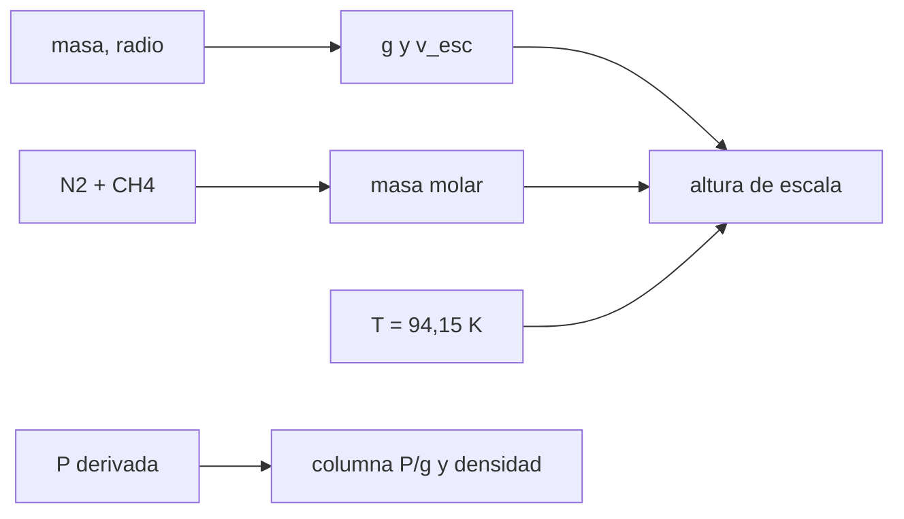

# B54-C16 — Atmósferas de Titán

<!-- nav:top -->
[🏠 Programa](../../../../README.md) · [📚 Bloque B54](../../../tronco-comun/B54-atmosferas-y-climatologia-planetaria.md) · [← Anterior: B54-C15 — Atmósferas de gigantes gaseosos](../B54-C15-atmosferas-de-gigantes-gaseosos/CLASE.md) · [Siguiente: B54-C17 — Clima exoplanetario →](../B54-C17-clima-exoplanetario/CLASE.md)
<!-- /nav -->

## 1. Ubicación, nivel y alcance

Clase 16 del bloque B54. Nivel N3. Titán, luna de Saturno, es el único satélite con una atmósfera espesa. Con su masa y radio de la ficha de satélites y la T y la composición de la página de NASA Science, calculas su gravedad, su altura de escala, la densidad en superficie y la columna de masa. La presión absoluta se **deriva** de la frase «60 % mayor que la terrestre» y es una estimación de la clase.

## 2. Por qué esta clase existe

Titán combina gravedad baja, frío extremo y una atmósfera de N₂ con metano. La pregunta motivadora: **¿por qué una luna pequeña retiene una atmósfera más densa que la terrestre?** La decisión central: comparar la columna de masa y la altura de escala con las de otros mundos.

## 3. Lo que podrás hacer al terminar

1. Calcular `g = G M/r²` y la velocidad de escape de Titán.
2. Verificar la densidad media con masa y radio.
3. Calcular `M`, `H`, `ρ` y la columna de masa de la atmósfera.
4. Comparar con la Tierra y Marte.
5. Explicar por qué `H` es 2,5 veces la terrestre.
6. Distinguir lo consultado de lo derivado y lo supuesto.

La evidencia es la **ficha de la atmósfera de Titán** del ejercicio 12 (sección 20).

## 4. Con qué llegas y cómo comprobarlo

1. ¿Qué es la gravedad superficial?
2. ¿Qué es la densidad media?
3. ¿Qué es una columna de masa?
4. ¿Qué es un valor sintético?
5. ¿Qué es una verificación?

<details>
<summary>Ver respuestas</summary>

1. `g = G M/r²`. 2. Masa dividida entre volumen. 3. `P/g` (B54-C04). 4. Un valor inventado para el ejemplo, no medido. 5. Comparar un cálculo con un caso independiente.
</details>

Con cuatro o cinco aciertos, sigue; si no, repasa los prerrequisitos.

## 5. Un caso de contexto y casos de referencia

Ficha de satélites (S1): radio `2575 km`, masa `1345,5 × 10²⁰ kg`, densidad `1880 kg/m³`. Página de NASA Science (S2): `−179 °C` (94,15 K), ~95 % N₂ y ~5 % CH₄, presión «60 % mayor que la terrestre». Con `P ≈ 1,6 × 101 325 Pa` (**derivada**; la presión terrestre de referencia es estándar no consultada). Es el **ejemplo conductor**.

## 6. Vocabulario

La **gravedad** de Titán es `g = G M/r²`. La **columna de masa** `P/g` mide el peso de la atmósfera por m². La **razón `H/r`** compara la altura de escala con el radio del cuerpo. El **metano** puede condensar a esas temperaturas (no se calcula aquí). El **balance radiativo** usa un albedo **sintético** de 0,3.

## 7. Modelo mental: un edredón en una habitación fría

Una atmósfera densa y fría cubre al cuerpo como un edredón grueso: pesa mucho y se extiende lejos para su tamaño.



*Descripción textual:* masa y radio dan la gravedad; con la composición y la temperatura se obtiene la altura de escala; la presión derivada da la columna y la densidad.

Analogía: el edredón. Límite: un edredón no cambia de fase; el metano de Titán sí podría.

## 8. La explicación, paso a paso

### 8.1 Cuerpo

La densidad media calculada es `1881,3 kg/m³`, frente a `1880` de la ficha (0,07 %). `g = G M/r² = 1,3544 m/s²` (con `G`, S3) y `v_esc = 2,641 km/s`.

### 8.2 Atmósfera

`M = 27,42 g/mol`; con `T = 94,15 K`, `H = 21,08 km`. Con `P ≈ 162 120 Pa` (derivada), `ρ = 5,68 kg/m³`. La columna de masa `P/g = 119 702 kg/m²` es unas `12` veces la terrestre (`~10 318`) y `700` veces la de Marte (`171`). La razón `H/r` vale `0,0082`, frente a `0,0013` de la Tierra: la atmósfera es extensa respecto del tamaño del cuerpo. Con 5 % de CH₄ por volumen, su presión parcial es `8106 Pa` y su fracción de masa `2,9 %`.

### 8.3 Balance radiativo (sintético)

Con `S = 1361/9,58² = 14,83 W/m²` (semieje de Saturno de 9,58 UA, valor ilustrativo **no consultado**) y albedo sintético `0,3`, `T_e = 82,3 K`, `11,9 K` por debajo de la temperatura de superficie. Este valor es ilustrativo: depende del albedo supuesto.

### 8.4 Gases separados

Si cada gas siguiera su propia atmósfera isoterma, `H(N₂) = 20,63 km` y `H(CH₄) = 36,03 km`; el cociente es el inverso de las masas molares. En la atmósfera real los gases se mezclan, de modo que esto es solo una comparación.

## 9. Magnitudes, símbolos y unidades

| Símbolo | Qué es | Unidad | Valor / nota |
|---|---|---|---|
| `g` | gravedad de Titán | m/s² | 1,3544 |
| `H` | altura de escala | km | 21,08 |
| `ρ` | densidad en superficie (P derivada) | kg/m³ | 5,68 |
| `P/g` | columna de masa | kg/m² | 119 702 |
| `T` | temperatura de superficie | K | 94,15 |

## 10. Convenciones y referencias

`P` derivada de «60 % mayor que la terrestre» con 101 325 Pa de referencia. Gas ideal, `T` uniforme en la baja atmósfera. Albedo y semieje de Saturno solo en 8.3.

## 11. De dónde sale lo que afirmamos

| ID | Fuente | Localizador | Respalda | Estado |
|---|---|---|---|---|
| S1 | NASA/NSSDC, *Saturnian Satellite Fact Sheet* | https://nssdc.gsfc.nasa.gov/planetary/factsheet/saturniansatfact.html | radio, masa, densidad media, semieje y periodo orbital de Titán | Consultada; solo la fila de Titán; consulta 2026-11-09 |
| S2 | NASA Science, *Titan Facts* | https://science.nasa.gov/saturn/moons/titan/facts/ | T de superficie (−179 °C), ~95 % N₂, ~5 % CH₄ y presión «60 % mayor que la terrestre» (sin valor absoluto) | Consultada; consulta 2026-11-09 |
| S3 | NIST, *CODATA 2022: constante de gravitación G* | https://physics.nist.gov/cgi-bin/cuu/Value?bg | G = 6,674 30(15) × 10⁻¹¹ m³ kg⁻¹ s⁻² | Consultada; consulta 2026-11-09 |
| S4 | NIST, *CODATA 2022: constante de Boltzmann k* | https://physics.nist.gov/cgi-bin/cuu/Value?k | k = 1,380 649 × 10⁻²³ J K⁻¹ (exacta) | Consultada; consulta 2026-11-09 |
| S5 | NIST, *CODATA 2022: constante de Avogadro N_A* | https://physics.nist.gov/cgi-bin/cuu/Value?na | N_A = 6,022 140 76 × 10²³ mol⁻¹ (exacta) | Consultada; consulta 2026-11-09 |

Límites: la presión absoluta es derivada; el semieje de Saturno y la presión terrestre de referencia no se consultaron; el albedo es sintético; la página de Titán da fracciones aproximadas («about»).

## 12. Cómo ver la atmósfera de Titán

| Magnitud | Valor |
|---|---|
| `g` | 1,3544 m/s² |
| `H` | 21,08 km |
| `ρ` (estimada) | 5,68 kg/m³ |
| columna / terrestre | ≈ 12 |

Descripción larga: un diagrama de barras de la columna de masa (Marte, Tierra, Titán, Venus) ordena los cuatro mundos; la tabla 8.2 da los números de Titán.

## 13. Ejemplo trabajado: g de Titán

**Paso 1 · Producto.** `G M = 8.9803e+12`.

**Paso 2 · Radio al cuadrado.** `r² = 6.6306e+12`.

**Paso 3 · Gravedad.** `g = 1.3544 m/s²`.

## 14. Distintas formas de describir una atmósfera espesa

**Por columna de masa:** `P/g`. **Por altura de escala:** `H`. **Por razón `H/r`:** extensión relativa. Las tres dicen que la atmósfera de Titán es masiva y extensa para un cuerpo pequeño.

## 15. Práctica guiada

**Ejercicio 1 · con los pasos indicados.** Calcula el volumen de Titán con `r = 2575 km`. *Pasos:* `4πr³/3`.

<details><summary>Solución comentada</summary>

`7.1519e+19 m³`.
</details>

**Ejercicio 2 · con una pista.** Calcula `v_esc`. *Pista:* `√(2GM/r)`.

<details><summary>Solución comentada</summary>

`2.641 km/s`.
</details>

**Ejercicio 3 · casi autónomo.** Calcula `M` para 95 % N₂ y 5 % CH₄.

<details><summary>Solución comentada</summary>

`27.42 g/mol`.
</details>

## 16. Práctica autónoma, transferencia e integrador

**Ejercicio 4 · autónomo.** Calcula `H` a 94,15 K con la `g` de Titán.

<details><summary>Solución comentada</summary>

`21.08 km`.
</details>

**Ejercicio 5 · autónomo.** Calcula la columna de masa con `P = 162 120 Pa`.

<details><summary>Solución comentada</summary>

`119702 kg/m²`.
</details>

**Ejercicio 6 · autónomo.** Calcula `ρ` en superficie.

<details><summary>Solución comentada</summary>

`5.68 kg/m³`.
</details>

**Ejercicio 7 · autónomo.** ¿Cuánto vale la razón `H/r`?

<details><summary>Solución comentada</summary>

`0.0082`.
</details>

**Ejercicio 8 · autónomo.** Calcula la presión parcial del metano (5 %) si `P = 162 120 Pa`.

<details><summary>Solución comentada</summary>

`8106 Pa`.
</details>

**Ejercicio 9 · transferencia.** **Transferencia.** Un colega afirma que Titán tiene exactamente 1,6 bar. ¿Qué respondes?

<details><summary>Solución comentada</summary>

Que la fuente consultada solo dice «60 % mayor que la terrestre»; 1,6 × 101 325 Pa es una derivación, no un dato.
</details>

**Ejercicio 10 · transferencia.** **Transferencia.** ¿Qué cambiaría si hubiese 10 % de CH₄?

<details><summary>Solución comentada</summary>

`M = 26.82 g/mol` y `H` aumentaría un 2.2 %.
</details>

**Ejercicio 11 · transferencia.** **Transferencia.** ¿Por qué no se da aquí un perfil de temperatura de Titán?

<details><summary>Solución comentada</summary>

Porque no se consultó ninguna fuente de perfiles; solo se dispone de la temperatura de superficie.
</details>

**Ejercicio 12 · integrador.** **Integrador.** Elabora tu *ficha de la atmósfera de Titán*: `g`, `M`, `H`, `ρ`, columna y comparación con Tierra y Marte.

<details><summary>Solución comentada</summary>

Secciones 8.1–8.4 y salida del laboratorio.
</details>

## 17. Laboratorio: gravedad, altura de escala y columna de Titán

El script [titan.py](titan.py) calcula `g`, `H`, `ρ` y la columna (**comprueba** la densidad media frente a la ficha con 1 % y la razón de alturas de escala).

**Datos:** ficha de satélites (S1), página de NASA Science (S2) y constantes de NIST (S3–S5); presión derivada; albedo sintético. **Predice antes de ejecutar:** ¿Cuánto vale `H`? (≈ 21 km.) **Ejecución del 2026-11-09 (Python 3.12.9):**

```text
Python 3.12.9 (biblioteca estandar)
Densidad media calculada = 1881.3 kg/m3 (ficha 1880.0; dif. 0.07 %)
g = G M/r^2 = 1.3544 m/s2 ; v_esc = 2.641 km/s
M = 27.42 g/mol ; H = 21.08 km ; P (estimada) = 162120 Pa ; rho(superficie) = 5.68 kg/m3
Columna P/g = 119702 kg/m2 (Tierra: ~10318 kg/m2, Marte 171 kg/m2)
Razon H/radio = 0.0082 (atmosfera extensa frente al cuerpo: Tierra 0.0013)
Presion parcial de metano (mezcla 5 % por volumen) = 8106 Pa ; fraccion de masa = 2.9 %
S(Saturno) ~ 14.83 W/m2 (inverso del cuadrado) ; Te con albedo sintetico 0.3 = 82.3 K -> Ts - Te = 11.9 K (el valor depende del albedo sintetico)
H(N2) = 20.63 km ; H(CH4) = 36.03 km (el metano, mas ligero, cae mas despacio con la altura si el gas se mezclara por separado)
Pruebas superadas.
```

```bash
python programa/clases/B54/B54-C16-atmosferas-de-titan/titan.py
```

**Límites:** gas ideal y presión derivada.

## 18. Errores frecuentes y cómo corregirlos

**Citar 1,6 bar como dato.** Se corrige con la sección 11.

**Usar la `g` terrestre.** Se corrige con 8.1.

**Tomar el balance de 8.3 como real.** Se corrige con 8.3.

**Olvidar que el metano puede condensar.** Se corrige con 8.4.

## 19. Cómo sabrás que vas bien

Tras la sección 8: ¿qué `H` esperabas y cuál obtuviste? Si dudas, repasa el ejemplo 13. Tras el laboratorio: ¿qué comprueba? (ver la sección 17).

## 20. Qué entregas y cómo se evalúa

El producto es tu **ficha de la atmósfera de Titán** (ejercicio 12).

| Criterio | Inicial | En desarrollo | Logrado | Destacado |
|---|---|---|---|---|
| Conceptos | Los confunde | Parciales | Gravedad, altura de escala y columna de Titán | Explica los límites |
| Cálculo | Sin unidades | Con errores | Tablas completas con unidades | Calcula casos nuevos |
| Numérico | Sin comprobar | Un caso | Contraste con el caso analítico o la ficha | Interpreta las diferencias |
| Fuentes | Sin fuente | Sin fecha | Fuentes con fecha | Declara lo sintético y lo no consultado |
| Límites | No los nombra | Uno | Tres | Discute qué falta del modelo |

**Condiciones críticas (no se compensan con promedio):** declarar la presión como derivada; rotular el albedo como sintético; citar solo lo consultado.

## 21. Ética, seguridad y límites

Clase educativa: gas ideal. Accesibilidad: tablas equivalentes a las gráficas, fórmulas en texto, ejercicios sin conexión.

## 22. Para cerrar y seguir

Titán tiene una columna de masa unas 12 veces la terrestre con una gravedad siete veces menor. Queda una pregunta: ¿cómo se aplican estas ideas fuera del sistema solar?

**Glosario español–inglés.** Titán · *Titan*; columna de masa · *column mass*; gravedad superficial · *surface gravity*; metano · *methane*; altura de escala · *scale height*.

**Continuidad.** [B54-C17](../B54-C17-clima-exoplanetario/CLASE.md) estudia el clima exoplanetario.

**Referencias:** ver sección 11.

<!-- nav:bottom -->
---

[← Anterior: B54-C15 — Atmósferas de gigantes gaseosos](../B54-C15-atmosferas-de-gigantes-gaseosos/CLASE.md) · [📚 Bloque B54](../../../tronco-comun/B54-atmosferas-y-climatologia-planetaria.md) · [Siguiente: B54-C17 — Clima exoplanetario →](../B54-C17-clima-exoplanetario/CLASE.md)
<!-- /nav -->
