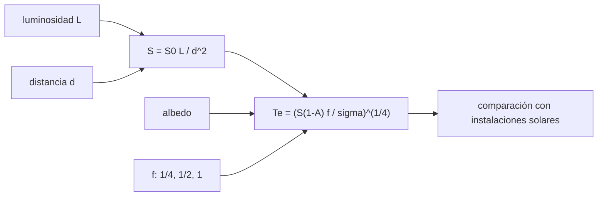

# B54-C17 — Clima exoplanetario

<!-- nav:top -->
[🏠 Programa](../../../../README.md) · [📚 Bloque B54](../../../tronco-comun/B54-atmosferas-y-climatologia-planetaria.md) · [← Anterior: B54-C16 — Atmósferas de Titán](../B54-C16-atmosferas-de-titan/CLASE.md) · [Siguiente: B54-C18 — Medición remota atmosférica →](../B54-C18-medicion-remota-atmosferica/CLASE.md)
<!-- /nav -->

## 1. Ubicación, nivel y alcance

Clase 17 del bloque B54. Nivel N3. Para un exoplaneta casi nunca se observa la atmósfera: se calcula cuánta energía recibe y qué temperatura de equilibrio tendría según cuánto redistribuya el calor. Aplicas el balance de B54-C03 a un planeta **sintético** alrededor de una estrella sintética de `0,05 L☉` y repasas los bordes de la zona habitable solar del resumen de Kopparapu et al.

## 2. Por qué esta clase existe

La temperatura de equilibrio de un exoplaneta es el primer número que se calcula. La pregunta motivadora: **¿cuánto cambia esa temperatura si el calor se redistribuye o no?** La decisión central: elegir el factor de redistribución `f`.

## 3. Lo que podrás hacer al terminar

1. Calcular la instalación estelar `S = S₀ (L/L☉)/d²`.
2. Calcular `T_e` con `f = 1/4`, `1/2` y `1`.
3. Verificar `T_e` solar y la invariancia `S d² = S₀ L`.
4. Comparar con los bordes solares 0,99 y 1,70 UA como ejemplo de mecánica.
5. Calcular la distancia que da una instalación dada.
6. Declarar que los bordes solares no se transfieren a otra estrella.

La evidencia es la **ficha climática de un exoplaneta sintético** del ejercicio 12 (sección 20).

## 4. Con qué llegas y cómo comprobarlo

1. ¿Qué es la luminosidad?
2. ¿Qué es el balance radiativo?
3. ¿Qué es una zona habitable?
4. ¿Qué es un valor sintético?
5. ¿Qué es una verificación?

<details>
<summary>Ver respuestas</summary>

1. La potencia total que emite una estrella. 2. Absorbida = emitida (B54-C03). 3. Un intervalo de distancias donde un modelo permite agua líquida en superficie. 4. Un valor inventado para el ejemplo, no medido. 5. Comparar un cálculo con un caso independiente.
</details>

Con cuatro o cinco aciertos, sigue; si no, repasa los prerrequisitos.

## 5. Un caso de contexto y casos de referencia

Con `S₀ = 1361,0 W/m²` (S1) y σ (S2), `T_e` terrestre es `255,12 K`. Los bordes de la zona habitable solar en un modelo 1-D sin nubes (S3, solo resumen) son ≈ `0,99` y `1,70 UA`. El planeta, su estrella (`L = 0,05 L☉`) y su albedo (`0,3`) son **sintéticos**. Es el **ejemplo conductor**.

## 6. Vocabulario

La **instalación** `S` es la irradiancia que recibe el planeta. El **factor de redistribución** `f` es `1/4` con redistribución global, `1/2` con redistribución solo en el hemisferio diurno y `1` en el punto subsolar sin redistribución. La **zona habitable** es un intervalo de distancias o instalaciones. La **temperatura de equilibrio** `T_e = [S(1 − A) f/σ]^{1/4}` no es la de superficie.

## 7. Modelo mental: una hoguera y distintas distancias

Cuanto más lejos de una hoguera, menos calor; y cuanto más se reparte el calor por tu cuerpo, menos te quema el lado que la mira.



*Descripción textual:* la luminosidad y la distancia dan la instalación; con albedo y redistribución se obtiene `T_e`, que se compara con las instalaciones solares de los bordes.

Analogía: la hoguera. Límite: una hoguera no tiene atmósfera que redistribuya el calor.

## 8. La explicación, paso a paso

### 8.1 Casos de control

`T_e` solar `= 255,12 K`. Las instalaciones de los bordes solares son `1388,6 W/m²` (`1,020 S☉`) a 0,99 UA y `470,9 W/m²` (`0,346 S☉`) a 1,70 UA.

### 8.2 Planeta sintético, `L = 0,05 L☉`, `A = 0,3`

| `d` (UA) | `S/S☉` | `T_e` `f=1/4` (K) | `f=1/2` (K) | subsolar (K) |
|---|---|---|---|---|
| 0,10 | 5,000 | 380,7 | 452,7 | 538,4 |
| 0,15 | 2,222 | 310,8 | 369,6 | 439,6 |
| 0,20 | 1,250 | 269,2 | 320,1 | 380,7 |
| 0,30 | 0,556 | 219,8 | 261,4 | 310,8 |

El laboratorio comprueba `S d² = S₀ L` y que duplicar la distancia divide `T_e` por `√2`. Las razones son `T_e(f=1/2)/T_e(f=1/4) = 1,1892` y `T_e(f=1)/T_e(f=1/4) = 1,4142`.

### 8.3 Distancias de igual instalación

Para `L = 0,05 L☉`, la instalación del borde interno solar se da a `0,221 UA` y la del externo a `0,380 UA`. **Es un ejercicio de mecánica**: el artículo indica que los bordes dependen de la temperatura efectiva de la estrella, por lo que no se transfieren sin más.

### 8.4 Lectura

Con el mismo planeta, `T_e` cambia 150 K según se redistribuya o no el calor (a 0,10 UA). Sin conocer la atmósfera, el número es un rango, no una temperatura.

## 9. Magnitudes, símbolos y unidades

| Símbolo | Qué es | Unidad | Valor / nota |
|---|---|---|---|
| `S` | instalación | W/m² | ver 8.2 |
| `L` | luminosidad estelar (sintética) | L☉ | 0,05 |
| `f` | factor de redistribución | — | 1/4, 1/2, 1 |
| `T_e` | temperatura de equilibrio | K | 219,8 … 538,4 |
| `d` | distancia | UA | 0,10 … 0,30 |

## 10. Convenciones y referencias

Órbita circular, albedo de Bond 0,3 sintético, esfera con emisividad 1. Bordes solares: del resumen de S3.

## 11. De dónde sale lo que afirmamos

| ID | Fuente | Localizador | Respalda | Estado |
|---|---|---|---|---|
| S1 | NASA/NSSDC, *Earth Fact Sheet* | https://nssdc.gsfc.nasa.gov/planetary/factsheet/earthfact.html | presión, densidad, altura de escala, composición, albedo, irradiancia, T de cuerpo negro, gravedad, masa, radio y velocidad de escape de la Tierra | Consultada; datos de ficha; consulta 2026-11-09 |
| S2 | NIST, *CODATA 2022: constante de Stefan–Boltzmann σ* | https://physics.nist.gov/cgi-bin/cuu/Value?sigma | σ = 5,670 374 419 × 10⁻⁸ W m⁻² K⁻⁴ (exacta) | Consultada; consulta 2026-11-09 |
| S3 | Kopparapu et al., *Habitable Zones Around Main-Sequence Stars: New Estimates (ApJ, 2013)* | arXiv:1301.6674 (https://arxiv.org/abs/1301.6674) | bordes de la zona habitable solar ≈ 0,99 y 1,70 UA en un modelo 1-D sin nubes | Solo el resumen; consulta 2026-11-09 |

Límites: solo se leyó el resumen de Kopparapu et al.; los bordes no se transfieren a otras estrellas; todos los parámetros del planeta son sintéticos.

## 12. Cómo ver el clima de un exoplaneta

| Magnitud | Valor |
|---|---|
| `T_e` solar | 255,12 K |
| `S` a 0,99 UA | 1388,6 W/m² |
| `T_e` a 0,20 UA (f=1/4) | 269,2 K |
| distancia de igual `S` que 0,99 UA | 0,221 UA |

Descripción larga: un gráfico de `T_e` frente a `d` decae como `d^{−1/2}`; la tabla 8.2 da los puntos.

## 13. Ejemplo trabajado: T_e a 0,20 UA

**Paso 1 · Instalación.** `S = 1361 × 0,05/0,2² = 1701.2 W/m²`.

**Paso 2 · Absorbida.** `S(1 − 0,3)/4 = 297.72 W/m²`.

**Paso 3 · Temperatura.** `T_e = 269.2 K`.

## 14. Distintas formas de dar el clima

**Por `T_e` con `f` variable:** un rango. **Por instalación relativa:** comparación con bordes. **Con un modelo de circulación:** no disponible aquí. Las dos primeras son lo que se hace.

## 15. Práctica guiada

**Ejercicio 1 · con los pasos indicados.** Calcula `S` a 0,25 UA para `L = 0,05`. *Pasos:* 8.2.

<details><summary>Solución comentada</summary>

`1088.8 W/m²`.
</details>

**Ejercicio 2 · con una pista.** Calcula `T_e` con `f = 1/4` para `S = 1361` y `A = 0,3`.

<details><summary>Solución comentada</summary>

`254.6 K`.
</details>

**Ejercicio 3 · casi autónomo.** ¿Cuántas veces mayor es la temperatura subsolar que `T_e` global?

<details><summary>Solución comentada</summary>

`√2 = 1.4142`.
</details>

## 16. Práctica autónoma, transferencia e integrador

**Ejercicio 4 · autónomo.** Calcula `T_e` a 0,10 UA con `f = 1/2`.

<details><summary>Solución comentada</summary>

`452,7 K` (tabla 8.2).
</details>

**Ejercicio 5 · autónomo.** ¿A qué distancia `S` iguala a `S☉` (1361) para `L = 0,05`?

<details><summary>Solución comentada</summary>

`√0,05 = 0.224 UA`.
</details>

**Ejercicio 6 · autónomo.** ¿Qué pasa con `T_e` si el albedo sube de 0,3 a 0,5 a 0,20 UA?

<details><summary>Solución comentada</summary>

`247.5 K`, es decir `-21.7 K`.
</details>

**Ejercicio 7 · autónomo.** ¿Por qué `d` y `L` solo aparecen en el producto `L/d²`?

<details><summary>Solución comentada</summary>

Porque la instalación depende solo de la luminosidad dividida por la distancia al cuadrado.
</details>

**Ejercicio 8 · autónomo.** Convierte `0,346 S☉` en W/m².

<details><summary>Solución comentada</summary>

`470.9 W/m²`.
</details>

**Ejercicio 9 · transferencia.** **Transferencia.** Un colega dice que un planeta a 0,221 UA de esta estrella 'está en su zona habitable'. ¿Qué respondes?

<details><summary>Solución comentada</summary>

Que solo tiene la misma instalación que el borde interno solar; los bordes dependen de la temperatura de la estrella y no se calcularon para ella.
</details>

**Ejercicio 10 · transferencia.** **Transferencia.** ¿Qué dato necesitarías para elegir `f`?

<details><summary>Solución comentada</summary>

Observaciones de la fase del planeta o modelos de su atmósfera; sin ellos, `f` es un parámetro libre.
</details>

**Ejercicio 11 · transferencia.** **Transferencia.** ¿Por qué no se debe llamar 'temperatura del planeta' a `T_e`?

<details><summary>Solución comentada</summary>

Porque no incluye el efecto invernadero, ni la convección, ni las nubes; es el equilibrio sin esos efectos.
</details>

**Ejercicio 12 · integrador.** **Integrador.** Elabora tu *ficha climática del exoplaneta sintético*: `S`, `T_e` para tres `f` y las distancias de igual instalación.

<details><summary>Solución comentada</summary>

Secciones 8.1–8.4 y salida del laboratorio.
</details>

## 17. Laboratorio: instalación estelar y temperatura de equilibrio

El script [exoclima.py](exoclima.py) calcula `S`, `T_e` con tres factores de redistribución y distancias de igual instalación (**comprueba** `T_e` solar y la invariancia `S d²`).

**Datos:** `S₀` de la ficha NASA (S1), σ de NIST (S2), bordes solares del resumen de S3; planeta y estrella sintéticos. **Predice antes de ejecutar:** ¿Qué `T_e` solar saldrá? (≈ 255,1 K.) **Ejecución del 2026-11-09 (Python 3.12.9):**

```text
Python 3.12.9 (biblioteca estandar)
Tierra: Te = 255.12 K
Instalacion en 0.99 UA = 1388.6 W/m2 = 1.020 S_T ; en 1.70 UA = 470.9 W/m2 = 0.346 S_T
Planeta sintetico alrededor de una estrella de L = 0.05 L_sol:
 d [UA]   S/S_T   Te f=1/4 [K]   Te f=1/2 [K]  Te subsolar [K]
  0.10    5.000         380.7         452.7           538.4
  0.15    2.222         310.8         369.6           439.6
  0.20    1.250         269.2         320.1           380.7
  0.30    0.556         219.8         261.4           310.8
Distancia con instalacion 'interna' solar para L = 0.05: 0.221 UA
Distancia con instalacion 'externa' solar para L = 0.05: 0.380 UA
Razon Te(f=1/2)/Te(f=1/4) = 1.1892 ; Te(f=1)/Te(f=1/4) = 1.4142
Pruebas superadas.
```

```bash
python programa/clases/B54/B54-C17-clima-exoplanetario/exoclima.py
```

**Límites:** órbita circular y albedo sintético.

## 18. Errores frecuentes y cómo corregirlos

**Transferir los bordes solares a otra estrella.** Se corrige con 8.3.

**Olvidar el factor `f`.** Se corrige con la sección 6.

**Llamar temperatura del planeta a `T_e`.** Se corrige con el ejercicio 11.

**Tomar el planeta por real.** Se corrige con la sección 5.

## 19. Cómo sabrás que vas bien

Tras la sección 8: ¿qué `T_e` esperabas a 0,20 UA y cuál obtuviste? Si dudas, repasa el ejemplo 13. Tras el laboratorio: ¿qué comprueba? (ver la sección 17).

## 20. Qué entregas y cómo se evalúa

El producto es tu **ficha climática de un exoplaneta sintético** (ejercicio 12).

| Criterio | Inicial | En desarrollo | Logrado | Destacado |
|---|---|---|---|---|
| Conceptos | Los confunde | Parciales | Instalación estelar y temperatura de equilibrio | Explica los límites |
| Cálculo | Sin unidades | Con errores | Tablas completas con unidades | Calcula casos nuevos |
| Numérico | Sin comprobar | Un caso | Contraste con el caso analítico o la ficha | Interpreta las diferencias |
| Fuentes | Sin fuente | Sin fecha | Fuentes con fecha | Declara lo sintético y lo no consultado |
| Límites | No los nombra | Uno | Tres | Discute qué falta del modelo |

**Condiciones críticas (no se compensan con promedio):** rotular el planeta como sintético; no transferir los bordes solares; citar solo lo consultado.

## 21. Ética, seguridad y límites

Clase educativa: planeta y estrella ficticios. Accesibilidad: tablas equivalentes a las gráficas, fórmulas en texto, ejercicios sin conexión.

## 22. Para cerrar y seguir

La misma instalación da `T_e` entre 269 y 381 K según cuánto se redistribuya el calor. Queda una pregunta: ¿cómo se mide una atmósfera de forma remota?

**Glosario español–inglés.** instalación estelar · *stellar insolation*; zona habitable · *habitable zone*; redistribución de calor · *heat redistribution*; exoplaneta · *exoplanet*; temperatura de equilibrio · *equilibrium temperature*.

**Continuidad.** [B54-C18](../B54-C18-medicion-remota-atmosferica/CLASE.md) estudia la medición remota.

**Referencias:** ver sección 11.

<!-- nav:bottom -->
---

[← Anterior: B54-C16 — Atmósferas de Titán](../B54-C16-atmosferas-de-titan/CLASE.md) · [📚 Bloque B54](../../../tronco-comun/B54-atmosferas-y-climatologia-planetaria.md) · [Siguiente: B54-C18 — Medición remota atmosférica →](../B54-C18-medicion-remota-atmosferica/CLASE.md)
<!-- /nav -->
