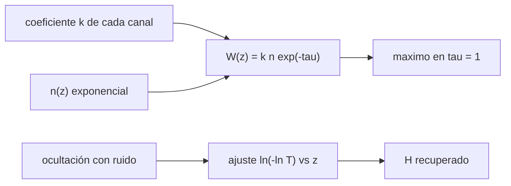

# B54-C18 — Medición remota atmosférica

<!-- nav:top -->
[🏠 Programa](../../../../README.md) · [📚 Bloque B54](../../../tronco-comun/B54-atmosferas-y-climatologia-planetaria.md) · [← Anterior: B54-C17 — Clima exoplanetario](../B54-C17-clima-exoplanetario/CLASE.md) · [Siguiente: B54-C19 — Modelos climáticos planetarios →](../B54-C19-modelos-climaticos-planetarios/CLASE.md)
<!-- /nav -->

## 1. Ubicación, nivel y alcance

Clase 18 del bloque B54. Nivel N3. Se mide una atmósfera sin entrar en ella con la luz que la atraviesa. Aquí calculas, con datos **sintéticos**, la **función de peso** de un sondeo desde el espacio con tres canales y recuperas la altura de escala de una atmósfera exponencial a partir de una ocultación con ruido. No se procesa ninguna observación real.

## 2. Por qué esta clase existe

Cada canal 've' una capa distinta según su absorción. La pregunta motivadora: **¿a qué altura 'mira' cada canal y cómo se recupera la altura de escala con ruido?** La decisión central: ubicar el máximo de la función de peso donde `τ = 1`.

## 3. Lo que podrás hacer al terminar

1. Definir `W(z) = k n(z) e^{−τ(z)}` y su máximo en `τ = 1`.
2. Verificar la altura del máximo contra `H ln(k n₀ H)`.
3. Comprobar que la integral de `W` vale `1 − e^{−τ₀}`.
4. Recuperar `H` con un ajuste lineal de `ln(−ln T)` frente a la altura.
5. Interpretar la dispersión de la recuperación con ruido.
6. Rotular los datos como sintéticos.

La evidencia es la **informe de un sondeo sintético** del ejercicio 12 (sección 20).

## 4. Con qué llegas y cómo comprobarlo

1. ¿Qué es la transmisión?
2. ¿Qué es un ajuste lineal?
3. ¿Qué es el ruido gaussiano?
4. ¿Qué es un valor sintético?
5. ¿Qué es una verificación?

<details>
<summary>Ver respuestas</summary>

1. La fracción de luz que atraviesa, `T = e^{−τ}`. 2. Una recta que minimiza el error cuadrático. 3. Una perturbación aleatoria con distribución normal. 4. Un valor inventado para el ejemplo, no medido. 5. Comparar un cálculo con un caso independiente.
</details>

Con cuatro o cinco aciertos, sigue; si no, repasa los prerrequisitos.

## 5. Un caso de contexto y casos de referencia

Atmósfera exponencial sintética con `H = 8500 m` (valor de la ficha de la Tierra, S1, usado solo como número de partida) y `n₀ = 2,5 × 10²⁵ m⁻³`. Tres canales con `k n₀ H = 3, 20, 150`. Ruido gaussiano de semilla fija `12345`. Es el **ejemplo conductor**; no hay datos reales.

## 6. Vocabulario

La **función de peso** `W(z)` indica de qué altura procede la señal. La **profundidad óptica** `τ(z)` se mide desde la altura `z` hasta el espacio. Una **ocultación** mide la transmisión de una fuente que se pone tras el limbo. La **recuperación** estima parámetros de la atmósfera desde la señal. El **ruido** es la fluctuación aleatoria de la medida.

## 7. Modelo mental: mirar una niebla con filtros de distinto color

Un filtro más oscuro solo deja ver las capas cercanas; uno más claro, las profundas.



*Descripción textual:* el coeficiente de absorción y la densidad dan la función de peso y su máximo; una ocultación con ruido se ajusta linealmente para recuperar `H`.

Analogía: la niebla y los filtros. Límite: en un sondeo real hay emisión térmica y dispersión que aquí no se modelan.

## 8. La explicación, paso a paso

### 8.1 Funciones de peso

| canal | `k n₀ H` | `z_m` analítico (km) | `z_m` numérico (km) |
|---|---|---|---|
| A | 3 | 9,338 | 9,340 |
| B | 20 | 25,464 | 25,465 |
| C | 150 | 42,590 | 42,590 |

El máximo de `W` por kilómetro vale `0,0433` en los tres canales (`1/(e H)`). La integral de `W` del canal B vale `1,00000`, igual a `1 − e^{−τ₀}`.

### 8.2 Ocultación sintética

En cinco repeticiones con ruido relativo de `10⁻⁴`, el ajuste da `H` = 8534, 7956, 8537, 8478 y 8476 m. La media es `8396,2 m` y la desviación `247,7 m`, frente al verdadero (sintético) `8500 m`. La media queda un `1,2 %` por debajo; el criterio del laboratorio (3 errores estándar más 1 %) se cumple, pero la dispersión de una repetición (3 %) muestra que una medida aislada no basta.

### 8.3 Lectura

El canal con mayor `k n₀ H` mira más arriba, porque se vuelve opaco antes al bajar. Todo es sintético: ningún valor corresponde a un instrumento ni a un planeta.

## 9. Magnitudes, símbolos y unidades

| Símbolo | Qué es | Unidad | Valor / nota |
|---|---|---|---|
| `W` | función de peso | m⁻¹ | máx. 4,33 × 10⁻⁵ |
| `τ` | profundidad óptica | — | — |
| `z_m` | altura del máximo | km | 9,3 … 42,6 |
| `H` | altura de escala (sintética) | m | 8500 |
| `k` | coeficiente de absorción (sintético) | m² | ver 8.1 |

## 10. Convenciones y referencias

Altura hacia arriba; observador en el espacio; atmósfera exponencial plano-paralela. En la ocultación la columna oblicua se normaliza con una constante sintética. Todo sintético.

## 11. De dónde sale lo que afirmamos

| ID | Fuente | Localizador | Respalda | Estado |
|---|---|---|---|---|
| S1 | NASA/NSSDC, *Earth Fact Sheet* | https://nssdc.gsfc.nasa.gov/planetary/factsheet/earthfact.html | presión, densidad, altura de escala, composición, albedo, irradiancia, T de cuerpo negro, gravedad, masa, radio y velocidad de escape de la Tierra | Consultada; datos de ficha; consulta 2026-11-09 |

Límites: el tratamiento de la columna oblicua es una forma simplificada; el ruido y la semilla son sintéticos; no se consultó ningún instrumento.

## 12. Cómo ver un sondeo

| Magnitud | Valor |
|---|---|
| canal A | 9,34 km |
| canal B | 25,46 km |
| canal C | 42,59 km |
| `H` recuperado (media) | 8396 m |

Descripción larga: un gráfico de `W` frente a `z` muestra tres picos del mismo alto y desplazados; la tabla 8.1 da sus alturas.

## 13. Ejemplo trabajado: altura del canal B

**Paso 1 · Producto.** `k n₀ H = 20`.

**Paso 2 · Logaritmo.** `ln 20 = 2.9957`.

**Paso 3 · Altura.** `z_m = 8,5 km × 2.9957 = 25.464 km`.

## 14. Distintas formas de recuperar H

**Por ajuste lineal de `ln(−ln T)`:** la que se hace. **Por ajuste no lineal:** más general (no se hace). **Por la altura del pico:** si se conoce `k n₀`. La primera es sensible al ruido.

## 15. Práctica guiada

**Ejercicio 1 · con los pasos indicados.** Calcula `z_m` si `k n₀ H = 50`. *Pasos:* `H ln(k n₀ H)`.

<details><summary>Solución comentada</summary>

`33.25 km`.
</details>

**Ejercicio 2 · con una pista.** ¿Cuánto vale `W_max`? *Pista:* `1/(e H)`.

<details><summary>Solución comentada</summary>

`0.0433 km⁻¹`.
</details>

**Ejercicio 3 · casi autónomo.** ¿Qué canal ve la capa más alta?

<details><summary>Solución comentada</summary>

El de mayor `k n₀ H`: el C.
</details>

## 16. Práctica autónoma, transferencia e integrador

**Ejercicio 4 · autónomo.** ¿Cuánto vale `1 − e^{−τ₀}` con `τ₀ = 20`?

<details><summary>Solución comentada</summary>

`1.000000`.
</details>

**Ejercicio 5 · autónomo.** Si el ruido se redujera 10 veces, ¿cómo cambiaría la dispersión de `H`?

<details><summary>Solución comentada</summary>

Bajaría en una proporción similar, porque la pendiente se estima mejor.
</details>

**Ejercicio 6 · autónomo.** Calcula la diferencia entre la media recuperada y la verdadera, en %.

<details><summary>Solución comentada</summary>

`1.2 %`.
</details>

**Ejercicio 7 · autónomo.** ¿Por qué se usa `ln(−ln T)`?

<details><summary>Solución comentada</summary>

Porque `−ln T = τ ∝ e^{−z/H}`; su logaritmo es lineal en `z` con pendiente `−1/H`.
</details>

**Ejercicio 8 · autónomo.** Calcula la altura donde `τ = 3` si `τ(0) = 20`.

<details><summary>Solución comentada</summary>

`H ln(20/3) = 16.13 km`.
</details>

**Ejercicio 9 · transferencia.** **Transferencia.** Un colega usa estas alturas 'para interpretar un espectro de Venus'. ¿Qué respondes?

<details><summary>Solución comentada</summary>

Que el modelo es sintético, sin dispersión ni emisión; para Venus harían falta datos, opacidades y un transporte radiativo completo.
</details>

**Ejercicio 10 · transferencia.** **Transferencia.** ¿Qué ocurre si hay nubes opacas a la altura de un canal?

<details><summary>Solución comentada</summary>

El canal solo ve por encima de las nubes y su función de peso queda truncada.
</details>

**Ejercicio 11 · transferencia.** **Transferencia.** ¿Por qué repetir cinco veces la recuperación?

<details><summary>Solución comentada</summary>

Para estimar la dispersión y detectar sesgos; una sola medida no distingue ruido de error sistemático.
</details>

**Ejercicio 12 · integrador.** **Integrador.** Elabora tu *informe del sondeo sintético*: alturas de los tres canales, normalización de `W` y la recuperación de `H`.

<details><summary>Solución comentada</summary>

Secciones 8.1–8.3 y salida del laboratorio.
</details>

## 17. Laboratorio: funciones de peso y recuperación por ocultación

El script [medicion_remota.py](medicion_remota.py) calcula las funciones de peso de tres canales y recupera `H` con ruido (**comprueba** el máximo frente al análisis y la integral de `W`).

**Datos:** solo sintéticos; `H` de la ficha de la Tierra (S1) como número de partida. **Predice antes de ejecutar:** ¿A qué altura ve el canal B? (≈ 25,5 km.) **Ejecución del 2026-11-09 (Python 3.12.9):**

```text
Python 3.12.9 (biblioteca estandar)
canal   k [m2]   z_m analitico [km]   z_m numerico [km]   W_max [1/km]
A      1.41e-29             9.338              9.340        0.0433
B      9.41e-29            25.464             25.465        0.0433
C      7.06e-28            42.590             42.590        0.0433
Integral de W (canal B) = 1.00000 (esperado 1 - exp(-tau0) = 1.00000)
H recuperado por repeticion [m]: 8534 7956 8537 8478 8476
media = 8396.2 m ; desviacion = 247.7 m ; H verdadero (sintetico) = 8500 m
Pruebas superadas.
```

```bash
python programa/clases/B54/B54-C18-medicion-remota-atmosferica/medicion_remota.py
```

**Límites:** monocromático, sin dispersión ni emisión.

## 18. Errores frecuentes y cómo corregirlos

**Presentar los datos sintéticos como observaciones.** Se corrige con la sección 5.

**Creer que un canal ve toda la columna.** Se corrige con 8.1.

**Concluir con una sola repetición.** Se corrige con el ejercicio 11.

**Olvidar el ruido.** Se corrige con 8.2.

## 19. Cómo sabrás que vas bien

Tras la sección 8: ¿qué altura esperabas para el canal B y cuál obtuviste? Si dudas, repasa el ejemplo 13. Tras el laboratorio: ¿qué comprueba? (ver la sección 17).

## 20. Qué entregas y cómo se evalúa

El producto es tu **informe de un sondeo sintético** (ejercicio 12).

| Criterio | Inicial | En desarrollo | Logrado | Destacado |
|---|---|---|---|---|
| Conceptos | Los confunde | Parciales | Función de peso y recuperación | Explica los límites |
| Cálculo | Sin unidades | Con errores | Tablas completas con unidades | Calcula casos nuevos |
| Numérico | Sin comprobar | Un caso | Contraste con el caso analítico o la ficha | Interpreta las diferencias |
| Fuentes | Sin fuente | Sin fecha | Fuentes con fecha | Declara lo sintético y lo no consultado |
| Límites | No los nombra | Uno | Tres | Discute qué falta del modelo |

**Condiciones críticas (no se compensan con promedio):** rotular todo como sintético; no hablar de instrumentos reales; citar solo lo consultado.

## 21. Ética, seguridad y límites

Clase educativa: ningún dato real. Accesibilidad: tablas equivalentes a las gráficas, fórmulas en texto, ejercicios sin conexión.

## 22. Para cerrar y seguir

Tres canales sintéticos ven alturas de 9, 25 y 43 km y una ocultación con ruido recupera la altura de escala con 1,2 % de sesgo. Queda una pregunta: ¿cómo se reúne todo en un modelo de clima?

**Glosario español–inglés.** función de peso · *weighting function*; ocultación · *occultation*; recuperación · *retrieval*; transmisión · *transmission*; sondeo · *sounding*.

**Continuidad.** [B54-C19](../B54-C19-modelos-climaticos-planetarios/CLASE.md) estudia los modelos climáticos.

**Referencias:** ver sección 11.

<!-- nav:bottom -->
---

[← Anterior: B54-C17 — Clima exoplanetario](../B54-C17-clima-exoplanetario/CLASE.md) · [📚 Bloque B54](../../../tronco-comun/B54-atmosferas-y-climatologia-planetaria.md) · [Siguiente: B54-C19 — Modelos climáticos planetarios →](../B54-C19-modelos-climaticos-planetarios/CLASE.md)
<!-- /nav -->
