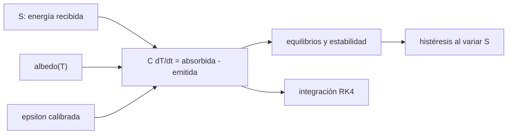

# B54-C19 — Modelos climáticos planetarios

<!-- nav:top -->
[🏠 Programa](../../../../README.md) · [📚 Bloque B54](../../../tronco-comun/B54-atmosferas-y-climatologia-planetaria.md) · [← Anterior: B54-C18 — Medición remota atmosférica](../B54-C18-medicion-remota-atmosferica/CLASE.md) · [Siguiente: B54-C20 — Comparación de habitabilidad climática →](../B54-C20-comparacion-de-habitabilidad-climatica/CLASE.md)
<!-- /nav -->

## 1. Ubicación, nivel y alcance

Clase 19 del bloque B54. Nivel N3. El modelo climático más simple es una sola ecuación: la temperatura cambia según la diferencia entre energía absorbida y emitida. Construyes un **modelo de balance de energía de dimensión cero** con una emisividad efectiva calibrada y una retroalimentación hielo–albedo **sintética**, lo verificas contra soluciones analíticas y exploras equilibrios múltiples e histéresis. Es un modelo de enseñanza, no una predicción.

## 2. Por qué esta clase existe

Un modelo permite preguntar qué pasa si cambia la energía recibida. La pregunta motivadora: **¿puede un mismo planeta tener dos climas estables con la misma energía?** La decisión central: ajustar la emisividad para que la Tierra actual sea un equilibrio y declarar que el resto de los parámetros son sintéticos.

## 3. Lo que podrás hacer al terminar

1. Plantear `C dT/dt = (S/4)(1 − α(T)) − ε σ T⁴`.
2. Calibrar `ε` para que `T = 288 K` sea un equilibrio con `α = 0,294`.
3. Verificar el equilibrio con albedo constante y la relajación lineal con RK4.
4. Encontrar equilibrios y clasificar su estabilidad.
5. Reproducir una histéresis al variar `S` lentamente.
6. Declarar que los parámetros de albedo y `C` son sintéticos.

La evidencia es la **modelo de balance de energía validado** del ejercicio 12 (sección 20).

## 4. Con qué llegas y cómo comprobarlo

1. ¿Qué es una ecuación diferencial?
2. ¿Qué es un equilibrio estable?
3. ¿Qué es la retroalimentación hielo–albedo?
4. ¿Qué es un valor sintético?
5. ¿Qué es una verificación?

<details>
<summary>Ver respuestas</summary>

1. Una ecuación que relaciona una función con su derivada. 2. Uno al que el sistema vuelve tras una perturbación pequeña. 3. El hielo aumenta el albedo y enfría más. 4. Un valor inventado para el ejemplo, no medido. 5. Comparar un cálculo con un caso independiente.
</details>

Con cuatro o cinco aciertos, sigue; si no, repasa los prerrequisitos.

## 5. Un caso de contexto y casos de referencia

Con `S = 1361,0 W/m²` y `T = 288 K` de la ficha de la Tierra (S1) y σ (S2). Capacidad calorífica efectiva `C = 4,0 × 10⁸ J m⁻² K⁻¹` y albedo `0,62` por debajo de `250 K`, `0,294` por encima de `280 K` y lineal entre ambos: **sintéticos**. Es el **ejemplo conductor**.

## 6. Vocabulario

La **capacidad calorífica efectiva** `C` fija la inercia térmica. La **emisividad efectiva** `ε` resume el efecto del invernadero. Un **equilibrio** es una `T` con `dT/dt = 0`; es **estable** si `dT/dt` cambia de + a − al crecer `T`. La **histéresis** es el camino distinto de ida y vuelta al variar `S`. El **tiempo de relajación** es `τ = C/(4 ε σ T³)`.

## 7. Modelo mental: una bola en un paisaje de valles

Los equilibrios estables son valles y los inestables, cimas; la bola (la temperatura) rueda al valle más cercano.



*Descripción textual:* la energía recibida, el albedo dependiente de `T` y la emisividad calibrada dan la ecuación; sus ceros son los equilibrios y la integración muestra la histéresis.

Analogía: la bola en el paisaje. Límite: el paisaje real cambia con el tiempo; aquí solo cambia `S`.

## 8. La explicación, paso a paso

### 8.1 Calibración y verificaciones

La emisividad calibrada es `ε = 0.6158`. Con albedo constante `0,294`, el equilibrio es `288,0 K` (error menor que `10⁻⁹ K`). El tiempo de relajación es `3,80 años`; integrando con RK4 desde `290 K` durante `3 τ`, se obtiene `288,0986 K` frente al valor lineal exacto `288,0996 K`.

### 8.2 Equilibrios

| `S/S₀` | equilibrios (K) y estabilidad |
|---|---|
| 0,80 | 233,3 (estable) |
| 0,90 | 240,3 (estable), 275,3 (inestable), 280,5 (estable) |
| 0,95 | 243,5 (e), 261,6 (i), 284,3 (e) |
| 1,00 | 246,7 (e), 254,9 (i), 288,0 (e) |
| 1,05 | 249,7 (e), 250,4 (i), 291,5 (e) |
| 1,10 | 294,9 (estable) |

Con la energía actual hay dos climas estables (`246,7 K` y `288,0 K`) separados por uno inestable.

### 8.3 Histéresis

Bajando `S` desde `1,00 S₀`, el planeta se mantiene cálido hasta `0,90` (`280,5 K`) y colapsa a `238,9 K` en `0,88`. Subiendo desde `0,70`, permanece frío incluso en `1,00` (`246,7 K`). Ida y vuelta no coinciden.

### 8.4 Lectura

Los números de 8.2 y 8.3 son una consecuencia de la rampa de albedo sintética; no predicen el clima de la Tierra ni de otro planeta.

## 9. Magnitudes, símbolos y unidades

| Símbolo | Qué es | Unidad | Valor / nota |
|---|---|---|---|
| `C` | capacidad calorífica efectiva (sintética) | J m⁻² K⁻¹ | 4,0 × 10⁸ |
| `ε` | emisividad efectiva | — | 0.6158 |
| `α(T)` | albedo (rampa sintética) | — | 0,62 … 0,294 |
| `τ` | tiempo de relajación | años | 3,80 |
| `S` | irradiancia | W/m² | 1361 |

## 10. Convenciones y referencias

Temperaturas en K; tiempo integrado con pasos de 1 día (relajación) o 10 días (barridos); sin estacionalidad ni latitud. Parámetros de albedo y `C` sintéticos.

## 11. De dónde sale lo que afirmamos

| ID | Fuente | Localizador | Respalda | Estado |
|---|---|---|---|---|
| S1 | NASA/NSSDC, *Earth Fact Sheet* | https://nssdc.gsfc.nasa.gov/planetary/factsheet/earthfact.html | presión, densidad, altura de escala, composición, albedo, irradiancia, T de cuerpo negro, gravedad, masa, radio y velocidad de escape de la Tierra | Consultada; datos de ficha; consulta 2026-11-09 |
| S2 | NIST, *CODATA 2022: constante de Stefan–Boltzmann σ* | https://physics.nist.gov/cgi-bin/cuu/Value?sigma | σ = 5,670 374 419 × 10⁻⁸ W m⁻² K⁻⁴ (exacta) | Consultada; consulta 2026-11-09 |

Límites: no se consultó ninguna fuente de modelos de balance de energía; la forma de la ecuación es estándar y se verifica internamente.

## 12. Cómo ver los equilibrios

| Magnitud | Valor |
|---|---|
| `ε` calibrada | 0.6158 |
| equilibrios a `S = S₀` | 246,7 / 254,9 / 288,0 K |
| colapso al bajar `S` | en 0,88 `S₀` |
| `τ` | 3,80 años |

Descripción larga: una gráfica de `dT/dt` frente a `T` corta el eje tres veces para `S = S₀`; las tablas 8.2 y 8.3 dan los puntos.

## 13. Ejemplo trabajado: calibración de ε

**Paso 1 · Absorbida.** `1361(1 − 0,294)/4 = 240.22 W/m²`.

**Paso 2 · Emisión sin `ε`.** `σ 288⁴ = 390.11 W/m²`.

**Paso 3 · Cociente.** `ε = 0.6158`.

## 14. Distintas formas de analizar el modelo

**Integración temporal:** sigue la evolución. **Búsqueda de ceros:** da los equilibrios. **Barrido de `S`:** muestra la histéresis. Las tres se hacen en el laboratorio.

## 15. Práctica guiada

**Ejercicio 1 · con los pasos indicados.** Calcula la energía absorbida con `S = 1361` y `α = 0,294`. *Pasos:* `S(1 − α)/4`.

<details><summary>Solución comentada</summary>

`240.22 W/m²`.
</details>

**Ejercicio 2 · con una pista.** Calcula `ε σ T⁴` a 288 K con `ε = 0,6158`.

<details><summary>Solución comentada</summary>

`240.22 W/m²`.
</details>

**Ejercicio 3 · casi autónomo.** Calcula `τ = C/(4 ε σ T³)` en años.

<details><summary>Solución comentada</summary>

`3.80 años`.
</details>

## 16. Práctica autónoma, transferencia e integrador

**Ejercicio 4 · autónomo.** ¿Qué `α` da equilibrio a 246,7 K con `S = 1361`?

<details><summary>Solución comentada</summary>

`0,62` (rama fría de la rampa).
</details>

**Ejercicio 5 · autónomo.** ¿Cuántos equilibrios hay con `S/S₀ = 1,10`?

<details><summary>Solución comentada</summary>

Uno solo, cálido (294,9 K).
</details>

**Ejercicio 6 · autónomo.** ¿Y con `S/S₀ = 0,80`?

<details><summary>Solución comentada</summary>

Uno solo, frío (233,3 K).
</details>

**Ejercicio 7 · autónomo.** ¿Por qué el equilibrio intermedio es inestable?

<details><summary>Solución comentada</summary>

Porque a su izquierda `dT/dt` es negativa y a su derecha positiva: cualquier perturbación se amplifica.
</details>

**Ejercicio 8 · autónomo.** Calcula la sensibilidad `dT/dS` del equilibrio sin retroalimentación (`T ∝ S^{1/4}`) a 288 K.

<details><summary>Solución comentada</summary>

`T/(4S) = 0.0529 K por W/m²`.
</details>

**Ejercicio 9 · transferencia.** **Transferencia.** Un colega dice que el modelo predice un 'planeta bola de nieve' si baja el Sol 12 %. ¿Qué respondes?

<details><summary>Solución comentada</summary>

Que es un resultado de una rampa de albedo sintética; no se calibró con datos y no predice nada sobre un planeta real.
</details>

**Ejercicio 10 · transferencia.** **Transferencia.** ¿Qué cambiaría con `C` diez veces mayor?

<details><summary>Solución comentada</summary>

El tiempo de relajación pasaría a 38 años y los barridos de 10 días por paso serían demasiado rápidos para ser cuasiestáticos.
</details>

**Ejercicio 11 · transferencia.** **Transferencia.** ¿Por qué el modelo no puede dar la distribución de temperatura por latitud?

<details><summary>Solución comentada</summary>

Porque tiene una sola temperatura global; faltan transporte y estacionalidad.
</details>

**Ejercicio 12 · integrador.** **Integrador.** Elabora tu *modelo de balance de energía validado*: calibración, verificaciones, tabla de equilibrios e histéresis.

<details><summary>Solución comentada</summary>

Secciones 8.1–8.4 y salida del laboratorio.
</details>

## 17. Laboratorio: balance de energía con retroalimentación hielo–albedo

El script [ebm.py](ebm.py) integra el modelo, encuentra equilibrios y reproduce la histéresis (**comprueba** el equilibrio de 288 K y la relajación contra la solución lineal).

**Datos:** `S` y T de la ficha NASA de la Tierra (S1), σ de NIST (S2); albedo y `C` sintéticos. **Predice antes de ejecutar:** ¿Cuántos equilibrios hay con `S = S₀`? (tres.) **Ejecución del 2026-11-09 (Python 3.12.9):**

```text
Python 3.12.9 (biblioteca estandar)
eps calibrada = 0.6158
Escala de tiempo de relajacion = 3.80 anios
Relajacion a 3 tau desde 290 K: numerico = 288.0986 K ; lineal exacto = 288.0996 K
S/S_0   equilibrios [K] (estabilidad)
 0.80    233.3 (estable)
 0.90    240.3 (estable),  275.3 (inestable),  280.5 (estable)
 0.95    243.5 (estable),  261.6 (inestable),  284.3 (estable)
 1.00    246.7 (estable),  254.9 (inestable),  288.0 (estable)
 1.05    249.7 (estable),  250.4 (inestable),  291.5 (estable)
 1.10    294.9 (estable)
S/S_0   T al bajar S [K]   T al subir S [K]
 1.00            288.0              246.7
 0.98            286.5              245.4
 0.96            285.1              244.2
 0.94            283.6              242.9
 0.92            282.1              241.6
 0.90            280.5              240.3
 0.88            238.9              238.9
 0.86            237.6              237.6
 0.84            236.2              236.2
 0.82            234.7              234.7
 0.80            233.3              233.3
 0.78            231.8              231.8
 0.76            230.3              230.3
 0.74            228.8              228.8
 0.72            227.2              227.2
 0.70            225.6              225.6
Pruebas superadas.
```

```bash
python programa/clases/B54/B54-C19-modelos-climaticos-planetarios/ebm.py
```

**Límites:** dimensión cero, sin transporte ni estacionalidad.

## 18. Errores frecuentes y cómo corregirlos

**Interpretar el colapso como predicción.** Se corrige con 8.4.

**Olvidar la calibración de `ε`.** Se corrige con 8.1.

**Confundir equilibrio y estabilidad.** Se corrige con la sección 6.

**Barrer `S` demasiado rápido.** Se corrige con el ejercicio 10.

## 19. Cómo sabrás que vas bien

Tras la sección 8: ¿cuántos equilibrios esperabas con `S = S₀` y cuántos obtuviste? Si dudas, repasa el ejemplo 13. Tras el laboratorio: ¿qué comprueba? (ver la sección 17).

## 20. Qué entregas y cómo se evalúa

El producto es tu **modelo de balance de energía validado** (ejercicio 12).

| Criterio | Inicial | En desarrollo | Logrado | Destacado |
|---|---|---|---|---|
| Conceptos | Los confunde | Parciales | Balance de energía, equilibrios e histéresis | Explica los límites |
| Cálculo | Sin unidades | Con errores | Tablas completas con unidades | Calcula casos nuevos |
| Numérico | Sin comprobar | Un caso | Contraste con el caso analítico o la ficha | Interpreta las diferencias |
| Fuentes | Sin fuente | Sin fecha | Fuentes con fecha | Declara lo sintético y lo no consultado |
| Límites | No los nombra | Uno | Tres | Discute qué falta del modelo |

**Condiciones críticas (no se compensan con promedio):** rotular el albedo y `C` como sintéticos; no predecir climas reales; citar solo lo consultado.

## 21. Ética, seguridad y límites

Clase educativa: modelo de enseñanza. Accesibilidad: tablas equivalentes a las gráficas, fórmulas en texto, ejercicios sin conexión.

## 22. Para cerrar y seguir

Con la misma energía el modelo sintético tiene dos climas estables, uno de 247 K y otro de 288 K. Queda una pregunta: ¿cómo comparar condiciones climáticas de varios mundos sin sobrestimar lo que dicen?

**Glosario español–inglés.** balance de energía · *energy balance*; retroalimentación hielo–albedo · *ice–albedo feedback*; histéresis · *hysteresis*; equilibrio estable · *stable equilibrium*; tiempo de relajación · *relaxation time*.

**Continuidad.** [B54-C20](../B54-C20-comparacion-de-habitabilidad-climatica/CLASE.md) compara las condiciones climáticas de varios mundos.

**Referencias:** ver sección 11.

<!-- nav:bottom -->
---

[← Anterior: B54-C18 — Medición remota atmosférica](../B54-C18-medicion-remota-atmosferica/CLASE.md) · [📚 Bloque B54](../../../tronco-comun/B54-atmosferas-y-climatologia-planetaria.md) · [Siguiente: B54-C20 — Comparación de habitabilidad climática →](../B54-C20-comparacion-de-habitabilidad-climatica/CLASE.md)
<!-- /nav -->
