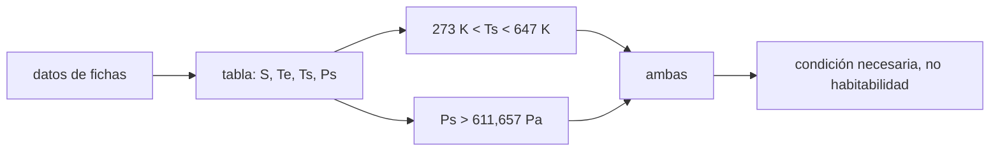

# B54-C20 — Comparación de habitabilidad climática

<!-- nav:top -->
[🏠 Programa](../../../../README.md) · [📚 Bloque B54](../../../tronco-comun/B54-atmosferas-y-climatologia-planetaria.md) · [← Anterior: B54-C19 — Modelos climáticos planetarios](../B54-C19-modelos-climaticos-planetarios/CLASE.md) · [Siguiente: B55-C01 — Abundancia química cósmica →](../../B55/B55-C01-abundancia-quimica-cosmica/CLASE.md)
<!-- /nav -->

## 1. Ubicación, nivel y alcance

Clase 20 del bloque B54, cierre del bloque. Nivel N3. Reúnes Venus, la Tierra, Marte y Titán en una tabla de condiciones climáticas: instalación relativa, temperatura de equilibrio, efecto atmosférico y tres condiciones **necesarias, no suficientes** para agua líquida en la superficie. El indicador **no mide habitabilidad**.

## 2. Por qué esta clase existe

Comparar mundos tienta a ordenarlos por «habitabilidad». La pregunta motivadora: **¿qué dicen realmente la temperatura y la presión de superficie sobre la posibilidad de agua líquida?** La decisión central: usar condiciones necesarias y declararlas como tales.

## 3. Lo que podrás hacer al terminar

1. Construir una tabla comparativa con datos de fichas y recalcular `T_e`.
2. Calcular el efecto atmosférico `T_s − T_e`.
3. Aplicar tres condiciones necesarias para agua líquida.
4. Situar los semiejes de Venus, la Tierra y Marte respecto de 0,99–1,70 UA.
5. Interpretar el resultado sin llamarlo habitabilidad.
6. Declarar lo derivado, lo sintético y lo no consultado.

La evidencia es la **tabla comparativa de condiciones climáticas** del ejercicio 12 (sección 20).

## 4. Con qué llegas y cómo comprobarlo

1. ¿Qué es el punto triple del agua?
2. ¿Qué es una condición necesaria?
3. ¿Qué es `T_e`?
4. ¿Qué es un valor sintético?
5. ¿Qué es una verificación?

<details>
<summary>Ver respuestas</summary>

1. La `T` y `P` donde coexisten sólido, líquido y vapor. 2. Una que debe cumplirse, pero que no garantiza el resultado. 3. La temperatura de equilibrio (B54-C03). 4. Un valor inventado para el ejemplo, no medido. 5. Comparar un cálculo con un caso independiente.
</details>

Con cuatro o cinco aciertos, sigue; si no, repasa los prerrequisitos.

## 5. Un caso de contexto y casos de referencia

Fichas NASA de Venus, la Tierra y Marte (S1–S3); Titán: página de NASA Science (S4; `94,15 K`, presión «60 % mayor que la terrestre»), instalación `1361/9,58²` con 9,58 UA (**no consultado**) y albedo **sintético** `0,3`. Punto triple del agua (`273,16 K`, `611,657 Pa`) y temperatura crítica (`647,1 K`): estándar **no consultados**. Bordes solares 0,99–1,70 UA del resumen de Kopparapu et al. (S6). Es el **ejemplo conductor**.

## 6. Vocabulario

Una **condición necesaria** debe cumplirse, pero no basta. La **instalación relativa** es `S/S_Tierra`. El **efecto atmosférico** es `T_s − T_e`. La **zona habitable** es un intervalo que depende del modelo. El **agua líquida en superficie** exige, al menos, `P > 611,657 Pa` y `273,16 K < T < 647,1 K`.

## 7. Modelo mental: un filtro con tres rendijas

Un filtro con rendijas deja pasar solo lo que cabe por todas; pasar el filtro no garantiza que algo sea valioso.



*Descripción textual:* los datos de fichas dan la tabla; las condiciones de temperatura y presión se combinan en una condición necesaria que no es habitabilidad.

Analogía: el filtro con rendijas. Límite: quien cumple los requisitos puede no ser habitable por otras razones (química, radiación, energía).

## 8. La explicación, paso a paso

### 8.1 Tabla

| mundo | `S/S☉` | `T_e` (K) | `T_s` (K) | `T_s − T_e` (K) | `P_s` (Pa) | `273 < T < 647 K` | `P > 611,7 Pa` | ambas |
|---|---|---|---|---|---|---|---|---|
| Venus | 1,911 | 226,6 | 737,0 | 510,4 | 9,2 × 10⁶ | no | sí | no |
| Tierra | 1,000 | 255,1 | 288,0 | 32,9 | 101 400 | sí | sí | sí |
| Marte | 0,431 | 209,8 | 214,0 | 4,2 | 636 | no | sí | no |
| Titán | 0,011 | 82,3 | 94,2 | 11,9 | 162 120 | no | sí | no |

Los `T_e` de Venus y Marte coinciden con las fichas dentro de 0,3 K (comprobado). La presión de Titán es derivada y su `T_e` usa un albedo sintético.

### 8.2 Posición respecto del intervalo solar

Los semiejes `0,7233` (Venus), `1,0000` (Tierra) y `1,5237 UA` (Marte) se comparan con 0,99–1,70 UA (modelo 1-D sin nubes, solo resumen): Venus queda interior, la Tierra y Marte dentro. Ese intervalo describe un modelo y no es una predicción sobre un planeta concreto.

### 8.3 Lectura

Solo la Tierra cumple las tres condiciones. Marte, con `P/P_triple = 1,04`, cumple por poco la de presión y falla la de temperatura media (`214 K`). Venus supera la temperatura crítica. Titán no cumple la de temperatura. Que un mundo falle estas condiciones no dice nada sobre otros tipos de habitabilidad, y que las cumpla no basta para ser habitable.

## 9. Magnitudes, símbolos y unidades

| Símbolo | Qué es | Unidad | Valor / nota |
|---|---|---|---|
| `S/S☉` | instalación relativa | — | 0,011 … 1,911 |
| `T_e` | temperatura de equilibrio | K | 82,3 … 255,1 |
| `T_s − T_e` | efecto atmosférico | K | 4,2 … 510,4 |
| `P_s` | presión de superficie | Pa | 636 … 9,2 × 10⁶ |
| `T_c` | temperatura crítica del agua (estándar) | K | 647,1 |

## 10. Convenciones y referencias

Datos de superficie de las fichas; Titán derivado. Condiciones de temperatura y presión de superficie media, que no reflejan variaciones locales ni estacionales.

## 11. De dónde sale lo que afirmamos

| ID | Fuente | Localizador | Respalda | Estado |
|---|---|---|---|---|
| S1 | NASA/NSSDC, *Venus Fact Sheet* | https://nssdc.gsfc.nasa.gov/planetary/factsheet/venusfact.html | presión, densidad, altura de escala, T, composición, albedo, irradiancia, gravedad y masa de Venus | Consultada; datos de ficha; consulta 2026-11-09 |
| S2 | NASA/NSSDC, *Earth Fact Sheet* | https://nssdc.gsfc.nasa.gov/planetary/factsheet/earthfact.html | presión, densidad, altura de escala, composición, albedo, irradiancia, T de cuerpo negro, gravedad, masa, radio y velocidad de escape de la Tierra | Consultada; datos de ficha; consulta 2026-11-09 |
| S3 | NASA/NSSDC, *Mars Fact Sheet* | https://nssdc.gsfc.nasa.gov/planetary/factsheet/marsfact.html | presión (y su rango estacional), densidad, altura de escala, T, composición, albedo, irradiancia, gravedad y masa de Marte | Consultada; datos de ficha; consulta 2026-11-09 |
| S4 | NASA Science, *Titan Facts* | https://science.nasa.gov/saturn/moons/titan/facts/ | T de superficie (−179 °C), ~95 % N₂, ~5 % CH₄ y presión «60 % mayor que la terrestre» (sin valor absoluto) | Consultada; consulta 2026-11-09 |
| S5 | NIST, *CODATA 2022: constante de Stefan–Boltzmann σ* | https://physics.nist.gov/cgi-bin/cuu/Value?sigma | σ = 5,670 374 419 × 10⁻⁸ W m⁻² K⁻⁴ (exacta) | Consultada; consulta 2026-11-09 |
| S6 | Kopparapu et al., *Habitable Zones Around Main-Sequence Stars: New Estimates (ApJ, 2013)* | arXiv:1301.6674 (https://arxiv.org/abs/1301.6674) | bordes de la zona habitable solar ≈ 0,99 y 1,70 UA en un modelo 1-D sin nubes | Solo el resumen; consulta 2026-11-09 |

Límites: punto triple, temperatura crítica y semieje de Saturno no consultados; albedo de Titán sintético; de Kopparapu et al. solo el resumen; las condiciones son necesarias, no suficientes.

## 12. Cómo ver la comparación

| Magnitud | Valor |
|---|---|
| mundos que cumplen las tres condiciones | Tierra |
| `T_s − T_e` mayor | Venus, 510,4 K |
| `P_s/P_triple` de Marte | 1,04 |
| `S/S☉` de Titán | 0,011 |

Descripción larga: un gráfico de `T_s` frente a `P_s` con el rectángulo de condiciones deja solo a la Tierra dentro; la tabla 8.1 da los datos.

## 13. Ejemplo trabajado: las condiciones de Marte

**Paso 1 · Temperatura.** `214 K` no está entre `273,16` y `647,1 K`: falla.

**Paso 2 · Presión.** `636/611,657 = 1.04`: cumple.

**Paso 3 · Conjunto.** `falla ∧ cumple = falla`.

## 14. Distintas formas de comparar mundos

**Por condiciones necesarias:** lo que se hace. **Por intervalo de instalación:** bordes de un modelo. **Por balance de energía y modelo climático:** B54-C19. Ninguna sustituye el análisis de química y energía disponible.

## 15. Práctica guiada

**Ejercicio 1 · con los pasos indicados.** Calcula `S/S☉` de Marte. *Pasos:* `586,2/1361`.

<details><summary>Solución comentada</summary>

`0.431`.
</details>

**Ejercicio 2 · con una pista.** Calcula `T_e` de Titán con `S = 1361/9,58²` y `A = 0,3`.

<details><summary>Solución comentada</summary>

`82.3 K`.
</details>

**Ejercicio 3 · casi autónomo.** ¿Cuántas veces es `P_s` terrestre mayor que el punto triple?

<details><summary>Solución comentada</summary>

`166`.
</details>

## 16. Práctica autónoma, transferencia e integrador

**Ejercicio 4 · autónomo.** ¿Qué condición de Venus falla?

<details><summary>Solución comentada</summary>

La de temperatura: 737 K supera 647,1 K.
</details>

**Ejercicio 5 · autónomo.** ¿Qué condición de Titán falla?

<details><summary>Solución comentada</summary>

La de temperatura: 94,2 K está por debajo de 273,16 K.
</details>

**Ejercicio 6 · autónomo.** Calcula `T_s − T_e` de Titán y explica por qué depende del albedo sintético.

<details><summary>Solución comentada</summary>

`11.9 K`; un albedo distinto cambia `T_e` y por tanto la diferencia.
</details>

**Ejercicio 7 · autónomo.** ¿Qué le pasa a `T_e` de Marte si su albedo fuera 0,10?

<details><summary>Solución comentada</summary>

`219.6 K`, a pesar de lo cual `T_s` sigue por debajo de 273,16 K en el cálculo del promedio.
</details>

**Ejercicio 8 · autónomo.** ¿A qué `T_s` mínima debería llegar Marte, con `P` actual, para cumplir las dos condiciones?

<details><summary>Solución comentada</summary>

`273,16 K`: unos 59 K sobre su media de 214 K.
</details>

**Ejercicio 9 · transferencia.** **Transferencia.** Un colega dice que Titán 'no es habitable' porque falla la condición del agua. ¿Qué respondes?

<details><summary>Solución comentada</summary>

Que la condición es solo para agua líquida en superficie; no dice nada de otros disolventes ni de otros ambientes, y el cálculo no es una evaluación de habitabilidad.
</details>

**Ejercicio 10 · transferencia.** **Transferencia.** ¿Por qué la Tierra cumple las condiciones y eso no prueba que sea habitable por sí solo?

<details><summary>Solución comentada</summary>

Porque son necesarias; la habitabilidad depende además de química, energía y estabilidad, que aquí no se evalúan.
</details>

**Ejercicio 11 · transferencia.** **Transferencia.** ¿Qué agregarías para comparar un exoplaneta?

<details><summary>Solución comentada</summary>

Su instalación, un rango de `f` (B54-C17) y la incertidumbre de albedo; aun así solo habría `T_e`, no `T_s`.
</details>

**Ejercicio 12 · integrador.** **Integrador.** Elabora tu *tabla comparativa de condiciones climáticas*: `S`, `T_e`, `T_s`, `P_s` y las tres condiciones para los cuatro mundos, con sus fuentes y límites.

<details><summary>Solución comentada</summary>

Secciones 8.1–8.3 y salida del laboratorio.
</details>

## 17. Laboratorio: tabla comparativa de condiciones climáticas

El script [habitabilidad.py](habitabilidad.py) reúne los datos de cuatro mundos y evalúa tres condiciones necesarias (**comprueba** `T_e` de Venus y Marte frente a las fichas con 0,3 K).

**Datos:** fichas NASA (S1–S3), página de Titán (S4), σ de NIST (S5), resumen de S6; Titán con albedo sintético. **Predice antes de ejecutar:** ¿Qué mundos cumplen las tres condiciones? (solo la Tierra.) **Ejecución del 2026-11-09 (Python 3.12.9):**

```text
Python 3.12.9 (biblioteca estandar)
mundo     S/S_T   Te [K]   Ts [K]  Delta [K]  Ps [Pa]    273<T<647 P>611.7  ambas
Venus      1.911    226.6    737.0     510.4   9200000.0     False     True  False
Tierra     1.000    255.1    288.0      32.9    101400.0      True     True   True
Marte      0.431    209.8    214.0       4.2       636.0     False     True  False
Titan      0.011     82.3     94.2      11.9    162120.0     False     True  False
Venus   a = 0.7233 UA: interior al borde interno del intervalo 0.99-1.70 UA (Sol, modelo sin nubes)
Tierra  a = 1.0000 UA: dentro del intervalo 0.99-1.70 UA (Sol, modelo sin nubes)
Marte   a = 1.5237 UA: dentro del intervalo 0.99-1.70 UA (Sol, modelo sin nubes)
Marte: P_media / P_punto_triple = 1.04 (por encima del umbral por poco; con T media de 214 K el agua no es liquida)
Pruebas superadas.
```

```bash
python programa/clases/B54/B54-C20-comparacion-de-habitabilidad-climatica/habitabilidad.py
```

**Límites:** condiciones necesarias, no suficientes; valores medios.

## 18. Errores frecuentes y cómo corregirlos

**Llamar habitabilidad a la tabla.** Se corrige con la sección 1.

**Tratar una condición necesaria como suficiente.** Se corrige con 8.3.

**Olvidar que Titán es derivado y sintético en parte.** Se corrige con la sección 11.

**Aplicar el intervalo solar a otra estrella.** Se corrige con 8.2.

## 19. Cómo sabrás que vas bien

Tras la sección 8: ¿qué mundos esperabas que cumplieran y cuáles lo hicieron? Si dudas, repasa el ejemplo 13. Tras el laboratorio: ¿qué comprueba? (ver la sección 17).

## 20. Qué entregas y cómo se evalúa

El producto es tu **tabla comparativa de condiciones climáticas** (ejercicio 12).

| Criterio | Inicial | En desarrollo | Logrado | Destacado |
|---|---|---|---|---|
| Conceptos | Los confunde | Parciales | Condiciones necesarias y comparación | Explica los límites |
| Cálculo | Sin unidades | Con errores | Tablas completas con unidades | Calcula casos nuevos |
| Numérico | Sin comprobar | Un caso | Contraste con el caso analítico o la ficha | Interpreta las diferencias |
| Fuentes | Sin fuente | Sin fecha | Fuentes con fecha | Declara lo sintético y lo no consultado |
| Límites | No los nombra | Uno | Tres | Discute qué falta del modelo |

**Condiciones críticas (no se compensan con promedio):** no llamar habitabilidad al indicador; rotular lo derivado y sintético; citar solo lo consultado.

## 21. Ética, seguridad y límites

Clase educativa. No afirma que ningún mundo sea o no habitable. Accesibilidad: tablas equivalentes a las gráficas, fórmulas en texto, ejercicios sin conexión.

## 22. Para cerrar y seguir

Solo la Tierra cumple las tres condiciones necesarias de la tabla, y eso no basta para concluir nada más. Esto cierra el bloque; el siguiente trata la astroquímica extraterrestre.

**Glosario español–inglés.** condición necesaria · *necessary condition*; punto triple · *triple point*; temperatura crítica · *critical temperature*; zona habitable · *habitable zone*; agua líquida · *liquid water*.

**Continuidad.** Fin del bloque B54; sigue [B55](../../../tronco-comun/B55-astroquimica-y-geoquimica-extraterrestre.md).

**Referencias:** ver sección 11.

<!-- nav:bottom -->
---

[← Anterior: B54-C19 — Modelos climáticos planetarios](../B54-C19-modelos-climaticos-planetarios/CLASE.md) · [📚 Bloque B54](../../../tronco-comun/B54-atmosferas-y-climatologia-planetaria.md) · [Siguiente: B55-C01 — Abundancia química cósmica →](../../B55/B55-C01-abundancia-quimica-cosmica/CLASE.md)
<!-- /nav -->
