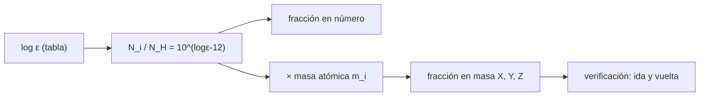

# B55-C01 — Abundancia química cósmica

<!-- nav:top -->
[🏠 Programa](../../../../README.md) · [📚 Bloque B55](../../../tronco-comun/B55-astroquimica-y-geoquimica-extraterrestre.md) · [← Anterior: B54-C20 — Comparación de habitabilidad climática](../../B54/B54-C20-comparacion-de-habitabilidad-climatica/CLASE.md) · [Siguiente: B55-C02 — Nucleosíntesis y elementos →](../B55-C02-nucleosintesis-y-elementos/CLASE.md)
<!-- /nav -->

## 1. Ubicación, nivel y alcance

Clase 1 del bloque B55 (área A05), nivel N3. Abre el bloque: antes de hablar de reacciones hay que saber **de qué está hecha** la materia que reacciona. Aprendes la escala logarítmica `log ε` con que se publican las abundancias, cómo pasar de ella a fracciones en número y en masa (`X`, `Y`, `Z`) y qué cambia al modificar un elemento. Usas logaritmos y proporciones; no necesitas química previa. Las abundancias de la clase son **ilustrativas**.

## 2. Por qué esta clase existe

Cualquier modelo químico del espacio parte de una composición inicial: cuánto hidrógeno, helio, carbono u oxígeno hay. Las fuentes dan esa composición en una escala logarítmica poco intuitiva, y los modelos piden fracciones en número o en masa. La decisión central: **¿cómo convierto una tabla de `log ε` en las fracciones que necesita mi cálculo, y cuánto me cambia el resultado un error de 0,1 dex en un elemento?**

## 3. Lo que podrás hacer al terminar

1. Definir `log ε` y recuperar `N_i/N_H` a partir de él.
2. Calcular fracciones en número y en masa de una mezcla de elementos.
3. Obtener `X`, `Y` y `Z` y la razón `Z/X`.
4. Calcular cocientes como C/O en número y en masa, y distinguirlos.
5. Comprobar una conversión con una ida y vuelta y con una segunda vía de cálculo.
6. Estimar la sensibilidad de `Z` a un cambio de abundancia.

La evidencia es la **ficha de composición de una mezcla** del ejercicio 12 (sección 20).

## 4. Con qué llegas y cómo comprobarlo

1. ¿Qué es una masa atómica relativa?
2. ¿Qué es un dex?
3. ¿Qué significa «fracción en masa»?
4. ¿Qué es un valor ilustrativo?
5. ¿Qué es una ida y vuelta?

<details>
<summary>Ver respuestas</summary>

1. La masa de un átomo en unidades de masa atómica `u`, relativa a 1/12 del carbono-12. 2. Una unidad de logaritmo decimal: 1 dex es un factor 10. 3. La masa de un componente dividida por la masa total. 4. Un valor propuesto para el ejemplo, no medido. 5. Convertir y volver al punto de partida para verificar que se recupera el dato.
</details>

Con cuatro o cinco aciertos, sigue; si no, repasa los prerrequisitos.

## 5. Un caso de contexto y casos de referencia

Una mezcla de gas de ocho elementos (H, He, C, N, O, Mg, Si, Fe) con abundancias **ilustrativas** de orden solar: `log ε` = 12,00 para H y 10,90 para He, 8,40 para C, 7,80 para N, 8,70 para O, 7,55 para Mg y 7,50 para Si y Fe. Es el **ejemplo conductor**: en la sección 13 se obtienen sus fracciones y en los ejercicios se modifican. No son los valores de Asplund et al. (2009) (S1), de quienes solo se leyó el resumen, que informa de abundancias de C, N, O y Ne más bajas que las usadas una década antes; sirve de contexto de que **estas cifras se revisan**.

## 6. Vocabulario

La **abundancia logarítmica** `log ε_i = log₁₀(N_i/N_H) + 12` fija el hidrógeno en 12 por definición. La **fracción en número** es `N_i / ΣN`; la **fracción en masa** es `N_i m_i / ΣN_j m_j`. `X`, `Y` y `Z` son las fracciones en masa de hidrógeno, helio y todo lo demás (los «metales» de la astrofísica). Un **dex** es un factor 10 en el logaritmo. La **metalicidad** es `Z` o la razón `Z/X`. Un **cociente C/O** es la razón del número de átomos de carbono al de oxígeno.

## 7. Modelo mental: una receta con porciones

Piensa en la composición como una receta: la escala `log ε` da las porciones **en número de átomos** respecto de una unidad de hidrógeno; para saber cuánto **pesa** cada ingrediente hay que multiplicar por su masa atómica.



*Descripción textual:* la tabla logarítmica se exponencia para obtener cantidades relativas al hidrógeno; multiplicadas por la masa atómica y normalizadas dan las fracciones en masa, que se verifican convirtiendo de vuelta.

Analogía: una receta donde las porciones se dan en cucharadas y hay que convertir a gramos según la densidad de cada ingrediente. Límite: los átomos no se mezclan en proporciones libres: la composición real obedece a la nucleosíntesis (C02) y a la química (C03).

## 8. La explicación, paso a paso

### 8.1 De `log ε` a cantidades relativas

Despeja `N_i/N_H = 10^(log ε_i − 12)`. Cada +1 dex multiplica la cantidad por 10. Para el oxígeno ilustrativo, `10^(8,70−12) = 5,01 × 10⁻⁴` átomos de O por átomo de H.

### 8.2 Masas atómicas

El laboratorio calcula las masas de H, C, N y O con las masas isotópicas y las composiciones isotópicas del NIST (S2) y usa los pesos atómicos estándar del NIST para He, Mg, Si y Fe (S2). Resultan H = 1,00794, C = 12,01074, O = 15,99940 u.

### 8.3 Fracciones en número y en masa

| elemento | `log ε` | `N/N_H` | fracción en número | fracción en masa |
|---|---|---|---|---|
| H | 12,00 | 1,0000 | 9,256 × 10⁻¹ | 7,515 × 10⁻¹ |
| He | 10,90 | 7,943 × 10⁻² | 7,353 × 10⁻² | 2,370 × 10⁻¹ |
| C | 8,40 | 2,512 × 10⁻⁴ | 2,325 × 10⁻⁴ | 2,249 × 10⁻³ |
| N | 7,80 | 6,310 × 10⁻⁵ | 5,840 × 10⁻⁵ | 6,589 × 10⁻⁴ |
| O | 8,70 | 5,012 × 10⁻⁴ | 4,639 × 10⁻⁴ | 5,978 × 10⁻³ |
| Mg | 7,55 | 3,548 × 10⁻⁵ | 3,284 × 10⁻⁵ | 6,429 × 10⁻⁴ |
| Si | 7,50 | 3,162 × 10⁻⁵ | 2,927 × 10⁻⁵ | 6,621 × 10⁻⁴ |
| Fe | 7,50 | 3,162 × 10⁻⁵ | 2,927 × 10⁻⁵ | 1,317 × 10⁻³ |

Mira que el helio es el 7,4 % de los átomos pero el 23,7 % de la masa: **número y masa cuentan historias distintas**.

### 8.4 `X`, `Y`, `Z` y cocientes

`X = 0,75146`, `Y = 0,23703`, `Z = 1 − X − Y = 0,011508` (de esta mezcla de ocho elementos) y `Z/X = 0,015314`. El cociente C/O en número es `0,5012` y en masa `0,3762`: el carbono pesa menos por átomo que el oxígeno, de modo que **el cociente en masa no es el cociente en número**.

### 8.5 Sensibilidad

Subir el oxígeno 0,10 dex lleva `Z` de `0,011508` a `0,013036` (+13 %). Los errores de abundancia de los elementos pesados se propagan casi linealmente a `Z`.

## 9. Magnitudes, símbolos y unidades

| Símbolo | Qué es | Unidad | Valor / nota |
|---|---|---|---|
| `ε_i` | abundancia logarítmica del elemento i | dex (con H = 12) | 8,70 (O, ilustrativo) |
| `N_i/N_H` | átomos de i por átomo de H | — | 5,01 × 10⁻⁴ (O) |
| `m_i` | masa atómica | u | 15,9994 (O) |
| `X, Y, Z` | fracciones en masa de H, He y el resto | — | 0,75146; 0,23703; 0,011508 |
| `C/O` | cociente de átomos de carbono a oxígeno | — | 0,5012 |

## 10. Convenciones y referencias

Sistema de referencia: composición de un gas, sin dependencia espacial. Escala `log ε` con H = 12. Pesos atómicos estándar del NIST (los intervalos de Mg y Si se tomaron en su punto medio, con efecto despreciable en la tercera cifra). Versiones: Python 3.12.9, biblioteca estándar. Tolerancias: suma de masas 1 a 1e-12; ida y vuelta 1e-10 dex.

## 11. De dónde sale lo que afirmamos

| ID | Fuente | Localizador | Respalda | Estado |
|---|---|---|---|---|
| S1 | Asplund, Grevesse, Sauval y Scott, «The chemical composition of the Sun», *Annu. Rev. Astron. Astrophys.* 47, 481 (2009) | arXiv:0909.0948 | contexto: los valores de abundancia solar se revisan (C, N, O, Ne más bajos que los de una década antes); no se usó ninguna cifra | Consultada el 2026-11-09; solo resumen |
| S2 | NIST, *Atomic Weights and Isotopic Compositions for All Elements* | https://physics.nist.gov/cgi-bin/Compositions/stand_alone.pl | masas isotópicas y abundancias isotópicas de H, C, N, O y pesos atómicos estándar de He, Mg, Si, Fe | Consultada el 2026-11-09; consultada (tabla de isótopos seleccionados) |
| — | Sin fuente externa para el resto | — | relaciones y valores que verifica el laboratorio con una segunda vía de cálculo; los parámetros de modelo se rotulan ilustrativos | No se consultó una fuente para esta parte |

Límites: las abundancias numéricas de la mezcla son ilustrativas; del artículo de Asplund et al. solo se leyó el resumen y no se extrajo ningún valor.

## 12. Cómo ver la composición en número y en masa

| Elemento | Fracción en número (%) | Fracción en masa (%) |
|---|---|---|
| H | 92,56 | 75,15 |
| He | 7,35 | 23,70 |
| O | 0,046 | 0,598 |
| C | 0,023 | 0,225 |

Descripción larga: un diagrama de barras con dos barras por elemento mostraría que el helio crece al pasar de número a masa, y que los elementos pesados aumentan unas diez veces.

## 13. Ejemplo trabajado: fracciones de la mezcla conductora

**Paso 1 · Cantidades relativas.** Para O: `10^(8,70−12) = 5,012 × 10⁻⁴`.

**Paso 2 · Total.** `ΣN/N_H = 1,0803` (suma de la columna `N/N_H`).

**Paso 3 · Fracción en número de O.** `5,012 × 10⁻⁴ / 1,0803 = 4,639 × 10⁻⁴`.

**Paso 4 · Masa.** `N m = 5,012 × 10⁻⁴ × 15,9994 = 8,019 × 10⁻³` y la suma de todos los `N m` vale `1,3413`: fracción `5,978 × 10⁻³`.

## 14. Distintas formas de expresar una composición

**Por `log ε`:** compacta y cómoda para comparar con espectros. **Por fracción en número:** natural para la química (reacciones entre átomos). **Por fracción en masa:** natural para la dinámica y la estructura. **Por `X, Y, Z`:** resumen de tres números para modelos estelares. Se elige según la pregunta: reacciones → número; masa total → masa.

## 15. Práctica guiada

**Ejercicio 1 · con los pasos indicados.** Calcula `N_C/N_H` para `log ε` = 8,40 (sección 8.1).

<details><summary>Solución comentada</summary>

`10^(8,40−12) = 10^(−3,6) = 2,512 × 10⁻⁴`.
</details>

**Ejercicio 2 · con una pista.** Calcula el cociente C/O en número a partir de los `log ε` (sección 8.4). *Pista:* basta restar.

<details><summary>Solución comentada</summary>

`10^(8,40−8,70) = 10^(−0,30) = 0,5012`.
</details>

**Ejercicio 3 · casi autónomo.** Sin recalcular todo, ¿qué fracción en masa tendría el oxígeno si sus átomos pesasen la mitad? (sección 8.3). *Casi autónomo.*

<details><summary>Solución comentada</summary>

Se compara el producto `N m`: pasa de `8,019 × 10⁻³` a la mitad, `4,01 × 10⁻³`, y el total baja de `1,3413` a `1,3373`; la fracción es `4,01 × 10⁻³ / 1,3373 = 3,0 × 10⁻³`, casi la mitad de `5,978 × 10⁻³`. La renormalización cambia poco porque el oxígeno es una parte pequeña de la masa.
</details>

## 16. Práctica autónoma, transferencia e integrador

**Ejercicio 4 · autónomo.** Calcula la razón `Y/X` a partir de `log ε` y las masas atómicas de H y He (secciones 8.1 y 8.3).

<details><summary>Solución comentada</summary>

`Y/X = (7,943 × 10⁻²)(4,00260/1,00794) = 0,3154`, el valor del laboratorio.
</details>

**Ejercicio 5 · autónomo.** Calcula `N_Fe/N_Si` y su valor en masa (sección 8.3).

<details><summary>Solución comentada</summary>

En número `10^0 = 1,000`; en masa `55,845/28,085 = 1,988`.
</details>

**Ejercicio 6 · autónomo.** Si el hidrógeno fuese 12 y el helio 10,00, ¿qué valor de `Y` resultaría (aproximación con solo H y He)? (sección 8.4).

<details><summary>Solución comentada</summary>

`N_He/N_H = 0,01`; `Y = 0,01·4,0026/(1,00794 + 0,01·4,0026) = 0,0382`.
</details>

**Ejercicio 7 · autónomo.** ¿Cuántos dex hay que subir el oxígeno para duplicar su fracción en masa de forma aproximada? (sección 8.5).

<details><summary>Solución comentada</summary>

Duplicar es `log₁₀2 = 0,301` dex (la renormalización es pequeña); el laboratorio da +13 % de `Z` por +0,10 dex.
</details>

**Ejercicio 8 · autónomo.** Explica por qué la suma de las fracciones en número y de las en masa es 1 en ambos casos (sección 8.3).

<details><summary>Solución comentada</summary>

Cada una se normaliza dividiendo por su propio total; cambian los pesos relativos pero no la suma.
</details>

**Ejercicio 9 · transferencia.** Un artículo presenta `[Fe/H]` = −1,0 (cociente solar). ¿Cuántas veces menos hierro, respecto del hidrógeno, tiene esa estrella? (secciones 6 y 8.1).

<details><summary>Solución comentada</summary>

`[Fe/H]` es un `log` del cociente respecto del solar: −1 dex es un factor 10 menos.
</details>

**Ejercicio 10 · transferencia.** Una nube tiene el doble de C/O que la mezcla conductora. ¿Qué `N_C/N_O` hay? (sección 8.4).

<details><summary>Solución comentada</summary>

`2 × 0,5012 = 1,0024 ≈ 1`: carbono y oxígeno casi igualados, una condición que cambia la química de moléculas orgánicas (se verá en C03 y C04).
</details>

**Ejercicio 11 · transferencia.** ¿Por qué una tabla de pesos atómicos con intervalos exige una convención explícita en el cálculo? (sección 10).

<details><summary>Solución comentada</summary>

Porque el resultado depende de la elección dentro del intervalo; aquí se tomó el punto medio y su efecto es mucho menor que la incertidumbre de las abundancias.
</details>

**Ejercicio 12 · integrador.** Elabora tu *ficha de composición de una mezcla*: elige ocho elementos, propón `log ε` rotulados como ilustrativos, calcula fracciones en número y en masa, `X, Y, Z`, un cociente C/O y la sensibilidad a un cambio de 0,1 dex, e incluye la ida y vuelta.

<details><summary>Solución modelo</summary>

Debe mostrar las secciones 8.1–8.5 con unidades, la suma de masas igual a 1, la ida y vuelta recuperada y la nota de que los valores son ilustrativos.
</details>

## 17. Laboratorio: de `log ε` a `X`, `Y`, `Z`

El script [abundancias.py](abundancias.py) convierte una tabla ilustrativa de `log ε` en fracciones en número y en masa, y **comprueba** la suma de masas, la ida y vuelta y una fórmula cerrada para `Y/X`.

**Datos:** masas isotópicas y pesos atómicos del NIST (S2); abundancias **ilustrativas**. **Predice antes de ejecutar:** ¿cuál es la `Z` de la mezcla? (≈ 0,0115). **Ejecución del 2026-11-09 (Python 3.12.9):**

```text
Python 3.12.9 (biblioteca estandar)
Masas atomicas usadas [u]: H 1.00794, He 4.00260, C 12.01074, N 14.00670, O 15.99940, Mg 24.30500, Si 28.08500, Fe 55.84500
A. Mezcla ILUSTRATIVA: log eps, fraccion en numero y fraccion en masa
elem   log_eps   N/N_H          frac_numero   frac_masa
   H    12.00   1.0000e+00   9.256285e-01   7.514574e-01
  He    10.90   7.9433e-02   7.352529e-02   2.370346e-01
   C     8.40   2.5119e-04   2.325074e-04   2.249256e-03
   N     7.80   6.3096e-05   5.840321e-05   6.588784e-04
   O     8.70   5.0119e-04   4.639132e-04   5.978238e-03
  Mg     7.55   3.5481e-05   3.284254e-05   6.429319e-04
  Si     7.50   3.1623e-05   2.927094e-05   6.621308e-04
  Fe     7.50   3.1623e-05   2.927094e-05   1.316599e-03
B. X = 0.75146 ; Y = 0.23703 ; Z (suma de los demas) = 0.011508 ; Z/X = 0.015314
C. C/O en numero = 0.5012 ; O/H = 5.012e-04 ; (C/O) en masa = 0.3762
D. Suma de fracciones en masa = 1.000000000000000 ; error ida y vuelta = 0.00e+00 dex ; Y/X = 0.315433 (cerrada 0.315433)
E. Sensibilidad: +0.10 dex en O => Z pasa de 0.011508 a 0.013036
Pruebas superadas.
```

```bash
python programa/clases/B55/B55-C01-abundancia-quimica-cosmica/abundancias.py
```

**Límites:** mezcla de ocho elementos; sin moléculas ni granos; pesos con intervalos tomados en su punto medio.

## 18. Errores frecuentes y cómo corregirlos

**Sumar los `log ε` como si fueran cantidades.** Se exponencian primero (sección 8.1).

**Confundir C/O en número con C/O en masa.** Se compara con 8.4.

**Olvidar que la fracción en masa depende de las masas atómicas.** Se aplica 8.3.

**Presentar la mezcla ilustrativa como la composición del Sol.** Se aclara en la sección 5.

## 19. Cómo sabrás que vas bien

Tras la sección 8: ¿qué `Z` esperabas y cuál obtuviste? Si dudas, repasa el ejemplo 13. Tras el laboratorio: ¿qué comprueba? (ver la sección 17).

## 20. Qué entregas y cómo se evalúa

El producto es tu **ficha de composición de una mezcla** (ejercicio 12).

| Criterio | Inicial | En desarrollo | Logrado | Destacado |
|---|---|---|---|---|
| Conceptos | Los confunde | Parciales | Distingue número, masa y `log ε` | Explica los límites |
| Cálculo | Sin unidades | Con errores | Tablas completas con unidades | Calcula casos nuevos |
| Numérico | Sin comprobar | Un caso | Contraste con el caso analítico | Interpreta las diferencias |
| Fuentes | Sin fuente | Sin fecha | Fuentes con fecha y estado | Declara lo sintético e ilustrativo |
| Límites | No los nombra | Uno | Tres | Discute qué falta del modelo |

**Condiciones críticas (no se compensan con promedio):** rotular las abundancias como ilustrativas; no atribuirlas al Sol ni a Asplund et al.; citar solo lo consultado.

## 21. Ética, seguridad y límites

Las composiciones reales se citan con su fuente y versión; una abundancia revisada cambia conclusiones. Clase educativa: los modelos son simplificados y ningún resultado de esta clase es una observación. Accesibilidad: tablas equivalentes a las gráficas, fórmulas en texto, ejercicios sin conexión.

## 22. Para cerrar y seguir

La mezcla ilustrativa tiene `X = 0,751`, `Y = 0,237` y `Z = 0,0115`, y el número no cuenta lo mismo que la masa. Queda una pregunta: ¿de dónde salen esos elementos?

**Glosario español–inglés.** abundancia logarítmica · *logarithmic abundance*; fracción en masa · *mass fraction*; metalicidad · *metallicity*; dex · *dex*; masa atómica · *atomic mass*.

**Continuidad.** [B55-C02](../B55-C02-nucleosintesis-y-elementos/CLASE.md) estudia cómo se forjaron los elementos y cuánta energía libera cada reacción nuclear.

**Referencias:** ver sección 11.

<!-- nav:bottom -->
---

[← Anterior: B54-C20 — Comparación de habitabilidad climática](../../B54/B54-C20-comparacion-de-habitabilidad-climatica/CLASE.md) · [📚 Bloque B55](../../../tronco-comun/B55-astroquimica-y-geoquimica-extraterrestre.md) · [Siguiente: B55-C02 — Nucleosíntesis y elementos →](../B55-C02-nucleosintesis-y-elementos/CLASE.md)
<!-- /nav -->
