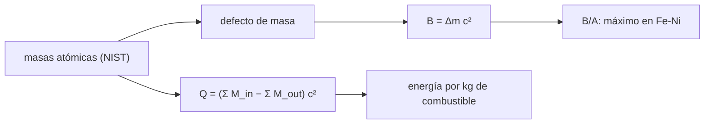

# B55-C02 — Nucleosíntesis y elementos

<!-- nav:top -->
[🏠 Programa](../../../../README.md) · [📚 Bloque B55](../../../tronco-comun/B55-astroquimica-y-geoquimica-extraterrestre.md) · [← Anterior: B55-C01 — Abundancia química cósmica](../B55-C01-abundancia-quimica-cosmica/CLASE.md) · [Siguiente: B55-C03 — Reacciones en medio interestelar →](../B55-C03-reacciones-en-medio-interestelar/CLASE.md)
<!-- /nav -->

## 1. Ubicación, nivel y alcance

Clase 2 del bloque B55, nivel N3. Calculas con masas atómicas del NIST la **energía de enlace por nucleón** de nueve núcleos, ves por qué el hierro y el níquel cierran la curva y obtienes la energía de las reacciones de quemado. Retoma [B24-C08](../../B24/B24-C08-nucleosintesis-estelar/CLASE.md) (nucleosíntesis estelar) desde la química de los elementos. Las masas son valores publicados; no se modela ninguna tasa de reacción.

## 2. Por qué esta clase existe

Los elementos que encontramos en el espacio, en cometas y en meteoritos se formaron en estrellas. Para saber hasta dónde puede llegar una cadena de fusión y cuánta energía libera hay que mirar la energía de enlace. La decisión central: **¿por qué la fusión libera energía hasta el hierro y qué reacción da más por kilogramo?**

## 3. Lo que podrás hacer al terminar

1. Calcular la energía de enlace de un núcleo a partir de masas atómicas.
2. Reconocer el máximo de `B/A` y su significado.
3. Calcular el valor `Q` de reacciones de fusión.
4. Cerrar un ciclo de reacciones y comprobar que `Q` es aditivo.
5. Comparar la fracción de masa liberada por la fusión de H y de He.
6. Situar los procesos lentos y rápidos de captura de neutrones como origen de los elementos pesados.

La evidencia es la **tabla de energía de enlace y reacciones** del ejercicio 12 (sección 20).

## 4. Con qué llegas y cómo comprobarlo

1. ¿Qué dice `E = mc²`?
2. ¿Qué es un nucleón?
3. ¿Qué es un valor `Q`?
4. ¿Qué es una unidad de masa atómica?
5. ¿Qué es un ciclo cerrado?

<details>
<summary>Ver respuestas</summary>

1. Que una masa `m` equivale a una energía `mc²`. 2. Un protón o un neutrón. 3. La energía liberada (positiva) o absorbida (negativa) por una reacción. 4. 1/12 de la masa del carbono-12. 5. Una secuencia que vuelve al estado inicial: la suma de sus cambios de energía es la del camino directo.
</details>

Con cuatro o cinco aciertos, sigue; si no, repasa los prerrequisitos.

## 5. Un caso de contexto y casos de referencia

Nueve núcleos del H-2 al Ni-62 con sus masas atómicas y las reacciones `4 H → He`, `3 He → C`, `C + He → O`, `2 C → Mg`, `2 O → Si + He`. Es el **ejemplo conductor**. Los datos son **publicados** (NIST, CODATA 2022 (S1, S2)); los modelos de supernovas o fusiones de estrellas de neutrones que forman elementos más allá del hierro se tratan con los resúmenes de Cowan et al. 2021 y Kobayashi et al. 2020 (S3, S4), que indican que el proceso r produce cerca de la mitad de los elementos más pesados que el hierro y que el proceso s en estrellas AGB explica bien los picos segundo y tercero.

## 6. Vocabulario

La **energía de enlace** `B` es la energía que habría que aportar para separar el núcleo en nucleones libres; `B/A` es por nucleón. El **defecto de masa** es la diferencia entre la masa de los constituyentes y la del núcleo. El **valor `Q`** de una reacción es la diferencia de energías en reposo antes y después. El **proceso s** y el **proceso r** son capturas de neutrones lentas y rápidas respecto de la desintegración beta.

## 7. Modelo mental: una cuenta de masa

Un núcleo pesa menos que sus piezas sueltas; esa diferencia, multiplicada por `c²`, es la energía de enlace. Una fusión libera energía si los productos están más ligados por nucleón que los reactivos.



*Descripción textual:* las masas atómicas dan el defecto de masa y la energía de enlace por nucleón, con un máximo en la región del hierro y el níquel; las diferencias de masa entre reactivos y productos dan los valores `Q`.

Analogía: una caja de legos que pesa menos armada que suelta. Límite: en un núcleo la «pegada» es la interacción fuerte, y el defecto de masa es pequeño (menos del 1 %).

## 8. La explicación, paso a paso

### 8.1 Energía de enlace

`B = [Z·M(¹H) + N·mₙ − M(átomo)]·c²`, con masas **atómicas** (los electrones se cancelan). Se usan `mₙ = 1,00866491606 u` y `1 u·c² = 931,49410372 MeV` (S1, S2) y las masas del NIST (S5). El laboratorio calcula `B` por dos caminos (masas y excesos de masa) y coinciden a 1e-9 MeV.

| núclido | `B` total (MeV) | `B/A` (MeV) |
|---|---|---|
| H-2 | 2,2246 | 1,1123 |
| He-4 | 28,2957 | 7,0739 |
| C-12 | 92,1617 | 7,6801 |
| O-16 | 127,6193 | 7,9762 |
| Mg-24 | 198,2570 | 8,2607 |
| Si-28 | 236,5369 | 8,4477 |
| Ca-40 | 342,0522 | 8,5513 |
| Fe-56 | 492,2592 | 8,7903 |
| Ni-62 | 545,2619 | 8,7945 |

En este conjunto el máximo es el Ni-62 (8,7945 MeV), con el Fe-56 muy cerca. Por encima, fusionar ya no libera energía.

### 8.2 Energía de las reacciones

| reacción | `Q` (MeV) |
|---|---|
| 4 ¹H → ⁴He | 26,7310 |
| 3 ⁴He → ¹²C | 7,2747 |
| ¹²C + ⁴He → ¹⁶O | 7,1619 |
| 2 ¹²C → ²⁴Mg | 13,9336 |
| 2 ¹⁶O → ²⁸Si + ⁴He | 9,5939 |
| 2 ²H → ⁴He | 23,8465 |

### 8.3 Cierre de ciclo y energía por masa

`Q(3α) + Q(C+α) = 14,436665 MeV` es igual a `Q(4α → O)` calculado directo: la energía es aditiva. La fracción de masa liberada es 0,00712 para `H → He` y 0,00065 para `3α → C`: la fusión del hidrógeno rinde unas diez veces más por unidad de masa. La energía por kilogramo de hidrógeno es `6,3978 × 10¹⁴ J/kg`.

### 8.4 Más allá del hierro

Como la fusión ya no rinde, los núcleos más pesados se forman por captura de neutrones. Según el resumen de S3 el proceso r, con sitios candidatos como fusiones de estrellas de neutrones, produce cerca de la mitad de los elementos más pesados que el hierro; según S4 el proceso s en estrellas AGB explica bien los picos segundo y tercero. Aquí solo se cita esa visión general: no se calcula ninguna tasa.

## 9. Magnitudes, símbolos y unidades

| Símbolo | Qué es | Unidad | Valor / nota |
|---|---|---|---|
| `B` | energía de enlace | MeV | 545,2619 (Ni-62) |
| `B/A` | energía de enlace por nucleón | MeV | 8,7945 (Ni-62) |
| `Q` | energía liberada por la reacción | MeV | 26,7310 (4 H → He) |
| `mₙ` | masa del neutrón | u | 1,00866491606 (CODATA 2022) |
| `u·c²` | energía de una unidad de masa atómica | MeV | 931,49410372 (CODATA 2022) |

## 10. Convenciones y referencias

Sistema de referencia: núcleos en reposo y estado fundamental. Masas atómicas (no nucleares). Datos de NIST (CODATA 2022), consultados el 2026-11-09. Versiones: Python 3.12.9, biblioteca estándar. Tolerancias: dos caminos de `B` a 1e-9 MeV; ciclo cerrado a 1e-9 MeV.

## 11. De dónde sale lo que afirmamos

| ID | Fuente | Localizador | Respalda | Estado |
|---|---|---|---|---|
| S1 | NIST, CODATA 2022: neutron mass in u | https://physics.nist.gov/cgi-bin/cuu/Value?mnu | masa del neutrón en u | Consultada el 2026-11-09; consultada (valor y edición) |
| S2 | NIST, CODATA 2022: atomic mass constant energy equivalent in MeV | https://physics.nist.gov/cgi-bin/cuu/Value?muc2mev | equivalente energético de la unidad de masa atómica | Consultada el 2026-11-09; consultada (valor y edición) |
| S3 | Cowan et al., «Origin of the Heaviest Elements: the Rapid Neutron-Capture Process», *Rev. Mod. Phys.* 93, 015002 (2021) | arXiv:1901.01410 | contexto: el proceso r y su origen incierto | Consultada el 2026-11-09; solo resumen |
| S4 | Kobayashi, Karakas y Lugaro, «The Origin of Elements from Carbon to Uranium», *ApJ* (2020) | arXiv:2008.04660 | contexto: proceso s en AGB y origen de los elementos | Consultada el 2026-11-09; solo resumen |
| S5 | NIST, *Atomic Weights and Isotopic Compositions for All Elements* | https://physics.nist.gov/cgi-bin/Compositions/stand_alone.pl | masas atómicas de los nueve núcleos | Consultada el 2026-11-09; consultada (tabla de isótopos seleccionados) |
| — | Sin fuente externa para el resto | — | relaciones y valores que verifica el laboratorio con una segunda vía de cálculo; los parámetros de modelo se rotulan ilustrativos | No se consultó una fuente para esta parte |

Límites: S3 y S4 se leyeron solo en su resumen y se usan para el contexto cualitativo; no se calcula ninguna tasa de captura de neutrones.

## 12. Cómo ver la curva de energía de enlace

| Núclido | B/A (MeV) |
|---|---|
| H-2 | 1,11 |
| He-4 | 7,07 |
| C-12 | 7,68 |
| O-16 | 7,98 |
| Fe-56 | 8,79 |
| Ni-62 | 8,79 |

Descripción larga: la curva sube rápido hasta el helio, después lentamente, y se aplana en el hierro y el níquel.

## 13. Ejemplo trabajado: la energía del triple alfa

**Paso 1 · Masas.** `3 M(⁴He) = 12,00780976 u` y `M(¹²C) = 12 u` exactos.

**Paso 2 · Diferencia.** `0,00780976 u`.

**Paso 3 · Energía.** `0,00780976 × 931,494 = 7,2747 MeV`, la `Q` de la tabla 8.2.

## 14. Distintas formas de calcular la energía de una reacción

**Con masas atómicas:** directo. **Con energías de enlace:** `Q = Σ B_productos − Σ B_reactivos`. **Con excesos de masa:** resta de excesos. Las tres coinciden; la primera es la más corta y la más propensa a errores de redondeo si se restan masas muy parecidas.

## 15. Práctica guiada

**Ejercicio 1 · con los pasos indicados.** Calcula `Q` de `2 ²H → ⁴He` con las masas de la tabla (sección 8.2).

<details><summary>Solución comentada</summary>

`2×2,01410177812 − 4,00260325413 = 0,02560030211 u → 23,8465 MeV`.
</details>

**Ejercicio 2 · con una pista.** Calcula `B/A` del C-12 a partir de `B` (sección 8.1). *Pista:* divide por 12.

<details><summary>Solución comentada</summary>

`92,1617/12 = 7,6801 MeV`.
</details>

**Ejercicio 3 · casi autónomo.** Comprueba que la `Q` de `3α` más `Q(C+α)` coincide con `Q(4α → O)` (sección 8.3). *Casi autónomo.*

<details><summary>Solución comentada</summary>

`7,2747 + 7,1619 = 14,4366 MeV`, igual que el cálculo directo con `4 M(He) − M(O)`.
</details>

## 16. Práctica autónoma, transferencia e integrador

**Ejercicio 4 · autónomo.** Calcula la energía por nucleón liberada al fusionar `4 H → He` (sección 8.2).

<details><summary>Solución comentada</summary>

`26,7310/4 = 6,68 MeV por nucleón`, más que cualquier otra reacción de la tabla por nucleón.
</details>

**Ejercicio 5 · autónomo.** ¿Qué fracción de la masa de dos núcleos de C-12 se libera al formar Mg-24? (sección 8.2).

<details><summary>Solución comentada</summary>

`13,9336/(24×931,494) = 6,2 × 10⁻⁴`.
</details>

**Ejercicio 6 · autónomo.** ¿Por qué la `Q` de `2 ²H → ⁴He` supera a `Q(3α)`? (sección 8.3).

<details><summary>Solución comentada</summary>

Porque pasa de B/A muy bajo (1,11) a 7,07, un salto mucho mayor que de 7,07 a 7,68.
</details>

**Ejercicio 7 · autónomo.** Estima la energía por kilogramo de un combustible con fracción de masa liberada 0,00065 (sección 8.3).

<details><summary>Solución comentada</summary>

`0,00065 × (3×10⁸)² ≈ 5,8 × 10¹³ J/kg`, ~11 veces menos que el hidrógeno.
</details>

**Ejercicio 8 · autónomo.** Explica el valor `Q = 9,5939` MeV de `2 O → Si + He` aunque el producto no sea el más ligado (sección 8.2).

<details><summary>Solución comentada</summary>

Sigue habiendo un aumento de `B/A` de 7,98 a ~8,45 en el Si; la reacción libera la diferencia.
</details>

**Ejercicio 9 · transferencia.** Una estrella consume todo su helio. ¿Cuánta energía libera por reacción la fase de triple alfa y por qué es menor que la del hidrógeno? (secciones 8.2–8.3).

<details><summary>Solución comentada</summary>

7,2747 MeV por reacción, pero sobre 12 u de masa de combustible; por masa es ~11 veces menos que `H → He`.
</details>

**Ejercicio 10 · transferencia.** Un colega afirma que se puede obtener energía fusionando Ni-62 con He. ¿Qué dice la curva? (sección 8.1).

<details><summary>Solución comentada</summary>

Al estar en el máximo de `B/A`, la fusión no libera energía neta.
</details>

**Ejercicio 11 · transferencia.** ¿Por qué no se puede obtener oro por fusión estelar normal? (sección 8.4).

<details><summary>Solución comentada</summary>

Porque más allá del hierro la fusión ya no es exotérmica; se necesitan capturas de neutrones (procesos s y r).
</details>

**Ejercicio 12 · integrador.** Elabora tu *tabla de energía de enlace y reacciones*: `B/A` de los nueve núcleos, cinco valores `Q`, el cierre de ciclo y la energía por kilogramo de H.

<details><summary>Solución modelo</summary>

Debe contener las tablas 8.1 y 8.2, el cierre de 8.3, las constantes con su edición CODATA y la identificación del máximo.
</details>

## 17. Laboratorio: energía de enlace y valores Q

El script [energia_de_enlace.py](energia_de_enlace.py) calcula `B/A` por dos caminos, los valores `Q` y el cierre de ciclo, y **comprueba** que el máximo cae en Fe-56/Ni-62, que `Q` es aditivo y que la fracción de masa del H→He está entre 0,65 % y 0,75 %.

**Datos:** masas atómicas y constantes del NIST (S1, S2, S5). **Predice antes de ejecutar:** ¿qué núclido tiene mayor `B/A`? (Ni-62.) **Ejecución del 2026-11-09 (Python 3.12.9):**

```text
Python 3.12.9 (biblioteca estandar)
A. Energia de enlace por nucleon (masas atomicas NIST, constantes CODATA 2022)
nuclido   B total [MeV]   B/A [MeV]
    H-2         2.2246      1.1123
   He-4        28.2957      7.0739
   C-12        92.1617      7.6801
   O-16       127.6193      7.9762
  Mg-24       198.2570      8.2607
  Si-28       236.5369      8.4477
  Ca-40       342.0522      8.5513
  Fe-56       492.2592      8.7903
  Ni-62       545.2619      8.7945
Maximo de B/A en el conjunto: Ni-62 (8.7945 MeV)
B. Energia liberada por reaccion de quemado (Q = masas iniciales - finales)
4 H-1 -> He-4           Q =   26.7310 MeV
3 He-4 -> C-12          Q =    7.2747 MeV
C-12 + He-4 -> O-16     Q =    7.1619 MeV
2 C-12 -> Mg-24         Q =   13.9336 MeV
2 O-16 -> Si-28 + He-4  Q =    9.5939 MeV
2 H-2 -> He-4           Q =   23.8465 MeV
C. Cierre del ciclo: Q(3a)+Q(C12+a) = 14.436665 MeV ; Q(4 a -> O-16) = 14.436665 MeV
D. Fraccion de masa liberada: H->He 0.00712 ; 3a->C 0.00065 ; energia por kg de H: 6.3978e+14 J/kg
Pruebas superadas.
```

```bash
python programa/clases/B55/B55-C02-nucleosintesis-y-elementos/energia_de_enlace.py
```

**Límites:** solo balance de masa; sin tasas ni secciones eficaces; estado fundamental.

## 18. Errores frecuentes y cómo corregirlos

**Usar masas nucleares con masas atómicas mezcladas.** Se usan solo masas atómicas (8.1).

**Olvidar la masa del electrón en los positrones.** El balance de 4 H → He con masas atómicas ya lo incluye.

**Pensar que el hierro es el elemento más abundante porque es el más ligado.** El máximo de ligadura no implica máxima abundancia.

**Presentar `Q` como energía útil en la estrella.** Parte la llevan los neutrinos.

## 19. Cómo sabrás que vas bien

Tras la sección 8: ¿qué `Q` esperabas para `3α`? Si dudas, repasa el ejemplo 13. Tras el laboratorio: ¿qué comprueba? (ver la sección 17).

## 20. Qué entregas y cómo se evalúa

El producto es tu **tabla de energía de enlace y reacciones** (ejercicio 12).

| Criterio | Inicial | En desarrollo | Logrado | Destacado |
|---|---|---|---|---|
| Conceptos | Los confunde | Parciales | Interpreta `B/A` y `Q` | Explica los límites |
| Cálculo | Sin unidades | Con errores | Tablas completas con unidades | Calcula casos nuevos |
| Numérico | Sin comprobar | Un caso | Contraste con el caso analítico | Interpreta las diferencias |
| Fuentes | Sin fuente | Sin fecha | Fuentes con fecha y estado | Declara lo sintético e ilustrativo |
| Límites | No los nombra | Uno | Tres | Discute qué falta del modelo |

**Condiciones críticas (no se compensan con promedio):** usar masas atómicas con su fuente y edición; no presentar `Q` como energía térmica útil; citar solo lo consultado.

## 21. Ética, seguridad y límites

Se separan los valores publicados de las interpretaciones; la formación de elementos pesados es un tema de investigación abierto (S3). Clase educativa: los modelos son simplificados y ningún resultado de esta clase es una observación. Accesibilidad: tablas equivalentes a las gráficas, fórmulas en texto, ejercicios sin conexión.

## 22. Para cerrar y seguir

El `B/A` crece hasta 8,79 MeV en Fe/Ni y la fusión del hidrógeno libera 0,71 % de la masa. Queda una pregunta: ¿qué reacciones químicas ocurren entre esos elementos en el medio interestelar?

**Glosario español–inglés.** energía de enlace · *binding energy*; defecto de masa · *mass defect*; valor Q · *Q-value*; proceso s · *s-process*; proceso r · *r-process*.

**Continuidad.** [B55-C03](../B55-C03-reacciones-en-medio-interestelar/CLASE.md) plantea las reacciones químicas del medio interestelar y sus escalas de tiempo.

**Referencias:** ver sección 11.

<!-- nav:bottom -->
---

[← Anterior: B55-C01 — Abundancia química cósmica](../B55-C01-abundancia-quimica-cosmica/CLASE.md) · [📚 Bloque B55](../../../tronco-comun/B55-astroquimica-y-geoquimica-extraterrestre.md) · [Siguiente: B55-C03 — Reacciones en medio interestelar →](../B55-C03-reacciones-en-medio-interestelar/CLASE.md)
<!-- /nav -->
