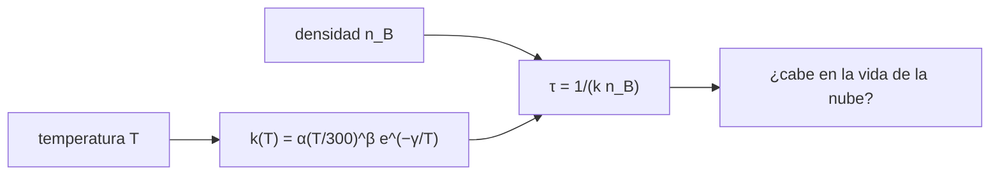

# B55-C03 — Reacciones en medio interestelar

<!-- nav:top -->
[🏠 Programa](../../../../README.md) · [📚 Bloque B55](../../../tronco-comun/B55-astroquimica-y-geoquimica-extraterrestre.md) · [← Anterior: B55-C02 — Nucleosíntesis y elementos](../B55-C02-nucleosintesis-y-elementos/CLASE.md) · [Siguiente: B55-C04 — Química de nubes moleculares →](../B55-C04-quimica-de-nubes-moleculares/CLASE.md)
<!-- /nav -->

## 1. Ubicación, nivel y alcance

Clase 3 del bloque B55, nivel N3. Aprendes a escribir y evaluar el **coeficiente de velocidad** de una reacción en el medio interestelar, a distinguir reacciones con y sin barrera y a convertir un coeficiente en una **escala de tiempo** con la densidad. Usas exponenciales y ecuaciones diferenciales sencillas ([B10](../../../tronco-comun/B10-algebra-lineal-y-matematicas-geometricas.md)). Los coeficientes de la clase son **ilustrativos**.

## 2. Por qué esta clase existe

En el espacio la densidad es tan baja que una reacción puede tardar siglos o millones de años, y la temperatura de 10 K cierra casi todas las reacciones con barrera. Saber cuáles ocurren define qué moléculas pueden existir. La decisión central: **¿esta reacción importa en una nube de 10 K y 10⁴ cm⁻³, y en cuánto tiempo?**

## 3. Lo que podrás hacer al terminar

1. Evaluar `k(T) = α (T/300)^β exp(−γ/T)`.
2. Distinguir una reacción ion–molécula sin barrera de una neutro–neutro con barrera.
3. Convertir `k` y la densidad en una escala de tiempo.
4. Integrar numéricamente una reacción de primer y de segundo orden.
5. Verificar la integración contra la solución analítica.
6. Reconocer el tamaño de las bases de datos de reacciones.

La evidencia es la **ficha de una reacción con su escala de tiempo** del ejercicio 12 (sección 20).

## 4. Con qué llegas y cómo comprobarlo

1. ¿Qué es una densidad numérica?
2. ¿Qué es una constante de velocidad?
3. ¿Qué es una barrera de activación?
4. ¿Qué es una escala de tiempo?
5. ¿Qué es una solución analítica?

<details>
<summary>Ver respuestas</summary>

1. Número de partículas por unidad de volumen, aquí en cm⁻³. 2. El factor que relaciona la velocidad de reacción con las concentraciones. 3. La energía que deben superar los reactivos para reaccionar. 4. El tiempo característico en que cambia una cantidad, por ejemplo `1/(k n)`. 5. Una fórmula exacta de la solución de una ecuación.
</details>

Con cuatro o cinco aciertos, sigue; si no, repasa los prerrequisitos.

## 5. Un caso de contexto y casos de referencia

Dos reacciones **ilustrativas**: una ion–molécula con `α = 10⁻⁹ cm³ s⁻¹` y sin barrera, y una neutro–neutro con `α = 10⁻¹⁰` y barrera `γ = 1500 K`. Es el **ejemplo conductor**. Los datos son sintéticos. Como contexto, el resumen de McElroy et al. (2013) (S1) describe una base de datos de reacciones del medio interestelar con 6173 reacciones y 467 especies; no se usó ningún coeficiente suyo.

## 6. Vocabulario

La **parametrización de Arrhenius modificada** es `k(T) = α (T/300 K)^β exp(−γ/T)` con `k` en cm³ s⁻¹. Una reacción **ion–molécula** ocurre entre un ion y una molécula neutra y casi no tiene barrera. Una reacción **neutro–neutro** suele tener barrera `γ`. La **escala de tiempo** de consumo es `τ = 1/(k n_B)`. Una **reacción de pseudo-primer orden** es una de segundo orden con un reactivo en gran exceso.

## 7. Modelo mental: una compuerta que se abre con la temperatura

El factor exponencial es una compuerta: a baja temperatura casi nadie tiene energía para cruzar la barrera; sin barrera la compuerta está abierta siempre. La densidad fija cuántas veces se encuentran los reactivos.



*Descripción textual:* la temperatura determina el coeficiente `k` y, junto con la densidad, la escala de tiempo, que se compara con la vida de la nube.

Analogía: una compuerta cuya apertura depende de la temperatura. Límite: los coeficientes reales dependen de los estados cuánticos de las moléculas y pueden tener otras formas funcionales.

## 8. La explicación, paso a paso

### 8.1 Coeficientes en función de la temperatura

| T (K) | `k` ion–molécula (cm³ s⁻¹) | `k` neutro–neutro, `γ = 1500 K` |
|---|---|---|
| 10 | 1,0000 × 10⁻⁹ | 7,1751 × 10⁻⁷⁶ |
| 30 | 1,0000 × 10⁻⁹ | 1,9287 × 10⁻³² |
| 100 | 1,0000 × 10⁻⁹ | 3,0590 × 10⁻¹⁷ |
| 300 | 1,0000 × 10⁻⁹ | 6,7379 × 10⁻¹³ |

Sin barrera `k` no depende de `T` (con `β = 0`); con barrera, de 10 K a 300 K el coeficiente sube un factor `9,39 × 10⁶²`. A 10 K la reacción con barrera **no ocurre** en ninguna escala física.

### 8.2 Escalas de tiempo

| `n_B` (cm⁻³) | ion–molécula a 10 K | neutro–neutro a 300 K |
|---|---|---|
| 10² | 0,317 años | 470,3 años |
| 10⁴ | 3,169 × 10⁻³ años | 4,703 años |
| 10⁶ | 3,169 × 10⁻⁵ años | 4,703 × 10⁻² años |

Las reacciones ion–molécula son rápidas incluso en el frío; las neutro–neutro con barrera necesitan calor.

### 8.3 Integración y verificación

Pseudo-primer orden (`n_B = 10⁴ cm⁻³`, `T = 10 K`): `A(3τ) = 4,9787068368 × 10⁻²` numérico y analítico, error relativo `1,26 × 10⁻¹³`. Segundo orden `A + A` (`n₀ = 10³ cm⁻³`, `T = 100 K`): `n = 166,666667 cm⁻³` frente a `1/(1/n₀ + k t)`, error `1,71 × 10⁻¹⁵`. El método de Runge–Kutta de orden 4 reproduce las soluciones.

## 9. Magnitudes, símbolos y unidades

| Símbolo | Qué es | Unidad | Valor / nota |
|---|---|---|---|
| `k` | coeficiente de velocidad (2.º orden) | cm³ s⁻¹ | 1,0 × 10⁻⁹ (ilustrativo) |
| `α, β, γ` | parámetros de la parametrización | cm³ s⁻¹; —; K | 10⁻¹⁰; 0; 1500 (ilustrativos) |
| `T` | temperatura | K | 10 a 300 |
| `n_B` | densidad del reactivo en exceso | cm⁻³ | 10⁴ |
| `τ` | escala de tiempo | s o años (1 año juliano = 3,15576 × 10⁷ s) | 3,169 × 10⁻³ años |

## 10. Convenciones y referencias

Sistema de referencia: un volumen de gas uniforme a `T` y `n` constantes. Los coeficientes son ilustrativos y no proceden de una base de datos. Unidades CGS habituales en astroquímica (cm³ s⁻¹). Versiones: Python 3.12.9, biblioteca estándar. Tolerancia de integración: error relativo < 1e-8.

## 11. De dónde sale lo que afirmamos

| ID | Fuente | Localizador | Respalda | Estado |
|---|---|---|---|---|
| S1 | McElroy et al., «The UMIST database for astrochemistry 2012», *A&A* (2013) | arXiv:1212.6362 | contexto: tamaño de una base de datos de reacciones (6173 reacciones, 467 especies); no se usó ningún coeficiente | Consultada el 2026-11-09; solo resumen |
| — | Sin fuente externa para el resto | — | relaciones y valores que verifica el laboratorio con una segunda vía de cálculo; los parámetros de modelo se rotulan ilustrativos | No se consultó una fuente para esta parte |

Límites: del artículo solo se leyó el resumen; los coeficientes de la clase son inventados y sirven solo para ejercitar la forma matemática.

## 12. Cómo ver la escala de tiempo

| Reacción | T (K) | `n_B` (cm⁻³) | τ (años) |
|---|---|---|---|
| ion–molécula | 10 | 10⁴ | 3,169 × 10⁻³ |
| neutro–neutro con barrera | 300 | 10⁴ | 4,703 |

Descripción larga: en una gráfica de `τ` frente a `T`, la curva sin barrera sería una recta horizontal y la de barrera caería abruptamente al subir `T`.

## 13. Ejemplo trabajado: cuánto tarda en consumirse A

**Paso 1 · `k` a 10 K.** `10⁻⁹ cm³ s⁻¹` (sin barrera).

**Paso 2 · Frecuencia.** `k n_B = 10⁻⁹ × 10⁴ = 10⁻⁵ s⁻¹`.

**Paso 3 · Escala.** `τ = 10⁵ s = 3,169 × 10⁻³ años` (1,16 días).

**Paso 4 · Después de 3 τ.** `A/A₀ = e⁻³ = 0,049787`, el valor del laboratorio.

## 14. Distintas formas de resolver una reacción

**Analítica:** exacta para primer y segundo orden. **Numérica (RK4):** sirve cuando hay muchas reacciones acopladas (C20). **Estimación por escala de tiempo:** da el orden de magnitud sin resolver nada. Se compara siempre la numérica con la analítica en el caso sencillo.

## 15. Práctica guiada

**Ejercicio 1 · con los pasos indicados.** Calcula `k` ion–molécula a 300 K (sección 8.1).

<details><summary>Solución comentada</summary>

`10⁻⁹ cm³ s⁻¹`, igual que a 10 K.
</details>

**Ejercicio 2 · con una pista.** Calcula `τ` para `k = 10⁻⁹` y `n_B = 10⁶ cm⁻³` (sección 8.2). *Pista:* `1/(k n_B)`.

<details><summary>Solución comentada</summary>

`10⁻³ s⁻¹ → 1000 s = 3,169 × 10⁻⁵ años`.
</details>

**Ejercicio 3 · casi autónomo.** Calcula `k(100 K)` con barrera sin usar el laboratorio (sección 8.1). *Casi autónomo.*

<details><summary>Solución comentada</summary>

`10⁻¹⁰ × (1/3)⁰ × e^(−15) = 10⁻¹⁰ × 3,059 × 10⁻⁷ = 3,06 × 10⁻¹⁷`.
</details>

## 16. Práctica autónoma, transferencia e integrador

**Ejercicio 4 · autónomo.** ¿Cuántos grados necesita la barrera `γ = 1500 K` para que `exp(−γ/T) = 0,1`? (sección 8.1).

<details><summary>Solución comentada</summary>

`γ/T = ln 10 = 2,303 → T = 651 K`.
</details>

**Ejercicio 5 · autónomo.** Con `β = 0,5` y `γ = 0`, ¿cuánto cambia `k` entre 100 y 300 K? (sección 8.1).

<details><summary>Solución comentada</summary>

Factor `(300/100)^0,5 / 1 = 1,73` (sube).
</details>

**Ejercicio 6 · autónomo.** Para `A + A` con `k = 10⁻⁹` y `n₀ = 10³`, ¿cuánto tarda en caer a la mitad? (sección 8.3).

<details><summary>Solución comentada</summary>

`1/n = 1/n₀ + k t → t = 1/(k n₀) = 10⁶ s = 0,0317 años`.
</details>

**Ejercicio 7 · autónomo.** ¿Qué fracción de A queda tras 5 τ en pseudo-primer orden? (sección 8.3).

<details><summary>Solución comentada</summary>

`e⁻⁵ = 0,00674`.
</details>

**Ejercicio 8 · autónomo.** Explica por qué RK4 con 2000 pasos reproduce `e⁻³` con error 1e-13 (sección 8.3).

<details><summary>Solución comentada</summary>

El método es de orden 4: el error por paso escala como `h⁵`, y con `h = 3τ/2000` el error acumulado es minúsculo para una exponencial suave.
</details>

**Ejercicio 9 · transferencia.** Un modelo usa `k = 10⁻¹²` para una reacción a 10 K con `n_B = 10⁴`. ¿Importa en una nube que dura 10⁷ años? (secciones 8.2–8.3).

<details><summary>Solución comentada</summary>

`τ = 1/(10⁻¹² × 10⁴) = 10⁸ s = 3,17 años` ≪ 10⁷ años: sí importa.
</details>

**Ejercicio 10 · transferencia.** ¿Por qué las bases de datos de reacciones listan para cada una un intervalo de temperatura de validez? (sección 10).

<details><summary>Solución comentada</summary>

Porque la parametrización solo describe la reacción en ese intervalo; fuera hay extrapolación.
</details>

**Ejercicio 11 · transferencia.** Un colega propone una reacción con barrera de 1500 K para formar una molécula a 10 K. ¿Qué respondes? (sección 8.1).

<details><summary>Solución comentada</summary>

Que `k ≈ 10⁻⁷⁶` y la reacción no ocurre; hay que buscar un camino sin barrera (ion–molécula, catálisis en grano; C07).
</details>

**Ejercicio 12 · integrador.** Elabora tu *ficha de una reacción con su escala de tiempo*: elige una reacción ilustrativa, calcula `k(T)` para cuatro temperaturas, `τ` para tres densidades e integra un caso comparando con la solución analítica.

<details><summary>Solución modelo</summary>

Debe mostrar las tablas 8.1–8.2, el cálculo de 8.3 con el error relativo, la nota de que los coeficientes son ilustrativos y las unidades de cada magnitud.
</details>

## 17. Laboratorio: coeficientes de velocidad y escalas de tiempo

El script [reacciones_ism.py](reacciones_ism.py) evalúa `k(T)` de dos reacciones ilustrativas, las escalas de tiempo y la integración RK4, y **comprueba** el error de la solución numérica frente a la analítica (< 1e-8).

**Datos:** **sintéticos**; ningún coeficiente de una base de datos. **Predice antes de ejecutar:** ¿cuánto vale `τ` para `n_B = 10⁴`, `k = 10⁻⁹`? (≈ 10⁵ s ≈ 3,2 × 10⁻³ años.) **Ejecución del 2026-11-09 (Python 3.12.9):**

```text
Python 3.12.9 (biblioteca estandar)
A. Coeficientes k(T) en cm3 s-1 de dos reacciones ILUSTRATIVAS
T [K]   k_ion-molecula   k_neutro-neutro(barrera 1500 K)
   10   1.0000e-09     7.1751e-76
   30   1.0000e-09     1.9287e-32
  100   1.0000e-09     3.0590e-17
  300   1.0000e-09     6.7379e-13
Cociente k(300 K)/k(10 K) con barrera: 9.3907e+62 ; sin barrera: 1.0000
B. Escala de tiempo t = 1/(k n_B) [anos] para consumir A, con B en exceso
n_B [cm-3]    ion-molecula (T=10 K)   neutro-neutro (T=300 K)
    1e+02     3.1688e-01              4.7029e+02
    1e+04     3.1688e-03              4.7029e+00
    1e+06     3.1688e-05              4.7029e-02
C. Pseudo-primer orden (n_B = 1e4 cm-3, T = 10 K): A(3 tau) numerico = 4.9787068368e-02 ; analitico = 4.9787068368e-02 ; error relativo = 1.26e-13
D. Segundo orden A + A (n0 = 1e3 cm-3, T = 100 K): n(t) numerico = 1.66666667e+02 ; analitico = 1.66666667e+02 ; error relativo = 1.71e-15
Pruebas superadas.
```

```bash
python programa/clases/B55/B55-C03-reacciones-en-medio-interestelar/reacciones_ism.py
```

**Límites:** T y n constantes; reacción irreversible; sin otras vías.

## 18. Errores frecuentes y cómo corregirlos

**Olvidar que `exp(−γ/T)` aplasta la reacción a 10 K.** Se calcula en 8.1.

**Confundir `k` (cm³ s⁻¹) con la frecuencia `k n` (s⁻¹).** Se separan en la sección 9.

**Usar un coeficiente fuera de su intervalo de temperatura.** Se advierte en la sección 10.

**Presentar los coeficientes ilustrativos como medidos.** Se aclara en la sección 5.

## 19. Cómo sabrás que vas bien

Tras la sección 8: ¿qué `τ` esperabas y cuál obtuviste? Si dudas, repasa el ejemplo 13. Tras el laboratorio: ¿qué comprueba? (ver la sección 17).

## 20. Qué entregas y cómo se evalúa

El producto es tu **ficha de una reacción con su escala de tiempo** (ejercicio 12).

| Criterio | Inicial | En desarrollo | Logrado | Destacado |
|---|---|---|---|---|
| Conceptos | Los confunde | Parciales | Relaciona `k`, `T` y escala de tiempo | Explica los límites |
| Cálculo | Sin unidades | Con errores | Tablas completas con unidades | Calcula casos nuevos |
| Numérico | Sin comprobar | Un caso | Contraste con el caso analítico | Interpreta las diferencias |
| Fuentes | Sin fuente | Sin fecha | Fuentes con fecha y estado | Declara lo sintético e ilustrativo |
| Límites | No los nombra | Uno | Tres | Discute qué falta del modelo |

**Condiciones críticas (no se compensan con promedio):** rotular los coeficientes como ilustrativos; no usar la base UMIST como fuente de valores; citar solo lo consultado.

## 21. Ética, seguridad y límites

Los coeficientes de una base de datos se citan con su versión; los modelos pequeños no sustituyen a las redes reales. Clase educativa: los modelos son simplificados y ningún resultado de esta clase es una observación. Accesibilidad: tablas equivalentes a las gráficas, fórmulas en texto, ejercicios sin conexión.

## 22. Para cerrar y seguir

Una reacción sin barrera consume A en `3,2 × 10⁻³` años a `10⁴ cm⁻³`, y una con barrera de 1500 K no ocurre a 10 K. Queda una pregunta: ¿qué pasa cuando juntas muchas reacciones en una nube molecular?

**Glosario español–inglés.** coeficiente de velocidad · *rate coefficient*; barrera de activación · *activation barrier*; escala de tiempo · *timescale*; ion–molécula · *ion–molecule*; pseudo-primer orden · *pseudo-first order*.

**Continuidad.** [B55-C04](../B55-C04-quimica-de-nubes-moleculares/CLASE.md) estudia la química de una nube molecular con ionización por rayos cósmicos.

**Referencias:** ver sección 11.

<!-- nav:bottom -->
---

[← Anterior: B55-C02 — Nucleosíntesis y elementos](../B55-C02-nucleosintesis-y-elementos/CLASE.md) · [📚 Bloque B55](../../../tronco-comun/B55-astroquimica-y-geoquimica-extraterrestre.md) · [Siguiente: B55-C04 — Química de nubes moleculares →](../B55-C04-quimica-de-nubes-moleculares/CLASE.md)
<!-- /nav -->
