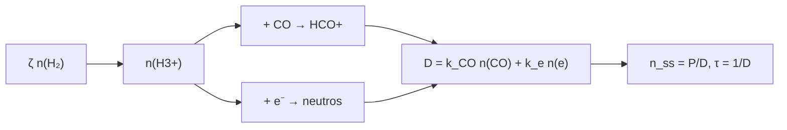

# B55-C04 — Química de nubes moleculares

<!-- nav:top -->
[🏠 Programa](../../../../README.md) · [📚 Bloque B55](../../../tronco-comun/B55-astroquimica-y-geoquimica-extraterrestre.md) · [← Anterior: B55-C03 — Reacciones en medio interestelar](../B55-C03-reacciones-en-medio-interestelar/CLASE.md) · [Siguiente: B55-C05 — Granos de polvo interestelar →](../B55-C05-granos-de-polvo-interestelar/CLASE.md)
<!-- /nav -->

## 1. Ubicación, nivel y alcance

Clase 4 del bloque B55, nivel N3. Aplicas la clase anterior a una **mini-nube molecular**: la ionización por rayos cósmicos produce `H3+`, que reacciona con CO para dar `HCO+`. Resuelves el balance de producción y destrucción, hallas el estado estacionario y la escala de relajación. Usas [B55-C03](../B55-C03-reacciones-en-medio-interestelar/CLASE.md). Todas las abundancias y coeficientes son **ilustrativos**.

## 2. Por qué esta clase existe

Una nube molecular fría es un reactor lento sostenido por una fuente débil de ionización. Entender el balance de una sola especie clave enseña a leer cualquier red. La decisión central: **¿qué abundancia de `H3+` sostiene la ionización y cuánto tarda la nube en alcanzarla?**

## 3. Lo que podrás hacer al terminar

1. Escribir el balance `dn/dt = P − D n`.
2. Hallar el estado estacionario `n = P/D` y la escala `τ = 1/D`.
3. Integrar numéricamente la relajación y compararla con `1 − e^(−t/τ)`.
4. Ver que `n(H3+)` es lineal en la tasa de ionización `ζ`.
5. Calcular qué fracción de la destrucción corresponde a CO.
6. Estimar la producción de `HCO+`.

La evidencia es la **estacionario de una mini-nube** del ejercicio 12 (sección 20).

## 4. Con qué llegas y cómo comprobarlo

1. ¿Qué es un estado estacionario?
2. ¿Qué es una tasa de ionización?
3. ¿Qué es un rayo cósmico?
4. ¿Qué es una escala de relajación?
5. ¿Qué es un valor ilustrativo?

<details>
<summary>Ver respuestas</summary>

1. Uno en que las cantidades no cambian porque producción y destrucción se igualan. 2. El número de ionizaciones por molécula y por segundo. 3. Una partícula energética (sobre todo protones) que ioniza el gas. 4. El tiempo en que un sistema se acerca al equilibrio. 5. Un valor propuesto para el ejemplo, no medido.
</details>

Con cuatro o cinco aciertos, sigue; si no, repasa los prerrequisitos.

## 5. Un caso de contexto y casos de referencia

Una nube **sintética** con `n(H₂) = 10⁴ cm⁻³`, `n(CO) = 1 cm⁻³` (abundancia 10⁻⁴), `n(e) = 10⁻³ cm⁻³`, `ζ = 10⁻¹⁷ s⁻¹` y coeficientes `k_CO = 1,7 × 10⁻⁹` y `k_e = 2 × 10⁻⁷ cm³ s⁻¹` (todos ilustrativos). Es el **ejemplo conductor**. Como contexto, el censo de McGuire (2021) (S1) informa en su resumen de 241 moléculas identificadas en el medio interestelar y circunestelar y otros entornos, y Boogert et al. (2015) (S2) muestran, en el suyo, que los hielos son una reserva de moléculas; ninguna cifra de esas fuentes se usa en el modelo.

## 6. Vocabulario

El **balance** es `dn/dt = P − D n`, con `P` la producción (cm⁻³ s⁻¹) y `D` el coeficiente de destrucción (s⁻¹). El **estado estacionario** es `n_ss = P/D`. La **ionización por rayos cósmicos** de `H₂` da `H₂⁺`, que reacciona con `H₂` para formar `H3+`. `HCO+` es el ion formilo, producto de `H3+ + CO`. La **recombinación disociativa** es la destrucción de un ion por un electrón.

## 7. Modelo mental: una bañera con grifo y desagüe

El `H3+` es el agua de una bañera: el grifo es la ionización, el desagüe es la reacción con CO y con electrones. El nivel se estabiliza cuando entra lo mismo que sale, y el tiempo que tarda lo fija solo el desagüe.



*Descripción textual:* la ionización alimenta `H3+`, que se destruye por CO y por electrones; el coeficiente total `D` fija el valor estacionario y la escala de tiempo.

Analogía: una bañera con grifo y desagüe. Límite: aquí las abundancias de H₂, CO y e⁻ se fijan; en una nube real también cambian y los granos intervienen (C05, C07).

## 8. La explicación, paso a paso

### 8.1 Producción y destrucción

Cada ionización de `H₂` produce un `H3+`: `P = ζ n(H₂) = 10⁻¹⁷ × 10⁴ = 10⁻¹³ cm⁻³ s⁻¹`. La destrucción tiene dos vías: CO (`k_CO n(CO) = 1,7 × 10⁻⁹ s⁻¹`) y electrones (`k_e n(e) = 2 × 10⁻¹⁰ s⁻¹`). Total `D = 1,9 × 10⁻⁹ s⁻¹`.

### 8.2 Estado estacionario y escala

`n_ss = P/D = 5,263158 × 10⁻⁵ cm⁻³` y `τ = 1/D = 5,263 × 10⁸ s = 16,68 años`. La integración numérica hasta 20 τ llega a `n = n_ss` dentro de `10⁻⁹` relativo.

### 8.3 Relajación

| t/τ | numérica | analítica `1 − e^(−t/τ)` |
|---|---|---|
| 0,5 | 0,39346934 | 0,39346934 |
| 1,0 | 0,63212056 | 0,63212056 |
| 2,0 | 0,86466472 | 0,86466472 |
| 4,0 | 0,98168436 | 0,98168436 |

### 8.4 Dependencia con la ionización

| `ζ` (s⁻¹) | `n(H3+)` (cm⁻³) | fracción por CO |
|---|---|---|
| 5 × 10⁻¹⁸ | 2,6316 × 10⁻⁵ | 0,8947 |
| 1 × 10⁻¹⁷ | 5,2632 × 10⁻⁵ | 0,8947 |
| 2 × 10⁻¹⁷ | 1,0526 × 10⁻⁴ | 0,8947 |
| 5 × 10⁻¹⁷ | 2,6316 × 10⁻⁴ | 0,8947 |

`n(H3+)` es lineal en `ζ`; la fracción por CO (0,8947) no depende de `ζ`. La producción de `HCO+` es `8,947 × 10⁻¹⁴ cm⁻³ s⁻¹`.

## 9. Magnitudes, símbolos y unidades

| Símbolo | Qué es | Unidad | Valor / nota |
|---|---|---|---|
| `ζ` | tasa de ionización por molécula de H₂ | s⁻¹ | 10⁻¹⁷ (ilustrativa) |
| `P` | producción | cm⁻³ s⁻¹ | 10⁻¹³ |
| `D` | coeficiente de destrucción | s⁻¹ | 1,9 × 10⁻⁹ |
| `n_ss` | valor estacionario | cm⁻³ | 5,263 × 10⁻⁵ |
| `τ` | escala de relajación | s o años | 5,263 × 10⁸ s = 16,68 años |

## 10. Convenciones y referencias

Sistema de referencia: un volumen uniforme de nube a temperatura constante. Todos los parámetros son ilustrativos. Cada ionización produce un H3+. Versiones: Python 3.12.9, biblioteca estándar, RK4. Tolerancias: estacionario 1e-6 relativo; relajación 1e-6.

## 11. De dónde sale lo que afirmamos

| ID | Fuente | Localizador | Respalda | Estado |
|---|---|---|---|---|
| S1 | McGuire, «2021 Census of Interstellar, Circumstellar, Extragalactic, Protoplanetary Disk, and Exoplanetary Molecules», *ApJS* | arXiv:2109.13848 | contexto: existen 241 moléculas identificadas (resumen); no se usan cifras del artículo en el cálculo | Consultada el 2026-11-09; solo resumen |
| S2 | Boogert, Gerakines y Whittet, «Observations of the Icy Universe», *Annu. Rev. Astron. Astrophys.* 53 (2015) | arXiv:1501.05317 | contexto: los hielos observados por espectroscopía infrarroja (resumen) | Consultada el 2026-11-09; solo resumen |
| — | Sin fuente externa para el resto | — | relaciones y valores que verifica el laboratorio con una segunda vía de cálculo; los parámetros de modelo se rotulan ilustrativos | No se consultó una fuente para esta parte |

Límites: solo se leyeron los resúmenes; el modelo es una caricatura de una nube real y sus parámetros son ilustrativos.

## 12. Cómo ver el balance de H3+

| Magnitud | Valor |
|---|---|
| Producción | 1,000 × 10⁻¹³ cm⁻³ s⁻¹ |
| Destrucción total | 1,900 × 10⁻⁹ s⁻¹ |
| Estacionario | 5,263 × 10⁻⁵ cm⁻³ |
| Escala | 16,68 años |

Descripción larga: una curva que sube desde 0 y se aplana en 5,26 × 10⁻⁵ cm⁻³; a 1 τ alcanza el 63 %.

## 13. Ejemplo trabajado: el estacionario de H3+

**Paso 1 · Producción.** `ζ n(H₂) = 10⁻¹³ cm⁻³ s⁻¹`.

**Paso 2 · Destrucción.** `D = 1,7 × 10⁻⁹ × 1 + 2 × 10⁻⁷ × 10⁻³ = 1,9 × 10⁻⁹ s⁻¹`.

**Paso 3 · Estacionario.** `n = 10⁻¹³ / 1,9 × 10⁻⁹ = 5,263 × 10⁻⁵ cm⁻³`.

**Paso 4 · Escala.** `τ = 5,263 × 10⁸ s = 16,7 años`.

## 14. Distintas formas de estudiar el balance de una especie

**Estacionario analítico:** inmediato, da el valor final. **Integración numérica:** da la evolución y sirve cuando `P` o `D` dependen del tiempo. **Escala de tiempo:** da el ritmo sin resolver. Aquí se usan los tres y deben concordar.

## 15. Práctica guiada

**Ejercicio 1 · con los pasos indicados.** Calcula `P` para `ζ = 3 × 10⁻¹⁷` y `n(H₂) = 10⁴` (sección 8.1).

<details><summary>Solución comentada</summary>

`3 × 10⁻¹³ cm⁻³ s⁻¹`.
</details>

**Ejercicio 2 · con una pista.** Calcula `D` si `n(CO) = 0,1` (sección 8.1). *Pista:* recalcula `k_CO n(CO)`.

<details><summary>Solución comentada</summary>

`1,7 × 10⁻¹⁰ + 2 × 10⁻¹⁰ = 3,7 × 10⁻¹⁰ s⁻¹`.
</details>

**Ejercicio 3 · casi autónomo.** Calcula `n_ss` con ese `D` y `P = 10⁻¹³` (sección 8.2). *Casi autónomo.*

<details><summary>Solución comentada</summary>

`10⁻¹³/3,7 × 10⁻¹⁰ = 2,70 × 10⁻⁴ cm⁻³`: sube 5,1 veces al bajar el CO a la décima parte porque la destrucción por CO era dominante.
</details>

## 16. Práctica autónoma, transferencia e integrador

**Ejercicio 4 · autónomo.** ¿Cuánto vale `n(t)/n_ss` a 3 τ? (sección 8.3).

<details><summary>Solución comentada</summary>

`1 − e⁻³ = 0,9502`.
</details>

**Ejercicio 5 · autónomo.** Con `ζ` 5 × 10⁻¹⁷, ¿cambia `τ`? (sección 8.4).

<details><summary>Solución comentada</summary>

No: `τ = 1/D` no depende de `ζ`.
</details>

**Ejercicio 6 · autónomo.** ¿Qué fracción de la destrucción corresponde a los electrones? (sección 8.1).

<details><summary>Solución comentada</summary>

`2 × 10⁻¹⁰ / 1,9 × 10⁻⁹ = 0,105`.
</details>

**Ejercicio 7 · autónomo.** Si `n(e)` pasara a 10⁻², ¿qué vía domina? (sección 8.1).

<details><summary>Solución comentada</summary>

`k_e n(e) = 2 × 10⁻⁹ > 1,7 × 10⁻⁹`: dominan los electrones.
</details>

**Ejercicio 8 · autónomo.** ¿Cuántos años tarda en alcanzar el 99 %? (sección 8.3).

<details><summary>Solución comentada</summary>

`t = τ ln 100 = 4,605 × 16,68 = 76,8 años`.
</details>

**Ejercicio 9 · transferencia.** Un modelo duplica `ζ` para una nube de mayor ionización. ¿Cuánto cambia `HCO+` producido por segundo? (sección 8.4).

<details><summary>Solución comentada</summary>

Se duplica, porque `n(H3+)` es lineal en `ζ` y la fracción por CO no cambia.
</details>

**Ejercicio 10 · transferencia.** ¿Qué pasaría con `n(H3+)` si el CO se agotara por completo? (sección 8.1).

<details><summary>Solución comentada</summary>

`D` sería solo `k_e n(e) = 2 × 10⁻¹⁰` y `n_ss = 5 × 10⁻⁴ cm⁻³`, unas 9,5 veces mayor.
</details>

**Ejercicio 11 · transferencia.** ¿Por qué la escala de 16,7 años es corta frente a la vida de una nube (~10⁶–10⁷ años)? ¿Qué implica? (secciones 8.2 y 5).

<details><summary>Solución comentada</summary>

Que `H3+` está siempre en estacionario respecto de las lentas variaciones de la nube; basta el balance algebraico.
</details>

**Ejercicio 12 · integrador.** Elabora tu *estacionario de una mini-nube*: define parámetros ilustrativos, calcula `P`, `D`, `n_ss` y `τ`, integra la relajación y compárala con la analítica.

<details><summary>Solución modelo</summary>

Debe incluir las tablas 8.3 y 8.4, el error relativo, la unidad de cada magnitud y la nota de que los parámetros son ilustrativos.
</details>

## 17. Laboratorio: estacionario de H3+ en una mini-nube

El script [nube_h3plus.py](nube_h3plus.py) integra el balance de `H3+` y **comprueba** el estacionario analítico (1e-6) y la relajación exponencial (1e-6).

**Datos:** **sintéticos**: `ζ`, densidades y coeficientes ilustrativos. **Predice antes de ejecutar:** ¿cuánto vale `n(H3+)` en el estacionario? (≈ 5,3 × 10⁻⁵ cm⁻³.) **Ejecución del 2026-11-09 (Python 3.12.9):**

```text
Python 3.12.9 (biblioteca estandar)
A. Parametros ILUSTRATIVOS: zeta = 1e-17 s-1 ; n(H2) = 1e4 cm-3 ; n(CO) = 1 cm-3 ; n(e) = 1e-3 cm-3
B. Produccion P = 1.000e-13 cm-3 s-1 ; destruccion D = 1.900e-09 s-1 ; tau = 1/D = 5.263e+08 s = 16.68 anos
   n(H3+) estacionario analitico = 5.263158e-05 cm-3
C. Integracion hasta 20 tau: n = 5.263158e-05 cm-3 ; error relativo = 2.06e-09
D. Relajacion n(t)/n_ss = 1 - exp(-t/tau): numerica frente a analitica
t/tau    numerica     analitica
  0.5   0.39346934   0.39346934
  1.0   0.63212056   0.63212056
  2.0   0.86466472   0.86466472
  4.0   0.98168436   0.98168436
E. Escala con zeta (n_ss lineal en zeta) y reparto de la destruccion
zeta [s-1]   n(H3+) [cm-3]   fraccion por CO
5.0e-18      2.6316e-05     0.8947
1.0e-17      5.2632e-05     0.8947
2.0e-17      1.0526e-04     0.8947
5.0e-17      2.6316e-04     0.8947
F. Produccion de HCO+ (flujo H3+ + CO) = 8.947e-14 cm-3 s-1 ; HCO+ acumulado en 1e5 anos si no se destruyera = 2.824e-01 cm-3
Pruebas superadas.
```

```bash
python programa/clases/B55/B55-C04-quimica-de-nubes-moleculares/nube_h3plus.py
```

**Límites:** H₂, CO y e⁻ fijos; una sola especie dinámica; sin granos.

## 18. Errores frecuentes y cómo corregirlos

**Creer que la escala `τ` depende de la ionización.** Solo depende de `D` (8.2).

**Olvidar la destrucción por electrones.** Se suma en `D` (8.1).

**Presentar los parámetros como los de una nube real.** Se aclara en la sección 5.

**Confundir flujo de producción con abundancia.** El flujo es `P`; la abundancia es `n_ss`.

## 19. Cómo sabrás que vas bien

Tras la sección 8: ¿qué `n_ss` esperabas y cuál obtuviste? Si dudas, repasa el ejemplo 13. Tras el laboratorio: ¿qué comprueba? (ver la sección 17).

## 20. Qué entregas y cómo se evalúa

El producto es tu **estacionario de una mini-nube** (ejercicio 12).

| Criterio | Inicial | En desarrollo | Logrado | Destacado |
|---|---|---|---|---|
| Conceptos | Los confunde | Parciales | Distingue producción, destrucción y estacionario | Explica los límites |
| Cálculo | Sin unidades | Con errores | Tablas completas con unidades | Calcula casos nuevos |
| Numérico | Sin comprobar | Un caso | Contraste con el caso analítico | Interpreta las diferencias |
| Fuentes | Sin fuente | Sin fecha | Fuentes con fecha y estado | Declara lo sintético e ilustrativo |
| Límites | No los nombra | Uno | Tres | Discute qué falta del modelo |

**Condiciones críticas (no se compensan con promedio):** rotular los parámetros como ilustrativos; no presentar el resultado como medición de una nube; citar solo lo consultado.

## 21. Ética, seguridad y límites

Un resultado de un modelo de juguete no se contrasta con observaciones sin un modelo completo; se declara su alcance. Clase educativa: los modelos son simplificados y ningún resultado de esta clase es una observación. Accesibilidad: tablas equivalentes a las gráficas, fórmulas en texto, ejercicios sin conexión.

## 22. Para cerrar y seguir

La mini-nube alcanza `n(H3+) = 5,26 × 10⁻⁵ cm⁻³` en una escala de 16,7 años. Queda una pregunta: ¿qué papel tienen los granos de polvo que aquí ignoramos?

**Glosario español–inglés.** estado estacionario · *steady state*; ionización por rayos cósmicos · *cosmic-ray ionization*; recombinación disociativa · *dissociative recombination*; nube molecular · *molecular cloud*; balance · *balance*.

**Continuidad.** [B55-C05](../B55-C05-granos-de-polvo-interestelar/CLASE.md) estudia la población de granos de polvo interestelar.

**Referencias:** ver sección 11.

<!-- nav:bottom -->
---

[← Anterior: B55-C03 — Reacciones en medio interestelar](../B55-C03-reacciones-en-medio-interestelar/CLASE.md) · [📚 Bloque B55](../../../tronco-comun/B55-astroquimica-y-geoquimica-extraterrestre.md) · [Siguiente: B55-C05 — Granos de polvo interestelar →](../B55-C05-granos-de-polvo-interestelar/CLASE.md)
<!-- /nav -->
