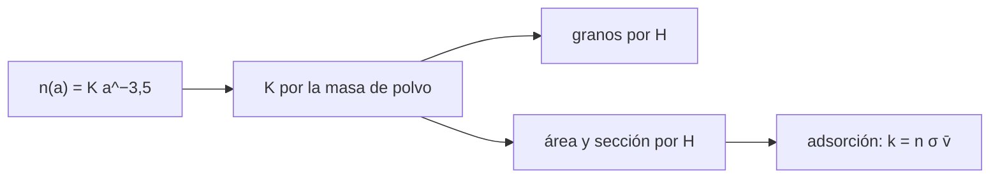

# B55-C05 — Granos de polvo interestelar

<!-- nav:top -->
[🏠 Programa](../../../../README.md) · [📚 Bloque B55](../../../tronco-comun/B55-astroquimica-y-geoquimica-extraterrestre.md) · [← Anterior: B55-C04 — Química de nubes moleculares](../B55-C04-quimica-de-nubes-moleculares/CLASE.md) · [Siguiente: B55-C06 — Hielos astrofísicos →](../../../tronco-comun/B55-astroquimica-y-geoquimica-extraterrestre.md#b55-c06)
<!-- /nav -->

## 1. Ubicación, nivel y alcance

Clase 5 del bloque B55, nivel N3. Construyes una **población sintética de granos de polvo** con una distribución de tamaños en ley de potencias y calculas cuántos granos, cuánta superficie y cuánta sección eficaz hay por átomo de hidrógeno, y con qué rapidez los granos capturan átomos de H. Usas integrales de potencias y el modelo cinético del gas ([B10](../../../tronco-comun/B10-algebra-lineal-y-matematicas-geometricas.md)). Los parámetros son **ilustrativos**.

## 2. Por qué esta clase existe

Los granos de polvo son la superficie donde ocurren muchas reacciones que en fase gaseosa no ocurren (C07) y donde se acumulan hielos (C06). Saber cuánta superficie hay por átomo de H determina cuánta química de superficie es posible. La decisión central: **¿cuánta área de grano hay por átomo de hidrógeno y en cuánto tiempo se adsorbe un átomo?**

## 3. Lo que podrás hacer al terminar

1. Normalizar una distribución `n(a) ∝ a^(−3,5)` con la masa total de polvo.
2. Calcular granos, sección eficaz y área por átomo de H.
3. Comprobar las integrales analíticas contra las numéricas.
4. Comparar el reparto de número, superficie y masa entre granos pequeños y grandes.
5. Calcular la velocidad media térmica y el tiempo de adsorción de un átomo de H.
6. Distinguir lo geométrico de la teoría de Mie.

La evidencia es la **ficha de la población de granos** del ejercicio 12 (sección 20).

## 4. Con qué llegas y cómo comprobarlo

1. ¿Qué es una ley de potencias?
2. ¿Qué es una densidad de material?
3. ¿Qué es una sección eficaz geométrica?
4. ¿Qué es la velocidad media térmica?
5. ¿Qué es una integral numérica?

<details>
<summary>Ver respuestas</summary>

1. Una función `a^p` con exponente `p` constante. 2. Masa por unidad de volumen, aquí 3 g cm⁻³. 3. El área proyectada `π a²` de una esfera. 4. `√(8kT/πm)` en un gas de Maxwell–Boltzmann. 5. Una suma que aproxima el área bajo una curva.
</details>

Con cuatro o cinco aciertos, sigue; si no, repasa los prerrequisitos.

## 5. Un caso de contexto y casos de referencia

Granos esféricos con `n(a) da = K a^(−3,5) da` entre `0,005` y `0,25 µm`, densidad de 3 g cm⁻³ y cociente de masa polvo/hidrógeno de 0,01, todo **ilustrativo** (exponente y límites de tipo clásico, no leídos en una fuente). Es el **ejemplo conductor**. Draine (2003) (S1), en su resumen, describe el polvo interestelar con silicatos, grafito y PAH; esa descripción es contexto, no origen de los números.

## 6. Vocabulario

El **tamaño de grano** `a` es su radio. La **ley de potencias** `n(a) ∝ a^(−q)` tiene exponente `q = 3,5`. La **sección eficaz geométrica** es `π a²`; el **área superficial** es `4π a²`. El **pegado** `S` es la probabilidad de que un átomo que choca quede adsorbido. La **velocidad media térmica** es `v̄ = √(8 k T/(π m))`.

## 7. Modelo mental: muchas bolitas de distintos tamaños

Una ley de potencias con `q = 3,5` tiene muchísimos granos pequeños pero casi toda la masa está en los grandes. El **área**, que importa para la química, queda en el medio.



*Descripción textual:* la masa total fija la constante `K`; con ella se integran el número, el área y la sección eficaz, y de la sección eficaz sale la tasa de adsorción.

Analogía: un saco de arena con muchos granos finos y pocas piedras. Límite: los granos reales no son esferas lisas: son porosos y pueden formar agregados.

## 8. La explicación, paso a paso

### 8.1 Normalización

La masa de polvo por átomo de H es `(4/3)π ρ K ∫ a^(3−q) da = 0,01 m_H`. Esto da `K = 1,5503 × 10⁻²⁵ cm^2,5` por átomo de H.

### 8.2 Número, área y sección eficaz

`n_gr = K ∫ a^(−q) da = 3,5077 × 10⁻¹⁰` granos por H; `σ = π K ∫ a^(2−q) da = 1,1827 × 10⁻²¹ cm²` por H y área superficial `4π K ∫ a^(2−q) da = 4,7309 × 10⁻²¹ cm²` por H. Las integrales analíticas y numéricas (trapecio en `ln a`) coinciden a 10⁻⁶.

### 8.3 Reparto por tamaño

Los granos con `a < 0,01 µm` son el 82,33 % del número, el 34,11 % de la superficie y el 6,82 % de la masa: **muchos granos pequeños, poca masa**.

### 8.4 Adsorción

| T (K) | `v̄` (cm s⁻¹) | `k_ads` (s⁻¹) | tiempo (años) |
|---|---|---|---|
| 10 | 4,5847 × 10⁴ | 5,4225 × 10⁻¹³ | 5,8439 × 10⁴ |
| 20 | 6,4838 × 10⁴ | 7,6685 × 10⁻¹³ | 4,1322 × 10⁴ |
| 50 | 1,0252 × 10⁵ | 1,2125 × 10⁻¹² | 2,6135 × 10⁴ |
| 100 | 1,4498 × 10⁵ | 1,7147 × 10⁻¹² | 1,8480 × 10⁴ |

(con `n_H = 10⁴ cm⁻³` y `S = 1`.) El tiempo de adsorción baja como `T^(−1/2)`. El radio efectivo `⟨a³⟩/⟨a²⟩` es 0,03536 µm y la razón área/masa de polvo es `2,8284 × 10⁵ cm² g⁻¹`.

## 9. Magnitudes, símbolos y unidades

| Símbolo | Qué es | Unidad | Valor / nota |
|---|---|---|---|
| `a` | radio del grano | cm (1 µm = 10⁻⁴ cm) | 0,005 a 0,25 µm |
| `K` | constante de la distribución | cm^2,5 por H | 1,5503 × 10⁻²⁵ |
| `σ` | sección eficaz geométrica por H | cm² por H | 1,1827 × 10⁻²¹ |
| `v̄` | velocidad media térmica | cm s⁻¹ | 4,5847 × 10⁴ (10 K) |
| `k` | constante de Boltzmann | J K⁻¹ | 1,380649 × 10⁻²³ (CODATA 2022) |

## 10. Convenciones y referencias

Sistema de referencia: gas atómico de H a temperatura `T` y densidad `n_H`. Constante de Boltzmann y masa del protón del NIST (CODATA 2022; la masa del protón se usa como masa del átomo de H). Parámetros ilustrativos. Versiones: Python 3.12.9, biblioteca estándar. Tolerancia: integrales a 1e-6 relativo.

## 11. De dónde sale lo que afirmamos

| ID | Fuente | Localizador | Respalda | Estado |
|---|---|---|---|---|
| S1 | Draine, «Interstellar Dust Grains», *Annu. Rev. Astron. Astrophys.* 41, 241 (2003) | arXiv:astro-ph/0304489 | contexto: composición del polvo (silicatos, grafito, PAH) en el resumen | Consultada el 2026-11-09; solo resumen |
| S2 | NIST, CODATA 2022: Boltzmann constant | https://physics.nist.gov/cgi-bin/cuu/Value?k | constante de Boltzmann | Consultada el 2026-11-09; consultada (valor y edición) |
| S3 | NIST, CODATA 2022: proton mass | https://physics.nist.gov/cgi-bin/cuu/Value?mp | masa del protón, usada como masa del átomo de H | Consultada el 2026-11-09; consultada (valor y edición) |
| — | Sin fuente externa para el resto | — | relaciones y valores que verifica el laboratorio con una segunda vía de cálculo; los parámetros de modelo se rotulan ilustrativos | No se consultó una fuente para esta parte |

Límites: de Draine solo se leyó el resumen; el exponente y los límites de tamaño no se tomaron de una fuente consultada.

## 12. Cómo ver el reparto por tamaño

| Tamaño | Número (%) | Superficie (%) | Masa (%) |
|---|---|---|---|
| a < 0,01 µm | 82,33 | 34,11 | 6,82 |
| a ≥ 0,01 µm | 17,67 | 65,89 | 93,18 |

Descripción larga: tres barras apiladas mostrarían que el número se concentra en granos pequeños, la masa en los grandes y la superficie, repartida.

## 13. Ejemplo trabajado: sección eficaz por átomo de H

**Paso 1 · Integral.** `∫ a^(−1,5) da` entre los límites vale `2(a_min^(−0,5) − a_max^(−0,5))`.

**Paso 2 · Con `K`.** `σ = π K × integral`.

**Paso 3 · Resultado.** `σ = 1,1827 × 10⁻²¹ cm²` por átomo de H, el valor del laboratorio.

**Paso 4 · Adsorción.** Con `n_H = 10⁴` y `v̄ = 4,5847 × 10⁴ cm s⁻¹`, `k = n σ v̄ = 5,42 × 10⁻¹³ s⁻¹`.

## 14. Distintas formas de describir la población de granos

**Distribución continua:** una ley de potencias con límites. **Granos típicos:** un solo radio (`a_ef`) y número equivalente. **Por componentes:** silicatos y carbonosos. Cada forma pierde o gana detalle; la continua es la única que permite integrar el área.

## 15. Práctica guiada

**Ejercicio 1 · con los pasos indicados.** Calcula la masa de un grano de `a = 0,1 µm` y 3 g cm⁻³ (sección 8.1). Pasos: volumen y densidad.

<details><summary>Solución comentada</summary>

`(4/3)π(10⁻⁵ cm)³ × 3 = 1,26 × 10⁻¹⁴ g`.
</details>

**Ejercicio 2 · con una pista.** Calcula la sección eficaz geométrica de ese grano (sección 8.2). *Pista:* `π a²`.

<details><summary>Solución comentada</summary>

`π(10⁻⁵)² = 3,14 × 10⁻¹⁰ cm²`.
</details>

**Ejercicio 3 · casi autónomo.** ¿Cuántos de esos granos hacen falta para la sección eficaz total por H (sección 8.2)? *Casi autónomo.*

<details><summary>Solución comentada</summary>

`1,1827 × 10⁻²¹ / 3,14 × 10⁻¹⁰ = 3,8 × 10⁻¹²` por H granos de ese tamaño por H, mucho menos que los `3,5 × 10⁻¹⁰` granos totales, porque la población está dominada por granos mucho más pequeños.
</details>

## 16. Práctica autónoma, transferencia e integrador

**Ejercicio 4 · autónomo.** Comprueba que `v̄(40 K)/v̄(10 K) = 2` (sección 8.4).

<details><summary>Solución comentada</summary>

`√(40/10) = 2`, como pasa en el laboratorio.
</details>

**Ejercicio 5 · autónomo.** ¿Cuántos granos hay por cm³ si `n_H = 10⁴`? (sección 8.2).

<details><summary>Solución comentada</summary>

`3,5077 × 10⁻¹⁰ × 10⁴ = 3,5 × 10⁻⁶ cm⁻³`.
</details>

**Ejercicio 6 · autónomo.** ¿Qué fracción de la superficie queda en `a ≥ 0,01 µm`? (sección 8.3).

<details><summary>Solución comentada</summary>

`100 − 34,11 = 65,89 %`.
</details>

**Ejercicio 7 · autónomo.** Si el cociente polvo/H bajara a 0,005, ¿cómo cambia `σ`? (sección 8.1).

<details><summary>Solución comentada</summary>

`K` se reduce a la mitad y `σ` también.
</details>

**Ejercicio 8 · autónomo.** ¿Por qué el tiempo de adsorción baja al subir `T`? (sección 8.4).

<details><summary>Solución comentada</summary>

Porque `v̄` crece como `√T` y los átomos chocan más veces.
</details>

**Ejercicio 9 · transferencia.** Un modelo propone `q = 3,0` en vez de 3,5. ¿Qué cambia cualitativamente en el reparto por tamaño? (sección 8.3).

<details><summary>Solución comentada</summary>

Menos granos pequeños y más masa/superficie en los grandes; hay que recalcular las integrales.
</details>

**Ejercicio 10 · transferencia.** Un telescopio mide un cociente de masa polvo/H distinto de 0,01. ¿Cómo ajustas `K`? (sección 8.1).

<details><summary>Solución comentada</summary>

`K` es proporcional al cociente, con los mismos límites de tamaño.
</details>

**Ejercicio 11 · transferencia.** ¿Por qué no basta `π a²` para la extinción de luz de granos de tamaño comparable a la longitud de onda? (sección 8.2).

<details><summary>Solución comentada</summary>

Porque entonces interviene la dispersión (teoría de Mie), que esta clase no trata.
</details>

**Ejercicio 12 · integrador.** Elabora tu *ficha de la población de granos*: define `q`, `a_min`, `a_max`, `ρ` y el cociente de masa, calcula `K`, número, área y sección por H, el reparto por tamaño y el tiempo de adsorción a cuatro temperaturas.

<details><summary>Solución modelo</summary>

Debe mostrar 8.1–8.4 con unidades, las pruebas numéricas y la nota de que los parámetros son ilustrativos.
</details>

## 17. Laboratorio: población de granos con ley de potencias

El script [granos_polvo.py](granos_polvo.py) normaliza la distribución, integra número, área y masa, calcula las tasas de adsorción y **comprueba** las integrales analíticas contra las numéricas (1e-6) y el escalado `v̄ ∝ √T`.

**Datos:** **ilustrativos**; `k` de Boltzmann y masa del protón del NIST (S2, S3). **Predice antes de ejecutar:** ¿cuál es la sección eficaz por átomo de H? (≈ 1,2 × 10⁻²¹ cm².) **Ejecución del 2026-11-09 (Python 3.12.9):**

```text
Python 3.12.9 (biblioteca estandar)
A. Poblacion ILUSTRATIVA: n(a) = K a^-3.5 ; a en [0.005, 0.25] um ; rho = 3 g cm-3 ; M_polvo/M_H = 0.01
K = 1.5503e-25 cm^2.5 por atomo de H
B. Granos por atomo de H = 3.5077e-10 ; seccion eficaz geometrica por H = 1.1827e-21 cm2 ; area superficial por H = 4.7309e-21 cm2
C. Integrales analiticas frente a numericas (trapecio en ln a): superadas a 1e-6 relativo
D. Granos con a < 0.01 um: 82.33 % del numero ; 34.11 % de la superficie ; 6.82 % de la masa
E. Tasa de adsorcion de H por grano-superficie (S = 1) para n_H = 1e4 cm-3
T [K]   v_med [cm/s]   k_ads por atomo [s-1]   tiempo hasta adsorberse [anos]
   10    4.5847e+04   5.4225e-13          5.8439e+04
   20    6.4838e+04   7.6685e-13          4.1322e+04
   50    1.0252e+05   1.2125e-12          2.6135e+04
  100    1.4498e+05   1.7147e-12          1.8480e+04
F. Radio efectivo <a^3>/<a^2> = 0.03536 um ; razon area/masa = 2.8284e+05 cm2 g-1
Pruebas superadas.
```

```bash
python programa/clases/B55/B55-C05-granos-de-polvo-interestelar/granos_polvo.py
```

**Límites:** granos esféricos y geométricos; sin Mie, carga ni porosidad; `S = 1`.

## 18. Errores frecuentes y cómo corregirlos

**Confundir granos pequeños (muchos) con granos importantes en masa.** Se compara en 8.3.

**Mezclar µm con cm.** Se convierte en la sección 9.

**Usar la sección geométrica para luz de longitud de onda similar al tamaño.** Ver el ejercicio 11.

**Presentar los parámetros como medidos.** Se aclara en la sección 5.

## 19. Cómo sabrás que vas bien

Tras la sección 8: ¿qué `σ` esperabas y cuál obtuviste? Si dudas, repasa el ejemplo 13. Tras el laboratorio: ¿qué comprueba? (ver la sección 17).

## 20. Qué entregas y cómo se evalúa

El producto es tu **ficha de la población de granos** (ejercicio 12).

| Criterio | Inicial | En desarrollo | Logrado | Destacado |
|---|---|---|---|---|
| Conceptos | Los confunde | Parciales | Distingue número, área y masa | Explica los límites |
| Cálculo | Sin unidades | Con errores | Tablas completas con unidades | Calcula casos nuevos |
| Numérico | Sin comprobar | Un caso | Contraste con el caso analítico | Interpreta las diferencias |
| Fuentes | Sin fuente | Sin fecha | Fuentes con fecha y estado | Declara lo sintético e ilustrativo |
| Límites | No los nombra | Uno | Tres | Discute qué falta del modelo |

**Condiciones críticas (no se compensan con promedio):** rotular los parámetros como ilustrativos; no atribuir `q` ni los límites a una fuente no consultada; citar solo lo consultado.

## 21. Ética, seguridad y límites

Los parámetros de la población de granos se citan con su fuente cuando se usan en un modelo real. Clase educativa: los modelos son simplificados y ningún resultado de esta clase es una observación. Accesibilidad: tablas equivalentes a las gráficas, fórmulas en texto, ejercicios sin conexión.

## 22. Para cerrar y seguir

Con estos parámetros hay `1,18 × 10⁻²¹ cm²` de sección eficaz de grano por átomo de H, y un átomo tarda ~6 × 10⁴ años en adsorberse a 10 K. Queda una pregunta: ¿qué se acumula sobre los granos?

**Glosario español–inglés.** grano de polvo · *dust grain*; ley de potencias · *power law*; sección eficaz · *cross section*; adsorción · *adsorption*; velocidad media térmica · *mean thermal speed*.

**Continuidad.** [B55-C06](../B55-C06-hielos-astrofisicos/CLASE.md) estudia los hielos que se acumulan sobre los granos.

**Referencias:** ver sección 11.

<!-- nav:bottom -->
---

[← Anterior: B55-C04 — Química de nubes moleculares](../B55-C04-quimica-de-nubes-moleculares/CLASE.md) · [📚 Bloque B55](../../../tronco-comun/B55-astroquimica-y-geoquimica-extraterrestre.md) · [Siguiente: B55-C06 — Hielos astrofísicos →](../../../tronco-comun/B55-astroquimica-y-geoquimica-extraterrestre.md#b55-c06)
<!-- /nav -->
