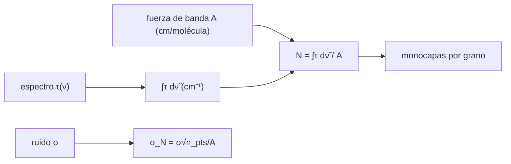

# B55-C06 — Hielos astrofísicos

<!-- nav:top -->
[🏠 Programa](../../../../README.md) · [📚 Bloque B55](../../../tronco-comun/B55-astroquimica-y-geoquimica-extraterrestre.md) · [← Anterior: B55-C05 — Granos de polvo interestelar](../B55-C05-granos-de-polvo-interestelar/CLASE.md) · [Siguiente: B55-C07 — Catálisis en superficies →](../B55-C07-catalisis-en-superficies/CLASE.md)
<!-- /nav -->

## 1. Ubicación, nivel y alcance

Clase 6 del bloque B55, nivel N3. Aprendes a pasar de una **banda de absorción infrarroja** a una **densidad de columna** de hielo: integras la profundidad óptica, divides por la fuerza de banda y propagas la incertidumbre del ruido y de la fuerza de banda. Usas [B55-C05](../B55-C05-granos-de-polvo-interestelar/CLASE.md) para convertir la columna en monocapas sobre los granos. La banda de la clase es **sintética**.

## 2. Por qué esta clase existe

Los hielos de los granos guardan gran parte de la química fría y se estudian por su absorción infrarroja. Para comparar con modelos hay que convertir una banda en moléculas por cm². La decisión central: **¿cuánto hielo hay y con qué incertidumbre, dado el ruido y la fuerza de banda adoptada?**

## 3. Lo que podrás hacer al terminar

1. Definir la profundidad óptica y la fuerza de banda.
2. Calcular `N = ∫τ dν̃ / A` por integración numérica y por fórmula analítica.
3. Estimar la incertidumbre por ruido con una fórmula y con Monte Carlo.
4. Ver cómo la incertidumbre de `A` se traslada a `N`.
5. Expresar la columna en monocapas por grano.
6. Reconocer el papel de los hielos observados por espectroscopía infrarroja.

La evidencia es la **densidad de columna de una banda sintética** del ejercicio 12 (sección 20).

## 4. Con qué llegas y cómo comprobarlo

1. ¿Qué es la profundidad óptica?
2. ¿Qué es un número de onda?
3. ¿Qué es una integral numérica?
4. ¿Qué es una simulación Monte Carlo?
5. ¿Qué es un valor ilustrativo?

<details>
<summary>Ver respuestas</summary>

1. `τ = −ln(I/I₀)`, la atenuación logarítmica de la luz. 2. `ν̃ = 1/λ`, medido en cm⁻¹. 3. Una suma que aproxima el área bajo una curva. 4. Repetir un cálculo con números aleatorios de semilla fija. 5. Un valor propuesto para el ejemplo, no medido.
</details>

Con cuatro o cinco aciertos, sigue; si no, repasa los prerrequisitos.

## 5. Un caso de contexto y casos de referencia

Una banda gaussiana **sintética** con centro 3280 cm⁻¹, FWHM 390 cm⁻¹, `τ_pico = 0,80`, fuerza de banda ilustrativa `A = 2,0 × 10⁻¹⁶ cm/molécula` y ruido de 0,01. Es el **ejemplo conductor**. Boogert, Gerakines y Whittet (2015) (S1) revisan en su resumen las detecciones de hielos por espectroscopía infrarroja en entornos interestelares y del Sistema Solar y señalan que los perfiles de las bandas revelan las etapas de formación y la historia térmica; esa idea es el contexto, no la fuente de los números.

## 6. Vocabulario

La **profundidad óptica** `τ(ν̃)`. La **fuerza de banda** `A` (cm por molécula) relaciona el área de la banda con el número de moléculas. La **densidad de columna** `N` (moléculas cm⁻²) es `∫τ dν̃ / A`. La **FWHM** es el ancho a media altura. Una **monocapa** es la cantidad de moléculas que cubre una superficie con una capa (aquí 10¹⁵ cm⁻², ilustrativo).

## 7. Modelo mental: una sombra en el espectro

La luz de una estrella de fondo atraviesa la nube; el hielo de los granos absorbe a ciertas frecuencias y deja una «sombra». El área de la sombra, medida en `τ × cm⁻¹`, dividida por lo que absorbe una sola molécula, es el número de moléculas por cm².



*Descripción textual:* el espectro se integra, se divide por la fuerza de banda para obtener la columna, el ruido da su incertidumbre y la columna se expresa en monocapas.

Analogía: medir cuánto líquido hay en una probeta por el área bajo la sombra que proyecta. Límite: la fuerza de banda real depende de la mezcla y de la temperatura del hielo; aquí es una constante.

## 8. La explicación, paso a paso

### 8.1 Integral de la banda

Para una gaussiana, `∫τ dν̃ = τ_pico · FWHM · √(π/(4 ln 2)) = 332,113710 cm⁻¹`. La integral numérica (trapecio, paso 1 cm⁻¹, ±6 FWHM) coincide con error relativo `1 × 10⁻¹⁵`.

### 8.2 Densidad de columna

`N = 332,1137 / (2,0 × 10⁻¹⁶) = 1,6606 × 10¹⁸ moléculas cm⁻²`, que son 1660,6 monocapas de 10¹⁵ cm⁻².

### 8.3 Ruido

Con 400 realizaciones de ruido 0,01 (semilla 12345) el valor medio es `1,6605 × 10¹⁸` y la desviación `3,5349 × 10¹⁵`; la fórmula `σ√n/A` da `3,4209 × 10¹⁵` (acuerdo en 3,3 %). El ruido pesa ~0,2 % de `N`.

### 8.4 Incertidumbre de la fuerza de banda

| `A` (cm/molécula) | `N` (cm⁻²) |
|---|---|
| 1,6 × 10⁻¹⁶ | 2,0757 × 10¹⁸ |
| 2,0 × 10⁻¹⁶ | 1,6606 × 10¹⁸ |
| 2,4 × 10⁻¹⁶ | 1,3838 × 10¹⁸ |

Un ±20 % en `A` cambia `N` entre +25 % y −17 %: **la fuerza de banda domina el error**, no el ruido.

### 8.5 Monocapas por grano

Con una abundancia ilustrativa de 10⁻⁴ moléculas de hielo por H y el área de grano de la clase B55-C05 (`4,7309 × 10⁻²¹ cm²` por H), el manto equivale a 21,1 monocapas.

## 9. Magnitudes, símbolos y unidades

| Símbolo | Qué es | Unidad | Valor / nota |
|---|---|---|---|
| `τ` | profundidad óptica | — | 0,80 (pico) |
| `ν̃` | número de onda | cm⁻¹ | 3280 (centro) |
| `A` | fuerza de banda | cm molécula⁻¹ | 2,0 × 10⁻¹⁶ (ilustrativa) |
| `N` | densidad de columna | moléculas cm⁻² | 1,6606 × 10¹⁸ |
| `σ` | ruido en `τ` | — | 0,01 |

## 10. Convenciones y referencias

Sistema de referencia: espectro de absorción con el continuo ya restado. Ley de Beer lineal. Banda y fuerza de banda ilustrativas. Versiones: Python 3.12.9, biblioteca estándar, semilla 12345. Tolerancias: integral 1e-6; ruido 5 %.

## 11. De dónde sale lo que afirmamos

| ID | Fuente | Localizador | Respalda | Estado |
|---|---|---|---|---|
| S1 | Boogert, Gerakines y Whittet, «Observations of the Icy Universe», *Annu. Rev. Astron. Astrophys.* 53 (2015) | arXiv:1501.05317 | contexto: detecciones de hielos por espectroscopía infrarroja y lo que revelan las bandas (resumen) | Consultada el 2026-11-09; solo resumen |
| — | Sin fuente externa para el resto | — | relaciones y valores que verifica el laboratorio con una segunda vía de cálculo; los parámetros de modelo se rotulan ilustrativos | No se consultó una fuente para esta parte |

Límites: del artículo solo se leyó el resumen; ni la banda ni la fuerza de banda proceden de una fuente.

## 12. Cómo ver la banda y su incertidumbre

| Magnitud | Valor |
|---|---|
| ∫τ dν̃ | 332,1137 cm⁻¹ |
| N | 1,6606 × 10¹⁸ cm⁻² |
| σ_N (ruido) | 3,4 × 10¹⁵ cm⁻² |
| N con A ±20 % | 1,38–2,08 × 10¹⁸ cm⁻² |

Descripción larga: un gráfico de `τ` frente a `ν̃` mostraría una campana centrada en 3280 cm⁻¹ de 0,8 de altura; el área gris es la integral.

## 13. Ejemplo trabajado: de la banda a la columna

**Paso 1 · Área.** `0,80 × 390 × √(π/(4 ln 2)) = 0,80 × 390 × 1,06447 = 332,11 cm⁻¹`.

**Paso 2 · División.** `332,11 / 2,0 × 10⁻¹⁶ = 1,6606 × 10¹⁸ cm⁻²`.

**Paso 3 · Monocapas.** `1,6606 × 10¹⁸ / 10¹⁵ = 1660,6`.

## 14. Distintas formas de medir la cantidad de hielo

**Por integral de la banda:** la usada aquí. **Por altura del pico:** más sensible a la forma de la banda. **Por ajuste a espectros de laboratorio:** el método real, que no se trata aquí. La integral es robusta si la forma cambia poco.

## 15. Práctica guiada

**Ejercicio 1 · con los pasos indicados.** Calcula `∫τ dν̃` para `τ_pico = 0,5` y FWHM = 200 cm⁻¹ (sección 8.1).

<details><summary>Solución comentada</summary>

`0,5 × 200 × 1,06447 = 106,4 cm⁻¹`.
</details>

**Ejercicio 2 · con una pista.** Calcula `N` con ese área y `A = 2 × 10⁻¹⁶` (sección 8.2). *Pista:* divide.

<details><summary>Solución comentada</summary>

`106,4/2 × 10⁻¹⁶ = 5,32 × 10¹⁷ cm⁻²`.
</details>

**Ejercicio 3 · casi autónomo.** ¿Cuántas monocapas son? (sección 8.5). *Casi autónomo.*

<details><summary>Solución comentada</summary>

`5,32 × 10¹⁷/10¹⁵ = 532`.
</details>

## 16. Práctica autónoma, transferencia e integrador

**Ejercicio 4 · autónomo.** Si el ruido pasa a 0,02, ¿cómo cambia `σ_N`? (sección 8.3).

<details><summary>Solución comentada</summary>

Se duplica: `6,8 × 10¹⁵`.
</details>

**Ejercicio 5 · autónomo.** ¿Cómo cambia `σ_N` si el paso de la malla pasa a 2 cm⁻¹? (sección 8.3).

<details><summary>Solución comentada</summary>

`σ_N = σ Δν √n_pts / A`; con paso 2 cm⁻¹ la integral pesa el doble y hay la mitad de puntos, así que `σ_N` crece un factor √2.
</details>

**Ejercicio 6 · autónomo.** Calcula `N` si `A = 1 × 10⁻¹⁶` (sección 8.4).

<details><summary>Solución comentada</summary>

`3,32 × 10¹⁸ cm⁻²`, el doble.
</details>

**Ejercicio 7 · autónomo.** ¿Qué `τ_pico` haría `N = 10¹⁸` con FWHM 390 y `A = 2 × 10⁻¹⁶`? (sección 8.2).

<details><summary>Solución comentada</summary>

`∫ = 200 cm⁻¹ → τ_pico = 200/(390×1,06447) = 0,48`.
</details>

**Ejercicio 8 · autónomo.** ¿Cuántos puntos tiene la malla de ±6 FWHM con paso 1 cm⁻¹? (sección 8.3).

<details><summary>Solución comentada</summary>

`12 × 390 + 1 = 4681`.
</details>

**Ejercicio 9 · transferencia.** Un espectro real tiene un continuo mal restado con pendiente. ¿Cómo afecta a `N`? (sección 8.1).

<details><summary>Solución comentada</summary>

Suma o resta un área que se confunde con la banda; es un error sistemático distinto del ruido.
</details>

**Ejercicio 10 · transferencia.** Dos laboratorios dan `A` distintos. ¿Qué haces? (sección 8.4).

<details><summary>Solución comentada</summary>

Propagas ambas, informas el intervalo de `N` y declaras cuál usaste.
</details>

**Ejercicio 11 · transferencia.** ¿Por qué 21 monocapas no significa 21 capas uniformes? (sección 8.5).

<details><summary>Solución comentada</summary>

Porque el cálculo es un promedio geométrico y los granos reales son porosos y de tamaños distintos.
</details>

**Ejercicio 12 · integrador.** Elabora tu *densidad de columna de una banda sintética*: define la banda, calcula `∫τ dν̃`, `N`, la incertidumbre por ruido y por `A`, y las monocapas.

<details><summary>Solución modelo</summary>

Debe mostrar 8.1–8.5 con unidades, el contraste numérico–analítico, la dispersión Monte Carlo y la nota de que banda y `A` son ilustrativas.
</details>

## 17. Laboratorio: densidad de columna de una banda sintética

El script [hielos_columna.py](hielos_columna.py) integra una banda gaussiana, calcula `N`, la dispersión por ruido (Monte Carlo) y el efecto de `A`, y **comprueba** la integral contra la fórmula analítica (1e-6) y la dispersión contra `σ√n/A` (5 %).

**Datos:** **sintéticos** (banda, ruido y `A`). **Predice antes de ejecutar:** ¿cuánto vale `N`? (≈ 1,66 × 10¹⁸ cm⁻².) **Ejecución del 2026-11-09 (Python 3.12.9):**

```text
Python 3.12.9 (biblioteca estandar)
A. Banda SINTETICA: centro 3280 cm-1, FWHM 390 cm-1, tau_pico 0.80, A = 2.0e-16 cm/molecula (ILUSTRATIVA)
B. Integral de tau d nu: numerica = 332.113710 cm-1 ; analitica = 332.113710 cm-1 ; error relativo = 1.03e-15
C. Densidad de columna sin ruido N = 1.6606e+18 moleculas cm-2 = 1660.6 monocapas
D. Monte Carlo (400 realizaciones con ruido 0.01, semilla 12345): N medio = 1.6605e+18 ; desviacion = 3.5349e+15 ; formula sigma sqrt(Npts)/A = 3.4209e+15
E. Efecto de la fuerza de banda A (la incertidumbre de A se traslada a N)
A [cm/molec]   N [cm-2]
1.60e-16    2.0757e+18
2.00e-16    1.6606e+18
2.40e-16    1.3838e+18
F. Con x(hielo) = 1e-4 por H y area de grano 4.7309e-21 cm2/H (B55-C05, ilustrativa): 21.1 monocapas
Pruebas superadas.
```

```bash
python programa/clases/B55/B55-C06-hielos-astrofisicos/hielos_columna.py
```

**Límites:** banda aislada, continuo restado, `A` constante, Beer lineal.

## 18. Errores frecuentes y cómo corregirlos

**Confundir la integral en `ν̃` con la altura del pico.** Se calcula en 8.1.

**Olvidar que la fuerza de banda domina el error.** Se muestra en 8.4.

**Dar `N` sin incertidumbre.** Se calcula en 8.3–8.4.

**Presentar la banda sintética como un espectro real.** Se aclara en la sección 5.

## 19. Cómo sabrás que vas bien

Tras la sección 8: ¿qué `N` esperabas y cuál obtuviste? Si dudas, repasa el ejemplo 13. Tras el laboratorio: ¿qué comprueba? (ver la sección 17).

## 20. Qué entregas y cómo se evalúa

El producto es tu **densidad de columna de una banda sintética** (ejercicio 12).

| Criterio | Inicial | En desarrollo | Logrado | Destacado |
|---|---|---|---|---|
| Conceptos | Los confunde | Parciales | Distingue τ, A y N | Explica los límites |
| Cálculo | Sin unidades | Con errores | Tablas completas con unidades | Calcula casos nuevos |
| Numérico | Sin comprobar | Un caso | Contraste con el caso analítico | Interpreta las diferencias |
| Fuentes | Sin fuente | Sin fecha | Fuentes con fecha y estado | Declara lo sintético e ilustrativo |
| Límites | No los nombra | Uno | Tres | Discute qué falta del modelo |

**Condiciones críticas (no se compensan con promedio):** rotular la banda y `A` como sintéticas; no inferir hielos reales; citar solo lo consultado.

## 21. Ética, seguridad y límites

Una columna de hielo se informa con la fuerza de banda adoptada y su fuente; cambiarla cambia el resultado. Clase educativa: los modelos son simplificados y ningún resultado de esta clase es una observación. Accesibilidad: tablas equivalentes a las gráficas, fórmulas en texto, ejercicios sin conexión.

## 22. Para cerrar y seguir

La banda sintética da `N = 1,66 × 10¹⁸ cm⁻²` con error de ruido de 0,2 % y de `A` de −17 % a +25 %. Queda una pregunta: ¿cómo se mueven los átomos sobre la superficie de esos granos?

**Glosario español–inglés.** profundidad óptica · *optical depth*; fuerza de banda · *band strength*; densidad de columna · *column density*; monocapa · *monolayer*; hielo · *ice*.

**Continuidad.** [B55-C07](../B55-C07-catalisis-en-superficies/CLASE.md) estudia la catálisis de la formación de H₂ sobre la superficie de los granos.

**Referencias:** ver sección 11.

<!-- nav:bottom -->
---

[← Anterior: B55-C05 — Granos de polvo interestelar](../B55-C05-granos-de-polvo-interestelar/CLASE.md) · [📚 Bloque B55](../../../tronco-comun/B55-astroquimica-y-geoquimica-extraterrestre.md) · [Siguiente: B55-C07 — Catálisis en superficies →](../B55-C07-catalisis-en-superficies/CLASE.md)
<!-- /nav -->
