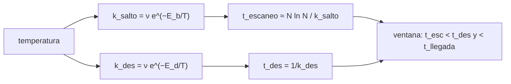

# B55-C07 — Catálisis en superficies

<!-- nav:top -->
[🏠 Programa](../../../../README.md) · [📚 Bloque B55](../../../tronco-comun/B55-astroquimica-y-geoquimica-extraterrestre.md) · [← Anterior: B55-C06 — Hielos astrofísicos](../B55-C06-hielos-astrofisicos/CLASE.md) · [Siguiente: B55-C08 — Fotoquímica cósmica →](../B55-C08-fotoquimica-cosmica/CLASE.md)
<!-- /nav -->

## 1. Ubicación, nivel y alcance

Clase 7 del bloque B55, nivel N3. Estudias cómo un grano de polvo actúa de **catalizador**: un átomo de H se adsorbe, salta de sitio en sitio y se encuentra con otro antes de desorberse. Calculas las tasas de salto y desorción, una ventana de temperatura y verificas una caminata aleatoria. Usas [B55-C05](../B55-C05-granos-de-polvo-interestelar/CLASE.md). Todos los parámetros son **ilustrativos**.

## 2. Por qué esta clase existe

En fase gaseosa dos átomos de H casi nunca forman H₂ al chocar (no pueden disipar la energía), y sin embargo el H₂ es la molécula más abundante: se forma en la superficie de los granos. La decisión central: **¿en qué intervalo de temperatura un grano puede formar H₂, y qué lo limita por debajo y por encima?**

## 3. Lo que podrás hacer al terminar

1. Calcular tasas de salto y desorción de tipo Arrhenius.
2. Estimar el tiempo de escaneo de un grano.
3. Derivar los límites `T_min` y `T_max` de una ventana de formación.
4. Comprobar la ventana evaluando las condiciones dentro y fuera de ella.
5. Verificar con Monte Carlo que `⟨r²⟩ = n` en una caminata aleatoria 2D.
6. Relacionar el resultado con la dependencia de la eficiencia con las barreras de difusión.

La evidencia es la **ventana de formación de H₂** del ejercicio 12 (sección 20).

## 4. Con qué llegas y cómo comprobarlo

1. ¿Qué es una tasa de Arrhenius?
2. ¿Qué es la adsorción?
3. ¿Qué es la desorción?
4. ¿Qué es una caminata aleatoria?
5. ¿Qué es un catalizador?

<details>
<summary>Ver respuestas</summary>

1. `k = ν exp(−E/T)`, con `E` en kelvin. 2. Que una partícula quede pegada a una superficie. 3. Que una partícula adsorbida se libere de la superficie. 4. Una sucesión de pasos al azar. 5. Algo que facilita una reacción sin consumirse.
</details>

Con cuatro o cinco aciertos, sigue; si no, repasa los prerrequisitos.

## 5. Un caso de contexto y casos de referencia

Un grano **sintético** con `N_s = 10⁶` sitios, frecuencia de vibración `ν = 10¹² s⁻¹`, barrera de difusión `E_b = 300 K`, energía de desorción `E_d = 500 K` y un tiempo entre llegadas de átomos de `10⁸ s`; todo ilustrativo. Es el **ejemplo conductor**. Zhao et al. (2022) (S1) examinan en su resumen cómo la eficiencia de formación de H₂ en nubes difusas y translúcidas depende de la difusión del H₂ sobre la superficie y de las barreras adoptadas; es el contexto, no el origen de los números.

## 6. Vocabulario

La **tasa de salto** `k_s = ν exp(−E_b/T)` es la frecuencia con que un átomo cambia de sitio. La **tasa de desorción** `k_d = ν exp(−E_d/T)`. El **tiempo de escaneo** `t_esc ≈ N_s ln N_s / k_s` es una estimación heurística del tiempo para recorrer un grano. La **ventana de formación** es el intervalo de `T` en que `t_esc` es menor que el tiempo de desorción y que el tiempo entre llegadas.

## 7. Modelo mental: una carrera contra el reloj

El átomo adsorbido corre para encontrar a otro antes de evaporarse y antes de que lleguen más: si hace demasiado frío no se mueve; si hace demasiado calor se desorbe antes de encontrarse.



*Descripción textual:* la temperatura fija las tasas de salto y desorción; la ventana de formación se da cuando el átomo escanea el grano antes de desorberse y antes de que lleguen otros.

Analogía: una carrera donde hay que cruzar una plaza antes de que cierre. Límite: el modelo omite el tunelamiento cuántico del H, distintos tipos de sitio y la formación en granos ya cubiertos de hielo.

## 8. La explicación, paso a paso

### 8.1 Tasas y tiempos

| T (K) | `k_salto` (s⁻¹) | `k_des` (s⁻¹) | `t_esc` (s) | `t_des` (s) | ¿forma H₂? |
|---|---|---|---|---|---|
| 6 | 1,929 × 10⁻¹⁰ | 6,439 × 10⁻²⁵ | 7,163 × 10¹⁶ | 1,553 × 10²⁴ | no |
| 8 | 5,176 × 10⁻⁵ | 7,188 × 10⁻¹⁶ | 2,669 × 10¹¹ | 1,391 × 10¹⁵ | no |
| 10 | 9,358 × 10⁻² | 1,929 × 10⁻¹⁰ | 1,476 × 10⁸ | 5,185 × 10⁹ | no |
| 11 | 1,431 | 1,817 × 10⁻⁸ | 9,655 × 10⁶ | 5,504 × 10⁷ | sí |
| 12 | 13,89 | 8,024 × 10⁻⁷ | 9,948 × 10⁵ | 1,246 × 10⁶ | sí |
| 13 | 95,02 | 1,979 × 10⁻⁵ | 1,454 × 10⁵ | 5,054 × 10⁴ | no |
| 20 | 3,059 × 10⁵ | 13,89 | 45,16 | 7,2 × 10⁻² | no |

### 8.2 La ventana

`T_min = E_b / ln(t_llegada ν/(N ln N)) = 10,13 K` y `T_max = (E_d − E_b)/ln(N ln N) = 12,16 K`. A 10 K el átomo tarda demasiado en recorrer el grano; a 13 K se desorbe antes. El laboratorio comprueba que dentro de la ventana se cumplen ambas condiciones y que fuera falla al menos una.

### 8.3 Caminata aleatoria

| n saltos | ⟨r²⟩ Monte Carlo | n |
|---|---|---|
| 10 | 9,95 | 10 |
| 100 | 98,78 | 100 |
| 1000 | 995,36 | 1000 |

(4000 caminantes, semilla 2024.) Concuerda con la teoría `⟨r²⟩ = n` dentro de 3 %. La difusión es lenta: la distancia crece como la raíz de los saltos.

### 8.4 Sensibilidad a la temperatura

El tiempo de salto baja de 10,69 s a 10 K a 3,269 × 10⁻⁶ s a 20 K (factor 3,27 × 10⁶): es la exponencial `e^(−E_b/T)`. Cambiar `E_b` mueve la ventana, tal como señala Zhao et al. (2022) para la eficiencia (S1, resumen).

## 9. Magnitudes, símbolos y unidades

| Símbolo | Qué es | Unidad | Valor / nota |
|---|---|---|---|
| `ν` | frecuencia de vibración | s⁻¹ | 10¹² (ilustrativa) |
| `E_b, E_d` | barrera de difusión y energía de desorción | K | 300; 500 (ilustrativas) |
| `N_s` | sitios por grano | — | 10⁶ |
| `t_esc` | tiempo de escaneo | s | 9,948 × 10⁵ (12 K) |
| `T_min, T_max` | límites de la ventana | K | 10,13; 12,16 |

## 10. Convenciones y referencias

Sistema de referencia: un grano con red cuadrada de `N_s` sitios. Energías en kelvin (`E/k_B`). Parámetros ilustrativos. Versiones: Python 3.12.9, biblioteca estándar, semilla 2024. Tolerancia: `⟨r²⟩` a 3 %.

## 11. De dónde sale lo que afirmamos

| ID | Fuente | Localizador | Respalda | Estado |
|---|---|---|---|---|
| S1 | Zhao et al., «Effect of surface H2 on molecular hydrogen formation on interstellar grains», *MNRAS* (2022) | arXiv:2203.03877 | contexto: la eficiencia de formación de H₂ depende de la difusión y las barreras (resumen) | Consultada el 2026-11-09; solo resumen |
| — | Sin fuente externa para el resto | — | relaciones y valores que verifica el laboratorio con una segunda vía de cálculo; los parámetros de modelo se rotulan ilustrativos | No se consultó una fuente para esta parte |

Límites: del artículo solo se leyó el resumen; el tiempo de escaneo `N ln N / k_s` es una estimación heurística y los parámetros son inventados.

## 12. Cómo ver la ventana de temperatura

| T (K) | ¿forma H₂? | razón |
|---|---|---|
| 10 | no | demasiado lento |
| 11 | sí | dentro de la ventana |
| 12 | sí | dentro de la ventana |
| 13 | no | se desorbe antes |

Descripción larga: en un eje de temperatura, una franja estrecha entre 10,1 y 12,2 K marca donde ambas condiciones se cumplen.

## 13. Ejemplo trabajado: el límite superior de la ventana

**Paso 1 · `N ln N`.** `10⁶ × ln(10⁶) = 1,382 × 10⁷`.

**Paso 2 · Logaritmo.** `ln(1,382 × 10⁷) = 16,44`.

**Paso 3 · Límite.** `T_max = (500 − 300)/16,44 = 12,16 K`, igual al del laboratorio.

## 14. Distintas formas de estimar la formación de H₂

**Ecuaciones de tasas:** sencillas, promedian el grano. **Monte Carlo cinético:** sigue cada átomo, más realista y costoso. **Ventana analítica:** da el orden de magnitud, como aquí. Las tres deben concordar cualitativamente.

## 15. Práctica guiada

**Ejercicio 1 · con los pasos indicados.** Calcula `k_salto` a 10 K (sección 8.1).

<details><summary>Solución comentada</summary>

`10¹² e^(−30) = 9,36 × 10⁻² s⁻¹`.
</details>

**Ejercicio 2 · con una pista.** Calcula `t_des` a 10 K (sección 8.1). *Pista:* `1/k_des`.

<details><summary>Solución comentada</summary>

`k_des = 1,929 × 10⁻¹⁰ → 5,18 × 10⁹ s`.
</details>

**Ejercicio 3 · casi autónomo.** Verifica que a 10 K no se cumple `t_esc < t_llegada` (sección 8.2). *Casi autónomo.*

<details><summary>Solución comentada</summary>

`t_esc = 1,476 × 10⁸ s > 10⁸ s`: no se cumple por un factor 1,5.
</details>

## 16. Práctica autónoma, transferencia e integrador

**Ejercicio 4 · autónomo.** ¿Cuál es `T_max` si `E_d = 600 K`? (sección 8.2).

<details><summary>Solución comentada</summary>

`(600 − 300)/16,44 = 18,25 K`.
</details>

**Ejercicio 5 · autónomo.** ¿Cuál es `T_min` si `t_llegada = 10⁹ s`? (sección 8.2).

<details><summary>Solución comentada</summary>

`300/ln(10⁹·10¹²/1,382 × 10⁷) = 300/ln(7,24 × 10¹³) = 300/31,91 = 9,40 K`.
</details>

**Ejercicio 6 · autónomo.** ¿Cuál es la distancia típica tras 1000 saltos, en sitios? (sección 8.3).

<details><summary>Solución comentada</summary>

`√1000 = 31,6 sitios`.
</details>

**Ejercicio 7 · autónomo.** ¿Por qué el tiempo de escaneo crece con `N_s`? (sección 8.1).

<details><summary>Solución comentada</summary>

Porque hay más sitios que visitar.
</details>

**Ejercicio 8 · autónomo.** ¿Qué pasa con la ventana si `E_b = E_d`? (sección 8.2).

<details><summary>Solución comentada</summary>

`T_max = 0`: la desorción compite con cada salto y no hay ventana.
</details>

**Ejercicio 9 · transferencia.** Un grano cubierto de hielo tiene barreras mayores. ¿Qué esperas para la ventana? (secciones 8.2 y 8.4).

<details><summary>Solución comentada</summary>

Que se desplace hacia temperaturas más altas (`E_b` grande sube `T_min`) y se estreche.
</details>

**Ejercicio 10 · transferencia.** Un modelo con ventana de 10–12 K, ¿explica H₂ en una nube a 50 K? (sección 8.2).

<details><summary>Solución comentada</summary>

No con este mecanismo; harían falta otros (sitios más ligados, quimisorción).
</details>

**Ejercicio 11 · transferencia.** ¿Qué cuantifica la dependencia de la eficiencia con las barreras en el trabajo de Zhao et al.? (sección 11).

<details><summary>Solución comentada</summary>

Que, según el resumen leído, en nubes translúcidas una barrera de difusión más alta (255 K frente a 194 K) puede bajar la eficiencia por debajo de 0,002.
</details>

**Ejercicio 12 · integrador.** Elabora tu *ventana de formación de H₂*: define los parámetros, calcula las tablas de tasas, `T_min`, `T_max` y verifica la caminata aleatoria.

<details><summary>Solución modelo</summary>

Debe mostrar 8.1–8.3, la comprobación dentro/fuera de la ventana, la nota de que los parámetros son ilustrativos y una discusión de los límites.
</details>

## 17. Laboratorio: ventana de formación de H₂ y caminata aleatoria

El script [catalisis_h2.py](catalisis_h2.py) calcula tasas, la ventana `T_min`–`T_max` y una caminata aleatoria 2D, y **comprueba** que las condiciones se cumplen dentro de la ventana y fallan fuera, y que `⟨r²⟩ = n` a 3 %.

**Datos:** **ilustrativos**; ningún valor medido. **Predice antes de ejecutar:** ¿entre qué temperaturas se forma H₂? (≈ 10,1–12,2 K.) **Ejecución del 2026-11-09 (Python 3.12.9):**

```text
Python 3.12.9 (biblioteca estandar)
A. Parametros ILUSTRATIVOS: nu = 1e12 s-1 ; E_b = 300 K ; E_d = 500 K ; N_s = 1e6 sitios ; t_llegada = 1e8 s
T [K]   k_salto [s-1]   k_des [s-1]    t_escaneo [s]   t_des [s]   forma H2?
  6.0   1.929e-10    6.439e-25   7.163e+16    1.553e+24   no
  8.0   5.176e-05    7.188e-16   2.669e+11    1.391e+15   no
 10.0   9.358e-02    1.929e-10   1.476e+08    5.185e+09   no
 11.0   1.431e+00    1.817e-08   9.655e+06    5.504e+07   si
 12.0   1.389e+01    8.024e-07   9.948e+05    1.246e+06   si
 13.0   9.502e+01    1.979e-05   1.454e+05    5.054e+04   no
 15.0   2.061e+03    3.338e-03   6.703e+03    2.996e+02   no
 20.0   3.059e+05    1.389e+01   4.516e+01    7.200e-02   no
B. Ventana analitica: T_min = E_b / ln(t_llegada nu / (N ln N)) = 10.13 K ; T_max = (E_d - E_b) / ln(N ln N) = 12.16 K
C. Dentro de la ventana se cumplen ambas condiciones y fuera de ella al menos una falla: superado
D. Camino aleatorio 2D (Monte Carlo, 4000 caminantes, semilla 2024): <r^2> frente a n saltos
n saltos   <r^2> MC   n (analitico)
      10        9.95          10
     100       98.78         100
    1000      995.36        1000
E. Tiempo de salto a 10 K = 1.069e+01 s ; a 20 K = 3.269e-06 s ; cociente = 3269017.4
Pruebas superadas.
```

```bash
python programa/clases/B55/B55-C07-catalisis-en-superficies/catalisis_h2.py
```

**Límites:** red cuadrada, un tipo de sitio, sin tunelamiento; tiempo de escaneo heurístico.

## 18. Errores frecuentes y cómo corregirlos

**Creer que más calor siempre acelera la formación.** La desorción lo impide (8.2).

**Confundir tasa con tiempo.** `t = 1/k` (8.1).

**Usar energías en eV sin convertir a K.** Se aclara en la sección 10.

**Presentar la ventana como medida.** Es ilustrativa (sección 5).

## 19. Cómo sabrás que vas bien

Tras la sección 8: ¿qué ventana esperabas y cuál obtuviste? Si dudas, repasa el ejemplo 13. Tras el laboratorio: ¿qué comprueba? (ver la sección 17).

## 20. Qué entregas y cómo se evalúa

El producto es tu **ventana de formación de H₂** (ejercicio 12).

| Criterio | Inicial | En desarrollo | Logrado | Destacado |
|---|---|---|---|---|
| Conceptos | Los confunde | Parciales | Distingue salto, desorción y escaneo | Explica los límites |
| Cálculo | Sin unidades | Con errores | Tablas completas con unidades | Calcula casos nuevos |
| Numérico | Sin comprobar | Un caso | Contraste con el caso analítico | Interpreta las diferencias |
| Fuentes | Sin fuente | Sin fecha | Fuentes con fecha y estado | Declara lo sintético e ilustrativo |
| Límites | No los nombra | Uno | Tres | Discute qué falta del modelo |

**Condiciones críticas (no se compensan con promedio):** rotular los parámetros como ilustrativos; no inferir la eficiencia real; citar solo lo consultado.

## 21. Ética, seguridad y límites

Los resultados de un modelo mínimo no sustituyen a simulaciones detalladas de superficies. Clase educativa: los modelos son simplificados y ningún resultado de esta clase es una observación. Accesibilidad: tablas equivalentes a las gráficas, fórmulas en texto, ejercicios sin conexión.

## 22. Para cerrar y seguir

Con estos parámetros el grano forma H₂ solo entre 10,1 y 12,2 K, y la caminata aleatoria cumple `⟨r²⟩ = n`. Queda una pregunta: ¿qué hace la luz ultravioleta con las moléculas formadas?

**Glosario español–inglés.** catálisis · *catalysis*; adsorción · *adsorption*; desorción · *desorption*; difusión · *diffusion*; caminata aleatoria · *random walk*.

**Continuidad.** [B55-C08](../B55-C08-fotoquimica-cosmica/CLASE.md) estudia la fotoquímica cósmica y la atenuación de la luz ultravioleta por el polvo.

**Referencias:** ver sección 11.

<!-- nav:bottom -->
---

[← Anterior: B55-C06 — Hielos astrofísicos](../B55-C06-hielos-astrofisicos/CLASE.md) · [📚 Bloque B55](../../../tronco-comun/B55-astroquimica-y-geoquimica-extraterrestre.md) · [Siguiente: B55-C08 — Fotoquímica cósmica →](../B55-C08-fotoquimica-cosmica/CLASE.md)
<!-- /nav -->
