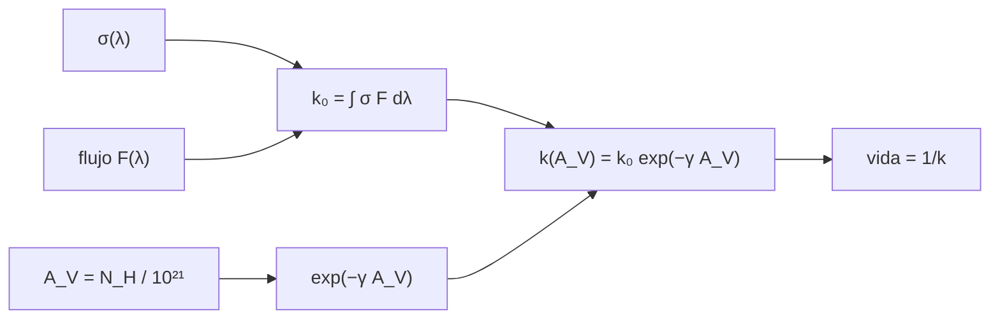

# B55-C08 — Fotoquímica cósmica

<!-- nav:top -->
[🏠 Programa](../../../../README.md) · [📚 Bloque B55](../../../tronco-comun/B55-astroquimica-y-geoquimica-extraterrestre.md) · [← Anterior: B55-C07 — Catálisis en superficies](../B55-C07-catalisis-en-superficies/CLASE.md) · [Siguiente: B55-C09 — Espectros moleculares de radio →](../B55-C09-espectros-moleculares-de-radio/CLASE.md)
<!-- /nav -->

## 1. Ubicación, nivel y alcance

Clase 8 del bloque B55, nivel N3. Calculas una **tasa de fotodisociación** como integral de sección eficaz por flujo de fotones, su **atenuación por polvo** con la extinción visual `A_V` y la profundidad a la que una molécula sobrevive la vida de una nube. Usas [B55-C03](../B55-C03-reacciones-en-medio-interestelar/CLASE.md) y [B55-C05](../B55-C05-granos-de-polvo-interestelar/CLASE.md). Sección eficaz, flujo y parámetros son **ilustrativos**.

## 2. Por qué esta clase existe

La luz ultravioleta del campo estelar destruye moléculas, y el polvo la apaga: por eso las moléculas sobreviven en el interior de las nubes y no en su superficie. La decisión central: **¿a qué profundidad de nube una molécula deja de ser destruida más rápido de lo que dura la nube?**

## 3. Lo que podrás hacer al terminar

1. Calcular `k₀ = ∫σ(λ) F(λ) dλ`.
2. Aplicar la atenuación `exp(−γ A_V)` y obtener vidas de las moléculas.
3. Calcular el `A_V` crítico para una vida dada.
4. Comprobar la integral numérica contra la analítica.
5. Estimar la fracción destruida en un tiempo dado.
6. Leer el significado de las tasas atenuadas y apantalladas descritas en la literatura.

La evidencia es la **perfil de tasa frente a `A_V`** del ejercicio 12 (sección 20).

## 4. Con qué llegas y cómo comprobarlo

1. ¿Qué es una sección eficaz?
2. ¿Qué es un flujo de fotones?
3. ¿Qué es la extinción visual `A_V`?
4. ¿Qué es una vida media?
5. ¿Qué es una integral numérica?

<details>
<summary>Ver respuestas</summary>

1. Un área efectiva de interacción, en cm². 2. Fotones por cm² y por segundo (aquí por nm). 3. Cuántas magnitudes se atenúa la luz visible. 4. `1/k` para una destrucción de primer orden. 5. Una suma que aproxima el área bajo una curva.
</details>

Con cuatro o cinco aciertos, sigue; si no, repasa los prerrequisitos.

## 5. Un caso de contexto y casos de referencia

Una molécula **sintética** con sección eficaz en caja de `10⁻¹⁷ cm²` entre 91,2 y 110,0 nm, un flujo ilustrativo de `10⁶ fotones cm⁻² s⁻¹ nm⁻¹`, una atenuación `γ = 2,5` y la relación ilustrativa `A_V = N_H/10²¹ cm⁻²`. Es el **ejemplo conductor**. Heays, Bosman y van Dishoeck (2017) (S1) calculan en su resumen secciones eficaces y tasas de fotodisociación y fotoionización de unas 100 especies, con incertidumbres, y modelan la reducción por polvo y por apantallamiento; ninguna cifra suya se usa aquí.

## 6. Vocabulario

La **tasa de fotodisociación** `k` (s⁻¹) es la probabilidad por segundo de que una molécula se rompa por absorber un fotón. El **campo de radiación** es el flujo de fotones. La **extinción** `A_V` mide el polvo atravesado. El **apantallamiento** (autoabsorción) reduce la tasa dentro de la nube. La **vida** de una molécula es `1/k`.

## 7. Modelo mental: una sombrilla de polvo

El polvo hace de sombrilla: cada magnitud de extinción multiplica por un factor constante el flujo ultravioleta que llega, de modo que la tasa decae exponencialmente con la profundidad.



*Descripción textual:* la tasa sin atenuar sale de integrar sección eficaz y flujo; el polvo la reduce exponencialmente con `A_V`, y la inversa da la vida de la molécula.

Analogía: una sombrilla que oscurece más cuanto más gruesa. Límite: la atenuación real depende de la longitud de onda y se añaden apantallamientos moleculares que no se modelan aquí.

## 8. La explicación, paso a paso

### 8.1 Tasa sin atenuar

`k₀ = σ F Δλ = 10⁻¹⁷ × 10⁶ × 18,8 = 1,88 × 10⁻¹⁰ s⁻¹`, con vida de 168,55 años. La integral numérica (trapecio) coincide con error relativo `2,3 × 10⁻¹²`.

### 8.2 Atenuación por polvo

| `A_V` | `N_H` (cm⁻²) | `k` (s⁻¹) | vida (años) |
|---|---|---|---|
| 0,0 | 0 | 1,8800 × 10⁻¹⁰ | 1,6855 × 10² |
| 0,5 | 5 × 10²⁰ | 5,3863 × 10⁻¹¹ | 5,8831 × 10² |
| 1,0 | 10²¹ | 1,5432 × 10⁻¹¹ | 2,0534 × 10³ |
| 2,0 | 2 × 10²¹ | 1,2667 × 10⁻¹² | 2,5016 × 10⁴ |
| 4,0 | 4 × 10²¹ | 8,5352 × 10⁻¹⁵ | 3,7126 × 10⁶ |
| 8,0 | 8 × 10²¹ | 3,8750 × 10⁻¹⁹ | 8,1776 × 10¹⁰ |

### 8.3 Profundidad crítica

Para que la vida iguale 10⁶ años: `A_V = ln(k₀ t)/γ = 3,475` (`N_H = 3,475 × 10²¹ cm⁻²`). A `A_V = 3` la fracción destruida en 10⁶ años sin reposición es 0,9624; a `A_V = 3,475` la molécula dura, justo, un millón de años. Más adentro, sobrevive.

## 9. Magnitudes, símbolos y unidades

| Símbolo | Qué es | Unidad | Valor / nota |
|---|---|---|---|
| `σ` | sección eficaz | cm² | 10⁻¹⁷ (ilustrativa) |
| `F` | flujo de fotones | fotones cm⁻² s⁻¹ nm⁻¹ | 10⁶ (ilustrativo) |
| `k` | tasa de fotodisociación | s⁻¹ | 1,88 × 10⁻¹⁰ |
| `A_V` | extinción visual | mag | 0 a 8 |
| `γ` | coeficiente de atenuación | — | 2,5 (ilustrativo) |

## 10. Convenciones y referencias

Sistema de referencia: un campo plano unidireccional que entra por la superficie de la nube. Parámetros ilustrativos; la relación `A_V ↔ N_H` es ilustrativa. Versiones: Python 3.12.9, biblioteca estándar. Tolerancia: integral 1e-9; tasa 1e-12.

## 11. De dónde sale lo que afirmamos

| ID | Fuente | Localizador | Respalda | Estado |
|---|---|---|---|---|
| S1 | Heays, Bosman y van Dishoeck, «Photodissociation and photoionisation of atoms and molecules of astrophysical interest», *A&A* 602, A105 (2017) | arXiv:1701.04459 | contexto: tasas de fotodisociación atenuadas por polvo y apantalladas, con incertidumbres (resumen) | Consultada el 2026-11-09; solo resumen |
| — | Sin fuente externa para el resto | — | relaciones y valores que verifica el laboratorio con una segunda vía de cálculo; los parámetros de modelo se rotulan ilustrativos | No se consultó una fuente para esta parte |

Límites: del artículo solo se leyó el resumen; todos los valores son ilustrativos y no se compararon con la base de datos de Leiden mencionada en él.

## 12. Cómo ver la tasa frente a la profundidad

| A_V | vida |
|---|---|
| 0 | 169 años |
| 1 | 2,1 × 10³ años |
| 3,475 | 10⁶ años |
| 8 | 8 × 10¹⁰ años |

Descripción larga: la curva de vida frente a `A_V` es una exponencial creciente que cruza 10⁶ años en `A_V ≈ 3,5`.

## 13. Ejemplo trabajado: la profundidad que protege por 10⁶ años

**Paso 1 · `k₀ t`.** `1,88 × 10⁻¹⁰ × 3,15576 × 10¹³ s = 5933`.

**Paso 2 · Logaritmo.** `ln 5933 = 8,688`.

**Paso 3 · `A_V`.** `8,688 / 2,5 = 3,475`, el valor del laboratorio.

## 14. Distintas formas de estimar la fotodisociación

**Integral de sección eficaz y flujo:** la usada aquí. **Tasa tabulada en un campo estándar con factor de atenuación:** la usan los modelos reales. **Con apantallamiento molecular:** agrega pérdida de fotones por la propia molécula (no tratado).

## 15. Práctica guiada

**Ejercicio 1 · con los pasos indicados.** Calcula `k₀` si el flujo baja a `5 × 10⁵` (sección 8.1).

<details><summary>Solución comentada</summary>

`9,4 × 10⁻¹¹ s⁻¹`.
</details>

**Ejercicio 2 · con una pista.** Calcula `k` a `A_V = 2` (sección 8.2). *Pista:* `e^(−5)`.

<details><summary>Solución comentada</summary>

`1,88 × 10⁻¹⁰ × 6,738 × 10⁻³ = 1,267 × 10⁻¹² s⁻¹`.
</details>

**Ejercicio 3 · casi autónomo.** Estima la vida a `A_V = 2` en años (sección 8.2). *Casi autónomo.*

<details><summary>Solución comentada</summary>

`1/1,267 × 10⁻¹² = 7,89 × 10¹¹ s = 2,5 × 10⁴ años`.
</details>

## 16. Práctica autónoma, transferencia e integrador

**Ejercicio 4 · autónomo.** ¿A qué `A_V` la tasa cae a 1 % de `k₀`? (sección 8.2).

<details><summary>Solución comentada</summary>

`ln 100/2,5 = 1,84`.
</details>

**Ejercicio 5 · autónomo.** ¿Cuántos nm tiene la banda de la caja? (sección 8.1).

<details><summary>Solución comentada</summary>

`110,0 − 91,2 = 18,8 nm`.
</details>

**Ejercicio 6 · autónomo.** Si `γ = 3`, ¿cambia el `A_V` crítico? (sección 8.3).

<details><summary>Solución comentada</summary>

`8,688/3 = 2,90`: baja.
</details>

**Ejercicio 7 · autónomo.** ¿Qué fracción se destruye en 10⁶ años a `A_V = 4`? (sección 8.2).

<details><summary>Solución comentada</summary>

`k = 8,5 × 10⁻¹⁵ s⁻¹ × 3,156 × 10¹³ s = 0,27`; fracción `1 − e^(−0,27) = 0,24`.
</details>

**Ejercicio 8 · autónomo.** ¿Por qué una molécula puede sobrevivir en el centro de una nube y no en el borde? (sección 8.3).

<details><summary>Solución comentada</summary>

Porque la atenuación es exponencial con la profundidad.
</details>

**Ejercicio 9 · transferencia.** Un campo de radiación 100 veces más intenso desplaza el `A_V` crítico. ¿Cuánto? (sección 8.3).

<details><summary>Solución comentada</summary>

`ln 100/γ = 1,84` más profundo.
</details>

**Ejercicio 10 · transferencia.** Tu molécula absorbe también a 150 nm, donde el polvo atenúa menos. ¿Qué haces? (sección 10).

<details><summary>Solución comentada</summary>

Usas `γ` dependiente de la longitud de onda o integras por tramos.
</details>

**Ejercicio 11 · transferencia.** ¿Qué falta en este modelo para compararlo con una nube real? (sección 11).

<details><summary>Solución comentada</summary>

Apantallamiento molecular, reposición por reacciones, geometría y valores medidos de `σ` y `F`.
</details>

**Ejercicio 12 · integrador.** Elabora tu *perfil de tasa frente a `A_V`*: define `σ`, `F`, `γ`, calcula `k₀`, la tabla de vidas y el `A_V` crítico para 10⁶ años.

<details><summary>Solución modelo</summary>

Debe mostrar 8.1–8.3 con unidades, el contraste numérico–analítico y la nota de que los parámetros son ilustrativos.
</details>

## 17. Laboratorio: fotodisociación y atenuación por polvo

El script [fotodisociacion.py](fotodisociacion.py) integra `σ F` y aplica la atenuación, y **comprueba** la integral contra la analítica (1e-9) y la vida en el `A_V` crítico (1e-12).

**Datos:** **ilustrativos**; no se usó ninguna base de datos. **Predice antes de ejecutar:** ¿a qué `A_V` la vida alcanza 10⁶ años? (≈ 3,5.) **Ejecución del 2026-11-09 (Python 3.12.9):**

```text
Python 3.12.9 (biblioteca estandar)
A. Seccion eficaz en caja ILUSTRATIVA 1e-17 cm2 (91.2-110.0 nm) ; flujo 1e6 fotones cm-2 s-1 nm-1
B. k0 (sin atenuar): numerica = 1.8800000000e-10 s-1 ; analitica = 1.8800000000e-10 s-1 ; error relativo = 2.32e-12 ; vida = 168.554 anos
C. Atenuacion por polvo: k(A_V) = k0 exp(-gamma A_V), gamma = 2.5 (ILUSTRATIVO)
A_V   N_H [cm-2]     k [s-1]        vida [anos]
 0.0  0.000e+00   1.8800e-10    1.6855e+02
 0.5  5.000e+20   5.3863e-11    5.8831e+02
 1.0  1.000e+21   1.5432e-11    2.0534e+03
 2.0  2.000e+21   1.2667e-12    2.5016e+04
 4.0  4.000e+21   8.5352e-15    3.7126e+06
 8.0  8.000e+21   3.8750e-19    8.1776e+10
D. A_V critico para que la vida iguale 1e6 anos = ln(k0 t) / gamma = 3.475 ; N_H = 3.475e+21 cm-2
E. Con A_V = 3: fraccion fotodisociada en 1e6 anos sin reposicion = 0.962423
Pruebas superadas.
```

```bash
python programa/clases/B55/B55-C08-fotoquimica-cosmica/fotodisociacion.py
```

**Límites:** campo plano, atenuación gris, sin apantallamiento molecular.

## 18. Errores frecuentes y cómo corregirlos

**Olvidar que la atenuación es exponencial y no lineal.** Se ve en 8.2.

**Confundir la vida con la tasa.** `τ = 1/k` (sección 6).

**Mezclar unidades de nm y cm.** Se declara en la sección 9.

**Usar la relación `A_V ↔ N_H` como medida.** Es ilustrativa (sección 5).

## 19. Cómo sabrás que vas bien

Tras la sección 8: ¿qué `A_V` crítico esperabas y cuál obtuviste? Si dudas, repasa el ejemplo 13. Tras el laboratorio: ¿qué comprueba? (ver la sección 17).

## 20. Qué entregas y cómo se evalúa

El producto es tu **perfil de tasa frente a `A_V`** (ejercicio 12).

| Criterio | Inicial | En desarrollo | Logrado | Destacado |
|---|---|---|---|---|
| Conceptos | Los confunde | Parciales | Distingue tasa, vida y atenuación | Explica los límites |
| Cálculo | Sin unidades | Con errores | Tablas completas con unidades | Calcula casos nuevos |
| Numérico | Sin comprobar | Un caso | Contraste con el caso analítico | Interpreta las diferencias |
| Fuentes | Sin fuente | Sin fecha | Fuentes con fecha y estado | Declara lo sintético e ilustrativo |
| Límites | No los nombra | Uno | Tres | Discute qué falta del modelo |

**Condiciones críticas (no se compensan con promedio):** rotular `σ`, `F`, `γ` y la relación `A_V ↔ N_H` como ilustrativos; no inferir la química de una nube real; citar solo lo consultado.

## 21. Ética, seguridad y límites

Una tasa de fotodisociación se cita con su campo de radiación y su incertidumbre; el modelo mínimo no las sustituye. Clase educativa: los modelos son simplificados y ningún resultado de esta clase es una observación. Accesibilidad: tablas equivalentes a las gráficas, fórmulas en texto, ejercicios sin conexión.

## 22. Para cerrar y seguir

Con estos parámetros una molécula dura 169 años en el borde y 10⁶ años a `A_V = 3,5`. Queda una pregunta: ¿cómo se reconocen esas moléculas desde lejos?

**Glosario español–inglés.** fotodisociación · *photodissociation*; extinción · *extinction*; apantallamiento · *shielding*; campo de radiación · *radiation field*; vida media · *lifetime*.

**Continuidad.** [B55-C09](../B55-C09-espectros-moleculares-de-radio/CLASE.md) estudia el espectro de rotación de las moléculas en radio.

**Referencias:** ver sección 11.

<!-- nav:bottom -->
---

[← Anterior: B55-C07 — Catálisis en superficies](../B55-C07-catalisis-en-superficies/CLASE.md) · [📚 Bloque B55](../../../tronco-comun/B55-astroquimica-y-geoquimica-extraterrestre.md) · [Siguiente: B55-C09 — Espectros moleculares de radio →](../B55-C09-espectros-moleculares-de-radio/CLASE.md)
<!-- /nav -->
