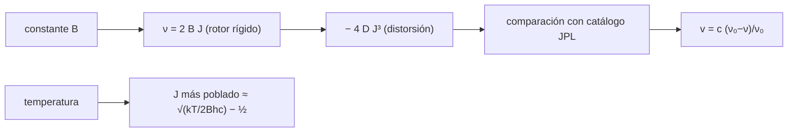

# B55-C09 — Espectros moleculares de radio

<!-- nav:top -->
[🏠 Programa](../../../../README.md) · [📚 Bloque B55](../../../tronco-comun/B55-astroquimica-y-geoquimica-extraterrestre.md) · [← Anterior: B55-C08 — Fotoquímica cósmica](../B55-C08-fotoquimica-cosmica/CLASE.md) · [Siguiente: B55-C10 — Identificación de moléculas orgánicas →](../B55-C10-identificacion-de-moleculas-organicas/CLASE.md)
<!-- /nav -->

## 1. Ubicación, nivel y alcance

Clase 9 del bloque B55, nivel N3. Aprendes a **leer un espectro de rotación**: el modelo de rotor rígido predice las frecuencias del CO, la distorsión centrifugal corrige la diferencia, y el efecto Doppler traduce una frecuencia observada en velocidad. Usas datos **observados en laboratorio** del catálogo JPL (CO y HCN). Las frecuencias del catálogo son valores publicados; las «observaciones» de velocidad son sintéticas.

## 2. Por qué esta clase existe

Las moléculas del espacio frío se detectan casi siempre por sus líneas de rotación en milimétrico y submilimétrico. Para identificar una línea hay que saber de dónde sale su frecuencia, qué fracción de niveles está poblada y cómo corregirla por la velocidad de la nube. La decisión central: **¿qué frecuencias espero y a qué velocidad corresponde un desplazamiento medido?**

## 3. Lo que podrás hacer al terminar

1. Predecir las frecuencias de una molécula lineal con el rotor rígido.
2. Ajustar una constante de distorsión centrifugal con el catálogo.
3. Convertir un desplazamiento de frecuencia en velocidad y viceversa.
4. Calcular el nivel de rotación más poblado a una temperatura.
5. Distinguir el estado de un dato de catálogo (observado en laboratorio) de una predicción.
6. Reconocer la estructura hiperfina del HCN y su separación en velocidad.

La evidencia es la **comparación rotor rígido–catálogo** del ejercicio 12 (sección 20).

## 4. Con qué llegas y cómo comprobarlo

1. ¿Qué es la frecuencia de una línea?
2. ¿Qué es el efecto Doppler?
3. ¿Qué es una distribución de Boltzmann?
4. ¿Qué es un momento de inercia?
5. ¿Qué es un valor observado en laboratorio?

<details>
<summary>Ver respuestas</summary>

1. El número de oscilaciones por segundo del fotón emitido, en Hz o MHz. 2. El corrimiento de frecuencia por movimiento relativo. 3. La población relativa de niveles `g exp(−E/kT)`. 4. Medida de la resistencia a girar. 5. Una medida hecha en laboratorio con la molécula, no una predicción.
</details>

Con cuatro o cinco aciertos, sigue; si no, repasa los prerrequisitos.

## 5. Un caso de contexto y casos de referencia

Las ocho primeras líneas de rotación del CO del catálogo JPL (etiqueta 28001, versión 4) con `B = 57635,968 MHz`, y las tres componentes hiperfinas de la transición `J = 1–0` del HCN (etiqueta 27001, versión 2). Es el **ejemplo conductor**. Los datos del catálogo son **valores de laboratorio publicados**; la velocidad de una nube es **sintética**. El catálogo cita la medida de Winnewisser et al. 1997 y el momento dipolar de Goorvitch 1994 (S2, lo leído en el archivo de documentación).

## 6. Vocabulario

El **rotor rígido** es una molécula lineal que gira sin deformarse; sus niveles son `E_J = h B J(J+1)` y las transiciones `J → J−1` caen en `ν = 2 B J`. La **constante rotacional** `B` (MHz) depende del momento de inercia. La **distorsión centrifugal** `D` corrige el estiramiento: `ν = 2 B J − 4 D J³`. La **estructura hiperfina** es el desdoblamiento por el espín nuclear. El **catálogo JPL** lista frecuencias, incertidumbres e intensidades.

## 7. Modelo mental: una peonza que se estira

Una molécula que gira como una mancuerna emite líneas equiespaciadas en `2B`. Al girar más rápido, se estira un poco y las líneas se acercan a una frecuencia ligeramente menor que la de la peonza rígida.



*Descripción textual:* el rotor rígido da las frecuencias, la distorsión las corrige, el catálogo las valida, el Doppler traduce desplazamientos a velocidad y la temperatura fija qué niveles están poblados.

Analogía: una peonza que se estira al girar más rápido. Límite: la molécula es cuántica: los niveles están cuantizados y el modelo clásico solo ayuda a recordar el efecto.

## 8. La explicación, paso a paso

### 8.1 Rotor rígido frente al catálogo

| `J_sup` | catálogo (MHz) | rotor rígido `2BJ` (MHz) | dif. relativa |
|---|---|---|---|
| 1 | 115271,2018 | 115271,9360 | 6,4 × 10⁻⁶ |
| 2 | 230538,0000 | 230543,8720 | 2,5 × 10⁻⁵ |
| 3 | 345795,9899 | 345815,8080 | 5,7 × 10⁻⁵ |
| 4 | 461040,7682 | 461087,7440 | 1,0 × 10⁻⁴ |
| 5 | 576267,9305 | 576359,6800 | 1,6 × 10⁻⁴ |
| 6 | 691473,0763 | 691631,6160 | 2,3 × 10⁻⁴ |
| 7 | 806651,8060 | 806903,5520 | 3,1 × 10⁻⁴ |
| 8 | 921799,7000 | 922175,4880 | 4,1 × 10⁻⁴ |

La diferencia crece con `J` (como `J²`): es la distorsión.

### 8.2 Ajuste de `D`

Con mínimos cuadrados sobre las ocho líneas, `D = 183,4906 kHz`; el modelo `2BJ − 4DJ³` reproduce el catálogo con diferencia relativa ≤ `9 × 10⁻⁹` en todas.

### 8.3 HCN `J = 1–0`

Tres componentes hiperfinas: 88630,416; 88631,847; 88633,936 MHz; centro ponderado por degeneraciones (3, 5, 1): 88631,6021 MHz; separación total 3,520 MHz, que equivale a 11,91 km/s. Si las tres líneas aparecen separadas, la nube tiene líneas más finas que ese intervalo.

### 8.4 Doppler

`v = c (ν₀ − ν)/ν₀`. Para el CO 1–0 (115271,2018 MHz) una velocidad sintética de 5 km/s da una frecuencia observada 115269,2793 MHz.

### 8.5 Población de niveles

El nivel más poblado (con `g = 2J+1`) es `J = 1` a 10 K, 2 a 30 K, 4 a 100 K y 7 a 300 K; coincide con `√(kT/2Bhc) − 1/2 = 0,84; 1,83; 3,75; 6,86`. Con ello se sabe qué transiciones esperar según la temperatura.

## 9. Magnitudes, símbolos y unidades

| Símbolo | Qué es | Unidad | Valor / nota |
|---|---|---|---|
| `B` | constante rotacional del CO | MHz | 57635,968 (JPL) |
| `D` | distorsión centrifugal | kHz | 183,4906 (ajustada) |
| `ν` | frecuencia de la transición | MHz | 115271,2018 (J=1–0) |
| `v` | velocidad radial | km s⁻¹ | 5,0 (sintética) |
| `c` | velocidad de la luz | km s⁻¹ | 299792,458 (exacta) |

## 10. Convenciones y referencias

Sistema de referencia: frecuencias en reposo del laboratorio; velocidad radial positiva = alejamiento. Unidades del catálogo: frecuencia en MHz, energía en cm⁻¹. h, c y k_B son exactas en el SI desde 2019. Versiones: Python 3.12.9, biblioteca estándar. Catálogo JPL consultado el 2026-11-09. Tolerancias: rotor rígido 1e-3 (J ≤ 4); con distorsión 1e-6 (J ≤ 8).

## 11. De dónde sale lo que afirmamos

| ID | Fuente | Localizador | Respalda | Estado |
|---|---|---|---|---|
| S1 | JPL, *Submillimeter, Millimeter, and Microwave Spectral Line Catalog*: directorio de catálogos | https://spec.jpl.nasa.gov/ftp/pub/catalog/catdir.html | descripción y organización del catálogo | Consultada el 2026-11-09; consultada (entradas y versiones) |
| S2 | JPL, catálogo de líneas y documentación de CO (etiqueta 28001, versión 4, ago. 1997) | https://spec.jpl.nasa.gov/ftp/pub/catalog/c028001.cat y doc/d028001.cat | frecuencias de las líneas de CO, valor de B y referencias de la medida | Consultada el 2026-11-09; consultada (archivo completo) |
| S3 | JPL, catálogo de líneas y documentación de HCN (etiqueta 27001, versión 2, ene. 1984) | https://spec.jpl.nasa.gov/ftp/pub/catalog/c027001.cat y doc/d027001.cat | frecuencias hiperfinas de HCN J=1–0 | Consultada el 2026-11-09; consultada (archivo completo) |
| — | Sin fuente externa para el resto | — | relaciones y valores que verifica el laboratorio con una segunda vía de cálculo; los parámetros de modelo se rotulan ilustrativos | No se consultó una fuente para esta parte |

Límites: la columna de energías del catálogo se usó solo para las ocho líneas del CO; los modelos de transferencia radiativa no se tratan; las «observaciones» de velocidad son sintéticas.

## 12. Cómo ver el espectro de rotación

| `J_sup` | `ν` (GHz) |
|---|---|
| 1 | 115,271 |
| 2 | 230,538 |
| 3 | 345,796 |
| 4 | 461,041 |

Descripción larga: líneas casi equiespaciadas cada 115 GHz que se separan ligeramente de la peine perfecta a medida que `J` crece.

## 13. Ejemplo trabajado: la línea CO 3–2 desplazada

**Paso 1 · Rotor rígido.** `2 × 57635,968 × 3 = 345815,808 MHz`.

**Paso 2 · Corrección.** `4 × D × 27 = 4 × 0,1834906 × 27 = 19,82 MHz`.

**Paso 3 · Resultado.** `345815,808 − 19,82 = 345795,99 MHz`, igual al catálogo (345795,9899).

## 14. Distintas formas de predecir una línea

**Rotor rígido:** rápido, error de 10⁻⁴ a 10⁻³. **Con distorsión:** 10⁻⁹ para el CO en este intervalo. **Catálogo:** frecuencia medida o ajustada a medidas, con incertidumbre. En la práctica se usa el catálogo y el modelo sirve para entender y comprobar.

## 15. Práctica guiada

**Ejercicio 1 · con los pasos indicados.** Calcula `2B` para el CO (sección 8.1).

<details><summary>Solución comentada</summary>

`115271,936 MHz`, frecuencia de la línea 1–0 en el modelo rígido.
</details>

**Ejercicio 2 · con una pista.** Calcula el desplazamiento Doppler de la línea 1–0 si `v = 10 km/s` (sección 8.4). *Pista:* `ν = ν₀(1 − v/c)`.

<details><summary>Solución comentada</summary>

`115271,2018 × (1 − 3,3356 × 10⁻⁵) = 115267,357 MHz`.
</details>

**Ejercicio 3 · casi autónomo.** Calcula `ν(J=5)` con el modelo corregido (sección 8.2). *Casi autónomo.*

<details><summary>Solución comentada</summary>

`2·57635,968·5 − 4·0,1834906·125 = 576359,68 − 91,75 = 576267,93 MHz`, igual al catálogo.
</details>

## 16. Práctica autónoma, transferencia e integrador

**Ejercicio 4 · autónomo.** ¿Por qué la diferencia con el rotor rígido crece con `J`? (sección 8.1).

<details><summary>Solución comentada</summary>

Porque el término `4DJ³` crece como `J³`, más rápido que `2BJ`.
</details>

**Ejercicio 5 · autónomo.** ¿Qué fracción de la velocidad de la luz es 11,91 km/s? (sección 8.3).

<details><summary>Solución comentada</summary>

`11,91/299792,458 = 3,97 × 10⁻⁵`.
</details>

**Ejercicio 6 · autónomo.** ¿Qué `J` esperas más poblado a 50 K? (sección 8.5).

<details><summary>Solución comentada</summary>

`√(50/(2·1,9225·1,4388)) − 0,5 = 2,5`: `J ≈ 2–3`.
</details>

**Ejercicio 7 · autónomo.** ¿Cuántos MHz mide la separación de las líneas contiguas del CO? (sección 8.1).

<details><summary>Solución comentada</summary>

Alrededor de `2B = 115 272 MHz`.
</details>

**Ejercicio 8 · autónomo.** Si una línea observada está 3 MHz bajo 115271,2018, ¿qué velocidad tiene? (sección 8.4).

<details><summary>Solución comentada</summary>

`v = c·3/115271,2018 = 7,8 km/s` (alejándose).
</details>

**Ejercicio 9 · transferencia.** Detectas dos líneas con cociente de frecuencias 2,0 casi exacto. ¿Qué molécula lineal sugiere? (sección 8.1).

<details><summary>Solución comentada</summary>

Una transición `J=1–0` y otra `2–1`, de una molécula con `B` ≈ la mitad de la frecuencia de la primera; hay que descartar otras con el catálogo (C10).
</details>

**Ejercicio 10 · transferencia.** Un modelo de nube a 10 K predice líneas del CO con `J_sup` hasta 3. ¿Es razonable? (sección 8.5).

<details><summary>Solución comentada</summary>

Sí: `J_máx = 1` a 10 K con colas hasta `J` 3; las líneas altas serán débiles.
</details>

**Ejercicio 11 · transferencia.** ¿Por qué no basta un solo dato de frecuencia para afirmar una detección? (sección 8.1).

<details><summary>Solución comentada</summary>

Porque otra molécula puede tener una línea cercana; se necesitan varias líneas y coherencia de velocidad (C10).
</details>

**Ejercicio 12 · integrador.** Elabora tu *comparación rotor rígido–catálogo*: tabla de ocho líneas de CO, ajuste de `D`, Doppler de tres velocidades y nivel más poblado a cuatro temperaturas.

<details><summary>Solución modelo</summary>

Debe mostrar 8.1–8.5 con unidades, la edición del catálogo y la distinción entre datos de laboratorio y velocidades sintéticas.
</details>

## 17. Laboratorio: rotor rígido frente al catálogo JPL

El script [rotor_rigido.py](rotor_rigido.py) compara las líneas del CO del catálogo con el rotor rígido y con la distorsión ajustada, calcula Doppler y niveles poblados, y **comprueba** los errores (1e-3 y 1e-6) y la población analítica.

**Datos:** frecuencias **observadas en laboratorio** del catálogo JPL (S2, S3); velocidades **sintéticas**. **Predice antes de ejecutar:** ¿qué diferencia relativa tiene el rotor rígido en `J = 4`? (≈ 10⁻⁴.) **Ejecución del 2026-11-09 (Python 3.12.9):**

```text
Python 3.12.9 (biblioteca estandar)
A. CO: catalogo JPL (OBSERVADO en laboratorio) frente al rotor rigido 2B J_sup
J_sup   catalogo [MHz]    rotor rigido [MHz]   dif relativa
    1      115271.2018       115271.9360      6.369e-06
    2      230538.0000       230543.8720      2.547e-05
    3      345795.9899       345815.8080      5.731e-05
    4      461040.7682       461087.7440      1.019e-04
    5      576267.9305       576359.6800      1.592e-04
    6      691473.0763       691631.6160      2.293e-04
    7      806651.8060       806903.5520      3.121e-04
    8      921799.7000       922175.4880      4.077e-04
B. Ajuste de D (minimos cuadrados con 8 lineas): D = 183.4906 kHz
J_sup   catalogo [MHz]    2BJ - 4DJ^3 [MHz]   dif relativa
    1      115271.2018       115271.2020        2.060e-09
    2      230538.0000       230538.0003        1.299e-09
    3      345795.9899       345795.9910        3.212e-09
    4      461040.7682       461040.7704        4.762e-09
    5      576267.9305       576267.9347        7.251e-09
    6      691473.0763       691473.0801        5.473e-09
    7      806651.8060       806651.8028        3.920e-09
    8      921799.7000       921799.6992        9.076e-10
C. HCN J=1-0: tres componentes hiperfinas 88630.416, 88631.847, 88633.936 MHz ; centro ponderado = 88631.6021 MHz ; separacion total = 3.520 MHz = 11.91 km/s
D. Velocidad Doppler de la linea CO 1-0 para frecuencias observadas (SINTETICAS)
nu_obs [MHz]    v [km/s]
 115275.0468    -10.000
 115271.2018      0.000
 115269.2793      5.000
 115259.6667     30.000
E. Nivel de rotacion mas poblado del CO segun Boltzmann (g = 2J+1, E = B hc J(J+1), B calculado de la documentacion JPL)
   B = 1.92253 cm-1
T [K]   J mas poblado (numerico)   J analitico sqrt(kT/(2 B hc)) - 1/2
   10          1                    0.84
   30          2                    1.83
  100          4                    3.75
  300          7                    6.86
Pruebas superadas.
```

```bash
python programa/clases/B55/B55-C09-espectros-moleculares-de-radio/rotor_rigido.py
```

**Límites:** molécula lineal 1Σ; hiperfina solo ilustrada para HCN; sin transferencia radiativa.

## 18. Errores frecuentes y cómo corregirlos

**Confundir `J_sup` con `J_inf`.** Se define en 8.1.

**Olvidar que `v > 0` es alejamiento.** Se fija en la sección 10.

**Esperar que el modelo rígido dé la frecuencia al 10⁻⁹.** Solo con distorsión (8.2).

**Presentar velocidades sintéticas como observadas.** Se aclara en la sección 5.

## 19. Cómo sabrás que vas bien

Tras la sección 8: ¿qué `ν(3→2)` esperabas y cuál obtuviste? Si dudas, repasa el ejemplo 13. Tras el laboratorio: ¿qué comprueba? (ver la sección 17).

## 20. Qué entregas y cómo se evalúa

El producto es tu **comparación rotor rígido–catálogo** (ejercicio 12).

| Criterio | Inicial | En desarrollo | Logrado | Destacado |
|---|---|---|---|---|
| Conceptos | Los confunde | Parciales | Distingue rotor rígido, distorsión y Doppler | Explica los límites |
| Cálculo | Sin unidades | Con errores | Tablas completas con unidades | Calcula casos nuevos |
| Numérico | Sin comprobar | Un caso | Contraste con el caso analítico | Interpreta las diferencias |
| Fuentes | Sin fuente | Sin fecha | Fuentes con fecha y estado | Declara lo sintético e ilustrativo |
| Límites | No los nombra | Uno | Tres | Discute qué falta del modelo |

**Condiciones críticas (no se compensan con promedio):** rotular lo observado en laboratorio y lo sintético; no afirmar detecciones; citar la edición del catálogo.

## 21. Ética, seguridad y límites

Una frecuencia de catálogo tiene incertidumbre y versión; citarlas es parte de la práctica. Clase educativa: los modelos son simplificados y ningún resultado de esta clase es una observación. Accesibilidad: tablas equivalentes a las gráficas, fórmulas en texto, ejercicios sin conexión.

## 22. Para cerrar y seguir

El rotor rígido reproduce el CO al 10⁻⁴ y la distorsión al 10⁻⁹, y el Doppler traduce 5 km/s en 1,9 MHz. Queda una pregunta: ¿cómo asignar sin error varias líneas a una molécula?

**Glosario español–inglés.** rotor rígido · *rigid rotor*; constante rotacional · *rotational constant*; distorsión centrifugal · *centrifugal distortion*; estructura hiperfina · *hyperfine structure*; velocidad radial · *radial velocity*.

**Continuidad.** [B55-C10](../B55-C10-identificacion-de-moleculas-organicas/CLASE.md) estudia la identificación de moléculas por emparejamiento de líneas con un catálogo.

**Referencias:** ver sección 11.

<!-- nav:bottom -->
---

[← Anterior: B55-C08 — Fotoquímica cósmica](../B55-C08-fotoquimica-cosmica/CLASE.md) · [📚 Bloque B55](../../../tronco-comun/B55-astroquimica-y-geoquimica-extraterrestre.md) · [Siguiente: B55-C10 — Identificación de moléculas orgánicas →](../B55-C10-identificacion-de-moleculas-organicas/CLASE.md)
<!-- /nav -->
