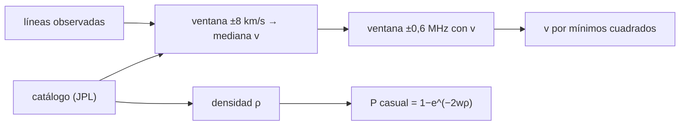

# B55-C10 — Identificación de moléculas orgánicas

<!-- nav:top -->
[🏠 Programa](../../../../README.md) · [📚 Bloque B55](../../../tronco-comun/B55-astroquimica-y-geoquimica-extraterrestre.md) · [← Anterior: B55-C09 — Espectros moleculares de radio](../B55-C09-espectros-moleculares-de-radio/CLASE.md) · [Siguiente: B55-C11 — Química en cometas →](../B55-C11-quimica-en-cometas/CLASE.md)
<!-- /nav -->

## 1. Ubicación, nivel y alcance

Clase 10 del bloque B55, nivel N3. Aprendes a **asignar líneas observadas a un catálogo**: estimas la velocidad común con una mediana robusta, ajustas con mínimos cuadrados y calculas la probabilidad de que una coincidencia sea casual. El espectro es **sintético** y construido con líneas reales de H₂CO del catálogo JPL. Usas [B55-C09](../B55-C09-espectros-moleculares-de-radio/CLASE.md).

## 2. Por qué esta clase existe

Casi todas las detecciones de moléculas se basan en coincidencias de frecuencia, y hay catálogos con decenas de miles de líneas: una coincidencia aislada puede ser casualidad. La decisión central: **¿cuántas líneas asignadas, con qué velocidad común y con qué probabilidad de falso positivo se justifica afirmar una especie?**

## 3. Lo que podrás hacer al terminar

1. Asignar líneas observadas a un catálogo con una tolerancia en frecuencia.
2. Recuperar una velocidad común por mediana y mínimos cuadrados.
3. Calcular la probabilidad de coincidencia por azar `1 − e^(−2wρ)`.
4. Verificar esa probabilidad con Monte Carlo.
5. Interpretar líneas no asignadas.
6. Entender por qué un catálogo parcial subestima los falsos positivos.

La evidencia es la **informe de asignación con tasa de falsos positivos** del ejercicio 12 (sección 20).

## 4. Con qué llegas y cómo comprobarlo

1. ¿Qué es una mediana?
2. ¿Qué es una tolerancia?
3. ¿Qué es una distribución uniforme?
4. ¿Qué es un falso positivo?
5. ¿Qué es una simulación Monte Carlo?

<details>
<summary>Ver respuestas</summary>

1. El valor central de una lista ordenada. 2. La diferencia máxima aceptada para considerar que dos valores coinciden. 3. Una en que todos los valores de un intervalo son igual de probables. 4. Afirmar una detección que en realidad es casual. 5. Repetir un cálculo con números aleatorios de semilla fija.
</details>

Con cuatro o cinco aciertos, sigue; si no, repasa los prerrequisitos.

## 5. Un caso de contexto y casos de referencia

Un espectro **sintético** con 14 líneas de H₂CO desplazadas 5,0 km/s (con ruido de 0,15 MHz) y 3 líneas inventadas de otra especie, contrastado con las 15 líneas más intensas de H₂CO entre 140 y 310 GHz del catálogo JPL (etiqueta 30004, versión 2). Es el **ejemplo conductor**. El catálogo es **dato de laboratorio publicado**; el espectro, **sintético**: ninguna línea es una detección. McGuire (2021) (S2) censa en su resumen 241 moléculas, contexto de cuánto catálogo hay que considerar.

## 6. Vocabulario

Una **asignación** liga una línea observada con una transición del catálogo. La **tolerancia** `w` es el semiancho aceptado en frecuencia. La **densidad de líneas** `ρ` (líneas/MHz) mide qué tan poblado está el catálogo. La **probabilidad de coincidencia casual** de una frecuencia aleatoria es `1 − exp(−2wρ)`. Las **líneas intrusas** pertenecen a otra especie.

## 7. Modelo mental: un peine con dientes

El catálogo es un peine de dientes finos; una línea observada es un punto. Cuanto más ancho el margen `w` y más dientes por GHz, más probable que un punto caiga junto a un diente por casualidad.



*Descripción textual:* una primera ventana en velocidad fija un valor robusto, una segunda ventana en frecuencia asigna líneas y se afina `v`; la densidad del catálogo da la probabilidad de coincidencias casuales.

Analogía: buscar una llave en un manojo de llaves parecidas. Límite: las líneas moleculares no se distribuyen al azar (hay series ordenadas), de modo que la hipótesis uniforme solo es una primera aproximación.

## 8. La explicación, paso a paso

### 8.1 Asignación

Se generan 17 líneas: 14 de H₂CO desplazadas por `v = 5,0 km/s` más ruido, y 3 intrusas. La primera ventana de ±8 km/s da `v` por mediana de las velocidades por línea; la segunda ventana de ±0,6 MHz asigna 14 de 17 y el ajuste de mínimos cuadrados da `v = 4,944 km/s` (inyectada 5,0; el ruido de 0,15 MHz explica la diferencia). Las tres intrusas (160123,4; 190456,7; 250789,1 MHz) quedan sin asignar.

### 8.2 Residuos

Los residuos están entre `−0,197` y `+0,405 MHz`, compatibles con el ruido de 0,15 MHz (el mayor es de 2,7σ y pertenece a una línea del grupo denso cerca de 291 GHz).

### 8.3 Coincidencias por azar

Con la densidad `ρ = 15 líneas / 170 000 MHz = 0,0882 líneas por GHz`:

| `w` (MHz) | P analítica | P Monte Carlo |
|---|---|---|
| 0,25 | 0,00004 | 0,00005 |
| 0,60 | 0,00011 | 0,00010 |
| 2,00 | 0,00035 | 0,00038 |
| 10,00 | 0,00176 | 0,00160 |

Para las 3 intrusas y `w = 0,6 MHz`, se esperan 0,0003 falsos positivos.

### 8.4 Advertencia

Esa probabilidad es tan baja porque el catálogo del ejemplo tiene solo 15 líneas. Un catálogo real completo, con miles de líneas, tiene una densidad cientos de veces mayor y la probabilidad casual crece en proporción; por eso una sola coincidencia no basta y se exige coherencia de varias líneas y de velocidad.

## 9. Magnitudes, símbolos y unidades

| Símbolo | Qué es | Unidad | Valor / nota |
|---|---|---|---|
| `w` | semiancho de tolerancia | MHz | 0,6 |
| `ρ` | densidad de líneas del catálogo | líneas GHz⁻¹ | 0,0882 |
| `v` | velocidad común | km s⁻¹ | 4,944 (ajustada) |
| `σ_f` | ruido de frecuencia sintético | MHz | 0,15 |
| `P` | probabilidad casual | — | 1,1 × 10⁻⁴ (w = 0,6) |

## 10. Convenciones y referencias

Sistema de referencia: frecuencias en reposo del catálogo y observadas en el sistema de la nube; velocidad positiva = alejamiento. Catálogo JPL 30004 versión 2 (nov. 1997), consultado el 2026-11-09. Una línea del catálogo (291384,264 MHz) se omitió por estar a 3,8 MHz de otra. Versiones: Python 3.12.9, biblioteca estándar, semillas 777 y 31415. Tolerancias: `v` a 0,1 km/s; probabilidad a 15 %.

## 11. De dónde sale lo que afirmamos

| ID | Fuente | Localizador | Respalda | Estado |
|---|---|---|---|---|
| S1 | JPL, catálogo de líneas y documentación de H2CO (etiqueta 30004, versión 2, nov. 1997) | https://spec.jpl.nasa.gov/ftp/pub/catalog/c030004.cat y doc/d030004.cat | frecuencias de las líneas de H₂CO del catálogo | Consultada el 2026-11-09; consultada (archivo completo) |
| S2 | McGuire, «2021 Census of Interstellar, Circumstellar, Extragalactic, Protoplanetary Disk, and Exoplanetary Molecules», *ApJS* | arXiv:2109.13848 | contexto: tamaño del censo de moléculas (241, en el resumen) | Consultada el 2026-11-09; solo resumen |
| — | Sin fuente externa para el resto | — | relaciones y valores que verifica el laboratorio con una segunda vía de cálculo; los parámetros de modelo se rotulan ilustrativos | No se consultó una fuente para esta parte |

Límites: de McGuire solo se leyó el resumen; el catálogo usado es un subconjunto de las líneas más intensas y no el catálogo completo; el espectro es sintético.

## 12. Cómo ver la asignación

| Línea | Estado |
|---|---|
| 14 de H₂CO | asignadas (residuos −0,2 a +0,4 MHz) |
| 3 intrusas | no asignadas |

Descripción larga: un diagrama de líneas verticales con 14 marcadas con el mismo color y desplazadas todas por 5 km/s, y tres de otro color sin pareja.

## 13. Ejemplo trabajado: la probabilidad casual para w = 0,6 MHz

**Paso 1 · Densidad.** `15/170 000 = 8,82 × 10⁻⁵ líneas/MHz`.

**Paso 2 · Ventana.** `2 w = 1,2 MHz`.

**Paso 3 · Probabilidad.** `1 − exp(−1,2 × 8,82 × 10⁻⁵) = 1,06 × 10⁻⁴`.

**Paso 4 · Intrusas.** `3 × 1,06 × 10⁻⁴ = 3,2 × 10⁻⁴`.

## 14. Distintas formas de asignar líneas

**Por coincidencia simple:** cada línea con su vecina más cercana, rápida y propensa a falsos positivos. **Con velocidad común:** exige coherencia de todas las líneas, mucho más selectiva. **Con intensidades relativas y temperatura de excitación:** el método real, que aquí no se trata.

## 15. Práctica guiada

**Ejercicio 1 · con los pasos indicados.** Calcula `ρ` en líneas/GHz para 15 líneas en 170 GHz (sección 8.3).

<details><summary>Solución comentada</summary>

`15/170 = 0,0882`.
</details>

**Ejercicio 2 · con una pista.** Calcula la velocidad de una línea observada en 150495,743 MHz que corresponde a 150498,334 MHz (sección 8.1). *Pista:* `c(1 − ν_obs/ν_cat)`.

<details><summary>Solución comentada</summary>

`299792,458 × (1 − 150495,743/150498,334) = 5,16 km/s`.
</details>

**Ejercicio 3 · casi autónomo.** Calcula la probabilidad casual con `w = 2 MHz` (sección 8.3). *Casi autónomo.*

<details><summary>Solución comentada</summary>

`1 − exp(−4 × 8,82 × 10⁻⁵) = 3,5 × 10⁻⁴`.
</details>

## 16. Práctica autónoma, transferencia e integrador

**Ejercicio 4 · autónomo.** ¿Cuántos falsos positivos esperas entre 100 líneas desconocidas con `w = 0,6` (sección 8.3)?

<details><summary>Solución comentada</summary>

`100 × 1,06 × 10⁻⁴ = 0,011`.
</details>

**Ejercicio 5 · autónomo.** Si el catálogo tuviera 1500 líneas en 170 GHz, ¿cuál sería `P` para `w = 0,6`? (sección 8.4).

<details><summary>Solución comentada</summary>

`ρ = 8,82 × 10⁻³ líneas/MHz`; `P = 1 − exp(−1,2 × 8,82 × 10⁻³) = 1,05 × 10⁻²`, cien veces mayor.
</details>

**Ejercicio 6 · autónomo.** ¿Qué velocidad produce un corrimiento de 2,35 MHz en 140839,502 MHz? (sección 8.1).

<details><summary>Solución comentada</summary>

`c·2,35/140839,5 = 5,0 km/s`.
</details>

**Ejercicio 7 · autónomo.** ¿Por qué la mediana es más robusta que el promedio para la primera estimación? (sección 8.1).

<details><summary>Solución comentada</summary>

Porque una asignación errónea no la desplaza demasiado.
</details>

**Ejercicio 8 · autónomo.** ¿Qué línea de la lista tiene el mayor residuo y qué podría explicarlo? (sección 8.2).

<details><summary>Solución comentada</summary>

`+0,405 MHz` en la línea de 291 GHz; pertenece a un grupo denso de líneas y el ruido aleatorio puede alcanzar 2,7σ en una de 14.
</details>

**Ejercicio 9 · transferencia.** Un colega ve una sola línea que coincide con una molécula rara y la anuncia. ¿Qué le pides? (secciones 8.3–8.4).

<details><summary>Solución comentada</summary>

Más líneas de la misma especie, coherencia en velocidad, intensidades relativas coherentes y la probabilidad casual calculada con el catálogo completo.
</details>

**Ejercicio 10 · transferencia.** Tienes un espectro con 200 líneas y un catálogo de 20 000. ¿Cómo cambia `P`? (sección 8.3).

<details><summary>Solución comentada</summary>

Crece con la densidad; hay que calcularla con la densidad real de la banda.
</details>

**Ejercicio 11 · transferencia.** ¿Por qué excluimos una línea del catálogo por estar cerca de otra? (sección 10).

<details><summary>Solución comentada</summary>

Por ser indistinguibles con la resolución del ejemplo; se trata como mezcla en un análisis real.
</details>

**Ejercicio 12 · integrador.** Elabora tu *informe de asignación con tasa de falsos positivos*: espectro sintético, velocidad recuperada, tabla de residuos, probabilidad casual y discusión del efecto del tamaño del catálogo.

<details><summary>Solución modelo</summary>

Debe mostrar 8.1–8.4, el contraste Monte Carlo–analítico, la aclaración de que el espectro es sintético y el catálogo es parcial.
</details>

## 17. Laboratorio: asignación de líneas y falsos positivos

El script [identificar_lineas.py](identificar_lineas.py) asigna líneas sintéticas a un subcatálogo de H₂CO del JPL, recupera la velocidad y estima la probabilidad casual; **comprueba** `v` a 0,1 km/s y `P` Monte Carlo contra la analítica (15 %).

**Datos:** catálogo **observado en laboratorio** (JPL 30004 v2); espectro **sintético**. **Predice antes de ejecutar:** ¿se asignan las 3 intrusas? (No.) **Ejecución del 2026-11-09 (Python 3.12.9):**

```text
Python 3.12.9 (biblioteca estandar)
A. Espectro SINTETICO: 17 lineas (14 de H2CO desplazadas 5.0 km/s + 3 intrusas)
B. Asignadas 14 de 17 lineas ; v recuperada = 4.944 km/s (inyectada 5.0) ; no asignadas = 3
nu_obs [MHz]   nu_cat [MHz]   residuo [MHz]
  140837.174     140839.502    -0.005
  145600.682     145602.949     0.134
  150495.743     150498.334    -0.109
  211208.033     211211.468     0.048
  218218.423     218222.192    -0.170
  218472.203     218475.632     0.174
  218756.710     218760.066     0.252
  225693.856     225697.775    -0.197
  281522.126     281526.929    -0.160
  290618.454     290623.405    -0.158
  291232.808     291237.780    -0.169
  291376.088     291380.488     0.405
  291943.399     291948.060     0.153
  300831.519     300836.635    -0.155
   no asignadas: 160123.4, 190456.7, 250789.1
C. Coincidencias por azar: P(al menos una linea de catalogo dentro de +-w de una frecuencia aleatoria)
w [MHz]   P analitica 1-exp(-2 w rho)   P Monte Carlo (200000 puntos)
  0.25        0.00004                     0.00005
  0.60        0.00011                     0.00010
  2.00        0.00035                     0.00038
 10.00        0.00176                     0.00160
D. Falsos positivos esperados entre las 3 intrusas con w = 0.6 MHz: 0.0003 (densidad 0.0882 lineas por GHz)
Pruebas superadas.
```

```bash
python programa/clases/B55/B55-C10-identificacion-de-moleculas-organicas/identificar_lineas.py
```

**Límites:** subcatálogo de 15 líneas; distribución uniforme de las líneas; ruido gaussiano.

## 18. Errores frecuentes y cómo corregirlos

**Aceptar una línea aislada como detección.** Se advierte en 8.4.

**Calcular `P` con un catálogo parcial y presentarla como definitiva.** Se explica en 8.4.

**Ignorar la velocidad común.** Se usa en 8.1.

**Presentar el espectro sintético como observación.** Se aclara en la sección 5.

## 19. Cómo sabrás que vas bien

Tras la sección 8: ¿cuántas líneas esperabas asignadas y cuántas obtuviste? Si dudas, repasa el ejemplo 13. Tras el laboratorio: ¿qué comprueba? (ver la sección 17).

## 20. Qué entregas y cómo se evalúa

El producto es tu **informe de asignación con tasa de falsos positivos** (ejercicio 12).

| Criterio | Inicial | En desarrollo | Logrado | Destacado |
|---|---|---|---|---|
| Conceptos | Los confunde | Parciales | Distingue asignación, velocidad y falso positivo | Explica los límites |
| Cálculo | Sin unidades | Con errores | Tablas completas con unidades | Calcula casos nuevos |
| Numérico | Sin comprobar | Un caso | Contraste con el caso analítico | Interpreta las diferencias |
| Fuentes | Sin fuente | Sin fecha | Fuentes con fecha y estado | Declara lo sintético e ilustrativo |
| Límites | No los nombra | Uno | Tres | Discute qué falta del modelo |

**Condiciones críticas (no se compensan con promedio):** rotular el espectro como sintético; no afirmar detecciones; declarar que el catálogo es parcial; citar solo lo consultado.

## 21. Ética, seguridad y límites

Una detección molecular exige evidencia coherente y una tasa de falsos positivos declarada; afirmarla con una sola línea es mala práctica. Clase educativa: los modelos son simplificados y ningún resultado de esta clase es una observación. Accesibilidad: tablas equivalentes a las gráficas, fórmulas en texto, ejercicios sin conexión.

## 22. Para cerrar y seguir

De 17 líneas sintéticas se asignaron 14 con `v = 4,94 km/s`, y la probabilidad casual por línea fue `1 × 10⁻⁴` con un catálogo de 15 líneas. Queda una pregunta: ¿qué química llevan consigo los cometas?

**Glosario español–inglés.** asignación · *assignment*; tolerancia · *tolerance*; falso positivo · *false positive*; densidad de líneas · *line density*; catálogo espectral · *spectral line catalog*.

**Continuidad.** [B55-C11](../B55-C11-quimica-en-cometas/CLASE.md) estudia la química de los cometas y la coma.

**Referencias:** ver sección 11.

<!-- nav:bottom -->
---

[← Anterior: B55-C09 — Espectros moleculares de radio](../B55-C09-espectros-moleculares-de-radio/CLASE.md) · [📚 Bloque B55](../../../tronco-comun/B55-astroquimica-y-geoquimica-extraterrestre.md) · [Siguiente: B55-C11 — Química en cometas →](../B55-C11-quimica-en-cometas/CLASE.md)
<!-- /nav -->
