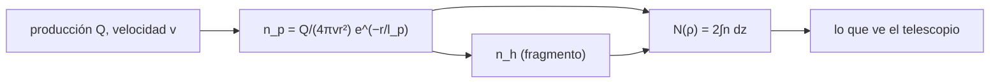

# B55-C11 — Química en cometas

<!-- nav:top -->
[🏠 Programa](../../../../README.md) · [📚 Bloque B55](../../../tronco-comun/B55-astroquimica-y-geoquimica-extraterrestre.md) · [← Anterior: B55-C10 — Identificación de moléculas orgánicas](../B55-C10-identificacion-de-moleculas-organicas/CLASE.md) · [Siguiente: B55-C12 — Geoquímica de meteoritos →](../B55-C12-geoquimica-de-meteoritos/CLASE.md)
<!-- /nav -->

## 1. Ubicación, nivel y alcance

Clase 11 del bloque B55, nivel N3. Aplicas el **modelo de Haser** a una coma cometaria **sintética**: una molécula «padre» sale del núcleo con velocidad constante y se fotodisocia en un «hijo». Calculas densidades, columnas proyectadas y números totales, y los verificas con casos analíticos. Retoma la fotoquímica de [B55-C08](../B55-C08-fotoquimica-cosmica/CLASE.md). Todos los parámetros son **ilustrativos**.

## 2. Por qué esta clase existe

Un telescopio no ve la densidad en cada punto de la coma sino la **columna** a lo largo de la línea de visión. Para pasar de lo medido a la producción de moléculas por el núcleo hay que modelar la expansión y la destrucción. La decisión central: **¿qué columna esperas a cada distancia proyectada y cómo se separa el padre del fragmento?**

## 3. Lo que podrás hacer al terminar

1. Escribir las densidades de padre e hijo de Haser.
2. Calcular longitudes de escala a partir de velocidad y vida.
3. Integrar la columna proyectada y comprobar el caso sin decaimiento `Q/(4vρ)`.
4. Verificar que el número total de padres es `Qτ_p`.
5. Interpretar el cociente hijo/padre con la distancia.
6. Reconocer qué sabe la literatura de 67P a partir de ROSINA.

La evidencia es la **perfil de densidad de columna de una coma sintética** del ejercicio 12 (sección 20).

## 4. Con qué llegas y cómo comprobarlo

1. ¿Qué es una columna de densidad?
2. ¿Cómo cae una densidad con flujo esférico constante?
3. ¿Qué es una vida media?
4. ¿Qué es una longitud de escala?
5. ¿Qué es un valor ilustrativo?

<details>
<summary>Ver respuestas</summary>

1. La densidad integrada a lo largo de la línea de visión, en cm⁻². 2. Como `1/r²`. 3. `τ` tal que la población decae como `e^(−t/τ)`. 4. La distancia `l = vτ` recorrida en una vida. 5. Un valor propuesto para el ejemplo, no medido.
</details>

Con cuatro o cinco aciertos, sigue; si no, repasa los prerrequisitos.

## 5. Un caso de contexto y casos de referencia

Una coma **sintética** con `Q = 10²⁸ s⁻¹`, `v = 0,5 km/s`, vida del padre de `10⁵ s` (longitud `5 × 10⁴ km`) y vida del hijo de `10⁶ s` (`5 × 10⁵ km`). Es el **ejemplo conductor**. Rubin et al. (2019) (S1) estiman en su resumen las abundancias de las principales especies volátiles del núcleo de 67P con ROSINA y concluyen que tiene O y C cercanos a los solares y H y N empobrecidos; es contexto, no se usa ninguna cifra.

## 6. Vocabulario

El **modelo de Haser** supone expansión esférica a velocidad constante `v` con destrucción de primer orden. La **densidad del padre** es `n_p = Q/(4πvr²) e^(−r/l_p)`; la **del hijo** `n_h = Q/(4πvr²) · l_h/(l_p−l_h) · (e^(−r/l_p) − e^(−r/l_h))`. La **distancia proyectada** `ρ` es la distancia al núcleo en el plano del cielo. La **columna** es `N(ρ) = 2∫ n(√(ρ²+z²)) dz`.

## 7. Modelo mental: una manguera esférica

Imagina el gas saliendo del núcleo como agua de una manguera esférica: se diluye como `1/r²`, y mientras viaja el padre se rompe, alimentando al hijo, que a su vez desaparece más lejos.



*Descripción textual:* la producción y la velocidad dan la densidad del padre, que decae y alimenta al hijo; integrando a lo largo de la línea de visión se obtiene la columna observable.

Analogía: una manguera esférica cuyo chorro se diluye y se rompe en gotas más pequeñas. Límite: una coma real no es esférica ni de velocidad constante, y puede tener fuentes extendidas y colisiones.

## 8. La explicación, paso a paso

### 8.1 Escalas

`l_p = vτ_p = 5 × 10⁹ cm` y `l_h = 5 × 10¹⁰ cm`. Dentro de `l_p` el padre es casi un flujo libre.

### 8.2 Columna sin decaimiento

Sin destrucción, `N(ρ) = Q/(4vρ)`. El laboratorio integra numéricamente y obtiene error relativo `2 × 10⁻¹³` en `ρ = 10⁷` y `10⁸ cm`: `5,0 × 10¹⁵` y `5,0 × 10¹⁴ cm⁻²`.

### 8.3 Números totales

El número de padres es `9,9998 × 10³²` frente a `Qτ_p = 10³³` (error `2 × 10⁻⁵`); el de hijos `10³⁴` frente a `Qτ_h = 10³⁴` (error `2 × 10⁻¹¹`): en estado estacionario cada población es producción por vida.

### 8.4 Columnas con decaimiento

| `ρ` (km) | `N_padre` (cm⁻²) | `N_hijo` (cm⁻²) | hijo/padre |
|---|---|---|---|
| 10² | 4,9533 × 10¹⁵ | 4,5039 × 10¹³ | 0,0091 |
| 10³ | 4,6799 × 10¹⁴ | 3,0381 × 10¹³ | 0,065 |
| 10⁴ | 3,2585 × 10¹³ | 1,5794 × 10¹³ | 0,485 |
| 10⁵ | 3,0914 × 10¹¹ | 3,2770 × 10¹² | 10,6 |

El padre domina cerca del núcleo; más allá de ~10⁴ km domina el fragmento. Esa transición es lo que permite distinguir moléculas «madre» de productos.

## 9. Magnitudes, símbolos y unidades

| Símbolo | Qué es | Unidad | Valor / nota |
|---|---|---|---|
| `Q` | producción | s⁻¹ | 10²⁸ (ilustrativa) |
| `v` | velocidad de expansión | km s⁻¹ | 0,5 |
| `τ_p, τ_h` | vidas del padre y del hijo | s | 10⁵; 10⁶ |
| `l` | longitud de escala `vτ` | cm | 5 × 10⁹; 5 × 10¹⁰ |
| `N` | densidad de columna | cm⁻² | 4,95 × 10¹⁵ (100 km) |

## 10. Convenciones y referencias

Sistema de referencia: centro en el núcleo, `ρ` en el plano del cielo, expansión estacionaria. Unidades CGS (cm). Parámetros ilustrativos. Versiones: Python 3.12.9, biblioteca estándar. Tolerancias: columna 1e-3; número total 1e-3.

## 11. De dónde sale lo que afirmamos

| ID | Fuente | Localizador | Respalda | Estado |
|---|---|---|---|---|
| S1 | Rubin et al., «Elemental and molecular abundances in comet 67P/Churyumov-Gerasimenko», *MNRAS* (2019) | arXiv:1907.11044 | contexto: inventario volátil de 67P con ROSINA (resumen) | Consultada el 2026-11-09; solo resumen |
| — | Sin fuente externa para el resto | — | relaciones y valores que verifica el laboratorio con una segunda vía de cálculo; los parámetros de modelo se rotulan ilustrativos | No se consultó una fuente para esta parte |

Límites: del artículo solo se leyó el resumen; todos los parámetros de la coma son inventados.

## 12. Cómo ver el cruce padre–hijo

| `ρ` (km) | domina |
|---|---|
| 10² | padre |
| 10³ | padre |
| 10⁴ | hijo (cociente 0,49 → casi igual) |
| 10⁵ | hijo |

Descripción larga: dos curvas decrecientes en escala log–log; la del padre cae más rápido y la del hijo la cruza cerca de 10⁴ km.

## 13. Ejemplo trabajado: columna libre a 100 km

**Paso 1 · Fórmula.** `N = Q/(4vρ)`.

**Paso 2 · Unidades.** `v = 5 × 10⁴ cm/s`, `ρ = 10⁷ cm`.

**Paso 3 · Cálculo.** `10²⁸/(4 × 5 × 10⁴ × 10⁷) = 5,0 × 10¹⁵ cm⁻²`; con decaimiento resulta `4,95 × 10¹⁵`, un 1 % menos.

## 14. Distintas formas de describir una coma

**Haser:** analítico, un padre y un hijo, esférico. **Modelo vectorial:** incluye la velocidad del fragmento. **Montecarlo de partículas:** colisiones y geometría. Haser es el primero que se plantea y el que se usa para ordenar magnitudes.

## 15. Práctica guiada

**Ejercicio 1 · con los pasos indicados.** Calcula `n` libre a `r = 10⁸ cm` (sección 8.2).

<details><summary>Solución comentada</summary>

`10²⁸/(4π·5 × 10⁴·10¹⁶) = 1,6 × 10⁶ cm⁻³`.
</details>

**Ejercicio 2 · con una pista.** Calcula `l_p` para `τ_p = 2 × 10⁵ s` (sección 8.1). *Pista:* `vτ`.

<details><summary>Solución comentada</summary>

`5 × 10⁴ × 2 × 10⁵ = 10¹⁰ cm`.
</details>

**Ejercicio 3 · casi autónomo.** Calcula `N` libre a `ρ = 10⁸ cm` y compárala con 4,68 × 10¹⁴ (sección 8.2). *Casi autónomo.*

<details><summary>Solución comentada</summary>

`5 × 10¹⁴`; el valor con decaimiento es 6,4 % menor.
</details>

## 16. Práctica autónoma, transferencia e integrador

**Ejercicio 4 · autónomo.** ¿Cuántos padres hay en total si `τ_p = 3 × 10⁵ s`? (sección 8.3).

<details><summary>Solución comentada</summary>

`Qτ = 3 × 10³³`.
</details>

**Ejercicio 5 · autónomo.** Si `Q` se duplica, ¿qué pasa con `N`? (sección 8.2).

<details><summary>Solución comentada</summary>

Se duplica.
</details>

**Ejercicio 6 · autónomo.** Si `v` se duplica, ¿qué pasa con la columna libre? (sección 8.2).

<details><summary>Solución comentada</summary>

Se reduce a la mitad.
</details>

**Ejercicio 7 · autónomo.** ¿Cuál es el cociente hijo/padre a 10⁵ km? (sección 8.4).

<details><summary>Solución comentada</summary>

10,6.
</details>

**Ejercicio 8 · autónomo.** ¿Por qué la columna libre cae como `1/ρ` y no como `1/ρ²`? (sección 8.2).

<details><summary>Solución comentada</summary>

Porque integra a lo largo de la línea de visión, lo que añade un factor `ρ`.
</details>

**Ejercicio 9 · transferencia.** Un espectro mide la columna de una molécula a 10³ km y a 10⁴ km. ¿Cómo distingues padre de hijo? (sección 8.4).

<details><summary>Solución comentada</summary>

El padre cae más rápido que `1/ρ`; el hijo se mantiene o crece relativamente.
</details>

**Ejercicio 10 · transferencia.** Una coma real tiene `v` variable con la distancia. ¿Qué parte del modelo falla? (sección 7).

<details><summary>Solución comentada</summary>

La conservación `n ∝ 1/(v r²)` y las longitudes `vτ` dejan de valer; hay que integrar con `v(r)`.
</details>

**Ejercicio 11 · transferencia.** ¿Qué falta para convertir una columna en una tasa de producción real? (sección 11).

<details><summary>Solución comentada</summary>

Parámetros medidos (`v`, vidas) y geometría de la observación; aquí son ilustrativos.
</details>

**Ejercicio 12 · integrador.** Elabora tu *perfil de densidad de columna de una coma sintética*: define `Q`, `v` y las vidas, calcula las escalas, las columnas de padre e hijo en cuatro distancias, el número total y la verificación analítica.

<details><summary>Solución modelo</summary>

Debe mostrar 8.1–8.4 con unidades, los errores numéricos y la nota de que la coma es sintética.
</details>

## 17. Laboratorio: modelo de Haser de una coma sintética

El script [haser_coma.py](haser_coma.py) integra columnas de padre e hijo y números totales, y **comprueba** la columna sin decaimiento (1e-3) y los totales `Qτ` (1e-3).

**Datos:** **sintéticos**; ninguna observación. **Predice antes de ejecutar:** ¿cuál es la columna libre a 100 km? (5 × 10¹⁵ cm⁻².) **Ejecución del 2026-11-09 (Python 3.12.9):**

```text
Python 3.12.9 (biblioteca estandar)
A. Coma SINTETICA: Q = 1e28 s-1 ; v = 0.5 km/s ; vida del padre 1e5 s ; vida del hijo 1e6 s ; escalas l_p = 5.000e+09 cm, l_h = 5.000e+10 cm
B. Prueba analitica sin decaimiento: N(rho) numerico frente a Q/(4 v rho)
   rho = 1.0e+07 cm : N numerica (+cola) = 5.000000e+15 cm-2 ; analitica = 5.000000e+15 cm-2 ; error relativo = 1.97e-13
   rho = 1.0e+08 cm : N numerica (+cola) = 5.000000e+14 cm-2 ; analitica = 5.000000e+14 cm-2 ; error relativo = 2.20e-13
C. Numero total de padres = 9.9998e+32 ; Q tau_p = 1.0000e+33 ; error = 2.00e-05
   Numero total de hijos  = 1.0000e+34 ; Q tau_h = 1.0000e+34 ; error = 2.00e-11
D. Densidad de columna N(rho) de padre e hijo [cm-2] (coma SINTETICA)
rho [km]    N_padre        N_hijo         N_hijo/N_padre
   1e+02   4.9533e+15   4.5039e+13   9.0927e-03
   1e+03   4.6799e+14   3.0381e+13   6.4919e-02
   1e+04   3.2585e+13   1.5794e+13   4.8469e-01
   1e+05   3.0914e+11   3.2770e+12   1.0600e+01
Pruebas superadas.
```

```bash
python programa/clases/B55/B55-C11-quimica-en-cometas/haser_coma.py
```

**Límites:** esfericidad, velocidad constante, un solo padre; sin colisiones.

## 18. Errores frecuentes y cómo corregirlos

**Olvidar convertir km a cm.** Se declara en la sección 9.

**Confundir columna con densidad.** Se definen en la sección 6.

**Interpretar el hijo como si saliera del núcleo.** Sale del padre (8.4).

**Presentar la coma sintética como observada.** Se aclara en la sección 5.

## 19. Cómo sabrás que vas bien

Tras la sección 8: ¿qué columna esperabas a 100 km y cuál obtuviste? Si dudas, repasa el ejemplo 13. Tras el laboratorio: ¿qué comprueba? (ver la sección 17).

## 20. Qué entregas y cómo se evalúa

El producto es tu **perfil de densidad de columna de una coma sintética** (ejercicio 12).

| Criterio | Inicial | En desarrollo | Logrado | Destacado |
|---|---|---|---|---|
| Conceptos | Los confunde | Parciales | Distingue densidad, columna y escala | Explica los límites |
| Cálculo | Sin unidades | Con errores | Tablas completas con unidades | Calcula casos nuevos |
| Numérico | Sin comprobar | Un caso | Contraste con el caso analítico | Interpreta las diferencias |
| Fuentes | Sin fuente | Sin fecha | Fuentes con fecha y estado | Declara lo sintético e ilustrativo |
| Límites | No los nombra | Uno | Tres | Discute qué falta del modelo |

**Condiciones críticas (no se compensan con promedio):** rotular la coma como sintética; no inferir producciones de un cometa real; citar solo lo consultado.

## 21. Ética, seguridad y límites

Las tasas de producción reales se informan con sus modelos y supuestos; un modelo mínimo no reemplaza una inversión de datos. Clase educativa: los modelos son simplificados y ningún resultado de esta clase es una observación. Accesibilidad: tablas equivalentes a las gráficas, fórmulas en texto, ejercicios sin conexión.

## 22. Para cerrar y seguir

La coma sintética tiene `N = 4,95 × 10¹⁵ cm⁻²` a 100 km y el fragmento supera al padre más allá de ~10⁴ km. Queda una pregunta: ¿qué dicen los meteoritos de la química del Sistema Solar primitivo?

**Glosario español–inglés.** coma · *coma*; modelo de Haser · *Haser model*; molécula padre · *parent molecule*; densidad de columna · *column density*; longitud de escala · *scale length*.

**Continuidad.** [B55-C12](../B55-C12-geoquimica-de-meteoritos/CLASE.md) estudia la geoquímica de meteoritos y su norma mineral.

**Referencias:** ver sección 11.

<!-- nav:bottom -->
---

[← Anterior: B55-C10 — Identificación de moléculas orgánicas](../B55-C10-identificacion-de-moleculas-organicas/CLASE.md) · [📚 Bloque B55](../../../tronco-comun/B55-astroquimica-y-geoquimica-extraterrestre.md) · [Siguiente: B55-C12 — Geoquímica de meteoritos →](../B55-C12-geoquimica-de-meteoritos/CLASE.md)
<!-- /nav -->
