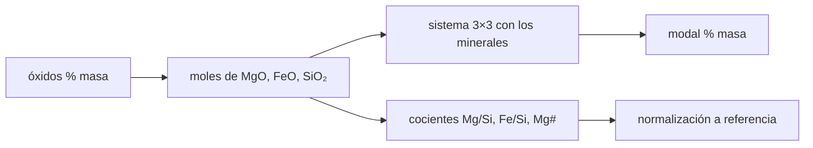

# B55-C12 — Geoquímica de meteoritos

<!-- nav:top -->
[🏠 Programa](../../../../README.md) · [📚 Bloque B55](../../../tronco-comun/B55-astroquimica-y-geoquimica-extraterrestre.md) · [← Anterior: B55-C11 — Química en cometas](../B55-C11-quimica-en-cometas/CLASE.md) · [Siguiente: B55-C13 — Isótopos como trazadores →](../B55-C13-isotopos-como-trazadores/CLASE.md)
<!-- /nav -->

## 1. Ubicación, nivel y alcance

Clase 12 del bloque B55, nivel N3. Aprendes la aritmética básica de la geoquímica de meteoritos: pasar de **óxidos en % de masa** a moles, calcular **cocientes molares** (Mg/Si, Fe/Si, Mg#), **normalizar** a una referencia y recuperar una **norma mineral** resolviendo un sistema lineal. El meteorito es **sintético**. Usas los pesos atómicos del NIST. La fusión por impacto y el metamorfismo de choque no se tratan aquí.

## 2. Por qué esta clase existe

Un meteorito se describe por su análisis químico, pero lo que interesa es qué minerales lo forman y cómo se compara con otros materiales. La decisión central: **¿qué mezcla de minerales reproduce una composición de óxidos, y qué dicen sus cocientes frente a una referencia?**

## 3. Lo que podrás hacer al terminar

1. Convertir % en masa de óxidos a moles.
2. Calcular Mg/Si, Fe/Si y Mg#.
3. Normalizar un cociente a una referencia.
4. Resolver la norma mineral con tres minerales y tres óxidos.
5. Comprobar el cálculo con una ida y vuelta.
6. Estimar la sensibilidad del resultado a un error analítico.

La evidencia es la **norma mineral de un meteorito sintético** del ejercicio 12 (sección 20).

## 4. Con qué llegas y cómo comprobarlo

1. ¿Qué es un mol?
2. ¿Qué es un sistema lineal?
3. ¿Qué es una masa molar?
4. ¿Qué es una fracción molar?
5. ¿Qué es un valor sintético?

<details>
<summary>Ver respuestas</summary>

1. Una cantidad de sustancia con `N_A` entidades. 2. Un conjunto de ecuaciones lineales en varias incógnitas. 3. La masa de un mol, en g/mol. 4. Moles de un componente sobre moles totales. 5. Un dato inventado para ejercitar el método.
</details>

Con cuatro o cinco aciertos, sigue; si no, repasa los prerrequisitos.

## 5. Un caso de contexto y casos de referencia

Un meteorito **sintético** formado por forsterita 30 %, fayalita 10 % y enstatita 60 % en masa, del que se obtienen los óxidos MgO, FeO y SiO₂. Es el **ejemplo conductor**. Pesos atómicos del NIST (S1): Mg 24,305 y Si 28,085 (puntos medios de intervalos), Fe 55,845 y O 15,9994 (de masas isotópicas). Ningún dato es de un meteorito real.

## 6. Vocabulario

La **norma mineral** es la mezcla de minerales ideales que reproduce una composición química. La **forsterita** (Mg₂SiO₄) y la **fayalita** (Fe₂SiO₄) son los extremos del olivino; la **enstatita** (MgSiO₃) es un piroxeno. **Mg#** es `Mg/(Mg+Fe)` en moles. **Normalizar** es dividir por una composición de referencia.

## 7. Modelo mental: una receta al revés

Es una receta al revés: se conocen los ingredientes elementales (óxidos) y se quiere saber qué platos (minerales) se prepararon. Como hay tantos ingredientes como platos, la respuesta es única.



*Descripción textual:* los óxidos se convierten en moles; con ellos se resuelve el sistema de minerales y se calculan cocientes que se normalizan.

Analogía: una receta al revés. Límite: un meteorito real tiene más óxidos y fases (Al, Ca, Ni, metales, sulfuros) que hacen el sistema sobredeterminado y no siempre exacto.

## 8. La explicación, paso a paso

### 8.1 Masas molares

MgO 40,3044; FeO 71,8444; SiO₂ 60,0838; Mg₂SiO₄ 140,693; Fe₂SiO₄ 203,773; MgSiO₃ 100,388 g/mol.

### 8.2 De modal a óxidos

Con 30/10/60 % se obtiene MgO 41,2774 %, FeO 7,0514 % y SiO₂ 51,6712 %; suman 100 (la masa se conserva).

### 8.3 De óxidos a modal

Se resuelve el sistema con pivote parcial: forsterita 30,000000, fayalita 10,000000 y enstatita 60,000000 %, con error máximo `3,6 × 10⁻¹⁴`.

### 8.4 Cocientes y normalización

`Mg/Si = 1,1909`, `Fe/Si = 0,1141` y `Mg# = 0,9125`. Contra una referencia **sintética** (0,95 y 0,60) quedan `1,2536` y `0,1902`: la muestra está enriquecida en Mg y empobrecida en Fe respecto de ella.

### 8.5 Olivino

`Fo# = 100·Fo/(Fo+Fa) = 81,29` en moles. Un +1 % relativo en FeO sube la fayalita de 10,000 a 10,100 % en masa: el error se propaga casi proporcionalmente.

## 9. Magnitudes, símbolos y unidades

| Símbolo | Qué es | Unidad | Valor / nota |
|---|---|---|---|
| `w` | porcentaje en masa de un óxido | % | 41,2774 (MgO) |
| `M` | masa molar | g mol⁻¹ | 40,3044 (MgO) |
| `Mg/Si` | cociente molar | — | 1,1909 |
| `Mg#` | `Mg/(Mg+Fe)` molar | — | 0,9125 |
| `Fo#` | porcentaje molar de forsterita | — | 81,29 |

## 10. Convenciones y referencias

Sistema de referencia: composición de roca total en % de masa. Pesos atómicos estándar del NIST consultados el 2026-11-09 (con los intervalos de Mg y Si tomados en su punto medio). Referencia de normalización **sintética**. Versiones: Python 3.12.9, biblioteca estándar. Tolerancia: recuperación del modal a 1e-10.

## 11. De dónde sale lo que afirmamos

| ID | Fuente | Localizador | Respalda | Estado |
|---|---|---|---|---|
| S1 | NIST, *Atomic Weights and Isotopic Compositions for All Elements* | https://physics.nist.gov/cgi-bin/Compositions/stand_alone.pl | pesos atómicos estándar de Mg, Si, Fe y masas isotópicas del O | Consultada el 2026-11-09; consultada (tabla de isótopos seleccionados) |
| — | Sin fuente externa para el resto | — | relaciones y valores que verifica el laboratorio con una segunda vía de cálculo; los parámetros de modelo se rotulan ilustrativos | No se consultó una fuente para esta parte |

Límites: no se consultó ninguna composición de meteorito real ni referencia de normalización publicada.

## 12. Cómo ver la composición y su norma

| Mineral | % masa |
|---|---|
| forsterita | 30 |
| fayalita | 10 |
| enstatita | 60 |

Descripción larga: una barra apilada de tres tramos; arriba, otra barra de óxidos con 41,3 % MgO, 7,1 % FeO y 51,7 % SiO₂.

## 13. Ejemplo trabajado: de modal a óxidos para la forsterita

**Paso 1 · Moles.** `30 g/140,693 = 0,21323 mol` de Mg₂SiO₄.

**Paso 2 · Óxidos.** `2 × 0,21323 = 0,42646 mol MgO` y `0,21323 mol SiO₂`.

**Paso 3 · Masa.** `0,42646 × 40,3044 = 17,19 g de MgO`: parte de los 41,28 % total.

## 14. Distintas formas de describir un meteorito

**Por óxidos:** lo que da el análisis. **Por cocientes:** compara sin depender de la masa total. **Por norma mineral:** acerca a lo que se ve al microscopio. Cada forma responde una pregunta distinta.

## 15. Práctica guiada

**Ejercicio 1 · con los pasos indicados.** Calcula la masa molar de FeO (sección 8.1).

<details><summary>Solución comentada</summary>

`55,845 + 15,9994 = 71,8444 g/mol`.
</details>

**Ejercicio 2 · con una pista.** Calcula los moles de MgO en 41,2774 g (sección 8.2). *Pista:* divide por la masa molar.

<details><summary>Solución comentada</summary>

`41,2774/40,3044 = 1,0241 mol`.
</details>

**Ejercicio 3 · casi autónomo.** Calcula Mg# con 1,0241 mol de Mg y 0,09815 mol de Fe (sección 8.4). *Casi autónomo.*

<details><summary>Solución comentada</summary>

`1,0241/(1,0241 + 0,09815) = 0,9125`.
</details>

## 16. Práctica autónoma, transferencia e integrador

**Ejercicio 4 · autónomo.** Calcula Fe/Si a partir de 0,09815 y 0,86 mol (sección 8.4).

<details><summary>Solución comentada</summary>

`0,1141`.
</details>

**Ejercicio 5 · autónomo.** Si el modal fuera 50/0/50 de forsterita y enstatita, ¿habría FeO? (sección 8.2).

<details><summary>Solución comentada</summary>

No: FeO = 0 %.
</details>

**Ejercicio 6 · autónomo.** ¿Qué minerales aportan SiO₂? (sección 8.1).

<details><summary>Solución comentada</summary>

Los tres: 1 mol por mol de mineral.
</details>

**Ejercicio 7 · autónomo.** Comprueba que la suma de óxidos es 100 en 8.2.

<details><summary>Solución comentada</summary>

`41,2774 + 7,0514 + 51,6712 = 100,0000`.
</details>

**Ejercicio 8 · autónomo.** ¿Por qué Mg# alto indica un material más magnésico? (sección 8.4).

<details><summary>Solución comentada</summary>

Porque hay mucho más Mg que Fe en moles.
</details>

**Ejercicio 9 · transferencia.** Un análisis real incluye CaO y Al₂O₃. ¿Qué cambia en el sistema? (sección 8.3).

<details><summary>Solución comentada</summary>

Hay más óxidos que minerales de este conjunto; se añaden minerales (piroxeno cálcico, plagioclasa) o se resuelve por mínimos cuadrados.
</details>

**Ejercicio 10 · transferencia.** Se publica un valor normalizado sin decir la referencia. ¿Qué haces? (sección 10).

<details><summary>Solución comentada</summary>

No lo usas: el valor no es reproducible.
</details>

**Ejercicio 11 · transferencia.** ¿Por qué un error de FeO de 1 % relativo no cambia el Mg#? (sección 8.5).

<details><summary>Solución comentada</summary>

Porque Fe es pequeño frente a Mg en esta muestra.
</details>

**Ejercicio 12 · integrador.** Elabora tu *norma mineral de un meteorito sintético*: elige un modal, calcula los óxidos, recupéralo, y calcula cocientes, Mg#, Fo# y una normalización con referencia declarada sintética.

<details><summary>Solución modelo</summary>

Debe mostrar 8.1–8.5 con unidades, la ida y vuelta y la nota de que los datos son sintéticos.
</details>

## 17. Laboratorio: norma mineral por sistema lineal

El script [norma_mineral.py](norma_mineral.py) calcula óxidos desde un modal sintético y lo recupera resolviendo el sistema, y **comprueba** la conservación de masa y la recuperación a 1e-10.

**Datos:** **sintéticos**; pesos atómicos del NIST (S1). **Predice antes de ejecutar:** ¿se recupera exactamente el modal? (Sí, al redondeo numérico.) **Ejecución del 2026-11-09 (Python 3.12.9):**

```text
Python 3.12.9 (biblioteca estandar)
Masas molares [g/mol]: MgO 40.3044, FeO 71.8444, SiO2 60.0838 ; forsterita Mg2SiO4 140.693, fayalita Fe2SiO4 203.773, enstatita MgSiO3 100.388
A. Meteorito SINTETICO: modal inyectado -> oxidos (% masa)
   MgO    41.2774
   FeO     7.0514
   SiO2   51.6712
   suma de oxidos = 100.000000 (igual a la suma del modal, 100)
B. Norma mineral recuperada (% masa) frente al modal inyectado
   forsterita Mg2SiO4    30.000000   inyectado  30.00
   fayalita Fe2SiO4      10.000000   inyectado  10.00
   enstatita MgSiO3      60.000000   inyectado  60.00
   error maximo = 3.55e-14
C. Cocientes molares: Mg/Si = 1.1909 ; Fe/Si = 0.1141 ; Mg# = Mg/(Mg+Fe) = 0.9125
D. Normalizacion a una referencia SINTETICA (valor/referencia)
   Mg/Si: 1.1909 / 0.95 = 1.2536
   Fe/Si: 0.1141 / 0.60 = 0.1902
E. Fo# del olivino = Fo/(Fo+Fa) en moles = 81.29
F. Sensibilidad: +1 % relativo de FeO cambia la fayalita de 10.0000 a 10.1000 % masa
Pruebas superadas.
```

```bash
python programa/clases/B55/B55-C12-geoquimica-de-meteoritos/norma_mineral.py
```

**Límites:** tres óxidos y tres minerales; sin Al, Ca, Ni ni fases opacas.

## 18. Errores frecuentes y cómo corregirlos

**Mezclar masa y moles.** Se convierte en 8.2–8.3.

**Normalizar sin declarar la referencia.** Se advierte en la sección 10.

**Interpretar la norma como la mineralogía real.** Es la mezcla ideal más simple.

**Presentar el meteorito como real.** Se aclara en la sección 5.

## 19. Cómo sabrás que vas bien

Tras la sección 8: ¿qué modal esperabas y cuál obtuviste? Si dudas, repasa el ejemplo 13. Tras el laboratorio: ¿qué comprueba? (ver la sección 17).

## 20. Qué entregas y cómo se evalúa

El producto es tu **norma mineral de un meteorito sintético** (ejercicio 12).

| Criterio | Inicial | En desarrollo | Logrado | Destacado |
|---|---|---|---|---|
| Conceptos | Los confunde | Parciales | Distingue óxidos, moles y minerales | Explica los límites |
| Cálculo | Sin unidades | Con errores | Tablas completas con unidades | Calcula casos nuevos |
| Numérico | Sin comprobar | Un caso | Contraste con el caso analítico | Interpreta las diferencias |
| Fuentes | Sin fuente | Sin fecha | Fuentes con fecha y estado | Declara lo sintético e ilustrativo |
| Límites | No los nombra | Uno | Tres | Discute qué falta del modelo |

**Condiciones críticas (no se compensan con promedio):** rotular la muestra y la referencia como sintéticas; no inferir la mineralogía de un meteorito real; citar solo lo consultado.

## 21. Ética, seguridad y límites

Una norma mineral es un cálculo, no una observación; los análisis reales se citan con su método y su incertidumbre. Clase educativa: los modelos son simplificados y ningún resultado de esta clase es una observación. Accesibilidad: tablas equivalentes a las gráficas, fórmulas en texto, ejercicios sin conexión.

## 22. Para cerrar y seguir

El meteorito sintético se recupera con error `10⁻¹⁴`, con Mg/Si = 1,19 y Mg# = 0,91. Queda una pregunta: ¿qué otro trazador comparte la información de origen?

**Glosario español–inglés.** norma mineral · *normative mineralogy*; olivino · *olivine*; piroxeno · *pyroxene*; normalización · *normalization*; óxido · *oxide*.

**Continuidad.** [B55-C13](../B55-C13-isotopos-como-trazadores/CLASE.md) estudia los isótopos como trazadores del origen de los materiales.

**Referencias:** ver sección 11.

<!-- nav:bottom -->
---

[← Anterior: B55-C11 — Química en cometas](../B55-C11-quimica-en-cometas/CLASE.md) · [📚 Bloque B55](../../../tronco-comun/B55-astroquimica-y-geoquimica-extraterrestre.md) · [Siguiente: B55-C13 — Isótopos como trazadores →](../B55-C13-isotopos-como-trazadores/CLASE.md)
<!-- /nav -->
