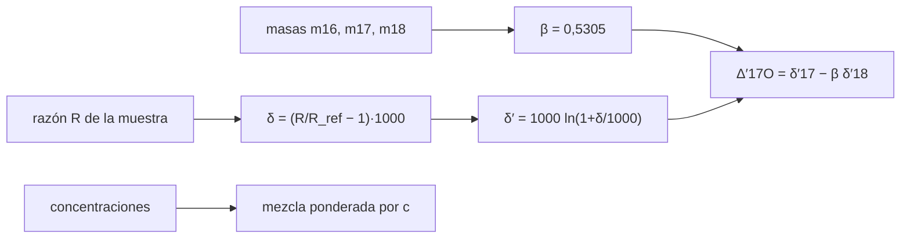

# B55-C13 — Isótopos como trazadores

<!-- nav:top -->
[🏠 Programa](../../../../README.md) · [📚 Bloque B55](../../../tronco-comun/B55-astroquimica-y-geoquimica-extraterrestre.md) · [← Anterior: B55-C12 — Geoquímica de meteoritos](../B55-C12-geoquimica-de-meteoritos/CLASE.md) · [Siguiente: B55-C14 — Química de regolitos →](../B55-C14-quimica-de-regolitos/CLASE.md)
<!-- /nav -->

## 1. Ubicación, nivel y alcance

Clase 13 del bloque B55, nivel N3. Aprendes la **notación δ** de los isótopos, cómo se **mezclan** dos reservorios (no linealmente en δ) y por qué el fraccionamiento dependiente de la masa deja una pendiente `β ≈ 0,53` en las razones de oxígeno, de modo que un `Δ'¹⁷O ≠ 0` señala algo distinto. Las masas y composiciones son del NIST; las muestras son **sintéticas**. Usas [B55-C02](../B55-C02-nucleosintesis-y-elementos/CLASE.md).

## 2. Por qué esta clase existe

Los isótopos son la «huella dactilar» de un reservorio: aguas, minerales y gases de distinto origen tienen razones distintas. Interpretarlas exige saber mezclar y distinguir fraccionamientos de procedencias. La decisión central: **¿una diferencia isotópica se debe a un proceso que depende de la masa o a un origen distinto?**

## 3. Lo que podrás hacer al terminar

1. Calcular `δ` respecto de una referencia.
2. Calcular el exponente `β` de fraccionamiento con masas atómicas.
3. Mezclar reservorios con concentraciones distintas y ver que `δ` no es lineal en la fracción.
4. Calcular `Δ'¹⁷O` y reconocer cuándo es cero.
5. Verificar la mezcla con la fórmula ponderada por concentración.
6. Declarar la referencia usada.

La evidencia es la **ficha isotópica de una mezcla** del ejercicio 12 (sección 20).

## 4. Con qué llegas y cómo comprobarlo

1. ¿Qué es un isótopo?
2. ¿Qué es una razón isotópica?
3. ¿Qué es un permil?
4. ¿Qué es un logaritmo natural?
5. ¿Qué es una referencia?

<details>
<summary>Ver respuestas</summary>

1. Un núclido del mismo elemento con distinto número de neutrones. 2. Cociente de abundancias del isótopo pesado al ligero. 3. Una milésima (‰). 4. El logaritmo en base `e`. 5. Un valor fijo contra el cual se compara.
</details>

Con cuatro o cinco aciertos, sigue; si no, repasa los prerrequisitos.

## 5. Un caso de contexto y casos de referencia

Muestras **sintéticas** de oxígeno e hidrógeno comparadas con una referencia calculada con las composiciones isotópicas del NIST (S1): `¹⁷O/¹⁶O = 3,809256 × 10⁻⁴`, `¹⁸O/¹⁶O = 2,054994 × 10⁻³` y `D/H = 1,150132 × 10⁻⁴`. **No es el estándar internacional de agua oceánica**, que no se consultó. Es el **ejemplo conductor**.

## 6. Vocabulario

`δ = (R/R_ref − 1) × 1000` en ‰. Un **fraccionamiento dependiente de la masa** sigue `δ'¹⁷ = β δ'¹⁸` con `δ' = 1000 ln(1+δ/1000)`. El **exponente** es `β = (1/m₁₆ − 1/m₁₇)/(1/m₁₆ − 1/m₁₈)`. `Δ'¹⁷O = δ'¹⁷ − β δ'¹⁸` mide el exceso no dependiente de la masa. Una **mezcla** combina números de átomos, no valores de `δ`.

## 7. Modelo mental: una balanza de dos platillos

Dos reservorios son dos platillos con distinto contenido de isótopo pesado; al mezclarlos se suman los átomos, así que el reservorio con más átomos de ese elemento pesa más en el resultado, aunque su `δ` sea moderado.



*Descripción textual:* la razón se convierte en `δ`, las masas dan `β`, con ambos se calcula `Δ'¹⁷O`, y la mezcla pondera por concentración.

Analogía: una balanza de dos platillos con pesas distintas. Límite: el fraccionamiento real puede tener un exponente algo distinto según el proceso (equilibrio o cinético).

## 8. La explicación, paso a paso

### 8.1 Referencia y exponente

La referencia sale de las abundancias NIST (S1). Con las masas `m₁₆ = 15,99491`, `m₁₇ = 16,99913` y `m₁₈ = 17,99916` u, `β = 0,530521`.

### 8.2 Muestras fraccionadas

| `δ¹⁸` (‰) | `δ¹⁷` (‰) | `Δ'¹⁷O` (‰) |
|---|---|---|
| −20 | −10,6607 | 5,5 × 10⁻¹⁴ |
| −5 | −2,6557 | −3,0 × 10⁻¹⁴ |
| 5 | 2,6495 | −1,3 × 10⁻¹⁵ |
| 12 | 6,3484 | −1,1 × 10⁻¹⁴ |
| 30 | 15,8052 | 1,0 × 10⁻¹³ |

Una muestra fraccionada solo por masa tiene `Δ'¹⁷O = 0`. Una muestra sintética con `δ¹⁷ = 5,8‰` y `δ¹⁸ = 10‰` tiene `Δ'¹⁷O = 0,5044‰`: no depende de la masa.

### 8.3 Mezcla de D/H

Dos reservorios sintéticos (`−200‰` con concentración 1 y `+1500‰` con 0,2):

| fracción del reservorio 1 | `δ` mezcla (‰) | lineal en la fracción (‰) |
|---|---|---|
| 0 | 1500,00 | 1500,0 |
| 0,25 | 437,50 | 1075,0 |
| 0,50 | 83,33 | 650,0 |
| 0,75 | −93,75 | 225,0 |
| 1 | −200,00 | −200,0 |

La mezcla exacta coincide con la fórmula ponderada por concentración (1e-9). Interpolar linealmente en la fracción da errores de cientos de ‰.

## 9. Magnitudes, símbolos y unidades

| Símbolo | Qué es | Unidad | Valor / nota |
|---|---|---|---|
| `δ` | desviación isotópica | ‰ | −200 a 1500 (sintética) |
| `R` | razón isotópica | — | 1,150132 × 10⁻⁴ (D/H ref.) |
| `β` | exponente de fraccionamiento | — | 0,530521 |
| `Δ'¹⁷O` | exceso no dependiente de la masa | ‰ | 0,5044 (sintético) |
| `c` | concentración del elemento | mol kg⁻¹ (relativa) | 1; 0,2 |

## 10. Convenciones y referencias

Sistema de referencia: razones relativas a la referencia calculada con NIST (no VSMOW). Masas y composiciones del NIST consultadas el 2026-11-09. Muestras y concentraciones sintéticas. Versiones: Python 3.12.9, biblioteca estándar. Tolerancias: mezcla 1e-9 ‰; `Δ'` 1e-9 ‰.

## 11. De dónde sale lo que afirmamos

| ID | Fuente | Localizador | Respalda | Estado |
|---|---|---|---|---|
| S1 | NIST, *Atomic Weights and Isotopic Compositions for All Elements* | https://physics.nist.gov/cgi-bin/Compositions/stand_alone.pl | masas de O-16/17/18 y composiciones isotópicas de H y O | Consultada el 2026-11-09; consultada (tabla de isótopos seleccionados) |
| — | Sin fuente externa para el resto | — | relaciones y valores que verifica el laboratorio con una segunda vía de cálculo; los parámetros de modelo se rotulan ilustrativos | No se consultó una fuente para esta parte |

Límites: no se consultó el estándar VSMOW ni valores isotópicos de materiales reales; las muestras son sintéticas.

## 12. Cómo ver la mezcla frente a la recta

| Fracción | `δ` exacto (‰) | `δ` lineal (‰) |
|---|---|---|
| 0,25 | 437,5 | 1075,0 |
| 0,50 | 83,3 | 650,0 |
| 0,75 | −93,8 | 225,0 |

Descripción larga: la curva exacta es una hipérbola por debajo de la recta que une los extremos.

## 13. Ejemplo trabajado: mezcla a partes iguales

**Paso 1 · Átomos ligeros.** `0,5·1 + 0,5·0,2 = 0,6`.

**Paso 2 · Pesados relativos.** Razones `0,8` y `2,5`: `0,5·1·0,8 + 0,5·0,2·2,5 = 0,65`.

**Paso 3 · Razón.** `0,65/0,6 = 1,0833` → `δ = +83,33‰`.

## 14. Distintas formas de comparar composiciones isotópicas

**Valores δ:** compactos, comparables entre laboratorios con la misma referencia. **Razones absolutas:** necesarias para mezclar. **δ' logarítmico:** convierte el fraccionamiento por masa en una recta. Se elige según el cálculo.

## 15. Práctica guiada

**Ejercicio 1 · con los pasos indicados.** Calcula `δ` de una muestra con `R = 1,2 R_ref` (sección 6).

<details><summary>Solución comentada</summary>

`+200‰`.
</details>

**Ejercicio 2 · con una pista.** Calcula `δ'` para `δ = 10‰` (sección 8.2). *Pista:* `1000 ln(1,01)`.

<details><summary>Solución comentada</summary>

`9,950‰`.
</details>

**Ejercicio 3 · casi autónomo.** Calcula `δ'¹⁷` para `δ'¹⁸ = 10‰` con `β` (sección 8.1). *Casi autónomo.*

<details><summary>Solución comentada</summary>

`0,5305 × 10 = 5,305‰`.
</details>

## 16. Práctica autónoma, transferencia e integrador

**Ejercicio 4 · autónomo.** ¿Qué `δ` tiene una mezcla 50/50 de reservorios de igual concentración y `δ` de 0 y 100‰? (sección 8.3).

<details><summary>Solución comentada</summary>

`50‰`: si las concentraciones son iguales la mezcla es lineal.
</details>

**Ejercicio 5 · autónomo.** ¿Por qué con concentraciones distintas deja de ser lineal? (sección 8.3).

<details><summary>Solución comentada</summary>

Porque el reservorio más concentrado aporta más átomos.
</details>

**Ejercicio 6 · autónomo.** Calcula `Δ'¹⁷O` si `δ'¹⁷ = 5,5` y `δ'¹⁸ = 10` (sección 8.1).

<details><summary>Solución comentada</summary>

`5,5 − 5,305 = 0,195‰`.
</details>

**Ejercicio 7 · autónomo.** ¿Qué fracción del reservorio 1 da `δ = 0‰`? (sección 8.3).

<details><summary>Solución comentada</summary>

Interpolando entre 0,25 (437) y 0,5 (83) y 0,75 (−94): alrededor de `0,6`.
</details>

**Ejercicio 8 · autónomo.** ¿Por qué conviene declarar la referencia? (sección 10).

<details><summary>Solución comentada</summary>

Porque `δ` depende de ella; sin referencia no es comparable.
</details>

**Ejercicio 9 · transferencia.** Un cometa y un meteorito tienen D/H distintos. ¿Qué concluyes? (sección 8.3).

<details><summary>Solución comentada</summary>

Solo que sus reservorios o procesos difieren; hace falta más información (y mezcla) para su origen.
</details>

**Ejercicio 10 · transferencia.** Una muestra tiene `Δ'¹⁷O = 0,5‰`. ¿Se explica por fraccionamiento por masa? (sección 8.2).

<details><summary>Solución comentada</summary>

No: eso apunta a un origen o proceso distinto.
</details>

**Ejercicio 11 · transferencia.** ¿Qué incertidumbre añade usar una referencia calculada y no la oficial? (sección 10).

<details><summary>Solución comentada</summary>

Un desplazamiento sistemático de `δ`; por eso los valores de la clase no deben compararse con la literatura.
</details>

**Ejercicio 12 · integrador.** Elabora tu *ficha isotópica de una mezcla*: calcula `β`, tres muestras fraccionadas con `Δ'¹⁷O`, y una mezcla de dos reservorios con la tabla y la verificación.

<details><summary>Solución modelo</summary>

Debe mostrar 8.1–8.3, la referencia declarada, la nota de que las muestras son sintéticas y la distinción entre mezcla y fraccionamiento.
</details>

## 17. Laboratorio: notación δ, mezcla y exponente de masa

El script [isotopos_delta.py](isotopos_delta.py) calcula `β`, `Δ'¹⁷O` y la mezcla de reservorios, y **comprueba** que la mezcla exacta coincide con la ponderada por concentración (1e-9) y que `Δ'¹⁷O` se anula para muestras fraccionadas por masa.

**Datos:** masas y composiciones del NIST (S1); muestras **sintéticas**. **Predice antes de ejecutar:** ¿cuánto vale `β`? (≈ 0,53.) **Ejecución del 2026-11-09 (Python 3.12.9):**

```text
Python 3.12.9 (biblioteca estandar)
A. Razones de REFERENCIA (de las composiciones NIST; no son VSMOW): 17O/16O = 3.809256e-04 ; 18O/16O = 2.054994e-03 ; D/H = 1.150132e-04
B. Exponente de fraccionamiento dependiente de la masa beta = (1/m16 - 1/m17)/(1/m16 - 1/m18) = 0.530521
C. Muestras SINTETICAS fraccionadas con beta: delta'18 prescrito, delta'17 = beta delta'18 => Delta'17O = 0
delta18 [permil]  delta17 [permil]  Delta'17O [permil]
      -20.00          -10.6607           5.507e-14
       -5.00           -2.6557          -2.975e-14
        5.00            2.6495          -1.332e-15
       12.00            6.3484          -1.066e-14
       30.00           15.8052           1.048e-13
D. Muestra SINTETICA con delta17 = 5.8 y delta18 = 10.0 permil : Delta'17O = 0.5044 permil (no dependiente de la masa si es distinto de cero)
E. Mezcla de dos reservorios SINTETICOS de D/H (delta en permil respecto de la referencia NIST)
f(res.1)   delta mezcla (exacto)   formula ponderada por c   lineal en f
   0.00      1500.000000           1500.000000           1500.0000
   0.25       437.500000            437.500000           1075.0000
   0.50        83.333333             83.333333            650.0000
   0.75       -93.750000            -93.750000            225.0000
   1.00      -200.000000           -200.000000           -200.0000
Pruebas superadas.
```

```bash
python programa/clases/B55/B55-C13-isotopos-como-trazadores/isotopos_delta.py
```

**Límites:** referencia no oficial; sin fraccionamiento cinético; reservorios fijos.

## 18. Errores frecuentes y cómo corregirlos

**Promediar `δ` linealmente.** Se muestra en 8.3.

**Olvidar declarar la referencia.** Sección 10.

**Atribuir un `Δ'` distinto de cero a una medición.** Aquí es sintético.

**Usar `δ` sin logaritmo para pendientes.** Ver 8.2.

## 19. Cómo sabrás que vas bien

Tras la sección 8: ¿qué `δ` esperabas para la mezcla 50/50 y cuál obtuviste? Si dudas, repasa el ejemplo 13. Tras el laboratorio: ¿qué comprueba? (ver la sección 17).

## 20. Qué entregas y cómo se evalúa

El producto es tu **ficha isotópica de una mezcla** (ejercicio 12).

| Criterio | Inicial | En desarrollo | Logrado | Destacado |
|---|---|---|---|---|
| Conceptos | Los confunde | Parciales | Distingue δ, mezcla y fraccionamiento | Explica los límites |
| Cálculo | Sin unidades | Con errores | Tablas completas con unidades | Calcula casos nuevos |
| Numérico | Sin comprobar | Un caso | Contraste con el caso analítico | Interpreta las diferencias |
| Fuentes | Sin fuente | Sin fecha | Fuentes con fecha y estado | Declara lo sintético e ilustrativo |
| Límites | No los nombra | Uno | Tres | Discute qué falta del modelo |

**Condiciones críticas (no se compensan con promedio):** rotular muestras y reservorios como sintéticos; declarar la referencia no oficial; citar solo lo consultado.

## 21. Ética, seguridad y límites

Una interpretación de origen a partir de isótopos exige referencia, incertidumbres y alternativas; la clase no concluye ningún origen. Clase educativa: los modelos son simplificados y ningún resultado de esta clase es una observación. Accesibilidad: tablas equivalentes a las gráficas, fórmulas en texto, ejercicios sin conexión.

## 22. Para cerrar y seguir

`β = 0,5305` y una muestra con `Δ'¹⁷O = 0,50‰` queda fuera de la línea de masa; la mezcla 50/50 da `+83,3‰`, no `650‰`. Queda una pregunta: ¿qué pasa en una superficie sin atmósfera?

**Glosario español–inglés.** razón isotópica · *isotope ratio*; fraccionamiento · *fractionation*; permil · *per mil*; mezcla · *mixing*; trazador · *tracer*.

**Continuidad.** [B55-C14](../B55-C14-quimica-de-regolitos/CLASE.md) estudia la química de los regolitos.

**Referencias:** ver sección 11.

<!-- nav:bottom -->
---

[← Anterior: B55-C12 — Geoquímica de meteoritos](../B55-C12-geoquimica-de-meteoritos/CLASE.md) · [📚 Bloque B55](../../../tronco-comun/B55-astroquimica-y-geoquimica-extraterrestre.md) · [Siguiente: B55-C14 — Química de regolitos →](../B55-C14-quimica-de-regolitos/CLASE.md)
<!-- /nav -->
