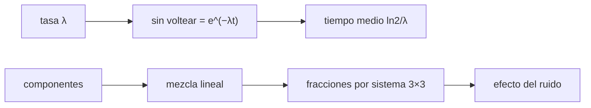

# B55-C14 — Química de regolitos

<!-- nav:top -->
[🏠 Programa](../../../../README.md) · [📚 Bloque B55](../../../tronco-comun/B55-astroquimica-y-geoquimica-extraterrestre.md) · [← Anterior: B55-C13 — Isótopos como trazadores](../B55-C13-isotopos-como-trazadores/CLASE.md) · [Siguiente: B55-C15 — Química de océanos internos →](../B55-C15-quimica-de-oceanos-internos/CLASE.md)
<!-- /nav -->

## 1. Ubicación, nivel y alcance

Clase 14 del bloque B55, nivel N3. Modelas un regolito **sintético**: la **jardineria** por impactos (cuánta capa sigue sin voltearse tras un tiempo) y la **mezcla** de componentes de distinta composición, recuperando las fracciones con un sistema lineal. Complementa [B55-C12](../B55-C12-geoquimica-de-meteoritos/CLASE.md). La maduración espectral y la meteorización espacial se tratan en otra clase programada del programa y no aquí.

## 2. Por qué esta clase existe

El regolito es el suelo de un cuerpo sin atmósfera y su química depende de qué impactos lo removieron y de qué componentes lo formaron. La decisión central: **¿cuánto tiempo hace falta para que una capa se voltee y qué mezcla de componentes explica la composición medida?**

## 3. Lo que podrás hacer al terminar

1. Modelar los volteos como un proceso de Poisson.
2. Calcular la fracción sin voltear `exp(−λt)` y el tiempo medio.
3. Verificarlo con Monte Carlo.
4. Recuperar fracciones de componentes con un sistema lineal.
5. Medir el efecto del ruido en esas fracciones.
6. Distinguir lo sintético de un análisis real de regolito.

La evidencia es la **perfil de volteo de un regolito sintético** del ejercicio 12 (sección 20).

## 4. Con qué llegas y cómo comprobarlo

1. ¿Qué es un proceso de Poisson?
2. ¿Qué distribución tiene el tiempo hasta el primer evento?
3. ¿Qué es una mezcla lineal en masa?
4. ¿Qué es un sistema de ecuaciones?
5. ¿Qué es una semilla fija?

<details>
<summary>Ver respuestas</summary>

1. Eventos independientes con tasa constante. 2. Exponencial. 3. Una composición que es la suma ponderada de las de los componentes. 4. Un conjunto de ecuaciones con incógnitas comunes. 5. Un valor que hace reproducible una secuencia aleatoria.
</details>

Con cuatro o cinco aciertos, sigue; si no, repasa los prerrequisitos.

## 5. Un caso de contexto y casos de referencia

Una capa de 1 cm con tasa de volteo **ilustrativa** `λ = 1/10⁸ años` y tres componentes **sintéticos** (basáltico, de tierras altas y enriquecido) caracterizados por %MgO, %FeO y %Al₂O₃. Es el **ejemplo conductor**. Ningún valor es de un regolito real.

## 6. Vocabulario

La **jardineria** es la mezcla vertical del regolito por impactos. La **tasa de volteo** `λ` es la frecuencia con que una celda se remueve. La **fracción sin voltear** tras `t` es `e^(−λt)`. Un **componente** es un material con composición propia. Una **mezcla lineal** pondera por fracción en masa.

## 7. Modelo mental: remover la arena de una playa

Piensa en una playa golpeada al azar por olas: cada grano se remueve cuando una ola lo alcanza. Con el tiempo, casi todos se han movido al menos una vez, pero algunos tardan mucho.



*Descripción textual:* la tasa de volteo da la fracción sin voltear y los tiempos; la mezcla de componentes se invierte con un sistema lineal cuya precisión depende del ruido.

Analogía: remover la arena de una playa con olas al azar. Límite: los impactos reales tienen distribución de tamaños, profundidades y eyección de material que este modelo no incluye.

## 8. La explicación, paso a paso

### 8.1 Jardineria

| `t` (años) | `e^(−λt)` | Monte Carlo (20 000) |
|---|---|---|
| 10⁷ | 0,90484 | 0,90540 |
| 5 × 10⁷ | 0,60653 | 0,60510 |
| 10⁸ | 0,36788 | 0,36665 |
| 3 × 10⁸ | 0,04979 | 0,04830 |
| 10⁹ | 0,00005 | 0,00010 |

La mitad de la capa se ha volteado en `ln 2/λ = 6,93 × 10⁷` años y en 10⁹ años hay 10 volteos medios.

### 8.2 Mezcla de componentes

Componentes (MgO, FeO, Al₂O₃ en %): basáltico (8, 20, 10), tierras altas (6, 5, 26), enriquecido (11, 12, 15). Con fracciones 0,50/0,30/0,20 el suelo es (8,00; 13,90; 15,80) %. El sistema recupera 0,500000; 0,300000; 0,200000 con error `1,4 × 10⁻¹⁶`.

### 8.3 Efecto del ruido

Con ruido gaussiano de 0,2 % absoluto (200 repeticiones, semilla 5), las desviaciones son 0,028 (basáltico), 0,020 (tierras altas) y 0,047 (enriquecido): el ruido de 0,2 puntos de óxido da errores de 2 a 5 puntos de fracción, porque los componentes se parecen entre sí.

## 9. Magnitudes, símbolos y unidades

| Símbolo | Qué es | Unidad | Valor / nota |
|---|---|---|---|
| `λ` | tasa de volteo | año⁻¹ | 10⁻⁸ (ilustrativa) |
| `t` | tiempo | años | 10⁷ a 10⁹ |
| `f` | fracción de un componente | — | 0,50; 0,30; 0,20 |
| `w` | contenido de óxido | % masa | 8,00 (MgO del suelo) |
| `σ` | ruido analítico | % absoluto | 0,2 |

## 10. Convenciones y referencias

Sistema de referencia: capa de 1 cm de un cuerpo sin atmósfera. Eventos independientes de tasa constante. Composiciones de componentes sintéticas, suma ≠ 100 por ser solo tres óxidos. Versiones: Python 3.12.9, biblioteca estándar, semillas 99 y 5. Tolerancias: Monte Carlo 1 % absoluto; recuperación 1e-10.

## 11. De dónde sale lo que afirmamos

| ID | Fuente | Localizador | Respalda | Estado |
|---|---|---|---|---|
| — | Sin fuente externa para el resto | — | relaciones y valores que verifica el laboratorio con una segunda vía de cálculo; los parámetros de modelo se rotulan ilustrativos | No se consultó una fuente para esta parte |

Límites: la clase no se apoya en ninguna fuente externa: es un modelo mínimo con parámetros ilustrativos y su verificación es interna.

## 12. Cómo ver el volteo en el tiempo

| `t` (años) | sin voltear |
|---|---|
| 10⁷ | 90 % |
| 10⁸ | 37 % |
| 3 × 10⁸ | 5 % |

Descripción larga: una exponencial decreciente que cruza el 50 % cerca de 7 × 10⁷ años.

## 13. Ejemplo trabajado: fracción sin voltear a 2 × 10⁸ años

**Paso 1 · `λt`.** `2 × 10⁸/10⁸ = 2`.

**Paso 2 · Exponencial.** `e⁻² = 0,1353`.

**Paso 3 · Lectura.** El 13,5 % de la capa sigue sin voltear.

## 14. Distintas formas de estudiar la mezcla de un regolito

**Poisson analítico:** la fracción sin voltear. **Monte Carlo:** admite eventos más complejos (profundidad, tamaño). **Mezcla lineal:** componentes conocidos; con más componentes que óxidos hay que añadir restricciones.

## 15. Práctica guiada

**Ejercicio 1 · con los pasos indicados.** Calcula `e^(−λt)` para `t = 10⁸` (sección 8.1).

<details><summary>Solución comentada</summary>

`e⁻¹ = 0,3679`.
</details>

**Ejercicio 2 · con una pista.** Calcula el tiempo para que quede el 10 % sin voltear (sección 8.1). *Pista:* `t = ln 10/λ`.

<details><summary>Solución comentada</summary>

`2,303 × 10⁸ años`.
</details>

**Ejercicio 3 · casi autónomo.** Calcula el MgO de un suelo 50 % basáltico, 30 % tierras altas, 20 % enriquecido (sección 8.2). *Casi autónomo.*

<details><summary>Solución comentada</summary>

`0,5·8 + 0,3·6 + 0,2·11 = 8,0 %`.
</details>

## 16. Práctica autónoma, transferencia e integrador

**Ejercicio 4 · autónomo.** ¿Cuántos volteos medios hay en 5 × 10⁸ años? (sección 8.1).

<details><summary>Solución comentada</summary>

5.
</details>

**Ejercicio 5 · autónomo.** Si `λ` se duplica, ¿cómo cambia el tiempo medio? (sección 8.1).

<details><summary>Solución comentada</summary>

Se reduce a la mitad: 3,47 × 10⁷ años.
</details>

**Ejercicio 6 · autónomo.** Calcula el FeO del suelo (sección 8.2).

<details><summary>Solución comentada</summary>

`0,5·20 + 0,3·5 + 0,2·12 = 13,9 %`.
</details>

**Ejercicio 7 · autónomo.** ¿Qué componente se estima con mayor incertidumbre? (sección 8.3).

<details><summary>Solución comentada</summary>

El enriquecido (0,047).
</details>

**Ejercicio 8 · autónomo.** ¿Por qué el ruido pequeño produce errores grandes en las fracciones? (sección 8.3).

<details><summary>Solución comentada</summary>

Los componentes tienen composiciones parecidas y el sistema está mal condicionado.
</details>

**Ejercicio 9 · transferencia.** Un regolito tiene 5 % sin voltear a 3 × 10⁸ años. ¿Qué concluyes sobre `λ`? (sección 8.1).

<details><summary>Solución comentada</summary>

Que es compatible con `λ ≈ 10⁻⁸`; con una sola medida no se descartan valores cercanos.
</details>

**Ejercicio 10 · transferencia.** Quieres separar cuatro componentes con tres óxidos. ¿Qué haces? (sección 8.2).

<details><summary>Solución comentada</summary>

Añades un óxido o una restricción (suma = 1) y/o usas mínimos cuadrados.
</details>

**Ejercicio 11 · transferencia.** Un impacto grande mezcla 1 m de profundidad. ¿Qué parte del modelo falla? (sección 7).

<details><summary>Solución comentada</summary>

La capa deja de ser independiente: hay volteos de varias celdas a la vez.
</details>

**Ejercicio 12 · integrador.** Elabora tu *perfil de volteo de un regolito sintético*: define `λ`, calcula la tabla de fracciones sin voltear con su Monte Carlo, y la mezcla de tres componentes con su ruido.

<details><summary>Solución modelo</summary>

Debe mostrar 8.1–8.3 con unidades, las semillas y la nota de que los datos son sintéticos.
</details>

## 17. Laboratorio: jardineria por impactos y mezcla lineal

El script [regolito_jardineria.py](regolito_jardineria.py) simula el volteo de celdas y resuelve la mezcla de tres componentes, y **comprueba** la fracción sin voltear (1 % absoluto) y la recuperación de las fracciones (1e-10).

**Datos:** **sintéticos**; ninguna fuente externa. **Predice antes de ejecutar:** ¿qué fracción sigue sin voltear a 10⁸ años? (0,368.) **Ejecución del 2026-11-09 (Python 3.12.9):**

```text
Python 3.12.9 (biblioteca estandar)
A. Jardineria: fraccion de una capa de 1 cm que sigue sin voltear (lambda = 1/1e8 anos, ILUSTRATIVA)
t [anos]     analitica exp(-lambda t)   Monte Carlo (20000 celdas)
  1.0e+07          0.90484                 0.90540
  5.0e+07          0.60653                 0.60510
  1.0e+08          0.36788                 0.36665
  3.0e+08          0.04979                 0.04830
  1.0e+09          0.00005                 0.00010
   tiempo en que la mitad de la capa se ha volteado al menos una vez = ln2 / lambda = 6.9315e+07 anos
   volteos medios en 1e9 anos = 10.0
B. Mezcla de tres componentes SINTETICOS (% masa de MgO, FeO, Al2O3)
   basaltico      (8.0, 20.0, 10.0)
   tierras altas  (6.0, 5.0, 26.0)
   enriquecido    (11.0, 12.0, 15.0)
   suelo = (8.0000, 13.9000, 15.8000) ; fracciones recuperadas: basaltico 0.500000, tierras altas 0.300000, enriquecido 0.200000 ; error maximo = 1.39e-16
C. Ruido gaussiano de 0.2 % absoluto en cada oxido (200 repeticiones, semilla 5)
   basaltico      media = 0.4987 ; desviacion = 0.0283
   tierras altas  media = 0.2980 ; desviacion = 0.0201
   enriquecido    media = 0.2033 ; desviacion = 0.0466
Pruebas superadas.
```

```bash
python programa/clases/B55/B55-C14-quimica-de-regolitos/regolito_jardineria.py
```

**Límites:** celdas independientes; mezcla lineal; tres óxidos.

## 18. Errores frecuentes y cómo corregirlos

**Confundir tiempo medio con tiempo de vida media.** El medio es `1/λ`, la mediana `ln2/λ`.

**Creer que todo se voltea a la vez.** Es un proceso aleatorio (8.1).

**Usar componentes casi iguales.** Aumenta el error (8.3).

**Presentar el regolito sintético como lunar.** Se aclara en la sección 5.

## 19. Cómo sabrás que vas bien

Tras la sección 8: ¿qué fracción esperabas sin voltear y cuál obtuviste? Si dudas, repasa el ejemplo 13. Tras el laboratorio: ¿qué comprueba? (ver la sección 17).

## 20. Qué entregas y cómo se evalúa

El producto es tu **perfil de volteo de un regolito sintético** (ejercicio 12).

| Criterio | Inicial | En desarrollo | Logrado | Destacado |
|---|---|---|---|---|
| Conceptos | Los confunde | Parciales | Distingue volteo y mezcla | Explica los límites |
| Cálculo | Sin unidades | Con errores | Tablas completas con unidades | Calcula casos nuevos |
| Numérico | Sin comprobar | Un caso | Contraste con el caso analítico | Interpreta las diferencias |
| Fuentes | Sin fuente | Sin fecha | Fuentes con fecha y estado | Declara lo sintético e ilustrativo |
| Límites | No los nombra | Uno | Tres | Discute qué falta del modelo |

**Condiciones críticas (no se compensan con promedio):** rotular regolito y componentes como sintéticos; no inferir edades de superficies reales; declarar que no hay fuentes externas.

## 21. Ética, seguridad y límites

Un modelo mínimo ilustra ideas; no reemplaza el análisis de muestras ni la teoría de cráteres. Clase educativa: los modelos son simplificados y ningún resultado de esta clase es una observación. Accesibilidad: tablas equivalentes a las gráficas, fórmulas en texto, ejercicios sin conexión.

## 22. Para cerrar y seguir

Con `λ = 10⁻⁸ año⁻¹` la mitad de la capa se voltea en `6,9 × 10⁷` años y la mezcla se recupera exactamente sin ruido. Queda una pregunta: ¿qué química hay bajo la superficie, en un océano?

**Glosario español–inglés.** regolito · *regolith*; jardineria por impactos · *impact gardening*; proceso de Poisson · *Poisson process*; mezcla lineal · *linear mixing*; componente · *end-member*.

**Continuidad.** [B55-C15](../B55-C15-quimica-de-oceanos-internos/CLASE.md) estudia la química de los océanos internos.

**Referencias:** ver sección 11.

<!-- nav:bottom -->
---

[← Anterior: B55-C13 — Isótopos como trazadores](../B55-C13-isotopos-como-trazadores/CLASE.md) · [📚 Bloque B55](../../../tronco-comun/B55-astroquimica-y-geoquimica-extraterrestre.md) · [Siguiente: B55-C15 — Química de océanos internos →](../B55-C15-quimica-de-oceanos-internos/CLASE.md)
<!-- /nav -->
