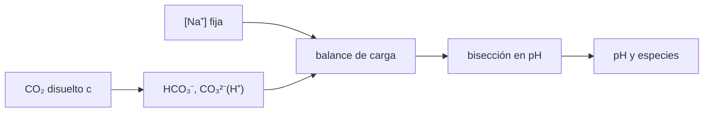

# B55-C15 — Química de océanos internos

<!-- nav:top -->
[🏠 Programa](../../../../README.md) · [📚 Bloque B55](../../../tronco-comun/B55-astroquimica-y-geoquimica-extraterrestre.md) · [← Anterior: B55-C14 — Química de regolitos](../B55-C14-quimica-de-regolitos/CLASE.md) · [Siguiente: B55-C16 — Procesos hidrotermales extraterrestres →](../../../tronco-comun/B55-astroquimica-y-geoquimica-extraterrestre.md#b55-c16)
<!-- /nav -->

## 1. Ubicación, nivel y alcance

Clase 15 del bloque B55, nivel N3. Calculas el **pH de un océano interno sintético** con el equilibrio del carbonato y el balance de carga, resolviéndolo por bisección y verificándolo con un caso analítico. Sin acceso a mediciones, el océano es un modelo con constantes **ilustrativas**. Usas logaritmos y ecuaciones no lineales sencillas.

## 2. Por qué esta clase existe

El pH de un océano bajo el hielo condiciona qué minerales precipitan y qué química prebiótica es posible. Se calcula con equilibrios acoplados. La decisión central: **¿cómo cambia el pH si cambian el sodio y el CO₂ disuelto?**

## 3. Lo que podrás hacer al terminar

1. Escribir el balance de carga con carbonato, sodio, H⁺ y OH⁻.
2. Resolverlo por bisección y comprobar el residuo.
3. Calcular fracciones de especies del carbono disuelto.
4. Comparar con la solución cuadrática de un caso sin carbonato.
5. Describir la respuesta del pH al CO₂ y al sodio.
6. Reconocer qué observaciones de Encelado sugieren agua en contacto con roca.

La evidencia es la **pH de un océano sintético** del ejercicio 12 (sección 20).

## 4. Con qué llegas y cómo comprobarlo

1. ¿Qué es el pH?
2. ¿Qué es una constante de equilibrio?
3. ¿Qué es un balance de carga?
4. ¿Qué es una bisección?
5. ¿Qué es un valor ilustrativo?

<details>
<summary>Ver respuestas</summary>

1. `−log₁₀[H⁺]`. 2. El cociente de concentraciones en el equilibrio. 3. La suma de cargas positivas igual a la de las negativas. 4. Un método para hallar la raíz de una función por intervalos. 5. Un valor propuesto para el ejemplo, no medido.
</details>

Con cuatro o cinco aciertos, sigue; si no, repasa los prerrequisitos.

## 5. Un caso de contexto y casos de referencia

Un océano **sintético** con `[Na⁺] = 10⁻² mol/kg`, CO₂ disuelto `10⁻³ mol/kg` y constantes `K₁ = 4,5 × 10⁻⁷`, `K₂ = 4,7 × 10⁻¹¹`, `K_w = 10⁻¹⁴` (de orden de magnitud para agua cerca de 25 °C; **no consultadas** y válidas sin corregir por temperatura ni salinidad). Es el **ejemplo conductor**. Hsu et al. (2015) (S2) y Waite et al. (2017) (S1) (ambos consultados solo por un resumen truncado) interpretan, respectivamente, granos de hielo ricos en sales de sodio y sílice nanométrica del penacho de Encelado, y el hidrógeno molecular detectado por Cassini, como evidencia de agua en contacto con roca; esas lecturas son contexto y no aportan cifras al modelo.

## 6. Vocabulario

El **equilibrio del carbonato** liga `CO₂(aq)`, `HCO₃⁻` y `CO₃²⁻` con `[H⁺]`: `[HCO₃⁻] = K₁c/[H⁺]` y `[CO₃²⁻] = K₁K₂c/[H⁺]²`. El **balance de carga** es `[Na⁺] + [H⁺] = [HCO₃⁻] + 2[CO₃²⁻] + [OH⁻]`. `K_w` es el producto iónico del agua. La **bisección** reduce a la mitad un intervalo que contiene la raíz.

## 7. Modelo mental: una balanza de cargas

Las cargas positivas y negativas deben igualarse. El sodio aporta carga positiva fija; el carbonato, que depende del pH, aporta la negativa; el pH se acomoda hasta que ambas coinciden.



*Descripción textual:* el sodio y el CO₂ fijan el balance; las especies del carbonato dependen del `H⁺`, y la bisección encuentra el pH que cierra la carga.

Analogía: una balanza de cargas que se inclina hasta equilibrarse. Límite: la solución real no es ideal: actividades, temperatura, presión y otras sales cambian los resultados.

## 8. La explicación, paso a paso

### 8.1 Solución del caso conductor

El pH resuelto es `7,3459`, con `[H⁺] = 4,5095 × 10⁻⁸`, `[HCO₃⁻] = 9,979 × 10⁻³`, `[CO₃²⁻] = 1,040 × 10⁻⁵` y `[OH⁻] = 2,2176 × 10⁻⁷ mol/kg`. El residuo del balance de carga es `1,4 × 10⁻¹⁷ mol/kg`.

### 8.2 Especies

Del carbono disuelto total: CO₂ 0,0910, HCO₃⁻ 0,9081, CO₃²⁻ 0,0009. A este pH domina el bicarbonato.

### 8.3 Verificación analítica

Con solo NaOH 10⁻³ (sin carbonato) el balance es `H² + Na·H − K_w = 0`; el pH analítico `11,000000` coincide con el numérico.

### 8.4 Respuesta a los parámetros

| CO₂ (mol/kg) | pH |
|---|---|
| 10⁻⁵ | 9,2751 |
| 10⁻⁴ | 8,3379 |
| 10⁻³ | 7,3459 |
| 10⁻² | 6,3467 |
| 10⁻¹ | 5,3470 |

| [Na⁺] (mol/kg) | pH |
|---|---|
| 10⁻⁴ | 5,3651 |
| 10⁻³ | 6,3469 |
| 10⁻² | 7,3459 |
| 10⁻¹ | 8,3380 |

Cada factor 10 de CO₂ baja el pH en ~1; cada factor 10 de sodio lo sube ~1.

## 9. Magnitudes, símbolos y unidades

| Símbolo | Qué es | Unidad | Valor / nota |
|---|---|---|---|
| `K₁, K₂` | constantes de disociación del carbonato | mol/kg | 4,5 × 10⁻⁷; 4,7 × 10⁻¹¹ (ilustrativas) |
| `K_w` | producto iónico del agua | mol²/kg² | 10⁻¹⁴ |
| `[Na⁺]` | sodio | mol/kg | 10⁻² |
| `c` | CO₂ disuelto | mol/kg | 10⁻³ |
| `pH` | −log₁₀[H⁺] | — | 7,3459 |

## 10. Convenciones y referencias

Sistema de referencia: solución acuosa ideal (actividad = concentración) a una temperatura fija implícita en las constantes, no corregida. Parámetros ilustrativos. Versiones: Python 3.12.9, biblioteca estándar. Tolerancias: residuo < 1e-12; pH analítico 1e-6.

## 11. De dónde sale lo que afirmamos

| ID | Fuente | Localizador | Respalda | Estado |
|---|---|---|---|---|
| S1 | Waite et al., «Cassini finds molecular hydrogen in the Enceladus plume: Evidence for hydrothermal processes», *Science* 356, 155 (2017) | PMID 28408597; doi:10.1126/science.aai8703 | contexto: hidrógeno molecular en el penacho de Encelado interpretado como evidencia de procesos hidrotermales (resumen truncado) | Consultada el 2026-11-09; resumen truncado (sin cifras) |
| S2 | Hsu et al., «Ongoing hydrothermal activities within Enceladus», *Nature* 519, 207 (2015) | PMID 25762281; doi:10.1038/nature14262 | contexto: granos ricos en sodio y sílice nanométrica interpretados como actividad hidrotermal (resumen truncado) | Consultada el 2026-11-09; resumen truncado |
| — | Sin fuente externa para el resto | — | relaciones y valores que verifica el laboratorio con una segunda vía de cálculo; los parámetros de modelo se rotulan ilustrativos | No se consultó una fuente para esta parte |

Límites: de ambos artículos solo se leyó un resumen truncado, sin cifras; no se compara el modelo con el océano de Encelado.

## 12. Cómo ver el pH y los parámetros

| CO₂ (mol/kg) | pH |
|---|---|
| 10⁻⁵ | 9,28 |
| 10⁻³ | 7,35 |
| 10⁻¹ | 5,35 |

Descripción larga: el pH decae casi linealmente con el logaritmo del CO₂; con el sodio sube en la misma proporción.

## 13. Ejemplo trabajado: el pH del caso conductor

**Paso 1 · Aproximación.** Con `[HCO₃⁻] ≈ [Na⁺]`, `[H⁺] ≈ K₁ c/[Na⁺] = 4,5 × 10⁻⁷·10⁻³/10⁻² = 4,5 × 10⁻⁸`.

**Paso 2 · pH.** `−log₁₀(4,5 × 10⁻⁸) = 7,347`.

**Paso 3 · Comparación.** El valor completo es `7,3459`: la aproximación acierta en 0,001.

## 14. Distintas formas de calcular el pH

**Aproximación de bicarbonato:** inmediata. **Bisección sobre el balance de carga:** exacta bajo las hipótesis. **Modelos de especiación con actividades:** necesarios para soluciones salinas reales (no tratados).

## 15. Práctica guiada

**Ejercicio 1 · con los pasos indicados.** Calcula `[H⁺]` para pH 7,3459 (sección 8.1).

<details><summary>Solución comentada</summary>

`10⁻⁷·³⁴⁵⁹ = 4,51 × 10⁻⁸ mol/kg`.
</details>

**Ejercicio 2 · con una pista.** Calcula `[OH⁻] = K_w/[H⁺]` (sección 8.1). *Pista:* divide.

<details><summary>Solución comentada</summary>

`10⁻¹⁴/4,5095 × 10⁻⁸ = 2,2176 × 10⁻⁷`.
</details>

**Ejercicio 3 · casi autónomo.** Calcula la fracción de HCO₃⁻ (sección 8.2). *Casi autónomo.*

<details><summary>Solución comentada</summary>

`9,979 × 10⁻³ / (10⁻³ + 9,979 × 10⁻³ + 1,04 × 10⁻⁵) = 0,908`.
</details>

## 16. Práctica autónoma, transferencia e integrador

**Ejercicio 4 · autónomo.** Estima el pH con la aproximación del bicarbonato si el sodio es 10⁻³ y el CO₂ 10⁻³ (sección 8.4).

<details><summary>Solución comentada</summary>

`[H⁺] ≈ 4,5 × 10⁻⁷`; pH 6,35; el valor numérico es 6,3469.
</details>

**Ejercicio 5 · autónomo.** ¿Qué pasa con el pH si el CO₂ cae a la décima parte? (sección 8.4).

<details><summary>Solución comentada</summary>

Sube cerca de 1 unidad.
</details>

**Ejercicio 6 · autónomo.** ¿Qué especie domina cerca de pH 10? (sección 8.2).

<details><summary>Solución comentada</summary>

El carbonato empieza a ser importante; `HCO₃⁻` domina entre ~6,3 y ~10,3.
</details>

**Ejercicio 7 · autónomo.** ¿Cuánto vale la carga negativa total en el caso conductor? (sección 8.1).

<details><summary>Solución comentada</summary>

`9,979 × 10⁻³ + 2·1,04 × 10⁻⁵ + 2,2 × 10⁻⁷ ≈ 1,0 × 10⁻²`.
</details>

**Ejercicio 8 · autónomo.** ¿Por qué la bisección converge siempre aquí? (sección 8.1).

<details><summary>Solución comentada</summary>

Porque el residuo cambia de signo en el intervalo [0, 14] y es monótono.
</details>

**Ejercicio 9 · transferencia.** Un modelo de océano frío usa constantes de 25 °C. ¿Qué incertidumbre introduce? (sección 10).

<details><summary>Solución comentada</summary>

Un desplazamiento sistemático del pH; hay que usar constantes a la temperatura y presión reales.
</details>

**Ejercicio 10 · transferencia.** Una observación sugiere sodio alto. ¿Qué esperas del pH? (sección 8.4).

<details><summary>Solución comentada</summary>

Más alcalino, para un CO₂ dado.
</details>

**Ejercicio 11 · transferencia.** ¿Puede inferirse la vida a partir de un pH? (sección 21).

<details><summary>Solución comentada</summary>

No: el pH describe condiciones químicas; la habitabilidad exige mucho más.
</details>

**Ejercicio 12 · integrador.** Elabora tu *pH de un océano sintético*: define sodio y CO₂, resuelve el pH, las especies, la verificación analítica y las dos tablas de respuesta.

<details><summary>Solución modelo</summary>

Debe mostrar 8.1–8.4 con unidades, el residuo y la nota de que las constantes son ilustrativas.
</details>

## 17. Laboratorio: pH por equilibrio carbonato

El script [oceano_carbonato.py](oceano_carbonato.py) resuelve el balance de carga por bisección y **comprueba** el residuo (1e-12), el caso analítico sin carbonato (1e-6) y la monotonía del pH con CO₂ y sodio.

**Datos:** **ilustrativos**; sin mediciones. **Predice antes de ejecutar:** ¿cuánto vale el pH del caso conductor? (≈ 7,35.) **Ejecución del 2026-11-09 (Python 3.12.9):**

```text
Python 3.12.9 (biblioteca estandar)
A. Oceano SINTETICO: [Na+] = 1e-2 mol/kg ; CO2 disuelto = 1e-3 mol/kg ; K1 = 4.5e-7 ; K2 = 4.7e-11 ; Kw = 1e-14 (ILUSTRATIVOS)
B. pH = 7.3459 ; [H+] = 4.5095e-08 ; [HCO3-] = 9.9790e-03 ; [CO3 2-] = 1.0401e-05 ; [OH-] = 2.2176e-07 mol/kg
   residuo del balance de carga = 1.39e-17 mol/kg
C. Fracciones del carbono disuelto total (CO2 + HCO3- + CO3 2-): CO2 0.0910 ; HCO3- 0.9081 ; CO3 2- 0.0009
D. Prueba sin carbonato (NaOH puro 1e-3): pH numerico = 11.000000 ; analitico = 11.000000
E. pH frente a la concentracion de CO2 disuelto (Na = 1e-2 mol/kg)
c(CO2) [mol/kg]   pH
       1e-05      9.2751
       1e-04      8.3379
       1e-03      7.3459
       1e-02      6.3467
       1e-01      5.3470
F. pH frente a [Na+] (CO2 = 1e-3 mol/kg)
[Na+] [mol/kg]   pH
       1e-04      5.3651
       1e-03      6.3469
       1e-02      7.3459
       1e-01      8.3380
Pruebas superadas.
```

```bash
python programa/clases/B55/B55-C15-quimica-de-oceanos-internos/oceano_carbonato.py
```

**Límites:** solución ideal; temperatura implícita; solo carbonato y sodio.

## 18. Errores frecuentes y cómo corregirlos

**Olvidar el factor 2 del carbonato.** Está en el balance (sección 6).

**Usar constantes a temperatura equivocada.** Sección 10.

**Interpretar el modelo como el océano de Encelado.** Se aclara en la sección 5.

**Olvidar `OH⁻` a pH alto.** Se ve en 8.3.

## 19. Cómo sabrás que vas bien

Tras la sección 8: ¿qué pH esperabas y cuál obtuviste? Si dudas, repasa el ejemplo 13. Tras el laboratorio: ¿qué comprueba? (ver la sección 17).

## 20. Qué entregas y cómo se evalúa

El producto es tu **pH de un océano sintético** (ejercicio 12).

| Criterio | Inicial | En desarrollo | Logrado | Destacado |
|---|---|---|---|---|
| Conceptos | Los confunde | Parciales | Distingue balance de carga y equilibrio | Explica los límites |
| Cálculo | Sin unidades | Con errores | Tablas completas con unidades | Calcula casos nuevos |
| Numérico | Sin comprobar | Un caso | Contraste con el caso analítico | Interpreta las diferencias |
| Fuentes | Sin fuente | Sin fecha | Fuentes con fecha y estado | Declara lo sintético e ilustrativo |
| Límites | No los nombra | Uno | Tres | Discute qué falta del modelo |

**Condiciones críticas (no se compensan con promedio):** rotular constantes y océano como ilustrativos; no inferir habitabilidad; citar solo lo consultado.

## 21. Ética, seguridad y límites

Un pH calculado es una condición del modelo; la habitabilidad se discute con evidencia múltiple y sin sobrerrepresentar. Clase educativa: los modelos son simplificados y ningún resultado de esta clase es una observación. Accesibilidad: tablas equivalentes a las gráficas, fórmulas en texto, ejercicios sin conexión.

## 22. Para cerrar y seguir

El océano sintético tiene pH 7,35 y domina el bicarbonato; cada decena de CO₂ baja el pH una unidad. Queda una pregunta: ¿qué energía química libera el agua al reaccionar con la roca?

**Glosario español–inglés.** océano interno · *internal ocean*; balance de carga · *charge balance*; equilibrio del carbonato · *carbonate equilibrium*; alcalinidad · *alkalinity*; bisección · *bisection*.

**Continuidad.** [B55-C16](../B55-C16-procesos-hidrotermales-extraterrestres/CLASE.md) estudia los procesos hidrotermales y el hidrógeno de la serpentinización.

**Referencias:** ver sección 11.

<!-- nav:bottom -->
---

[← Anterior: B55-C14 — Química de regolitos](../B55-C14-quimica-de-regolitos/CLASE.md) · [📚 Bloque B55](../../../tronco-comun/B55-astroquimica-y-geoquimica-extraterrestre.md) · [Siguiente: B55-C16 — Procesos hidrotermales extraterrestres →](../../../tronco-comun/B55-astroquimica-y-geoquimica-extraterrestre.md#b55-c16)
<!-- /nav -->
