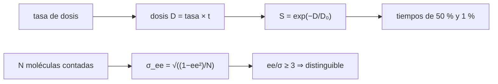

# B55-C17 — Compuestos prebióticos

<!-- nav:top -->
[🏠 Programa](../../../../README.md) · [📚 Bloque B55](../../../tronco-comun/B55-astroquimica-y-geoquimica-extraterrestre.md) · [← Anterior: B55-C16 — Procesos hidrotermales extraterrestres](../B55-C16-procesos-hidrotermales-extraterrestres/CLASE.md) · [Siguiente: B55-C18 — Contaminación de muestras →](../B55-C18-contaminacion-de-muestras/CLASE.md)
<!-- /nav -->

## 1. Ubicación, nivel y alcance

Clase 17 del bloque B55, nivel N3. Calculas la **supervivencia de un compuesto orgánico sintético** a la radiólisis durante el tiempo geológico y la **incertidumbre de un exceso enantiomérico** medido contando moléculas. Es un cálculo con parámetros **ilustrativos**; ninguna cifra sobre aminoácidos o nucleobases en meteoritos se usa porque esas fuentes no se consultaron con éxito.

## 2. Por qué esta clase existe

Que un compuesto prebiótico llegue intacto hasta nosotros depende de cuánta radiación recibió, y que un exceso entre dos formas quirales sea real depende de cuántas moléculas se contaron. La decisión central: **¿cuánto sobrevive y con qué incertidumbre puedo afirmar un exceso enantiomérico distinto de cero?**

## 3. Lo que podrás hacer al terminar

1. Calcular la dosis acumulada y la supervivencia `exp(−D/D₀)`.
2. Hallar el tiempo de supervivencia del 50 % y del 1 %.
3. Calcular el exceso enantiomérico `ee`.
4. Estimar su incertidumbre `√((1−ee²)/N)` y verificarla con Monte Carlo.
5. Decidir cuándo `ee` es distinguible de cero.
6. Reconocer los límites de la inferencia prebiótica.

La evidencia es la **ficha de supervivencia de un aminoácido** del ejercicio 12 (sección 20).

## 4. Con qué llegas y cómo comprobarlo

1. ¿Qué es una exponencial decreciente?
2. ¿Qué es una dosis de radiación?
3. ¿Qué es una molécula quiral?
4. ¿Qué es una distribución binomial?
5. ¿Qué es un valor ilustrativo?

<details>
<summary>Ver respuestas</summary>

1. Una función `e^(−x/a)` que cae por factor constante. 2. Energía absorbida por masa, en gray (Gy). 3. Una que no se superpone con su imagen especular (formas L y D). 4. La de aciertos en `N` ensayos de probabilidad `p`. 5. Un valor propuesto para el ejemplo, no medido.
</details>

Con cuatro o cinco aciertos, sigue; si no, repasa los prerrequisitos.

## 5. Un caso de contexto y casos de referencia

Un aminoácido **hipotético** con dosis característica `D₀ = 10⁶ Gy` y tasa de dosis de `10⁻³ Gy/año` (ambas ilustrativas), y una proporción verdadera de forma L de 0,55 (exceso enantiomérico 0,10). Es el **ejemplo conductor**. Todo es sintético; la clase no usa ninguna medición de meteoritos.

## 6. Vocabulario

La **radiólisis** es la destrucción química por radiación. La **dosis característica** `D₀` es la que reduce la población a `1/e`. El **exceso enantiomérico** es `ee = (L−D)/(L+D)`. La **desviación del conteo** de `ee` con `N` moléculas es `σ = √((1−ee²)/N)`. Un exceso es **distinguible de cero** si `ee/σ` supera ~3.

## 7. Modelo mental: una vela que se consume

La radiación consume el compuesto como una vela que se gasta a ritmo constante de dosis: cuanta más dosis, menos queda, y la fracción restante depende de la dosis total, no del tiempo por sí solo.



*Descripción textual:* la tasa y el tiempo dan la dosis, de la que sale la supervivencia; en paralelo, el número de moléculas contadas fija la incertidumbre del exceso enantiomérico.

Analogía: una vela que se consume con la dosis. Límite: la destrucción real depende de la matriz, la temperatura y los productos de reacción, y puede haber producción simultánea.

## 8. La explicación, paso a paso

### 8.1 Supervivencia

| `t` (años) | dosis (Gy) | `S` |
|---|---|---|
| 10⁶ | 10³ | 0,999000 |
| 10⁸ | 10⁵ | 0,904837 |
| 10⁹ | 10⁶ | 0,367879 |
| 4,5 × 10⁹ | 4,5 × 10⁶ | 0,011109 |

La mitad sobrevive a `D₀ ln 2/tasa = 6,9315 × 10⁸` años y solo el 1 % a `4,6052 × 10⁹` años (dosis `4,6052 × 10⁶ Gy`).

### 8.2 Exceso enantiomérico

Con `p_L = 0,55`, `ee = 2p − 1 = 0,100`. La desviación de `ee` según el número de moléculas contadas (2000 repeticiones Monte Carlo, semilla 1789):

| `N` | `ee` medio | `σ` MC | `σ` analítica | `ee/σ` |
|---|---|---|---|---|
| 100 | 0,0985 | 0,1011 | 0,0995 | 1,01 |
| 1000 | 0,1011 | 0,0313 | 0,0315 | 3,18 |
| 10000 | 0,0999 | 0,0099 | 0,0099 | 10,05 |

### 8.3 Lectura

Con 100 moléculas un `ee = 0,10` no se distingue de cero (1 σ). Con 1000 apenas supera 3 σ; con 10 000 es claro. El número de moléculas, no la intención, decide qué se puede afirmar.

## 9. Magnitudes, símbolos y unidades

| Símbolo | Qué es | Unidad | Valor / nota |
|---|---|---|---|
| `D₀` | dosis característica | Gy | 10⁶ (ilustrativa) |
| `Ḋ` | tasa de dosis | Gy año⁻¹ | 10⁻³ (ilustrativa) |
| `S` | fracción que sobrevive | — | 0,011109 (4,5 Gaño) |
| `ee` | exceso enantiomérico | — | 0,100 (sintético) |
| `N` | moléculas contadas | — | 100 a 10 000 |

## 10. Convenciones y referencias

Sistema de referencia: población de moléculas bajo dosis constante, destrucción de primer orden en la dosis. Parámetros sintéticos. Versiones: Python 3.12.9, biblioteca estándar, semilla 1789. Tolerancias: `σ` MC vs analítica 5 %.

## 11. De dónde sale lo que afirmamos

| ID | Fuente | Localizador | Respalda | Estado |
|---|---|---|---|---|
| — | Sin fuente externa para el resto | — | relaciones y valores que verifica el laboratorio con una segunda vía de cálculo; los parámetros de modelo se rotulan ilustrativos | No se consultó una fuente para esta parte |

Límites: no se usa ninguna fuente externa: el intento de consultar la bibliografía sobre nucleobases y aminoácidos en meteoritos no tuvo éxito y no se cita. Los parámetros son inventados.

## 12. Cómo ver la supervivencia y el conteo

| Magnitud | Valor |
|---|---|
| mitad sobrevive | 6,93 × 10⁸ años |
| 1 % sobrevive | 4,61 × 10⁹ años |
| `ee/σ` con N = 1000 | 3,18 |

Descripción larga: la exponencial cae a 0,37 cuando la dosis alcanza `D₀`; la banda de error de `ee` se estrecha con `1/√N`.

## 13. Ejemplo trabajado: cuánto sobrevive en 4,5 Gaño

**Paso 1 · Dosis.** `10⁻³ × 4,5 × 10⁹ = 4,5 × 10⁶ Gy`.

**Paso 2 · Exponente.** `D/D₀ = 4,5`.

**Paso 3 · Supervivencia.** `e⁻⁴·⁵ = 0,0111` (1,1 %).

## 14. Distintas formas de evaluar un exceso enantiomérico

**Valor puntual de ee:** simple, sin incertidumbre. **ee ± σ por conteo:** incorpora el ruido de muestreo. **Contraste de hipótesis (ee = 0):** decide si es distinguible, con un umbral declarado. Se recomienda siempre la segunda.

## 15. Práctica guiada

**Ejercicio 1 · con los pasos indicados.** Calcula la dosis tras 10⁷ años (sección 8.1).

<details><summary>Solución comentada</summary>

`10⁻³ × 10⁷ = 10⁴ Gy`.
</details>

**Ejercicio 2 · con una pista.** Calcula `S` con esa dosis (sección 8.1). *Pista:* `e^(−0,01)`.

<details><summary>Solución comentada</summary>

`0,990`.
</details>

**Ejercicio 3 · casi autónomo.** Calcula `ee` si hay 600 L y 400 D (sección 8.2). *Casi autónomo.*

<details><summary>Solución comentada</summary>

`(600−400)/1000 = 0,20`.
</details>

## 16. Práctica autónoma, transferencia e integrador

**Ejercicio 4 · autónomo.** ¿Cuántos años para `S = 0,1`? (sección 8.1).

<details><summary>Solución comentada</summary>

`D = D₀ ln 10 = 2,3026 × 10⁶ Gy → 2,3 × 10⁹ años`.
</details>

**Ejercicio 5 · autónomo.** Si la tasa de dosis se duplica, ¿qué pasa con el tiempo de la mitad? (sección 8.1).

<details><summary>Solución comentada</summary>

Se reduce a la mitad: `3,47 × 10⁸` años.
</details>

**Ejercicio 6 · autónomo.** Calcula `σ` para `ee = 0,2` y `N = 400` (sección 8.2).

<details><summary>Solución comentada</summary>

`√((1−0,04)/400) = 0,049`.
</details>

**Ejercicio 7 · autónomo.** ¿Cuántas moléculas hacen falta para `ee/σ = 3` con `ee = 0,10`? (sección 8.3).

<details><summary>Solución comentada</summary>

`N = 9(1−0,01)/0,01 = 891`.
</details>

**Ejercicio 8 · autónomo.** ¿Por qué `ee` medio con N = 100 es 0,0985 y no 0,1000? (sección 8.2).

<details><summary>Solución comentada</summary>

Por el ruido de un número finito de repeticiones y moléculas.
</details>

**Ejercicio 9 · transferencia.** Un laboratorio mide 5000 moléculas y obtiene `ee = 0,04`. ¿Es distinguible de cero? (sección 8.3).

<details><summary>Solución comentada</summary>

`σ = √(1/5000) = 0,0141`; `0,04/0,0141 = 2,8`: no concluyente.
</details>

**Ejercicio 10 · transferencia.** Un compuesto se destruye pero otro proceso lo produce. ¿Qué falla en `S`? (sección 7).

<details><summary>Solución comentada</summary>

Que asume solo destrucción; habría que añadir una fuente.
</details>

**Ejercicio 11 · transferencia.** Un autor afirma un origen abiótico a partir de un `ee` bajo. ¿Qué respondes? (sección 21).

<details><summary>Solución comentada</summary>

Que un `ee` observado es compatible con varios procesos y la inferencia requiere hipótesis, modelos y priores explícitos (C19).
</details>

**Ejercicio 12 · integrador.** Elabora tu *ficha de supervivencia de un aminoácido*: define `D₀` y la tasa, calcula la tabla de supervivencia, los tiempos de 50 % y 1 %, y la incertidumbre de `ee` para tres valores de `N`.

<details><summary>Solución modelo</summary>

Debe mostrar 8.1–8.3 con unidades, el Monte Carlo y la nota de que los parámetros son sintéticos.
</details>

## 17. Laboratorio: radiólisis y exceso enantiomérico

El script [prebioticos_radiolisis.py](prebioticos_radiolisis.py) calcula la supervivencia y simula conteos de enantiómeros, y **comprueba** que `σ` Monte Carlo coincide con la analítica a 5 % y que `ee` medio es consistente con el verdadero.

**Datos:** **sintéticos**; sin fuente externa. **Predice antes de ejecutar:** ¿cuánto sobrevive en 4,5 Gaño? (≈ 1 %.) **Ejecución del 2026-11-09 (Python 3.12.9):**

```text
Python 3.12.9 (biblioteca estandar)
A. Supervivencia S = exp(-D/D0) (tasa 1e-3 Gy/ano, D0 = 1e6 Gy; ILUSTRATIVOS)
t [anos]    dosis [Gy]    S
 1.0e+06    1.000e+03   0.999000
 1.0e+08    1.000e+05   0.904837
 1.0e+09    1.000e+06   0.367879
 4.5e+09    4.500e+06   0.011109
B. Tiempo para que sobreviva la mitad = D0 ln2 / tasa = 6.9315e+08 anos
   dosis para S = 1 % : 4.6052e+06 Gy ; tiempo = 4.6052e+09 anos
C. Exceso enantiomerico verdadero ee = (L-D)/(L+D) = 2p - 1 = 0.100 (p_L = 0.55 SINTETICO)
N molec.   ee medio MC   sigma MC     sigma analitica   ee/sigma
     100      0.0985      0.1011         0.0995        1.01
    1000      0.1011      0.0313         0.0315        3.18
   10000      0.0999      0.0099         0.0099       10.05
D. Con ee = 0.10 y N = 100 el cociente ee/sigma es 1.01 (no distinguible de 0 a 3 sigma)
Pruebas superadas.
```

```bash
python programa/clases/B55/B55-C17-compuestos-prebioticos/prebioticos_radiolisis.py
```

**Límites:** primer orden; sin producción; conteo independiente.

## 18. Errores frecuentes y cómo corregirlos

**Confundir tiempo con dosis.** La dosis es tasa × tiempo (8.1).

**Dar `ee` sin incertidumbre.** Se calcula en 8.2.

**Interpretar un `ee` pequeño como evidencia de un proceso.** Se discute en 8.3.

**Presentar el aminoácido hipotético como real.** Se aclara en la sección 5.

## 19. Cómo sabrás que vas bien

Tras la sección 8: ¿qué `S` esperabas y cuál obtuviste? Si dudas, repasa el ejemplo 13. Tras el laboratorio: ¿qué comprueba? (ver la sección 17).

## 20. Qué entregas y cómo se evalúa

El producto es tu **ficha de supervivencia de un aminoácido** (ejercicio 12).

| Criterio | Inicial | En desarrollo | Logrado | Destacado |
|---|---|---|---|---|
| Conceptos | Los confunde | Parciales | Distingue supervivencia, dosis y exceso | Explica los límites |
| Cálculo | Sin unidades | Con errores | Tablas completas con unidades | Calcula casos nuevos |
| Numérico | Sin comprobar | Un caso | Contraste con el caso analítico | Interpreta las diferencias |
| Fuentes | Sin fuente | Sin fecha | Fuentes con fecha y estado | Declara lo sintético e ilustrativo |
| Límites | No los nombra | Uno | Tres | Discute qué falta del modelo |

**Condiciones críticas (no se compensan con promedio):** rotular los parámetros como sintéticos; no afirmar la presencia de un compuesto en un cuerpo real; no citar fuentes no consultadas.

## 21. Ética, seguridad y límites

Los compuestos prebióticos se discuten con muestras, contaminación controlada (C18) y varios modelos; esta clase no concluye ningún origen. Clase educativa: los modelos son simplificados y ningún resultado de esta clase es una observación. Accesibilidad: tablas equivalentes a las gráficas, fórmulas en texto, ejercicios sin conexión.

## 22. Para cerrar y seguir

Con estos parámetros sobrevive el 1,1 % tras 4,5 Gaño y un `ee = 0,10` exige ~900 moléculas para distinguirse de cero a 3σ. Queda una pregunta: ¿cómo evitar que la contaminación de la muestra falsee el resultado?

**Glosario español–inglés.** radiólisis · *radiolysis*; dosis · *dose*; exceso enantiomérico · *enantiomeric excess*; quiral · *chiral*; prebiótico · *prebiotic*.

**Continuidad.** [B55-C18](../B55-C18-contaminacion-de-muestras/CLASE.md) estudia la contaminación de muestras, el blanco y el límite de detección.

**Referencias:** ver sección 11.

<!-- nav:bottom -->
---

[← Anterior: B55-C16 — Procesos hidrotermales extraterrestres](../B55-C16-procesos-hidrotermales-extraterrestres/CLASE.md) · [📚 Bloque B55](../../../tronco-comun/B55-astroquimica-y-geoquimica-extraterrestre.md) · [Siguiente: B55-C18 — Contaminación de muestras →](../B55-C18-contaminacion-de-muestras/CLASE.md)
<!-- /nav -->
