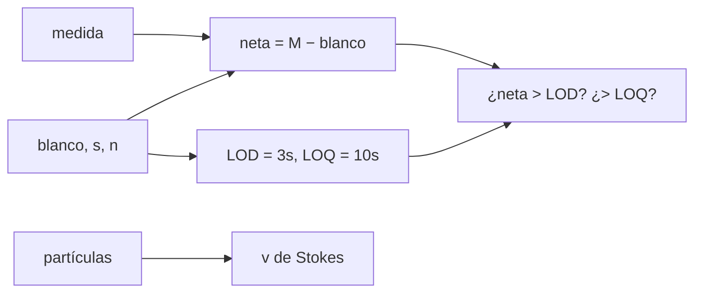

# B55-C18 — Contaminación de muestras

<!-- nav:top -->
[🏠 Programa](../../../../README.md) · [📚 Bloque B55](../../../tronco-comun/B55-astroquimica-y-geoquimica-extraterrestre.md) · [← Anterior: B55-C17 — Compuestos prebióticos](../B55-C17-compuestos-prebioticos/CLASE.md) · [Siguiente: B55-C19 — Interpretación de firmas químicas →](../B55-C19-interpretacion-de-firmas-quimicas/CLASE.md)
<!-- /nav -->

## 1. Ubicación, nivel y alcance

Clase 18 del bloque B55, nivel N3. Aprendes a **corregir por el blanco** de procedimiento, a calcular el **límite de detección** (LOD) y de cuantificación (LOQ) y a estimar cuánto tarda en **sedimentar** una partícula contaminante por la ley de Stokes. Los datos son **sintéticos**. La política de protección planetaria es contexto normativo; no se tratan sus categorías. Usas [B55-C17](../B55-C17-compuestos-prebioticos/CLASE.md) como motivación.

## 2. Por qué esta clase existe

En muestras extraterrestres la cantidad buscada puede ser del orden de la contaminación que entra al manipularlas. La decisión central: **¿la señal neta supera el límite de detección y con qué incertidumbre, una vez restado el blanco?**

## 3. Lo que podrás hacer al terminar

1. Calcular la señal neta y su incertidumbre con propagación.
2. Calcular LOD y LOQ a partir de la desviación del blanco.
3. Verificar la propagación con Monte Carlo.
4. Ver cómo la incertidumbre del blanco domina cuando la señal es pequeña.
5. Estimar la velocidad de sedimentación de partículas con Stokes.
6. Situar la política del COSPAR como marco de contexto.

La evidencia es la **informe de blanco y límite de detección** del ejercicio 12 (sección 20).

## 4. Con qué llegas y cómo comprobarlo

1. ¿Qué es un blanco de procedimiento?
2. ¿Qué es una desviación estándar?
3. ¿Qué es una propagación de incertidumbre?
4. ¿Qué es la ley de Stokes?
5. ¿Qué es un valor sintético?

<details>
<summary>Ver respuestas</summary>

1. Una muestra sin analito que pasa por todo el procedimiento. 2. Medida de la dispersión de réplicas. 3. Cómo se combinan incertidumbres en un cálculo. 4. La velocidad de una esfera pequeña en un fluido viscoso. 5. Un dato inventado para ejercitar el método.
</details>

Con cuatro o cinco aciertos, sigue; si no, repasa los prerrequisitos.

## 5. Un caso de contexto y casos de referencia

Una muestra **sintética** que mide 5,0 ± 0,4 ng, con un blanco de 6 réplicas de media 2,0 ng y desviación 0,5 ng. Es el **ejemplo conductor**. Los valores son inventados. La página institucional del COSPAR (S1) informa que su política de protección planetaria 2026 (aprobada el 2025-11-07) es un estándar voluntario que busca evitar la contaminación orgánica y biológica de los cuerpos visitados y proteger la Tierra del material devuelto, con requisitos que dependen del cuerpo y de la misión; no se leyeron sus categorías.

## 6. Vocabulario

La **señal neta** es `medida − media del blanco`. La **incertidumbre neta** es `√(σ_med² + s²/n)`. El **LOD** es `3 s` y el **LOQ** `10 s`, con `s` la desviación del blanco. La **velocidad de Stokes** es `v = 2r²(ρ_p − ρ_a)g/(9η)`, válida para Reynolds ≪ 1. La **contaminación cruzada** es la transferencia desde otra muestra o del ambiente.

## 7. Modelo mental: una linterna en una habitación iluminada

El blanco es la luz de fondo de la habitación; la señal es una linterna. Solo se la ve si supera claramente las fluctuaciones del fondo, y cuanto más variable el fondo, más fuerte debe ser la linterna.



*Descripción textual:* la medida menos el blanco da la señal neta, que se compara con los límites calculados de la variabilidad del blanco; aparte, la ley de Stokes estima la caída de partículas del ambiente.

Analogía: una linterna en una habitación iluminada. Límite: un blanco real puede variar con el tiempo y no ser aditivo.

## 8. La explicación, paso a paso

### 8.1 Señal neta

`neta = 5,0 − 2,0 = 3,000 ng`; `σ_neta = √(0,4² + 0,5²/6) = 0,4491 ng`. `LOD = 3 × 0,5 = 1,50 ng` y `LOQ = 5,00 ng`. La neta es el doble del LOD y el 60 % del LOQ: **detectable pero no cuantificable con confianza**.

### 8.2 Verificación

Monte Carlo (100 000 réplicas, semilla 2468): neta 3,0007 ng, desviación 0,4463 ng frente a 0,4491 ng analítica (0,6 %).

### 8.3 El blanco manda

| `s` del blanco (ng) | `σ_neta` (ng) | LOD (ng) | neta/LOD |
|---|---|---|---|
| 0,10 | 0,4021 | 0,30 | 10,0 |
| 0,25 | 0,4128 | 0,75 | 4,0 |
| 0,50 | 0,4491 | 1,50 | 2,0 |
| 1,00 | 0,5715 | 3,00 | 1,0 |

Con `s = 1 ng` la neta apenas iguala el LOD. Reducir la variabilidad del blanco importa tanto como medir mejor.

### 8.4 Partículas en el aire

| radio (µm) | `v` (mm/s) | tiempo para caer 1 m (h) | Reynolds |
|---|---|---|---|
| 1 | 0,2420 | 1,148 | 3,2 × 10⁻⁵ |
| 2 | 0,9680 | 0,287 | 2,6 × 10⁻⁴ |
| 5 | 6,0499 | 0,046 | 4,0 × 10⁻³ |
| 10 | 24,1994 | 0,011 | 3,2 × 10⁻² |

Las partículas de 1 µm tardan más de una hora en caer 1 m; las de 10 µm, menos de un minuto. La velocidad crece con `r²` (factor 100 de 1 a 10 µm).

## 9. Magnitudes, símbolos y unidades

| Símbolo | Qué es | Unidad | Valor / nota |
|---|---|---|---|
| `b, s, n` | media, desviación y réplicas del blanco | ng; ng; — | 2,0; 0,5; 6 |
| `σ_neta` | incertidumbre neta | ng | 0,4491 |
| `LOD, LOQ` | límites de detección y cuantificación | ng | 1,50; 5,00 |
| `v` | velocidad de Stokes | mm s⁻¹ | 0,2420 (1 µm) |
| `η` | viscosidad del aire | Pa s | 1,8 × 10⁻⁵ (ilustrativa) |

## 10. Convenciones y referencias

Sistema de referencia: un laboratorio con aire quieto a 1 atm aproximado. Blanco aditivo y estable, partículas esféricas de 2000 kg m⁻³. Datos sintéticos. `g = 9,80665 m s⁻²` (valor convencional). Versiones: Python 3.12.9, biblioteca estándar, semilla 2468. Tolerancias: propagación 3 %; Reynolds < 0,1.

## 11. De dónde sale lo que afirmamos

| ID | Fuente | Localizador | Respalda | Estado |
|---|---|---|---|---|
| S1 | COSPAR, página del Panel on Planetary Protection (política 2026, SRT 224, aprobada el 2025-11-07) | https://cosparhq.cnes.fr/scientific-structure/panel-on-planetary-protection-ppp/ | contexto normativo: existencia y propósito de la política de protección planetaria 2026 | Consultada el 2026-11-09; solo la página institucional; no se leyó el texto completo de las categorías |
| — | Sin fuente externa para el resto | — | relaciones y valores que verifica el laboratorio con una segunda vía de cálculo; los parámetros de modelo se rotulan ilustrativos | No se consultó una fuente para esta parte |

Límites: solo se leyó la página institucional; no se leyó el texto de la política ni sus categorías; los datos de blanco son sintéticos.

## 12. Cómo ver la señal y los límites

| Cantidad | Valor (ng) |
|---|---|
| Neta | 3,00 |
| LOD | 1,50 |
| LOQ | 5,00 |

Descripción larga: una recta con las marcas LOD en 1,5, neta en 3,0 y LOQ en 5,0; la neta cae entre el LOD y el LOQ.

## 13. Ejemplo trabajado: la neta y sus límites

**Paso 1 · Neta.** `5,0 − 2,0 = 3,0 ng`.

**Paso 2 · Incertidumbre.** `√(0,16 + 0,25/6) = 0,449`.

**Paso 3 · LOD.** `3 × 0,5 = 1,5`.

**Paso 4 · Conclusión.** `3,0 > 1,5` pero `3,0 < 5,0`: detectada, no cuantificada.

## 14. Distintas formas de tratar un blanco

**Restar la media:** simple y estándar. **Restar con incertidumbre propagada:** necesaria para informar. **Ignorarlo:** sesga todo al alza. Siempre se propaga la incertidumbre y se informa el LOD.

## 15. Práctica guiada

**Ejercicio 1 · con los pasos indicados.** Calcula la neta si la medida es 4,0 ng y el blanco 2,0 (sección 8.1).

<details><summary>Solución comentada</summary>

`2,0 ng`.
</details>

**Ejercicio 2 · con una pista.** Calcula el LOD si `s = 0,3 ng` (sección 8.1). *Pista:* `3s`.

<details><summary>Solución comentada</summary>

`0,9 ng`.
</details>

**Ejercicio 3 · casi autónomo.** ¿Está la neta de 2,0 ng por encima del LOD de 0,9? (sección 8.1). *Casi autónomo.*

<details><summary>Solución comentada</summary>

Sí (2,2 veces), pero por debajo del LOQ (3,0 ng).
</details>

## 16. Práctica autónoma, transferencia e integrador

**Ejercicio 4 · autónomo.** Calcula `σ_neta` con `σ_med = 0,2` y `s = 0,5`, `n = 6` (sección 8.1).

<details><summary>Solución comentada</summary>

`√(0,04 + 0,0417) = 0,286`.
</details>

**Ejercicio 5 · autónomo.** ¿Cuántas réplicas del blanco reducen su aporte a la mitad? (sección 8.1).

<details><summary>Solución comentada</summary>

Cuatro veces más: `s/√n` baja a la mitad con `n = 24`.
</details>

**Ejercicio 6 · autónomo.** Estima el tiempo de caída de 1 m para 5 µm (sección 8.4).

<details><summary>Solución comentada</summary>

0,046 h = 2,8 min.
</details>

**Ejercicio 7 · autónomo.** Si la viscosidad aumentara un 10 %, ¿qué pasa con `v`? (sección 8.4).

<details><summary>Solución comentada</summary>

Disminuye en 9 %: `1/1,1`.
</details>

**Ejercicio 8 · autónomo.** ¿Qué radio cae 1 m en una hora? (sección 8.4).

<details><summary>Solución comentada</summary>

Cerca de 1,05 µm: `v ∝ r²`, 0,2420 mm/s → 0,278 mm/s necesita `r = 1,07 µm`.
</details>

**Ejercicio 9 · transferencia.** Una muestra neta de 1,2 ng con LOD de 1,5. ¿Qué informas? (sección 8.1).

<details><summary>Solución comentada</summary>

«no detectada, < 1,5 ng», sin dar el valor como medición.
</details>

**Ejercicio 10 · transferencia.** Los blancos empeoran a lo largo del día. ¿Qué haces? (sección 7).

<details><summary>Solución comentada</summary>

Reconoces que el supuesto de blanco estable falla; usas blancos intercalados y no una media global.
</details>

**Ejercicio 11 · transferencia.** ¿Qué relación tiene esto con la protección planetaria? (sección 21).

<details><summary>Solución comentada</summary>

Que la política del COSPAR busca evitar contaminación en ambos sentidos; esta clase solo ilustra la parte estadística de detectar una contaminación pequeña.
</details>

**Ejercicio 12 · integrador.** Elabora tu *informe de blanco y límite de detección*: neta, incertidumbre propagada, LOD y LOQ, tabla de sensibilidad al blanco y estimación de sedimentación de partículas.

<details><summary>Solución modelo</summary>

Debe mostrar 8.1–8.4 con unidades, el Monte Carlo y la nota de que los datos son sintéticos.
</details>

## 17. Laboratorio: blanco, límite de detección y Stokes

El script [contaminacion_blanco.py](contaminacion_blanco.py) calcula la neta, el LOD/LOQ, la propagación con Monte Carlo y la sedimentación de Stokes, y **comprueba** la incertidumbre (3 %) y que Reynolds < 0,1 en todos los radios.

**Datos:** **sintéticos**; `g` convencional. **Predice antes de ejecutar:** ¿está la neta por encima del LOQ? (No.) **Ejecución del 2026-11-09 (Python 3.12.9):**

```text
Python 3.12.9 (biblioteca estandar)
A. Muestra SINTETICA: blanco de 6 replicas (media 2.0 ng, desviacion 0.5 ng) ; medida 5.0 +- 0.4 ng
B. Senal neta = 3.000 ng ; incertidumbre = 0.4491 ng ; LOD = 3 s = 1.50 ng ; LOQ = 10 s = 5.00 ng
   Neta/LOD = 2.00 ; Neta/LOQ = 0.60  => por encima del LOD y por debajo del LOQ
C. Monte Carlo (100000, semilla 2468): neta = 3.0007 ng ; desviacion = 0.4463 ng ; analitica 0.4491 ng
D. Efecto de la incertidumbre del blanco sobre la neta (la muestra no cambia)
s_blanco [ng]   sigma_neta [ng]   LOD [ng]   neta/LOD
        0.10           0.4021       0.30      10.00
        0.25           0.4128       0.75       4.00
        0.50           0.4491       1.50       2.00
        1.00           0.5715       3.00       1.00
E. Sedimentacion por Stokes en aire (rho_p = 2000 kg/m3, eta = 1.8e-5 Pa s)
radio [um]   v [mm/s]   tiempo para caer 1 m [h]   Reynolds
     1.0      0.2420            1.148    3.23e-05
     2.0      0.9680            0.287    2.58e-04
     5.0      6.0499            0.046    4.03e-03
    10.0     24.1994            0.011    3.23e-02
Pruebas superadas.
```

```bash
python programa/clases/B55/B55-C18-contaminacion-de-muestras/contaminacion_blanco.py
```

**Límites:** blanco aditivo y estable; partículas esféricas en régimen de Stokes.

## 18. Errores frecuentes y cómo corregirlos

**Restar el blanco sin propagar su incertidumbre.** Se hace en 8.1.

**Informar un valor bajo el LOD como medición.** Se informa «< LOD» (trans. 1).

**Usar Stokes con partículas grandes.** El Reynolds lo limita (8.4).

**Presentar los datos de blanco como reales.** Se aclara en la sección 5.

## 19. Cómo sabrás que vas bien

Tras la sección 8: ¿qué neta y qué LOD esperabas? Si dudas, repasa el ejemplo 13. Tras el laboratorio: ¿qué comprueba? (ver la sección 17).

## 20. Qué entregas y cómo se evalúa

El producto es tu **informe de blanco y límite de detección** (ejercicio 12).

| Criterio | Inicial | En desarrollo | Logrado | Destacado |
|---|---|---|---|---|
| Conceptos | Los confunde | Parciales | Distingue neta, LOD y LOQ | Explica los límites |
| Cálculo | Sin unidades | Con errores | Tablas completas con unidades | Calcula casos nuevos |
| Numérico | Sin comprobar | Un caso | Contraste con el caso analítico | Interpreta las diferencias |
| Fuentes | Sin fuente | Sin fecha | Fuentes con fecha y estado | Declara lo sintético e ilustrativo |
| Límites | No los nombra | Uno | Tres | Discute qué falta del modelo |

**Condiciones críticas (no se compensan con promedio):** rotular los datos como sintéticos; no atribuir al COSPAR requisitos no leídos; citar solo lo consultado.

## 21. Ética, seguridad y límites

Una detección debajo del LOD no se informa como valor; la integridad de una muestra extraterrestre exige controles de contaminación documentados. Clase educativa: los modelos son simplificados y ningún resultado de esta clase es una observación. Accesibilidad: tablas equivalentes a las gráficas, fórmulas en texto, ejercicios sin conexión.

## 22. Para cerrar y seguir

La neta sintética de 3,0 ± 0,45 ng supera el LOD (1,5) pero no el LOQ (5,0). Queda una pregunta: ¿cómo se razona con probabilidades sobre lo que significa una firma química?

**Glosario español–inglés.** blanco · *blank*; límite de detección · *limit of detection*; contaminación · *contamination*; propagación de incertidumbre · *uncertainty propagation*; ley de Stokes · *Stokes' law*.

**Continuidad.** [B55-C19](../B55-C19-interpretacion-de-firmas-quimicas/CLASE.md) estudia la interpretación de firmas químicas con razonamiento bayesiano.

**Referencias:** ver sección 11.

<!-- nav:bottom -->
---

[← Anterior: B55-C17 — Compuestos prebióticos](../B55-C17-compuestos-prebioticos/CLASE.md) · [📚 Bloque B55](../../../tronco-comun/B55-astroquimica-y-geoquimica-extraterrestre.md) · [Siguiente: B55-C19 — Interpretación de firmas químicas →](../B55-C19-interpretacion-de-firmas-quimicas/CLASE.md)
<!-- /nav -->
