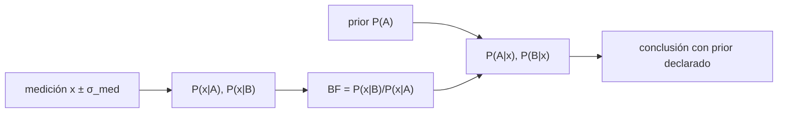

# B55-C19 — Interpretación de firmas químicas

<!-- nav:top -->
[🏠 Programa](../../../../README.md) · [📚 Bloque B55](../../../tronco-comun/B55-astroquimica-y-geoquimica-extraterrestre.md) · [← Anterior: B55-C18 — Contaminación de muestras](../B55-C18-contaminacion-de-muestras/CLASE.md) · [Siguiente: B55-C20 — Modelo simplificado de red astroquímica →](../B55-C20-modelo-simplificado-de-red-astroquimica/CLASE.md)
<!-- /nav -->

## 1. Ubicación, nivel y alcance

Clase 19 del bloque B55, nivel N3. Aprendes a **interpretar una firma química con probabilidades**: planteas dos procesos hipotéticos, calculas verosimilitudes, el factor de Bayes y el posterior, y ves cuánto depende la conclusión del prior. Todo es **sintético**: los procesos A y B no representan ningún proceso real y la clase no infiere vida ni origen alguno. Usas [B55-C18](../B55-C18-contaminacion-de-muestras/CLASE.md) para la cautela previa sobre los datos.

## 2. Por qué esta clase existe

Una medición rara vez prueba una hipótesis: la hace más o menos probable frente a otra. Quien interpreta una firma debe declarar qué alternativas considera y qué prior asume. La decisión central: **¿qué dice esta medición, qué dice el prior y qué conclusión es honesta?**

## 3. Lo que podrás hacer al terminar

1. Escribir el teorema de Bayes para dos hipótesis.
2. Calcular verosimilitudes normales con la incertidumbre de medición.
3. Calcular el factor de Bayes y el posterior.
4. Verificar la verosimilitud contra una integración numérica.
5. Mostrar la sensibilidad del posterior al prior y a la medición.
6. Redactar una conclusión que incluya el prior.

La evidencia es la **ficha de interpretación con prior explícito** del ejercicio 12 (sección 20).

## 4. Con qué llegas y cómo comprobarlo

1. ¿Qué es una probabilidad condicional?
2. ¿Qué es una distribución normal?
3. ¿Qué es un prior?
4. ¿Qué es un posterior?
5. ¿Qué es un valor sintético?

<details>
<summary>Ver respuestas</summary>

1. `P(A|B)`: probabilidad de A dado B. 2. La campana de media `μ` y desviación `σ`. 3. La probabilidad asignada antes de la medición. 4. La probabilidad actualizada tras la medición. 5. Un dato inventado para ejercitar el método.
</details>

Con cuatro o cinco aciertos, sigue; si no, repasa los prerrequisitos.

## 5. Un caso de contexto y casos de referencia

Un indicador `x` (una razón entre dos familias de compuestos) distribuido como normal con media 1,0 y σ 0,30 bajo el proceso hipotético A, y media 1,8 y σ 0,30 bajo el B; medición `x = 1,5 ± 0,20`. Es el **ejemplo conductor**. Todo es sintético; esta es una clase de método: los procesos A y B no son procesos reales.

## 6. Vocabulario

El **teorema de Bayes** es `P(H|x) = P(x|H)P(H)/ΣP(x|H')P(H')`. La **verosimilitud** `P(x|H)` es la densidad de la medición bajo `H`. El **factor de Bayes** `BF = P(x|B)/P(x|A)`. Las **hipótesis exhaustivas y excluyentes** agotan las posibilidades. El **prior** `P(H)` es la creencia previa. La varianza total es `σ_H² + σ_med²`.

## 7. Modelo mental: una balanza con prior

La medición inclina la balanza hacia una hipótesis con el peso del factor de Bayes; el prior es la posición inicial de la balanza. Con evidencia débil manda el prior; con evidencia fuerte, la medición.



*Descripción textual:* la medición produce verosimilitudes y un factor de Bayes que se combinan con el prior en el posterior; la conclusión debe declarar ambos.

Analogía: una balanza cuya posición inicial es el prior. Límite: el modelo supone que A y B agotan las posibilidades y que las verosimilitudes son correctas; si falta una hipótesis, el posterior engaña.

## 8. La explicación, paso a paso

### 8.1 Verosimilitudes

`P(x|A) = 0,423007` y `P(x|B) = 0,782719` (varianza total `0,30² + 0,20² = 0,13`); la integración numérica sobre la media verdadera coincide a 1e-6. `BF = 1,8504`: la medición favorece levemente a B.

### 8.2 Posterior y prior

| prior `P(A)` | `P(A|x)` | `P(B|x)` |
|---|---|---|
| 0,10 | 0,0566 | 0,9434 |
| 0,30 | 0,1881 | 0,8119 |
| 0,50 | 0,3508 | 0,6492 |
| 0,70 | 0,5577 | 0,4423 |
| 0,90 | 0,8295 | 0,1705 |
| 0,99 | 0,9817 | 0,0183 |

Con un prior de 0,99 a favor de A, la medición no basta para cambiar de lado: un `BF` de 1,85 es evidencia **débil**.

### 8.3 Efecto de la medición (prior 50/50)

| `x` | `P(A|x)` | `P(B|x)` |
|---|---|---|
| 0,8 | 0,9757 | 0,0243 |
| 1,2 | 0,7740 | 0,2260 |
| 1,4 | 0,5000 | 0,5000 |
| 1,5 | 0,3508 | 0,6492 |
| 1,6 | 0,2260 | 0,7740 |
| 1,9 | 0,0441 | 0,9559 |
| 2,3 | 0,0039 | 0,9961 |

El punto de indiferencia es `x = 1,4` (el punto medio de las medias).

### 8.4 Cuánto prior hace falta

Para alcanzar `P(B|x) ≥ 0,99` con esta medición se necesita un prior `P(B) ≥ 0,9817` (es decir `P(A) ≤ 0,0183`): la conclusión depende del prior, no de la medición sola.

## 9. Magnitudes, símbolos y unidades

| Símbolo | Qué es | Unidad | Valor / nota |
|---|---|---|---|
| `μ_A, μ_B` | medias del indicador por hipótesis | — | 1,0; 1,8 (sintéticas) |
| `σ` | desviaciones por hipótesis y de la medición | — | 0,30; 0,20 |
| `BF` | factor de Bayes B/A | — | 1,8504 |
| `P(H)` | prior | — | 0,5 (ejemplo) |
| `P(H|x)` | posterior | — | 0,3508 (A) |

## 10. Convenciones y referencias

Sistema de referencia: un único indicador escalar con distribuciones normales. Hipótesis A y B hipotéticas, exhaustivas y excluyentes. Datos sintéticos. Versiones: Python 3.12.9, biblioteca estándar. Tolerancias: verosimilitud cerrada vs numérica 1e-6; suma de posteriores 1e-12.

## 11. De dónde sale lo que afirmamos

| ID | Fuente | Localizador | Respalda | Estado |
|---|---|---|---|---|
| — | Sin fuente externa para el resto | — | relaciones y valores que verifica el laboratorio con una segunda vía de cálculo; los parámetros de modelo se rotulan ilustrativos | No se consultó una fuente para esta parte |

Límites: no se usa ninguna fuente externa: el método es el teorema de Bayes y se verifica con integración numérica propia.

## 12. Cómo ver el posterior frente al prior

| prior `P(A)` | `P(B|x)` |
|---|---|
| 0,1 | 0,943 |
| 0,5 | 0,649 |
| 0,9 | 0,171 |
| 0,99 | 0,018 |

Descripción larga: una curva decreciente en forma de S de `P(B|x)` frente al prior de A.

## 13. Ejemplo trabajado: posterior con prior 50/50

**Paso 1 · Verosimilitudes.** `P(x|A) = 0,4230`, `P(x|B) = 0,7827`.

**Paso 2 · Numeradores.** `0,5·0,4230 = 0,2115` y `0,5·0,7827 = 0,3914`.

**Paso 3 · Normalización.** `0,2115 + 0,3914 = 0,6029`.

**Paso 4 · Posterior.** `P(A|x) = 0,3508` y `P(B|x) = 0,6492`.

## 14. Distintas formas de interpretar una medición

**Umbral de valor:** simple y engañoso. **Contraste de hipótesis (p):** mide cuán raro es el dato bajo una hipótesis. **Bayesiano con prior declarado:** compara hipótesis alternativas y expone el supuesto. Aquí se usa el tercero.

## 15. Práctica guiada

**Ejercicio 1 · con los pasos indicados.** Calcula `BF` con las verosimilitudes (sección 8.1).

<details><summary>Solución comentada</summary>

`0,782719/0,423007 = 1,8504`.
</details>

**Ejercicio 2 · con una pista.** Calcula el posterior de A con prior 0,3 (sección 8.2). *Pista:* `0,3·0,423/(0,3·0,423+0,7·0,7827)`.

<details><summary>Solución comentada</summary>

`0,1269/(0,1269+0,5479) = 0,188`.
</details>

**Ejercicio 3 · casi autónomo.** Compara con la tabla (sección 8.2). *Casi autónomo.*

<details><summary>Solución comentada</summary>

La tabla da 0,1881; coincide.
</details>

## 16. Práctica autónoma, transferencia e integrador

**Ejercicio 4 · autónomo.** ¿Qué `x` deja igual de probables a A y B con prior 50/50? (sección 8.3).

<details><summary>Solución comentada</summary>

`x = 1,4`.
</details>

**Ejercicio 5 · autónomo.** Con prior 50/50 y `x = 1,9`, ¿qué hipótesis ganaría? (sección 8.3).

<details><summary>Solución comentada</summary>

B, con 0,956.
</details>

**Ejercicio 6 · autónomo.** ¿Cuánto vale `BF` si las dos verosimilitudes fueran iguales? (sección 8.1).

<details><summary>Solución comentada</summary>

1: la medición no discrimina.
</details>

**Ejercicio 7 · autónomo.** ¿Qué prior de A hace igual de probables a A y B tras la medición? (sección 8.2).

<details><summary>Solución comentada</summary>

`P(A)/P(B) = BF = 1,85 → P(A) = 0,649`.
</details>

**Ejercicio 8 · autónomo.** ¿Por qué el posterior depende de la incertidumbre de la medición? (sección 8.1).

<details><summary>Solución comentada</summary>

Porque la varianza total suma `σ_med²`; una medición más precisa discrimina más.
</details>

**Ejercicio 9 · transferencia.** Un informe dice «80 % de probabilidad de B». ¿Qué le exiges? (sección 8.4).

<details><summary>Solución comentada</summary>

El prior, el modelo de verosimilitud y la lista de hipótesis consideradas.
</details>

**Ejercicio 10 · transferencia.** Aparece una tercera hipótesis C no considerada. ¿Qué pasa con el posterior? (sección 7).

<details><summary>Solución comentada</summary>

El resultado condicionado a A y B deja de ser válido; hay que rehacerlo.
</details>

**Ejercicio 11 · transferencia.** ¿Puede una firma química probar vida? (sección 21).

<details><summary>Solución comentada</summary>

No sola: obliga a descartar procesos abióticos, contaminación y a exigir evidencia independiente.
</details>

**Ejercicio 12 · integrador.** Elabora tu *ficha de interpretación con prior explícito*: define A y B, calcula verosimilitudes, `BF`, la tabla de posterior frente al prior y una conclusión que declare el prior.

<details><summary>Solución modelo</summary>

Debe mostrar 8.1–8.4 con la verificación numérica y la nota de que A y B son hipotéticos y sintéticos.
</details>

## 17. Laboratorio: posterior bayesiano de una firma sintética

El script [firmas_bayes.py](firmas_bayes.py) calcula verosimilitudes cerradas y numéricas, el factor de Bayes y la tabla de posteriores, y **comprueba** la verosimilitud contra la integración numérica (1e-6) y el punto de indiferencia (1e-9).

**Datos:** **sintéticos**. **Predice antes de ejecutar:** ¿qué hipótesis favorece la medición? (B, débilmente.) **Ejecución del 2026-11-09 (Python 3.12.9):**

```text
Python 3.12.9 (biblioteca estandar)
A. Dos procesos hipoteticos SINTETICOS: A (mu 1.0, sigma 0.30) y B (mu 1.8, sigma 0.30); medicion x = 1.5 +- 0.20
B. Verosimilitud cerrada: P(x|A) = 0.423007 ; P(x|B) = 0.782719 ; numerica: 0.423007 ; 0.782719
   Factor de Bayes BF = P(x|B)/P(x|A) = 1.8504
C. Posterior segun el prior P(A)
P(A) prior   P(A|x)    P(B|x)
     0.10    0.0566    0.9434
     0.30    0.1881    0.8119
     0.50    0.3508    0.6492
     0.70    0.5577    0.4423
     0.90    0.8295    0.1705
     0.99    0.9817    0.0183
D. Efecto de la medicion (prior 50/50)
x       P(A|x)    P(B|x)
 0.8    0.9757    0.0243
 1.2    0.7740    0.2260
 1.4    0.5000    0.5000
 1.5    0.3508    0.6492
 1.6    0.2260    0.7740
 1.9    0.0441    0.9559
 2.3    0.0039    0.9961
E. Punto de indiferencia (prior 50/50): x = 1.4000 (punto medio de las medias = 1.4000)
F. Prior P(B) minimo para que P(B|x) >= 0.99: 0.9817 (es decir P(A) <= 0.0183)
Pruebas superadas.
```

```bash
python programa/clases/B55/B55-C19-interpretacion-de-firmas-quimicas/firmas_bayes.py
```

**Límites:** dos hipótesis, normales, indicador escalar.

## 18. Errores frecuentes y cómo corregirlos

**Presentar el posterior sin el prior.** Ver 8.4.

**Confundir `P(x|H)` con `P(H|x)`.** Se definen en la sección 6.

**Olvidar hipótesis alternativas.** Ver trans. 2.

**Concluir un origen real de un ejemplo sintético.** Se aclara en la sección 5.

## 19. Cómo sabrás que vas bien

Tras la sección 8: ¿qué posterior esperabas y cuál obtuviste? Si dudas, repasa el ejemplo 13. Tras el laboratorio: ¿qué comprueba? (ver la sección 17).

## 20. Qué entregas y cómo se evalúa

El producto es tu **ficha de interpretación con prior explícito** (ejercicio 12).

| Criterio | Inicial | En desarrollo | Logrado | Destacado |
|---|---|---|---|---|
| Conceptos | Los confunde | Parciales | Distingue verosimilitud, prior y posterior | Explica los límites |
| Cálculo | Sin unidades | Con errores | Tablas completas con unidades | Calcula casos nuevos |
| Numérico | Sin comprobar | Un caso | Contraste con el caso analítico | Interpreta las diferencias |
| Fuentes | Sin fuente | Sin fecha | Fuentes con fecha y estado | Declara lo sintético e ilustrativo |
| Límites | No los nombra | Uno | Tres | Discute qué falta del modelo |

**Condiciones críticas (no se compensan con promedio):** rotular A y B como hipótesis sintéticas; no inferir vida ni origen real; declarar el prior en toda conclusión.

## 21. Ética, seguridad y límites

Afirmar vida o ausencia de ella a partir de una firma química es una conclusión extraordinaria; exige evidencia independiente, controles de contaminación y revisión externa. Clase educativa: los modelos son simplificados y ningún resultado de esta clase es una observación. Accesibilidad: tablas equivalentes a las gráficas, fórmulas en texto, ejercicios sin conexión.

## 22. Para cerrar y seguir

La medición sintética da `BF = 1,85`: con prior 50/50, `P(B|x) = 0,65`; para llegar a 0,99 haría falta un prior de 0,98 en B. Queda una pregunta: ¿cómo se integra todo en un modelo de red de reacciones?

**Glosario español–inglés.** teorema de Bayes · *Bayes' theorem*; verosimilitud · *likelihood*; factor de Bayes · *Bayes factor*; prior · *prior*; posterior · *posterior*.

**Continuidad.** [B55-C20](../B55-C20-modelo-simplificado-de-red-astroquimica/CLASE.md) integra el bloque en una red astroquímica mínima verificada.

**Referencias:** ver sección 11.

<!-- nav:bottom -->
---

[← Anterior: B55-C18 — Contaminación de muestras](../B55-C18-contaminacion-de-muestras/CLASE.md) · [📚 Bloque B55](../../../tronco-comun/B55-astroquimica-y-geoquimica-extraterrestre.md) · [Siguiente: B55-C20 — Modelo simplificado de red astroquímica →](../B55-C20-modelo-simplificado-de-red-astroquimica/CLASE.md)
<!-- /nav -->
