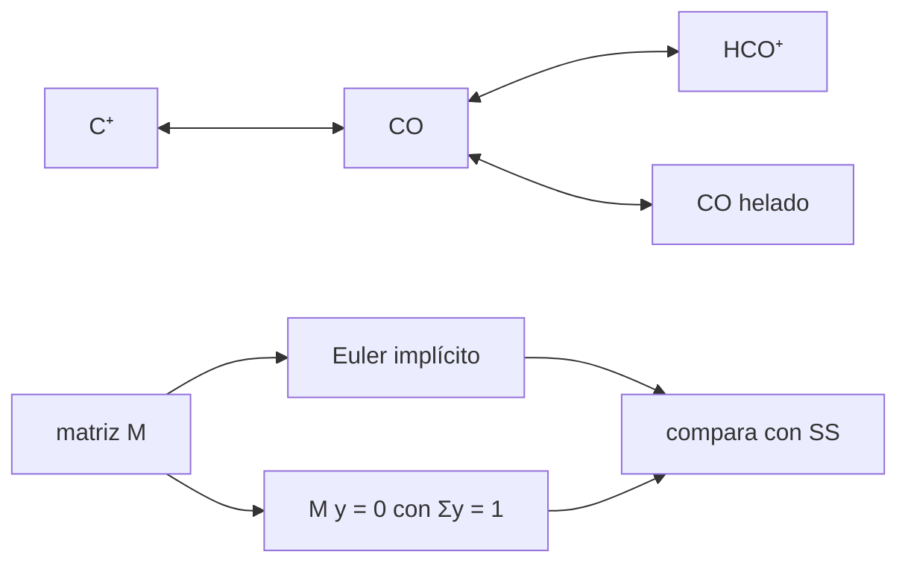

# B55-C20 — Modelo simplificado de red astroquímica

<!-- nav:top -->
[🏠 Programa](../../../../README.md) · [📚 Bloque B55](../../../tronco-comun/B55-astroquimica-y-geoquimica-extraterrestre.md) · [← Anterior: B55-C19 — Interpretación de firmas químicas](../B55-C19-interpretacion-de-firmas-quimicas/CLASE.md) · [Siguiente: B56-C01 — Definiciones operativas de vida →](../../../tronco-comun/B56-astrobiologia-y-vida-extraterrestre.md#b56-c01)
<!-- /nav -->

## 1. Ubicación, nivel y alcance

Clase 20 del bloque B55, nivel N3. Cierras el bloque con una **red astroquímica mínima de carbono** (C⁺, CO, HCO⁺ y CO helado), que conserva el carbono total, alcanza un estado estacionario que verificas de dos maneras y cuyos flujos se compensan. Reúne [B55-C03](../B55-C03-reacciones-en-medio-interestelar/CLASE.md), [B55-C04](../B55-C04-quimica-de-nubes-moleculares/CLASE.md), [B55-C06](../B55-C06-hielos-astrofisicos/CLASE.md) y [B55-C07](../B55-C07-catalisis-en-superficies/CLASE.md). Todas las tasas son **ilustrativas**. El acople gas–superficie–manto de tres fases queda para otra clase programada.

## 2. Por qué esta clase existe

Una red de reacciones es la herramienta con que se comparan modelos y observaciones, pero un error de signo o de conservación pasa inadvertido. La decisión central: **¿cómo sé que mi red está bien construida?** Con tres controles: conserva los elementos, tiene un estacionario que se obtiene por dos vías y sus flujos se balancean.

## 3. Lo que podrás hacer al terminar

1. Construir la matriz de tasas de una red lineal.
2. Comprobar que cada columna suma cero (conservación).
3. Integrar con Euler implícito y comprobar la conservación.
4. Obtener el estacionario algebraico y compararlo con la integración larga.
5. Verificar el balance de flujos entre pares de especies.
6. Medir la sensibilidad a una tasa.

La evidencia es la **red astroquímica verificada** del ejercicio 12 (sección 20).

## 4. Con qué llegas y cómo comprobarlo

1. ¿Qué es una matriz?
2. ¿Qué es una ecuación lineal `dy/dt = My`?
3. ¿Qué es un estado estacionario?
4. ¿Qué es una cantidad conservada?
5. ¿Qué es un método implícito?

<details>
<summary>Ver respuestas</summary>

1. Una tabla rectangular de números. 2. Un sistema donde la derivada es una combinación lineal de las especies. 3. Uno donde `dy/dt = 0`. 4. Una que no cambia con el tiempo. 5. Uno que usa el estado futuro para calcular el paso.
</details>

Con cuatro o cinco aciertos, sigue; si no, repasa los prerrequisitos.

## 5. Un caso de contexto y casos de referencia

Cuatro especies de carbono: C⁺, CO, HCO⁺ y CO congelado sobre granos. Tasas sintéticas (s⁻¹): C⁺→CO 2 × 10⁻¹⁰; CO→C⁺ 5 × 10⁻¹²; CO→HCO⁺ 9,01 × 10⁻¹⁴ (= 1,7 × 10⁻⁹ × 5,3 × 10⁻⁵, el `n(H3+)` de la clase C04); HCO⁺→CO 2 × 10⁻¹⁰ (= 2 × 10⁻⁷ × 10⁻³); CO→hielo 10⁻¹¹; hielo→CO 2 × 10⁻¹². Es el **ejemplo conductor**. McElroy et al. (2013) (S1) describen en su resumen una base de datos de 6173 reacciones y 467 especies; esta red es una miniatura **sintética** y no usa sus coeficientes.

## 6. Vocabulario

La **matriz de tasas** `M` cumple `dy/dt = M y`; cada reacción `i→j` con constante `k` resta `k` en `M_ii` y suma `k` en `M_ji`. La **conservación** exige que cada columna de `M` sume cero. El **Euler implícito** resuelve `(I − Δt M) y_{n+1} = y_n` y conserva los invariantes lineales. El **balance detallado** exige en el estacionario que los flujos de ida y vuelta de cada par se igualen (aquí la red es una cadena).

## 7. Modelo mental: un sistema de vasos comunicantes

Cada especie es un vaso y cada reacción un tubo con su propio caudal por unidad de contenido. El agua total no cambia (conservación) y, al cabo de un tiempo, los niveles se estabilizan (estacionario).



*Descripción textual:* el CO es el centro de una cadena que se conecta con C⁺, HCO⁺ y el hielo; la matriz de tasas se integra en el tiempo y se resuelve algebraicamente en el estacionario, y ambos resultados se comparan.

Analogía: vasos comunicantes con tubos de distinto caudal. Límite: una red real tiene reacciones no lineales (dos especies reaccionantes) y abundancias de H₃⁺ y electrones que cambian.

## 8. La explicación, paso a paso

### 8.1 Conservación

Cada columna de `M` suma cero (verificado a 1e-25). Por tanto `Σ y` es constante.

### 8.2 Estacionario algebraico

Resolviendo `M y = 0` con `Σ y = 1`: C⁺ 0,004149; CO 0,165963; HCO⁺ 0,000075; CO helado 0,829813. El hielo almacena el 83 % del carbono porque `k(CO→hielo)/k(hielo→CO) = 5`.

### 8.3 Integración

| t (años) | C⁺ | CO | HCO⁺ | CO helado | suma |
|---|---|---|---|---|---|
| 3,2 × 10¹ | 0,820815 | 0,178166 | 0,000008 | 0,001011 | 1,000000 |
| 3,2 × 10² | 0,151967 | 0,794084 | 0,000251 | 0,053698 | 1,000000 |
| 3,2 × 10³ | 0,011192 | 0,431137 | 0,000202 | 0,557469 | 1,000000 |
| 3,2 × 10⁴ | 0,004149 | 0,165970 | 0,000075 | 0,829806 | 1,000000 |
| 3,2 × 10⁶ | 0,004149 | 0,165963 | 0,000075 | 0,829813 | 1,000000 |

El carbono se conserva (suma 1 con error de redondeo `~10⁻¹²`) y la integración larga coincide con el estacionario algebraico dentro de `2,2 × 10⁻¹²`.

### 8.4 Balance de flujos

| par | flujo ida | flujo vuelta |
|---|---|---|
| C⁺ ↔ CO | 8,2981 × 10⁻¹³ | 8,2981 × 10⁻¹³ |
| CO ↔ HCO⁺ | 1,4953 × 10⁻¹⁴ | 1,4953 × 10⁻¹⁴ |
| CO ↔ hielo | 1,6596 × 10⁻¹² | 1,6596 × 10⁻¹² |

### 8.5 Sensibilidad

Duplicar `k(CO→hielo)` sube el CO helado de 0,8298 a 0,9070.

## 9. Magnitudes, símbolos y unidades

| Símbolo | Qué es | Unidad | Valor / nota |
|---|---|---|---|
| `y` | fracciones del carbono total | — | 0,165963 (CO) |
| `M` | matriz de tasas | s⁻¹ | — |
| `k` | constantes de reacción efectivas | s⁻¹ | 2 × 10⁻¹⁰ a 9 × 10⁻¹⁴ |
| `Δt` | paso de integración | s | 10⁸ |
| `t` | tiempo | años | 3,2 × 10¹ a 3,2 × 10⁶ |

## 10. Convenciones y referencias

Sistema de referencia: gas y granos como un único volumen homogéneo; abundancias de `H3+` y e⁻ fijas. Tasas sintéticas efectivas por átomo de C. Versiones: Python 3.12.9, biblioteca estándar. Tolerancias: conservación por columna 1e-25; suma 1e-9; estacionario vs integración 1e-6; flujos 1e-9 relativo.

## 11. De dónde sale lo que afirmamos

| ID | Fuente | Localizador | Respalda | Estado |
|---|---|---|---|---|
| S1 | McElroy et al., «The UMIST database for astrochemistry 2012», *A&A* (2013) | arXiv:1212.6362 | contexto: tamaño de una base de datos real (6173 reacciones, 467 especies; resumen) | Consultada el 2026-11-09; solo resumen |
| — | Sin fuente externa para el resto | — | relaciones y valores que verifica el laboratorio con una segunda vía de cálculo; los parámetros de modelo se rotulan ilustrativos | No se consultó una fuente para esta parte |

Límites: del artículo solo se leyó el resumen; las tasas son sintéticas y la red es lineal por construcción.

## 12. Cómo ver la relajación al estacionario

| Especie | estacionario |
|---|---|
| C⁺ | 0,004 |
| CO | 0,166 |
| HCO⁺ | 0,00008 |
| CO helado | 0,830 |

Descripción larga: tras ~3 × 10⁴ años las cuatro curvas se aplanan en esos valores; el CO helado crece y el C⁺ decae.

## 13. Ejemplo trabajado: una fracción del estacionario

**Paso 1 · Condición.** `k(CO→hielo) n(CO) = k(hielo→CO) n(hielo)`.

**Paso 2 · Cociente.** `n(hielo)/n(CO) = 10⁻¹¹/(2 × 10⁻¹²) = 5`.

**Paso 3 · Valor.** `0,165963 × 5 = 0,829813`, igual al del laboratorio.

## 14. Distintas formas de resolver una red

**Estacionario algebraico:** da el destino final sin integrar. **Integración implícita:** da la evolución y funciona con tasas muy dispares (rigidez). **Integración explícita:** necesitaría pasos mínimos por las tasas rápidas. Aquí se usan las dos primeras y deben coincidir.

## 15. Práctica guiada

**Ejercicio 1 · con los pasos indicados.** Calcula el cociente hielo/CO en el estacionario (sección 8.4). *Con los pasos indicados.*

<details><summary>Solución comentada</summary>

`5`.
</details>

**Ejercicio 2 · con una pista.** Calcula la fracción de HCO⁺ respecto de CO en el estacionario (sección 8.4). *Pista:* `k(CO→HCO⁺)/k(HCO⁺→CO)`.

<details><summary>Solución comentada</summary>

`9,01 × 10⁻¹⁴/2 × 10⁻¹⁰ = 4,5 × 10⁻⁴`; `0,165963 × 4,5 × 10⁻⁴ = 7,5 × 10⁻⁵`.
</details>

**Ejercicio 3 · casi autónomo.** Calcula el cociente C⁺/CO (sección 8.4). *Casi autónomo.*

<details><summary>Solución comentada</summary>

`k(CO→C⁺)/k(C⁺→CO) = 5 × 10⁻¹²/2 × 10⁻¹⁰ = 0,025`; `0,165963 × 0,025 = 0,004149`.
</details>

## 16. Práctica autónoma, transferencia e integrador

**Ejercicio 4 · autónomo.** Si `k(hielo→CO)` se duplica, ¿cuál es el nuevo cociente hielo/CO? (sección 8.5).

<details><summary>Solución comentada</summary>

`10⁻¹¹/4 × 10⁻¹² = 2,5`.
</details>

**Ejercicio 5 · autónomo.** ¿Cuánto vale la suma de las fracciones en cualquier instante? (sección 8.1).

<details><summary>Solución comentada</summary>

1.
</details>

**Ejercicio 6 · autónomo.** ¿Cuál es el tiempo característico para que el hielo llegue al estacionario? (sección 8.3).

<details><summary>Solución comentada</summary>

Del orden de `1/(k₅ + k₆) ≈ 8 × 10¹⁰ s ≈ 2,6 × 10³ años` al compararlo con la tabla.
</details>

**Ejercicio 7 · autónomo.** ¿Qué pasa con el HCO⁺ si `n(H3+)` se duplica? (sección 8.4).

<details><summary>Solución comentada</summary>

`k(CO→HCO⁺)` se duplica y el HCO⁺ estacionario también: `1,5 × 10⁻⁴`.
</details>

**Ejercicio 8 · autónomo.** ¿Por qué el paso de 10⁸ s es aceptable con Euler implícito? (sección 8.3).

<details><summary>Solución comentada</summary>

Porque el método es incondicionalmente estable para esta red lineal; el error de integración se mide con el estacionario.
</details>

**Ejercicio 9 · transferencia.** Añades una reacción pero olvidas restar de la especie de origen. ¿Qué detecta el control? (sección 8.1).

<details><summary>Solución comentada</summary>

La suma de la columna deja de ser cero y el carbono no se conserva.
</details>

**Ejercicio 10 · transferencia.** Quieres incluir la formación de CH₃OH a partir del hielo. ¿Qué cambia en el modelo? (sección 7).

<details><summary>Solución comentada</summary>

Aparece una especie y reacciones que podrían ser no lineales; se aplican los mismos controles.
</details>

**Ejercicio 11 · transferencia.** ¿Por qué una red de 4 especies no basta para comparar con un espectro? (sección 11).

<details><summary>Solución comentada</summary>

Faltan miles de reacciones y los parámetros reales; este modelo solo verifica el método.
</details>

**Ejercicio 12 · integrador.** Elabora tu *red astroquímica verificada*: define las especies y tasas, la matriz `M`, el estacionario, la integración y los tres controles (conservación, estacionario por dos vías, balance de flujos), y una sensibilidad.

<details><summary>Solución modelo</summary>

Debe mostrar 8.1–8.5 con unidades y la nota de que las tasas son sintéticas; los tres controles deben aparecer con su valor numérico.
</details>

## 17. Laboratorio: red de carbono con conservación y estacionario

El script [red_astroquimica.py](red_astroquimica.py) construye la matriz, integra con Euler implícito, resuelve el estacionario y **comprueba** la conservación por columna (1e-25), la suma (1e-9), el estacionario (1e-6) y el balance de flujos.

**Datos:** **sintéticos**; `n(H3+)` tomado de B55-C04. **Predice antes de ejecutar:** ¿qué fracción acaba en forma de hielo? (≈ 83 %.) **Ejecución del 2026-11-09 (Python 3.12.9):**

```text
Python 3.12.9 (biblioteca estandar)
A. Red SINTETICA de carbono: C+ <-> CO <-> HCO+ ; CO <-> hielo (tasas en s-1, ILUSTRATIVAS)
   k(C+->CO) = 2.0e-10 ; k(CO->C+) = 5.0e-12 ; k(CO->HCO+) = 9.010e-14 ; k(HCO+->CO) = 2.0e-10 ; k(CO->hielo) = 1.0e-11 ; k(hielo->CO) = 2.0e-12
B. Estado estacionario algebraico (fracciones del carbono total)
   C+         0.004149
   CO         0.165963
   HCO+       0.000075
   CO(hielo)  0.829813
C. Integracion (Euler implicito, paso 1e8 s) desde C+ = 1
t [anos]              C+          CO        HCO+   CO(hielo)   suma
 3.169e+01     0.820815    0.178166    0.000008    0.001011   1.000000000000
 3.169e+02     0.151967    0.794084    0.000251    0.053698   1.000000000000
 3.169e+03     0.011192    0.431137    0.000202    0.557469   1.000000000000
 3.169e+04     0.004149    0.165970    0.000075    0.829806   1.000000000001
 3.169e+05     0.004149    0.165963    0.000075    0.829813   1.000000000002
 3.169e+06     0.004149    0.165963    0.000075    0.829813   1.000000000002
   error relativo respecto del estacionario algebraico = 2.18e-12
D. Flujos en el estacionario [por atomo de C y por segundo]: debe haber balance neto cero por especie
   C+ -> CO     8.2981e-13   CO -> C+     8.2981e-13   diferencia 9.09e-27
   CO -> HCO+   1.4953e-14   HCO+ -> CO   1.4953e-14   diferencia 6.31e-30
   CO -> hielo  1.6596e-12   hielo -> CO  1.6596e-12   diferencia 6.66e-27
E. Sensibilidad: duplicar k(CO->hielo) cambia el CO helado de 0.8298 a 0.9070
Pruebas superadas.
```

```bash
python programa/clases/B55/B55-C20-modelo-simplificado-de-red-astroquimica/red_astroquimica.py
```

**Límites:** red lineal; H3+ y e⁻ fijos; sin dependencia de T ni de granos.

## 18. Errores frecuentes y cómo corregirlos

**Olvidar restar la especie de origen.** Rompe la conservación (8.1).

**Usar paso explícito grande.** Es inestable; se usa Euler implícito (8.3).

**Dar un estacionario sin comprobar la integración.** Se compara en 8.3.

**Presentar las tasas como medidas.** Se aclara en la sección 5.

## 19. Cómo sabrás que vas bien

Tras la sección 8: ¿qué estacionario esperabas y cuál obtuviste? Si dudas, repasa el ejemplo 13. Tras el laboratorio: ¿qué comprueba? (ver la sección 17).

## 20. Qué entregas y cómo se evalúa

El producto es tu **red astroquímica verificada** (ejercicio 12).

| Criterio | Inicial | En desarrollo | Logrado | Destacado |
|---|---|---|---|---|
| Conceptos | Los confunde | Parciales | Distingue conservación, estacionario y balance | Explica los límites |
| Cálculo | Sin unidades | Con errores | Tablas completas con unidades | Calcula casos nuevos |
| Numérico | Sin comprobar | Un caso | Contraste con el caso analítico | Interpreta las diferencias |
| Fuentes | Sin fuente | Sin fecha | Fuentes con fecha y estado | Declara lo sintético e ilustrativo |
| Límites | No los nombra | Uno | Tres | Discute qué falta del modelo |

**Condiciones críticas (no se compensan con promedio):** rotular las tasas como sintéticas; incluir los tres controles; no presentar la red como modelo de una nube real; citar solo lo consultado.

## 21. Ética, seguridad y límites

Un modelo astroquímico se publica con su red, versiones y controles de verificación; una red mínima solo valida el método. Clase educativa: los modelos son simplificados y ningún resultado de esta clase es una observación. Accesibilidad: tablas equivalentes a las gráficas, fórmulas en texto, ejercicios sin conexión.

## 22. Para cerrar y seguir

La red sintética conserva el carbono (suma = 1), llega al estacionario `(0,0041; 0,1660; 0,00008; 0,8298)` por dos vías y sus flujos se compensan. Con esto el bloque queda cerrado: del origen de los elementos a la verificación de un modelo.

**Glosario español–inglés.** red astroquímica · *astrochemical network*; matriz de tasas · *rate matrix*; conservación · *conservation*; Euler implícito · *implicit Euler*; balance detallado · *detailed balance*.

**Continuidad.** Esta es la última clase del bloque B55.

**Referencias:** ver sección 11.

<!-- nav:bottom -->
---

[← Anterior: B55-C19 — Interpretación de firmas químicas](../B55-C19-interpretacion-de-firmas-quimicas/CLASE.md) · [📚 Bloque B55](../../../tronco-comun/B55-astroquimica-y-geoquimica-extraterrestre.md) · [Siguiente: B56-C01 — Definiciones operativas de vida →](../../../tronco-comun/B56-astrobiologia-y-vida-extraterrestre.md#b56-c01)
<!-- /nav -->
