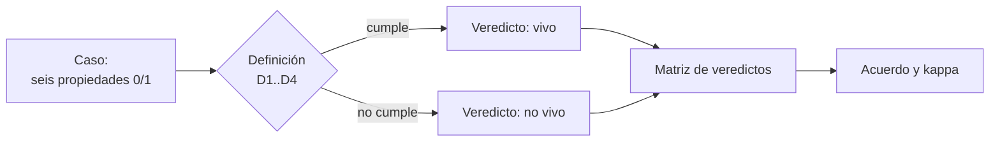

# B56-C01 — Definiciones operativas de vida

<!-- nav:top -->
[🏠 Programa](../../../../README.md) · [📚 Bloque B56](../../../tronco-comun/B56-astrobiologia-y-vida-extraterrestre.md) · [← Anterior: B55-C20 — Modelo simplificado de red astroquímica](../../B55/B55-C20-modelo-simplificado-de-red-astroquimica/CLASE.md) · [Siguiente: B56-C02 — Bioquímica y metabolismo terrestre →](../B56-C02-bioquimica-y-metabolismo-terrestre/CLASE.md)
<!-- /nav -->

## 1. Ubicación, nivel y alcance

Clase 1 del bloque B56, que abre la astrobiología. Nivel N3. No hay una definición de vida aceptada por todos; aquí aprendes a trabajar con **definiciones operativas**, es decir, reglas que permiten decidir si un caso concreto cuenta como vivo y que se pueden discutir con datos. Tomas la química básica ([B06](../../../tronco-comun/B06-quimica-y-materia-del-universo.md)) y la idea de probabilidad de [B12](../../../tronco-comun/B12-probabilidad-estadistica-e-incertidumbre.md). No decides qué es la vida «de verdad»: comparas criterios. La química de la vida terrestre sigue en [C02](../B56-C02-bioquimica-y-metabolismo-terrestre/CLASE.md).

## 2. Por qué esta clase existe

Una misión que busca vida necesita saber qué buscar y qué contará como hallazgo. Si el criterio es vago, cualquier resultado se puede discutir; si es demasiado estrecho, se pasa por alto lo que no se parece a la vida terrestre. La decisión central: **dado un caso límite (un virus, una llama, un cristal), ¿qué criterio lo declara vivo y cuánto coinciden dos criterios entre sí?**

## 3. Lo que podrás hacer al terminar

1. Definir definición operativa, criterio necesario y suficiente, caso límite y coincidencia entre definiciones.
2. Aplicar cuatro reglas booleanas a ocho casos y construir la matriz de veredictos.
3. Calcular el acuerdo y el kappa de Cohen entre dos definiciones, por dos vías.
4. Explicar por qué una definición que depende de la evolución darwiniana deja fuera a un individuo estéril.
5. Nombrar un caso que cada definición clasifica mal.
6. Distinguir lo que enseña el ejercicio (el método) de lo que no demuestra (qué es la vida).

La evidencia es la **matriz de casos límite** del ejercicio 12 (sección 20).

## 4. Con qué llegas y cómo comprobarlo

1. ¿Qué es una proposición verdadera o falsa y cómo se combinan con «y», «o»?
2. ¿Qué mide una proporción de coincidencias entre dos listas de 0 y 1?
3. ¿Qué es un virus, a grandes rasgos?
4. ¿Qué significa que algo «evolucione» en sentido de Darwin?
5. ¿Cómo se calcula una fracción exacta con `Fraction`?

<details>
<summary>Ver respuestas</summary>

1. «A y B» exige las dos; «A o B» basta una. 2. La fracción de posiciones donde coinciden. 3. Una partícula con material genético que solo se multiplica dentro de una célula. 4. Variación heredable y reproducción diferencial en una población. 5. `Fraction(3, 8)` guarda 3/8 sin error de redondeo.
</details>

Con cuatro o cinco aciertos, sigue; si no, repasa B06 y B12.

## 5. Un caso real: la frase de trabajo de la NASA

La NASA describe la astrobiología como el estudio del origen, la evolución y la distribución de la vida en el universo, y cita como definición de trabajo frecuente «un sistema autosostenido capaz de evolución darwiniana»; añade que existen varios cientos de otras definiciones (S1, consultada el 2026-11-09). Esa frase será nuestro **ejemplo conductor** y la regla `D1` del laboratorio. Los ocho casos y sus propiedades (metabolismo, reproducción, evolución, límite, homeostasis, crecimiento) son **ilustrativos**: los asigna el autor de la clase, no proceden de una fuente.

## 6. Vocabulario

Una **definición operativa** es una regla que, aplicada a un caso, da un veredicto repetible. Un **criterio necesario** debe cumplirse siempre; uno **suficiente** basta por sí solo. Un **caso límite** es uno donde las definiciones discrepan. **Metabolismo** es el conjunto de transformaciones químicas que mantienen un sistema fuera del equilibrio. **Homeostasis** es la regulación del medio interno. **Evolución darwiniana** es el cambio de una población por variación heredable y reproducción diferencial. El **acuerdo** entre dos definiciones es la fracción de casos con el mismo veredicto; el **kappa de Cohen** descuenta el acuerdo esperado por azar: `κ = (p_o − p_e)/(1 − p_e)`.

## 7. Modelo mental: un filtro con varias rendijas

Cada definición es un filtro que deja pasar los casos que cumplen sus condiciones. Dos filtros distintos coinciden en los casos extremos (una bacteria pasa, un cristal no) y discrepan en el medio.



*Descripción textual:* se evalúan las propiedades de cada caso con cada regla, se arma la matriz y se mide cuánto coinciden las reglas.

Analogía: varios jueces con reglamentos distintos puntuando la misma prueba. Su límite: los jueces opinan; aquí las reglas son explícitas, pero eso no las vuelve correctas.

## 8. La explicación, paso a paso

### 8.1 Cuatro reglas

`D1` (autosostenido y darwiniano): metabolismo **y** límite **y** evolución. `D2` (lista de comprobación): al menos 4 de las 6 propiedades. `D3` (fisiológica): metabolismo **y** homeostasis **y** crecimiento. `D4` (solo evolutiva): reproducción **y** evolución. Son reglas **inventadas para el ejercicio**, salvo que `D1` imita la frase de la NASA.

### 8.2 La matriz

El laboratorio aplica las reglas a ocho casos. La bacteria pasa las cuatro. La mula pasa `D2` y `D3` (metabolismo, homeostasis y crecimiento) pero no `D1` ni `D4`, porque un individuo estéril no reproduce ni evoluciona. El ARN que se copia in vitro y el prion pasan solo `D4`.

### 8.3 Acuerdo y kappa

El acuerdo de `D1` con `D2` es 7 de 8 y `κ = 0,600`; el de `D2` con `D4` es 5 de 8 y `κ = 0,143`. El kappa corrige por azar: si ambas reglas dicen «no vivo» casi siempre, el acuerdo alto es poco informativo.

### 8.4 Dos formas de calcular el kappa

Con marginales: `p_o` es el acuerdo observado y `p_e = p_a p_b + (1−p_a)(1−p_b)`. Con la tabla 2×2 `[[a,b],[c,d]]`: `κ = 2(ad − bc)/((a+b)(b+d) + (a+c)(c+d))`. Son idénticas algebraicamente; el laboratorio exige que coincidan con fracciones exactas.

### 8.5 Lo que el ejercicio no demuestra

Los veredictos dependen de cómo se codificaron las propiedades. Un virus se podría codificar con `metabolismo = 1` si se considera la célula infectada. El método sirve para **hacer explícito el desacuerdo**, no para resolverlo.

## 9. Magnitudes, símbolos y unidades

| Símbolo | Qué es | Unidad | Valor / nota |
|---|---|---|---|
| `p_o` | acuerdo observado | adimensional | 7/8 en `D1`–`D2` |
| `p_e` | acuerdo esperado por azar | adimensional | de los marginales |
| `κ` | kappa de Cohen | adimensional | −1 a 1 |
| `D1…D4` | reglas booleanas | — | definidas en 8.1 |

## 10. Convenciones y referencias

Propiedades binarias (0/1); ocho casos; aritmética con `Fraction`. Todos los datos de los casos son **ilustrativos**.

## 11. De dónde sale lo que afirmamos

| ID | Fuente | Localizador | Respalda | Estado |
|---|---|---|---|---|
| S1 | NASA Astrobiology, *About* | https://astrobiology.nasa.gov/about/ | Definición de astrobiología y frase de trabajo | Consultada el 2026-11-09 |

Límites: las propiedades de los casos, las reglas `D2`–`D4` y los veredictos son del autor de la clase y no tienen fuente; la frase de la NASA es una definición de trabajo, no una definición oficial única.

## 12. Cómo ver la matriz

Equivalente accesible a un mapa de calor (1 = vivo):

| Caso | D1 | D2 | D3 | D4 |
|---|---|---|---|---|
| bacteria | 1 | 1 | 1 | 1 |
| mula | 0 | 1 | 1 | 0 |
| virión libre, llama, cristal, espora latente | 0 | 0 | 0 | 0 |
| prion, ARN in vitro | 0 | 0 | 0 | 1 |

Descripción larga: solo la bacteria es unánime como viva; la mula y los replicadores moleculares son los casos que dividen las reglas.

## 13. Ejemplo trabajado: ¿es vivo un ARN que se copia en un tubo?

**Paso 1 · Propiedades.** Metabolismo 0, reproducción 1, evolución 1, límite 0, homeostasis 0, crecimiento 1 (ilustrativas).

**Paso 2 · Reglas.** `D1`: exige metabolismo y límite → 0. `D2`: suma 3 → 0. `D3` → 0. `D4`: reproducción y evolución → 1.

**Paso 3 · Lectura.** Solo la regla evolutiva lo acepta; la frase de la NASA lo excluye porque no es «autosostenido».

**Paso 4 · Sentido.** El caso muestra que la frase de la NASA exige un sistema completo; un replicador aislado no cumple «autosostenido». Es un resultado del *criterio*, no un hallazgo sobre el ARN.

## 14. Comparar definiciones

**Lista de comprobación (`D2`):** fácil de aplicar, sensible al umbral. **Fisiológica (`D3`):** acepta organismos estériles, excluye replicadores. **Evolutiva (`D4`):** abarca replicadores, acepta prones. **Autosostenida y darwiniana (`D1`):** exige un sistema completo, excluye a la mula. Ninguna es neutral; elegir una es una decisión sobre qué errores se toleran.

## 15. Práctica guiada

**Ejercicio 1 · con los pasos indicados.** Aplica `D1` a la llama (metabolismo 1, reproducción 1, evolución 0, límite 0, homeostasis 0, crecimiento 1). *Pasos:* `D1` exige las tres condiciones.

<details><summary>Solución comentada</summary>

La llama no tiene límite ni evolución: `D1 = 0` (8.1).
</details>

**Ejercicio 2 · con una pista.** Calcula el acuerdo de `D3` con `D4` en los ocho casos. *Pista:* cuenta posiciones iguales en las columnas de la sección 12.

<details><summary>Solución comentada</summary>

Coinciden en bacteria, virión, llama, cristal y espora: `5/8` (laboratorio).
</details>

**Ejercicio 3 · casi autónomo.** Con la tabla 2×2 `a=1, b=1, c=0, d=6` (D1 frente a D2), calcula `κ`.

<details><summary>Solución comentada</summary>

`2(1·6 − 1·0) = 12`; denominador `(2)(7) + (1)(6) = 20`; `κ = 0,600` (8.4).
</details>

## 16. Práctica autónoma, transferencia e integrador

**Ejercicio 4.** ¿Por qué `D1` clasifica a la mula como no viva y eso es un problema?

<details><summary>Solución comentada</summary>

Porque exige evolución, que es propiedad de poblaciones; un individuo estéril no la cumple. Un criterio que excluye a un animal evidente falla como definición de organismo (8.2).
</details>

**Ejercicio 5.** Cambia el umbral de `D2` a 3 de 6. ¿Qué casos se añaden?

<details><summary>Solución comentada</summary>

Suman 3: llama (metabolismo, reproducción, crecimiento), prion (reproducción, evolución... solo 2: no) y ARN in vitro (reproducción, evolución, crecimiento → 3, sí). Se añaden la llama y el ARN: un umbral más bajo admite fuego y replicadores.
</details>

**Ejercicio 6.** Calcula `p_e` para `D1` y `D4` si `D1` da 1/8 de «vivo» y `D4` 3/8.

<details><summary>Solución comentada</summary>

`p_e = (1/8)(3/8) + (7/8)(5/8) = 3/64 + 35/64 = 38/64 = 0,594` (8.4).
</details>

**Ejercicio 7.** Explica por qué un acuerdo alto no implica un kappa alto.

<details><summary>Solución comentada</summary>

Si casi todos los casos son «no vivo» en ambas reglas, el acuerdo esperado por azar ya es grande y el kappa lo descuenta (8.3).
</details>

**Ejercicio 8.** Añade un octavo criterio inventado y di qué dato nuevo necesitas.

<details><summary>Solución comentada</summary>

Por ejemplo «intercambia materia con el entorno»: necesitas una propiedad binaria nueva para cada caso. La regla es tan buena como los datos que la alimentan (8.5).
</details>

**Ejercicio 9 · transferencia.** Un colega afirma que «la llama es viva porque crece, se reproduce y consume combustible». ¿Qué regla de la clase la acepta y cuál no?

<details><summary>Solución comentada</summary>

Ninguna de `D1`–`D4` la acepta (tiene 3 propiedades, sin homeostasis ni evolución). Una regla de lista con umbral 3 sí (ejercicio 5): el desacuerdo está en el umbral.
</details>

**Ejercicio 10 · transferencia.** Una misión detecta un sistema químico que se replica y varía pero no tiene límite. ¿Qué reglas lo aceptan?

<details><summary>Solución comentada</summary>

Solo la evolutiva `D4`. Informar «vida» o «no vida» dependería de la regla; lo prudente es describir las propiedades observadas (sección 21).
</details>

**Ejercicio 11 · transferencia.** ¿Por qué conviene que un equipo escriba su regla antes de analizar los datos?

<details><summary>Solución comentada</summary>

Para que el veredicto no se ajuste a lo hallado. Una regla fijada a priori hace el resultado refutable.
</details>

**Ejercicio 12 · integrador.** Elabora tu *matriz de casos límite*: elige tres casos nuevos con sus seis propiedades (ilustrativas), aplica `D1`–`D4`, calcula el acuerdo de dos reglas y su kappa, y señala qué caso divide más las reglas.

<details><summary>Solución modelo</summary>

Por ejemplo viroide (met 0, repr 1, evol 1, límite 0, homeo 0, crece 0), semilla viva (1,0,1,1,1,0), robot autorreplicante hipotético (1,1,0,1,1,1). `D1`: 0, 0, 0; `D4`: 1, 0, 0; el viroide divide las reglas. Cálculo del kappa como en 8.4. Todo rotulado como ilustrativo.
</details>

## 17. Laboratorio: matriz de definiciones

El script [definiciones_vida.py](definiciones_vida.py) aplica las cuatro reglas a ocho casos, calcula el acuerdo y el kappa por dos vías (marginales y tabla 2×2) y **comprueba** que coinciden con fracciones exactas y que una regla consigo misma da `κ = 1`.

**Datos:** sintéticos e ilustrativos. **Predice antes de ejecutar:** ¿qué pareja de reglas coincide en los ocho casos? (`D2` y `D3`.) **Ejecución del 2026-11-09 (Python 3.12.9):**

```text
Python 3.12.9 (biblioteca estandar)
bacteria        D1=1 D2=1 D3=1 D4=1
mula            D1=0 D2=1 D3=1 D4=0
virion libre    D1=0 D2=0 D3=0 D4=0
llama           D1=0 D2=0 D3=0 D4=0
cristal         D1=0 D2=0 D3=0 D4=0
prion           D1=0 D2=0 D3=0 D4=1
espora latente  D1=0 D2=0 D3=0 D4=0
ARN in vitro    D1=0 D2=0 D3=0 D4=1
D1-D2: acuerdo 7/8 ; kappa = 0.600
D1-D3: acuerdo 7/8 ; kappa = 0.600
D1-D4: acuerdo 6/8 ; kappa = 0.385
D2-D3: acuerdo 8/8 ; kappa = 1.000
D2-D4: acuerdo 5/8 ; kappa = 0.143
D3-D4: acuerdo 5/8 ; kappa = 0.143
Pruebas superadas.
```

```bash
python programa/clases/B56/B56-C01-definiciones-operativas-de-vida/definiciones_vida.py
```

**Límites:** solo ocho casos y propiedades binarias asignadas por el autor; los resultados no dicen nada sobre cuáles son seres vivos.

## 18. Errores frecuentes y cómo corregirlos

**Creer que existe «la» definición correcta.** Se corrige con la sección 5 y el ejercicio 11.

**Tomar el kappa como probabilidad de acierto.** Se corrige con el ejercicio 7.

**Olvidar que la regla depende de los datos que la alimentan.** Se corrige con el ejercicio 8.

**Declarar «vivo» a lo que solo cumple una regla.** Se corrige con el ejercicio 10.

**Dar por probado lo ilustrativo.** Se corrige con la sección 10.

## 19. Cómo sabrás que vas bien

Tras 8.2: ¿sabes decir por qué la mula es un caso límite? Si no, ejercicio 4. Tras 8.3: ¿qué corrige el kappa? Ejercicio 7. Tras el laboratorio: ¿qué comprueba la igualdad de las dos fórmulas del kappa? (que el cálculo es consistente).

## 20. Qué entregas y cómo se evalúa

El producto es tu **matriz de casos límite** (ejercicio 12).

| Criterio | Inicial | En desarrollo | Logrado | Destacado |
|---|---|---|---|---|
| Definiciones | Las confunde | Parciales | Cuatro reglas claras | Discute necesario y suficiente |
| Matriz | Incompleta | Con errores | Completa y correcta | Con casos propios razonados |
| Kappa | Sin calcular | Una vía | Dos vías coincidentes | Interpreta el azar |
| Rótulos | Sin rotular | Parciales | Todo ilustrativo rotulado | Declara qué no demuestra |
| Fuentes | Sin fuente | Sin fecha | S1 con fecha | Distingue definición de trabajo y oficial |

**Condiciones críticas (no se compensan con promedio):** rotular las propiedades como ilustrativas; no afirmar que un caso «es» o «no es» vivo como hecho; citar solo lo consultado.

## 21. Ética, seguridad y límites

La clase es educativa y no clasifica seres reales. Declarar vivo o no vivo algo tiene consecuencias (regulatorias, éticas); por eso aquí se describen propiedades. Accesibilidad: tablas equivalentes a las gráficas, fórmulas en texto, ejercicios sin conexión.

## 22. Para cerrar y seguir

Una definición operativa convierte un debate en una regla discutible. Con ocho casos y cuatro reglas viste que el desacuerdo se concentra en pocos casos límite y que el kappa lo cuantifica. Queda una pregunta: ¿qué química hace funcionar a los sistemas que sí damos por vivos?

**Glosario español–inglés.** definición operativa · *operational definition*; caso límite · *edge case*; metabolismo · *metabolism*; homeostasis · *homeostasis*; evolución darwiniana · *Darwinian evolution*; kappa de Cohen · *Cohen's kappa*.

**Continuidad.** [B56-C02](../B56-C02-bioquimica-y-metabolismo-terrestre/CLASE.md) estudia la química y la energía de la vida conocida.

**Referencias:** ver sección 11.

<!-- nav:bottom -->
---

[← Anterior: B55-C20 — Modelo simplificado de red astroquímica](../../B55/B55-C20-modelo-simplificado-de-red-astroquimica/CLASE.md) · [📚 Bloque B56](../../../tronco-comun/B56-astrobiologia-y-vida-extraterrestre.md) · [Siguiente: B56-C02 — Bioquímica y metabolismo terrestre →](../B56-C02-bioquimica-y-metabolismo-terrestre/CLASE.md)
<!-- /nav -->
