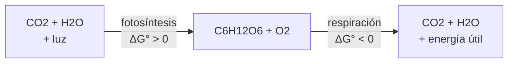

# B56-C02 — Bioquímica y metabolismo terrestre

<!-- nav:top -->
[🏠 Programa](../../../../README.md) · [📚 Bloque B56](../../../tronco-comun/B56-astrobiologia-y-vida-extraterrestre.md) · [← Anterior: B56-C01 — Definiciones operativas de vida](../B56-C01-definiciones-operativas-de-vida/CLASE.md) · [Siguiente: B56-C03 — Origen de moléculas autorreplicantes →](../B56-C03-origen-de-moleculas-autorreplicantes/CLASE.md)
<!-- /nav -->

## 1. Ubicación, nivel y alcance

Clase 2 del bloque B56. Nivel N3. Tomas la estequiometría ([B06-C07](../../B06/B06-C07-estequiometria-elemental/CLASE.md)) y la termoquímica ([B06-C12](../../B06/B06-C12-termoquimica-y-energia-de-reaccion/CLASE.md)) para describir cómo la vida que conocemos obtiene y gasta energía. Aquí solo tratas el balance de átomos y la energía libre estándar de dos reacciones, la fotosíntesis oxigénica y la respiración aerobia. Las otras fuentes de energía son tema de [C07](../B56-C07-energia-quimica-para-la-vida/CLASE.md); el origen de esta química, de [C03](../B56-C03-origen-de-moleculas-autorreplicantes/CLASE.md) y [C04](../B56-C04-hipotesis-de-abiogenesis/CLASE.md).

## 2. Por qué esta clase existe

Para buscar vida hay que saber qué hace la vida conocida con la materia: qué elementos usa y de dónde saca energía. La decisión central: **dada una reacción metabólica, ¿está balanceada y cuánta energía libre libera o consume por mol?**

## 3. Lo que podrás hacer al terminar

1. Definir metabolismo, energía libre de Gibbs, energía libre de formación y eficiencia.
2. Comprobar que una reacción conserva cada tipo de átomo.
3. Calcular `ΔG°` como suma ponderada de energías libres de formación.
4. Explicar por qué respiración y fotosíntesis son reacciones inversas con `ΔG°` opuestos.
5. Estimar la eficiencia de una reacción impulsada por fotones.
6. Nombrar qué deja fuera un cálculo de condiciones estándar.

La evidencia es la **ficha metabólica** del ejercicio 12 (sección 20).

## 4. Con qué llegas y cómo comprobarlo

1. ¿Cómo se balancea `C₃H₈ + O₂ → CO₂ + H₂O`?
2. ¿Qué es un mol?
3. ¿Qué energía tiene un fotón de longitud de onda `λ`?
4. ¿Qué significa que `ΔG < 0`?
5. ¿Qué es una ley de Hess?

<details>
<summary>Ver respuestas</summary>

1. `C₃H₈ + 5 O₂ → 3 CO₂ + 4 H₂O`. 2. `6,022 × 10²³` entidades. 3. `E = hc/λ`. 4. La reacción puede ocurrir espontáneamente en esas condiciones. 5. La variación de una magnitud de estado no depende del camino.
</details>

Con cuatro o cinco aciertos, sigue; si no, repasa B06-C07 y B06-C12.

## 5. Un caso real: la glucosa como reserva de energía

La vida terrestre almacena energía en moléculas orgánicas. Tomamos como **ejemplo conductor** la reacción global `6 CO₂ + 6 H₂O → C₆H₁₂O₆ + 6 O₂` (fotosíntesis) y su inversa (respiración). Con los valores ilustrativos del laboratorio, la fotosíntesis exige `+2871,7 kJ` por mol de glucosa y la respiración libera `−2871,7 kJ`. Con 48 fotones de 680 nm por glucosa (valor didáctico), la eficiencia estándar sería del `34,0 %`.

## 6. Vocabulario

El **metabolismo** es el conjunto de reacciones que transforman materia y energía en un organismo. La **energía libre de Gibbs** `G` mide cuánta energía puede convertirse en trabajo a `T` y `P` constantes; `ΔG < 0` indica reacción espontánea. La **energía libre de formación estándar** `ΔG_f°` es el cambio al formar un mol de compuesto desde sus elementos a 298,15 K y 1 bar. El **balance atómico** exige el mismo número de cada elemento a ambos lados. La **eficiencia** es energía almacenada dividida entre energía absorbida. Los elementos **CHNOPS** (carbono, hidrógeno, nitrógeno, oxígeno, fósforo, azufre) forman la mayor parte de la materia viva conocida.

## 7. Modelo mental: una cuenta de ahorros

La glucosa es un ahorro: la fotosíntesis deposita energía, la respiración la retira. Los átomos son las monedas: ninguna se crea ni se pierde.



*Descripción textual:* la fotosíntesis convierte CO₂ y agua en glucosa y oxígeno con aporte de luz; la respiración invierte el proceso y libera energía.

Analogía: una batería que se carga y se descarga. Su límite: una batería real pierde energía en cada ciclo; en la célula, las pérdidas están en las rutas, no en el balance global.

## 8. La explicación, paso a paso

### 8.1 Balance atómico

El laboratorio cuenta átomos con una expresión regular: lado izquierdo `C₆ O₁₈ H₁₂`, lado derecho el mismo. Una reacción que no balancea no es una reacción.

### 8.2 Energía libre estándar

`ΔG° = Σ ν_i ΔG_f°(productos) − Σ ν_i ΔG_f°(reactivos)`. Con `ΔG_f°` de CO₂ (−394,36), H₂O(l) (−237,13), glucosa(ac) (−917,2) y O₂ (0) kJ/mol (valores **ilustrativos de tabla, no consultados**), resulta `ΔG° = +2871,7 kJ/mol` para la fotosíntesis.

### 8.3 La inversa

Invertir la reacción cambia el signo: `ΔG°(resp) = −ΔG°(foto)`. El laboratorio lo comprueba a `10⁻⁹ kJ/mol`.

### 8.4 Eficiencia

Un fotón de `λ = 680 nm` tiene `E = hc/λ`; un mol de ellos lleva `175,9 kJ`. Con 48 fotones por glucosa: `2871,7/(48 × 175,9) = 34,0 %`. El número 48 y la longitud de onda son **valores didácticos** no consultados.

### 8.5 Lo que el cálculo deja fuera

Las condiciones de la célula no son estándar (concentraciones, pH, fuerza iónica); `ΔG` real depende de ellas (se verá en [C07](../B56-C07-energia-quimica-para-la-vida/CLASE.md)). Tampoco cuenta la ruta ni la cinética.

## 9. Magnitudes, símbolos y unidades

| Símbolo | Qué es | Unidad | Valor / nota |
|---|---|---|---|
| `h` | constante de Planck | `J Hz⁻¹` | `6,626 070 15 × 10⁻³⁴` (S1) |
| `c` | velocidad de la luz | `m s⁻¹` | `299 792 458` (S1) |
| `N_A` | constante de Avogadro | `mol⁻¹` | `6,022 140 76 × 10²³` (S1) |
| `ΔG_f°` | energía libre de formación | `kJ mol⁻¹` | ilustrativas, ver 8.2 |
| `ΔG°` | energía libre de reacción | `kJ mol⁻¹` | `+2871,7` (foto) |
| `η` | eficiencia | % | `34,0` (didáctica) |

## 10. Convenciones y referencias

Condiciones estándar: 298,15 K, 1 bar, 1 M. `ΔG_f°` de los elementos en su estado estándar es 0. La glucosa se toma en solución acuosa. 680 nm y 48 fotones son **valores didácticos no consultados**.

## 11. De dónde sale lo que afirmamos

| ID | Fuente | Localizador | Respalda | Estado |
|---|---|---|---|---|
| S1 | NIST, *Fundamental Physical Constants — Complete Listing* (CODATA 2022) | https://physics.nist.gov/cuu/Constants/Table/allascii.txt | `h`, `c`, `N_A` | Consultada el 2026-11-09 |
| S2 | NASA Astrobiology, *About* | https://astrobiology.nasa.gov/about/ | Contexto: la astrobiología estudia origen, evolución y distribución de la vida | Consultada el 2026-11-09 |

Límites: las energías libres de formación, la longitud de onda y los 48 fotones **no se consultaron** en ninguna fuente; son valores de libro recordados por el autor y se rotulan ilustrativos. La lista CHNOPS es conocimiento general no consultado.

## 12. Cómo ver el balance

Equivalente accesible a un diagrama de energía:

| Reacción | `ΔG°` (kJ/mol de glucosa) |
|---|---|
| Fotosíntesis | `+2871,7` |
| Respiración | `−2871,7` |

Descripción larga: las dos barras tienen la misma altura y signo contrario; la suma de las dos reacciones es cero.

## 13. Ejemplo trabajado: ¿balancea y cuánta energía hay?

**Paso 1 · Reacción.** `C₆H₁₂O₆ + 6 O₂ → 6 CO₂ + 6 H₂O`.

**Paso 2 · Átomos.** Izquierda: C 6, H 12, O 6 + 12 = 18. Derecha: C 6, O 12 + 6 = 18, H 12. Balancea.

**Paso 3 · Energía.** `ΔG° = 6(−394,36) + 6(−237,13) − (−917,2) − 0 = −2871,7 kJ/mol`.

**Paso 4 · Sentido.** La respiración es espontánea en estas condiciones; el resultado es estándar e ilustrativo, no el de una célula.

## 14. Distintas formas de calcular la energía

**Energías de formación (esta clase):** directa, depende de la calidad de la tabla. **Ley de Hess por pasos:** igual resultado con intermedios, útil para rutas. **Calorimetría:** mide el calor, no `ΔG` (la diferencia es `T ΔS`). Para una primera estimación sirve la tabla; para una célula hay que medir concentraciones.

## 15. Práctica guiada

**Ejercicio 1 · con los pasos indicados.** Comprueba que `CH₄ + 2 O₂ → CO₂ + 2 H₂O` balancea. *Pasos:* cuenta C, H y O a cada lado.

<details><summary>Solución comentada</summary>

C 1 = 1; H 4 = 2×2; O 4 = 2 + 2. Balancea (8.1).
</details>

**Ejercicio 2 · con una pista.** Calcula la energía de un mol de fotones de 680 nm. *Pista:* `E = hc/λ`, luego `× N_A`.

<details><summary>Solución comentada</summary>

`hc/λ = 2,921 × 10⁻¹⁹ J`; `× N_A = 1,759 × 10⁵ J = 175,9 kJ` (8.4).
</details>

**Ejercicio 3 · casi autónomo.** Calcula la eficiencia si hicieran falta 60 fotones en vez de 48.

<details><summary>Solución comentada</summary>

`2871,7/(60 × 175,9) = 27,2 %` (8.4).
</details>

## 16. Práctica autónoma, transferencia e integrador

**Ejercicio 4.** ¿Por qué `ΔG_f°(O₂) = 0`?

<details><summary>Solución comentada</summary>

Porque el O₂ es un elemento en su estado estándar; la energía de formación de un elemento puro se define como cero (10).
</details>

**Ejercicio 5.** Verifica por otra ruta (Hess) que `ΔG°(foto) = −6ΔG_f°(CO₂) − 6ΔG_f°(H₂O) + ΔG_f°(glucosa)`.

<details><summary>Solución comentada</summary>

`+2366,16 + 1422,78 − 917,2 = 2871,74 kJ/mol`, igual al resultado de 8.2.
</details>

**Ejercicio 6.** Si el valor de `ΔG_f°` de la glucosa fuera −910 kJ/mol, ¿cuánto cambia `ΔG°`?

<details><summary>Solución comentada</summary>

Cambia en `+7,2 kJ/mol` en la fotosíntesis (de 2871,7 a 2878,9; y en la respiración, de −2871,7 a −2878,9). Una incertidumbre pequeña en una entrada de tabla se propaga directamente.
</details>

**Ejercicio 7.** ¿Qué significa que la eficiencia sea 34 % y no 100 %?

<details><summary>Solución comentada</summary>

Que la mayor parte de la energía de los fotones no queda almacenada como energía libre del producto; se disipa como calor (8.4).
</details>

**Ejercicio 8.** Balancea `N₂ + 3 H₂ → 2 NH₃` y di qué elementos de CHNOPS intervienen.

<details><summary>Solución comentada</summary>

N 2 = 2; H 6 = 6. Intervienen N y H.
</details>

**Ejercicio 9 · transferencia.** Un compañero dice que «la respiración libera más energía que la fotosíntesis absorbe, así que crea energía». Respóndele.

<details><summary>Solución comentada</summary>

En condiciones estándar liberan y absorben lo mismo en valor absoluto (8.3). Si el ciclo real se cierra con pérdidas, la energía total sigue conservándose.
</details>

**Ejercicio 10 · transferencia.** ¿Por qué la química de CHNOPS no demuestra que toda vida use esos elementos?

<details><summary>Solución comentada</summary>

Porque solo conocemos una biosfera; es una muestra de una. Lo que se generaliza es una hipótesis, no un dato (sección 21).
</details>

**Ejercicio 11 · transferencia.** Una reacción tiene `ΔG° = −20 kJ/mol` pero no ocurre en el laboratorio. ¿Qué falta en el análisis?

<details><summary>Solución comentada</summary>

La cinética: `ΔG < 0` indica que puede ocurrir, no que ocurra en un tiempo observable (8.5).
</details>

**Ejercicio 12 · integrador.** Elabora tu *ficha metabólica*: elige una reacción metabólica distinta (propuesta tuya), comprueba su balance atómico, calcula `ΔG°` con una tabla de tu elección rotulando su procedencia, y dice qué condiciones no estándar la cambiarían.

<details><summary>Solución modelo</summary>

Por ejemplo `CH₃COOH + 2 O₂ → 2 CO₂ + 2 H₂O`: C 2, H 4, O 2 + 4 = 6 a cada lado; `ΔG°` con una tabla citada. Cambiarían la concentración de los reactivos y el pH. Se rotula la tabla como no consultada si no se consultó.
</details>

## 17. Laboratorio: balance y energía libre

El script [balance_metabolico.py](balance_metabolico.py) cuenta átomos con una expresión regular, calcula `ΔG°` de la fotosíntesis y la respiración y la eficiencia con fotones de 680 nm, y **comprueba** que ambas reacciones balancean, que `ΔG°(resp) = −ΔG°(foto)` (tolerancia `10⁻⁹ kJ/mol`) y que la ruta de Hess coincide.

**Datos:** `h`, `c`, `N_A` de NIST; energías libres de formación **ilustrativas**. **Predice antes de ejecutar:** ¿cuánto vale `ΔG°` de la respiración? (el opuesto, `−2871,7`.) **Ejecución del 2026-11-09 (Python 3.12.9):**

```text
Python 3.12.9 (biblioteca estandar)
Balance atomico: {'C': 6, 'O': 18, 'H': 12}
Delta G fotosintesis = 2871.7 kJ/mol glucosa ; respiracion = -2871.7 kJ/mol
Energia de un mol de fotones a 680 nm = 175.9 kJ ; eficiencia con 48 fotones = 34.0 %
Pruebas superadas.
```

```bash
python programa/clases/B56/B56-C02-bioquimica-y-metabolismo-terrestre/balance_metabolico.py
```

**Límites:** condiciones estándar, sin pH ni concentraciones; la eficiencia no representa a ningún organismo.

## 18. Errores frecuentes y cómo corregirlos

**Olvidar balancear antes de calcular.** Se corrige con el ejercicio 1.

**Confundir `ΔG` con velocidad de reacción.** Se corrige con el ejercicio 11.

**Cambiar mal el signo al invertir.** Se corrige con el ejercicio 5.

**Mezclar kJ y J.** Se corrige con el ejercicio 2.

**Generalizar CHNOPS a toda la vida posible.** Se corrige con el ejercicio 10.

## 19. Cómo sabrás que vas bien

Tras 8.2: ¿puedes calcular `ΔG°` de una reacción nueva? Ejercicios 5 y 12. Tras 8.4: ¿qué dice la eficiencia? Ejercicio 7. Tras el laboratorio: ¿qué prueba la ruta de Hess? (que dos cálculos independientes coinciden).

## 20. Qué entregas y cómo se evalúa

El producto es tu **ficha metabólica** (ejercicio 12).

| Criterio | Inicial | En desarrollo | Logrado | Destacado |
|---|---|---|---|---|
| Balance | Sin comprobar | Con errores | Correcto | Con comprobación automática |
| Energía | Sin unidades | Con errores | `ΔG°` y unidades correctos | Dos rutas |
| Fuentes | Sin fuente | Sin fecha | Procedencia de cada valor | Distingue consultado y recordado |
| Límites | Ninguno | Uno | Estándar y cinética | Propone medir `ΔG` real |
| Rótulos | Sin rotular | Parciales | Ilustrativo rotulado | Declara qué no demuestra |

**Condiciones críticas (no se compensan con promedio):** rotular como ilustrativas las energías de tabla no consultadas; no generalizar CHNOPS a toda la vida; citar solo lo consultado.

## 21. Ética, seguridad y límites

La clase es educativa y no da instrucciones de cultivo ni de manipulación de organismos. Los valores de tabla no consultados son ilustrativos. Accesibilidad: tablas equivalentes a las gráficas, fórmulas en texto, ejercicios sin conexión.

## 22. Para cerrar y seguir

La vida conocida cumple el balance atómico y almacena y libera energía con reacciones como la fotosíntesis y la respiración; su `ΔG°` es el mismo con signo opuesto. Queda una pregunta: ¿cómo pudo aparecer una química así desde moléculas sin vida?

**Glosario español–inglés.** metabolismo · *metabolism*; energía libre de Gibbs · *Gibbs free energy*; balance atómico · *atom balance*; fotosíntesis · *photosynthesis*; respiración · *respiration*; eficiencia · *efficiency*.

**Continuidad.** [B56-C03](../B56-C03-origen-de-moleculas-autorreplicantes/CLASE.md) pregunta cuántos errores de copia tolera un replicador primitivo.

**Referencias:** ver sección 11.

<!-- nav:bottom -->
---

[← Anterior: B56-C01 — Definiciones operativas de vida](../B56-C01-definiciones-operativas-de-vida/CLASE.md) · [📚 Bloque B56](../../../tronco-comun/B56-astrobiologia-y-vida-extraterrestre.md) · [Siguiente: B56-C03 — Origen de moléculas autorreplicantes →](../B56-C03-origen-de-moleculas-autorreplicantes/CLASE.md)
<!-- /nav -->
