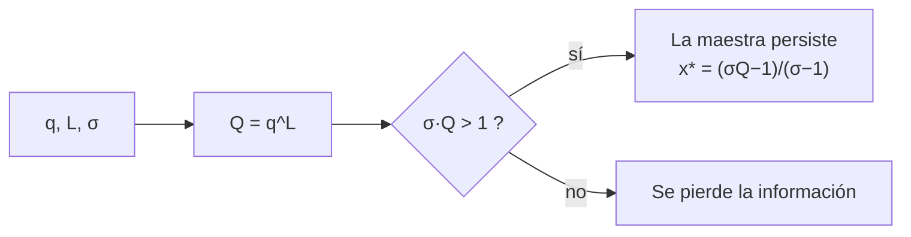

# B56-C03 — Origen de moléculas autorreplicantes

<!-- nav:top -->
[🏠 Programa](../../../../README.md) · [📚 Bloque B56](../../../tronco-comun/B56-astrobiologia-y-vida-extraterrestre.md) · [← Anterior: B56-C02 — Bioquímica y metabolismo terrestre](../B56-C02-bioquimica-y-metabolismo-terrestre/CLASE.md) · [Siguiente: B56-C04 — Hipótesis de abiogénesis →](../B56-C04-hipotesis-de-abiogenesis/CLASE.md)
<!-- /nav -->

## 1. Ubicación, nivel y alcance

Clase 3 del bloque B56. Nivel N3. Tomas las ecuaciones diferenciales ([B11](../../../tronco-comun/B11-ecuaciones-diferenciales-y-simulacion-numerica.md)) y la probabilidad ([B12](../../../tronco-comun/B12-probabilidad-estadistica-e-incertidumbre.md)) para estudiar una restricción cuantitativa de un replicador primitivo: **cuánta información puede conservar una molécula que se copia con errores**. No tratas aquí cómo se formaron las primeras moléculas ([C04](../B56-C04-hipotesis-de-abiogenesis/CLASE.md)) ni cómo se unen los monómeros ([C21](../B56-C21-polimerizacion-prebiotica-experimental-oligomeros-y-condiciones-de-laboratorio/CLASE.md)).

## 2. Por qué esta clase existe

Un replicador que copia mal pierde su información; uno que copia bien necesita una maquinaria que, sin vida previa, aún no existe. Esa tensión limita el tamaño de los primeros genomas. La decisión central: **dada la fidelidad por letra y la ventaja selectiva de la secuencia maestra, ¿hasta qué longitud se mantiene la información?**

## 3. Lo que podrás hacer al terminar

1. Definir replicador, secuencia maestra, fidelidad, calidad de copia y umbral de error.
2. Calcular la calidad de copia `Q = q^L`.
3. Hallar la fracción estacionaria de la secuencia maestra y la longitud máxima sostenible.
4. Verificar la forma cerrada integrando numéricamente la ecuación de la población.
5. Explicar por qué una mayor ventaja selectiva extiende poco la longitud máxima.
6. Nombrar qué deja fuera el modelo de pico único.

La evidencia es la **ficha del umbral de error** del ejercicio 12 (sección 20).

## 4. Con qué llegas y cómo comprobarlo

1. ¿Qué es una ecuación diferencial `dx/dt = f(x)` y cómo se integra con Runge–Kutta?
2. ¿Cuánto vale `0,99^100`?
3. ¿Qué es una probabilidad condicionada?
4. ¿Qué es una secuencia de nucleótidos?
5. ¿Qué es un estado estacionario?

<details>
<summary>Ver respuestas</summary>

1. Una regla de cambio instantáneo; RK4 avanza con cuatro evaluaciones por paso. 2. `0,366`. 3. La probabilidad de un suceso dado que otro ocurrió. 4. Una cadena de letras (A, C, G, U/T). 5. Un estado donde `dx/dt = 0`.
</details>

Con cuatro o cinco aciertos, sigue; si no, repasa B11 y B12.

## 5. Un caso real: el dilema de copiar sin enzimas

Una molécula que se copia a sí misma, como el ARN, necesita copiar con alta fidelidad para no degradarse. **Ejemplo conductor sintético:** una población con fidelidad por letra `q = 0,99`, ventaja selectiva de la secuencia maestra `σ = 10` y longitud `L = 100`. Los valores son **ilustrativos**: no son tasas medidas de ningún replicador real.

## 6. Vocabulario

Un **replicador** es una molécula que dirige su propia copia. La **secuencia maestra** es la más apta de la población. La **fidelidad** `q` es la probabilidad de copiar bien una letra. La **calidad de copia** `Q = q^L` es la probabilidad de copiar bien una secuencia de `L` letras. La **ventaja selectiva** `σ` es el cociente entre la tasa de replicación de la maestra y la de los mutantes. El **umbral de error** es la longitud a partir de la cual la maestra desaparece de la población. Una **cuasiespecie** es la nube de mutantes alrededor de la maestra.

## 7. Modelo mental: un fotocopiador borroso

Cada copia degrada la imagen. Si el original tiene pocas líneas, las copias salen bien; si tiene muchas, casi todas salen con algún error y el texto original se pierde.



*Descripción textual:* se calcula la calidad de copia; si la tasa efectiva de la maestra supera a la de los mutantes, se mantiene con una fracción estacionaria; si no, desaparece.

Analogía: un rumor que se transmite de boca en boca. Su límite: aquí los errores son independientes por letra y no hay corrección.

## 8. La explicación, paso a paso

### 8.1 Calidad de copia

La probabilidad de copiar sin error `L` letras independientes es `Q = q^L`. Con `q = 0,99` y `L = 100`, `Q = 0,366`; con `L = 300`, `Q = 0,049`.

### 8.2 Ecuación de la población

Sea `x` la fracción de la maestra. Ella produce `σ` copias por unidad de tiempo y una fracción `Q` sale correcta; los mutantes tienen tasa 1. Con flujo constante, `dx/dt = x(σQ − φ)` y `φ = σx + (1 − x)`.

### 8.3 Estado estacionario

`dx/dt = 0` da `x* = (σQ − 1)/(σ − 1)` si `σQ > 1` y `x* = 0` si no. Para `q = 0,99`, `L = 100`, `σ = 10`: `x* = 0,2956`. La integración RK4 da el mismo valor (laboratorio).

### 8.4 Longitud máxima

`σQ = 1` da `L_max = ln σ/(−ln q) ≈ ln σ/(1 − q)`. Con `σ = 10` y `q = 0,99`: `229,1` (exacta) frente a `230,3` (aproximada). Para `q = 0,999`, unas diez veces más: la fidelidad pesa más que la ventaja.

### 8.5 Lo que el modelo deja fuera

Un pico único sin retromutación, errores independientes por letra, sin recombinación ni selección por estructura. En un mundo real la fidelidad no es una constante.

## 9. Magnitudes, símbolos y unidades

| Símbolo | Qué es | Unidad | Valor / nota |
|---|---|---|---|
| `q` | fidelidad por letra | adimensional | 0,99 (ilustrativo) |
| `L` | longitud | letras | 100 (ilustrativo) |
| `σ` | ventaja selectiva | adimensional | 10 (ilustrativo) |
| `Q` | calidad de copia | adimensional | `q^L` |
| `x*` | fracción estacionaria de la maestra | adimensional | `0,2956` |
| `L_max` | longitud máxima | letras | `229,1` |

## 10. Convenciones y referencias

Tiempo en unidades de la tasa de los mutantes; `dt = 0,01`, `t = 400`. Todos los parámetros son **ilustrativos**.

## 11. De dónde sale lo que afirmamos

| ID | Fuente | Localizador | Respalda | Estado |
|---|---|---|---|---|
| S1 | Alejandre et al., *Polymerization and replication of primordial RNA induced by clay-water interface dynamics*, Commun. Chem. 2025 | https://doi.org/10.1038/s42004-025-01632-w | Contexto: un modelo computacional de replicación de ARN en una interfaz arcilla–agua | Solo resumen (Europe PMC), consultado el 2026-11-09 |

Límites: el modelo de Eigen de pico único se presenta como derivación propia verificada numéricamente, sin cita de un texto; los parámetros son ilustrativos; no se afirma que el umbral calculado sea el de ningún replicador real.

## 12. Cómo ver el umbral

Equivalente accesible a una gráfica de `x*` contra `L` (con `q = 0,99`, `σ = 10`):

| `L` | `Q` | `x*` |
|---|---|---|
| 100 | 0,366 | 0,296 |
| 200 | 0,134 | 0,038 |
| 229 | 0,100 | 0 |
| 300 | 0,049 | 0 |

Descripción larga: `x*` baja hasta cero al llegar a `L_max ≈ 229`; luego la información se pierde.

## 13. Ejemplo trabajado: ¿persiste un replicador de 150 letras?

**Paso 1 · Datos.** `q = 0,99`, `σ = 10`, `L = 150` (ilustrativos).

**Paso 2 · Calidad.** `Q = 0,99^150 = 0,221`.

**Paso 3 · Condición.** `σQ = 2,21 > 1`: persiste.

**Paso 4 · Fracción.** `x* = (2,21 − 1)/9 = 0,134`.

**Paso 5 · Sentido.** La maestra se mantiene pero es el 13 % de la población. Es un resultado del modelo, no una predicción sobre una molécula real.

## 14. Comparar enfoques

**Pico único con forma cerrada (esta clase):** exacto para su modelo, sencillo. **Cuasiespecie completa:** resuelve una matriz de mutación; más realista, costosa. **Simulación estocástica:** incluye ruido de poblaciones pequeñas. Para estimar un orden de magnitud sirve el primero.

## 15. Práctica guiada

**Ejercicio 1 · con los pasos indicados.** Calcula `Q` para `q = 0,995` y `L = 200`. *Pasos:* `Q = q^L`; usa logaritmos.

<details><summary>Solución comentada</summary>

`ln Q = 200 ln 0,995 = −1,0025`; `Q = 0,367` (8.1).
</details>

**Ejercicio 2 · con una pista.** ¿Persiste una maestra con `Q = 0,06` y `σ = 10`? *Pista:* compara `σQ` con 1.

<details><summary>Solución comentada</summary>

`σQ = 0,6 < 1`: no persiste (8.3).
</details>

**Ejercicio 3 · casi autónomo.** Calcula `x*` si `σ = 10` y `Q = 0,5`.

<details><summary>Solución comentada</summary>

`x* = (5 − 1)/9 = 0,444` (8.3).
</details>

## 16. Práctica autónoma, transferencia e integrador

**Ejercicio 4.** Calcula `L_max` para `q = 0,999` y `σ = 10`.

<details><summary>Solución comentada</summary>

`ln 10/(−ln 0,999) = 2,3026/0,0010005 = 2301` letras (8.4).
</details>

**Ejercicio 5.** Si `σ` sube de 10 a 100, ¿cuánto crece `L_max`?

<details><summary>Solución comentada</summary>

`ln σ` se duplica: `L_max` crece al doble (a 458 con `q = 0,99`). Una ventaja diez veces mayor solo duplica la longitud.
</details>

**Ejercicio 6.** ¿Qué `q` hace falta para sostener `L = 1000` con `σ = 10`?

<details><summary>Solución comentada</summary>

`−ln q = ln 10/1000 = 0,0023026`; `q = 0,99770`. Se necesita una fidelidad de 99,77 % por letra.
</details>

**Ejercicio 7.** Explica por qué `x* = 0` no significa que no haya moléculas.

<details><summary>Solución comentada</summary>

Significa que la maestra no se mantiene; la población sigue existiendo como mutantes que se copian al azar (8.2).
</details>

**Ejercicio 8.** Interpreta `x* = 0,296` para `L = 100`.

<details><summary>Solución comentada</summary>

El 29,6 % de la población es la secuencia maestra exacta; el resto, mutantes cercanos.
</details>

**Ejercicio 9 · transferencia.** Un compañero afirma que «con una σ enorme cualquier genoma se mantiene». Respóndele.

<details><summary>Solución comentada</summary>

`L_max = ln σ/(1 − q)` crece solo con el logaritmo de `σ` (ejercicio 5). Para genomas largos hace falta mejorar `q` (8.4).
</details>

**Ejercicio 10 · transferencia.** ¿Cómo resuelve esta tensión una célula actual?

<details><summary>Solución comentada</summary>

Con enzimas de copia y corrección que elevan `q` por encima de 0,9999; así sostiene genomas de millones de letras. Es conocimiento general no consultado; sirve para ver la dirección del argumento.
</details>

**Ejercicio 11 · transferencia.** ¿Qué cambia si cada letra tiene una fidelidad distinta?

<details><summary>Solución comentada</summary>

`Q = Π q_i`; el cálculo es el mismo con el producto. Un solo sitio muy propenso al error puede dominar `Q`.
</details>

**Ejercicio 12 · integrador.** Elabora tu *ficha del umbral de error*: elige `q`, `σ` y `L` (ilustrativos), calcula `Q`, `x*` y `L_max`, interpreta el resultado y di qué dos supuestos del modelo son más cuestionables.

<details><summary>Solución modelo</summary>

Para `q = 0,99`, `σ = 10`, `L = 100`: `Q = 0,366`, `x* = 0,296`, `L_max = 229`. Cuestionables: pico único sin retromutación y errores independientes por letra. Rotulado como ilustrativo.
</details>

## 17. Laboratorio: umbral de error de Eigen

El script [umbral_de_error.py](umbral_de_error.py) calcula `x*` por forma cerrada y por integración RK4, y **comprueba** que coinciden (tolerancia `10⁻⁶`) y que en `L = ln σ/(−ln q)` se cumple `σQ = 1`.

**Datos:** sintéticos e ilustrativos. **Predice antes de ejecutar:** ¿qué `x*` da `L = 300`? (cero.) **Ejecución del 2026-11-09 (Python 3.12.9):**

```text
Python 3.12.9 (biblioteca estandar)
q=0.99, L=100: Q=0.3660 ; x* cerrada=0.29559 ; RK4=0.29559
q=0.99, L=300: Q=0.0490 ; x* cerrada=0.00000 ; RK4=0.00000
q=0.999, L=1000: Q=0.3677 ; x* cerrada=0.29744 ; RK4=0.29744
q=0.99: L_exacto=229.1 ; aproximacion ln(sigma)/(1-q)=230.3
Pruebas superadas.
```

```bash
python programa/clases/B56/B56-C03-origen-de-moleculas-autorreplicantes/umbral_de_error.py
```

**Límites:** pico único, sin retromutación, errores independientes; no describe ningún replicador real.

## 18. Errores frecuentes y cómo corregirlos

**Confundir `Q` con `q`.** Se corrige con el ejercicio 1.

**Creer que `σ` grande lo resuelve todo.** Se corrige con los ejercicios 5 y 9.

**Tomar `x* = 0` como «no hay moléculas».** Se corrige con el ejercicio 7.

**Usar `q` como porcentaje sin convertir.** Se corrige con el ejercicio 6.

**Presentar el resultado como tasa real.** Se corrige con la sección 10.

## 19. Cómo sabrás que vas bien

Tras 8.3: ¿sabes decidir si una maestra persiste? Ejercicio 2. Tras 8.4: ¿cómo depende `L_max` de `σ`? Ejercicio 5. Tras el laboratorio: ¿qué prueba la integración RK4? (que la forma cerrada es correcta para este modelo).

## 20. Qué entregas y cómo se evalúa

El producto es tu **ficha del umbral de error** (ejercicio 12).

| Criterio | Inicial | En desarrollo | Logrado | Destacado |
|---|---|---|---|---|
| Definiciones | Las confunde | Parciales | `q`, `Q`, `σ` correctos | Distingue la maestra y la cuasiespecie |
| Cálculo | Sin unidades | Con errores | `Q`, `x*`, `L_max` correctos | Dos vías |
| Interpretación | Sin lectura | Parcial | Explica el umbral | Cuestiona los supuestos |
| Rótulos | Sin rotular | Parciales | Ilustrativo rotulado | No lo presenta como tasa real |
| Fuentes | Sin fuente | Sin fecha | S1 con fecha y «solo resumen» | Declara que el modelo es propio |

**Condiciones críticas (no se compensan con promedio):** rotular `q`, `σ` y `L` como ilustrativos; no atribuir el resultado a un replicador real; citar solo lo consultado.

## 21. Ética, seguridad y límites

La clase es educativa y no da procedimientos de síntesis de moléculas replicantes. Accesibilidad: tablas equivalentes a las gráficas, fórmulas en texto, ejercicios sin conexión.

## 22. Para cerrar y seguir

La fidelidad de copia fija la longitud máxima de la información que un replicador puede conservar, y esa longitud crece solo con el logaritmo de la ventaja selectiva. Queda una pregunta: ¿cuántas secuencias distintas tendría que explorar un ambiente para encontrar una que funcione?

**Glosario español–inglés.** replicador · *replicator*; secuencia maestra · *master sequence*; fidelidad · *fidelity*; umbral de error · *error threshold*; cuasiespecie · *quasispecies*; ventaja selectiva · *selective advantage*.

**Continuidad.** [B56-C04](../B56-C04-hipotesis-de-abiogenesis/CLASE.md) cuantifica el tamaño del espacio de secuencias y lo que un ambiente puede explorar.

**Referencias:** ver sección 11.

<!-- nav:bottom -->
---

[← Anterior: B56-C02 — Bioquímica y metabolismo terrestre](../B56-C02-bioquimica-y-metabolismo-terrestre/CLASE.md) · [📚 Bloque B56](../../../tronco-comun/B56-astrobiologia-y-vida-extraterrestre.md) · [Siguiente: B56-C04 — Hipótesis de abiogénesis →](../B56-C04-hipotesis-de-abiogenesis/CLASE.md)
<!-- /nav -->
