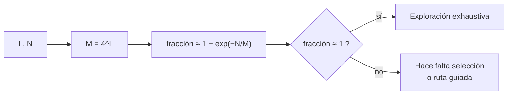

# B56-C04 — Hipótesis de abiogénesis

<!-- nav:top -->
[🏠 Programa](../../../../README.md) · [📚 Bloque B56](../../../tronco-comun/B56-astrobiologia-y-vida-extraterrestre.md) · [← Anterior: B56-C03 — Origen de moléculas autorreplicantes](../B56-C03-origen-de-moleculas-autorreplicantes/CLASE.md) · [Siguiente: B56-C05 — Extremófilos y límites ambientales →](../B56-C05-extremofilos-y-limites-ambientales/CLASE.md)
<!-- /nav -->

## 1. Ubicación, nivel y alcance

Clase 4 del bloque B56. Nivel N3. Tomas el umbral de error de [C03](../B56-C03-origen-de-moleculas-autorreplicantes/CLASE.md) y la probabilidad de [B12](../../../tronco-comun/B12-probabilidad-estadistica-e-incertidumbre.md) para comparar hipótesis sobre el origen de la vida **con cantidades**. No eliges una hipótesis ganadora: aprendes a preguntar cuánto espacio químico podía explorar un ambiente y a qué precio. La polimerización experimental se trata en [C21](../B56-C21-polimerizacion-prebiotica-experimental-oligomeros-y-condiciones-de-laboratorio/CLASE.md).

## 2. Por qué esta clase existe

Las hipótesis (mundo de ARN, metabolismo primero, ventilas hidrotermales, charcas con ciclos húmedo–seco, aporte meteorítico) se discuten a menudo con palabras. Una cuenta de espacio de secuencias permite saber cuándo una afirmación es plausible por números y cuándo exige un mecanismo de selección. La decisión central: **dado un número de moléculas producidas, ¿qué fracción del espacio de secuencias de longitud `L` se explora?**

## 3. Lo que podrás hacer al terminar

1. Definir abiogénesis, espacio de secuencias, cobertura y selección.
2. Calcular el tamaño `4^L` de un espacio de secuencias.
3. Calcular la fracción esperada explorada tras `N` ensayos.
4. Verificar la fórmula con una simulación de semilla fija.
5. Explicar por qué la exploración al azar no basta para longitudes grandes y qué papel juega la selección.
6. Distinguir lo que una cuenta demuestra de lo que una hipótesis necesita.

La evidencia es la **comparación de hipótesis con cantidades** del ejercicio 12 (sección 20).

## 4. Con qué llegas y cómo comprobarlo

1. ¿Cuántas secuencias de 3 letras hay con 4 letras posibles?
2. ¿Qué es `log₁₀ 4^L`?
3. ¿Qué es el número de Avogadro?
4. ¿Qué mide una fracción esperada?
5. ¿Qué es una simulación con semilla fija?

<details>
<summary>Ver respuestas</summary>

1. `4³ = 64`. 2. `L log₁₀ 4 = 0,602 L`. 3. `6,022 × 10²³ mol⁻¹`. 4. El promedio de la fracción sobre muchas repeticiones. 5. Una simulación aleatoria reproducible porque se fija el generador.
</details>

Con cuatro o cinco aciertos, sigue; si no, repasa B12.

## 5. Un caso real: una charca hipotética

Las hipótesis sobre el origen de la vida buscan ambientes con ciclos, superficies y energía. **Ejemplo conductor sintético:** una charca de `10³ m³` con `10⁻⁶ mol/L` de oligómeros que se renueva `10⁴` veces. Produce `6,02 × 10²⁷` moléculas en total. Es un ejemplo **ilustrativo**: no describe una Tierra primitiva real. El contexto experimental (ciclos húmedo–seco que forman polímeros resistentes a la ARNasa) procede del resumen de Simonis et al. (S2).

## 6. Vocabulario

La **abiogénesis** es el origen de la vida a partir de materia sin vida. El **espacio de secuencias** es el conjunto de todas las secuencias posibles de longitud `L`, de tamaño `M = 4^L` con cuatro letras. La **cobertura** es la fracción del espacio explorada. La **selección** es el aumento de la frecuencia de secuencias que funcionan mejor. El **mundo de ARN** es la hipótesis de que una etapa temprana usó ARN como información y catalizador.

## 7. Modelo mental: pescar en un lago enorme

El espacio de secuencias es un lago; cada ensayo es una tirada de caña. Sin pistas sobre dónde pescar, hay que tirar tantas veces como peces diferentes hay.



*Descripción textual:* se calcula el tamaño del espacio, se estima la cobertura con la fórmula y, si es muy baja, la hipótesis necesita un mecanismo de selección.

Analogía: buscar una combinación de candado probando al azar. Su límite: en química hay intermedios funcionales que guían la búsqueda.

## 8. La explicación, paso a paso

### 8.1 Tamaño del espacio

Con cuatro letras, `M = 4^L`. Para `L = 20`, `M = 1,1 × 10¹²`; para `L = 100`, `10^{60,2}`.

### 8.2 Cobertura esperada

Si se producen `N` secuencias al azar, uniformes e independientes, la probabilidad de que una secuencia concreta no se produzca nunca es `(1 − 1/M)^N`. La fracción esperada es `1 − (1 − 1/M)^N ≈ 1 − e^{−N/M}`.

### 8.3 Verificación con simulación

Para `M = 20 000` y `N = 30 000`, la fórmula da `0,7769`; la simulación con semilla 12345 da `0,7791` (diferencia relativa `0,3 %`).

### 8.4 La charca

Con `N = 6,02 × 10²⁷`: para `L = 20, 30, 40` la cobertura es prácticamente total (`N/M` enorme); para `L = 60` baja a `4,5 × 10⁻⁹` y para `L = 100` a `3,8 × 10⁻³³`. El límite cae entre 40 y 60 letras en este ejemplo.

### 8.5 Lo que la cuenta deja fuera

El muestreo no es uniforme (la química favorece ciertas secuencias), no se cuentan secuencias funcionales múltiples ni los mecanismos de copia que concentran lo útil. Cada hipótesis aporta su propia razón para que la búsqueda no sea al azar; la cuenta fija **cuánta ayuda necesita**.

## 9. Magnitudes, símbolos y unidades

| Símbolo | Qué es | Unidad | Valor / nota |
|---|---|---|---|
| `N_A` | constante de Avogadro | `mol⁻¹` | `6,022 140 76 × 10²³` (S1) |
| `L` | longitud | letras | 20 a 100 |
| `M` | tamaño del espacio | secuencias | `4^L` |
| `N` | ensayos | secuencias | `6,02 × 10²⁷` (sintético) |
| `f` | cobertura | adimensional | `1 − e^{−N/M}` |

## 10. Convenciones y referencias

Alfabeto de 4 letras, muestreo uniforme e independiente; simulación con semilla 12345. La charca es **sintética**.

## 11. De dónde sale lo que afirmamos

| ID | Fuente | Localizador | Respalda | Estado |
|---|---|---|---|---|
| S1 | NIST, *Fundamental Physical Constants — Complete Listing* (CODATA 2022) | https://physics.nist.gov/cuu/Constants/Table/allascii.txt | `N_A` | Consultada el 2026-11-09 |
| S2 | Simonis et al., *Abiotic synthesis of RNase-resistant phosphodiester and pyrophosphate-linked polymers via thermodynamically controlled wet-dry cycling*, Sci. Rep. 2026 | https://doi.org/10.1038/s41598-026-56548-9 | Contexto: síntesis abiótica de polímeros con ciclos húmedo–seco | Solo resumen (Europe PMC), consultado el 2026-11-09 |

Límites: de S2 solo se leyó el resumen; no se citan cifras de rendimiento del artículo. La charca, los ciclos y la concentración son sintéticos. La fórmula de cobertura es un resultado estándar verificado numéricamente.

## 12. Cómo ver la cobertura

Equivalente accesible a una gráfica de cobertura contra `L` para la charca:

| `L` | `log₁₀ M` | Cobertura |
|---|---|---|
| 20 | 12,0 | ≈ 1 |
| 40 | 24,1 | ≈ 1 |
| 60 | 36,1 | `4,5 × 10⁻⁹` |
| 100 | 60,2 | `3,8 × 10⁻³³` |

Descripción larga: la cobertura es total hasta unas 40 letras y se desploma exponencialmente después.

## 13. Ejemplo trabajado: ¿explora la charca un espacio de 50 letras?

**Paso 1 · Datos.** `N = 6,02 × 10²⁷`, `L = 50` (sintéticos).

**Paso 2 · Espacio.** `log₁₀ M = 50 × 0,602 = 30,1`; `M = 1,3 × 10³⁰`.

**Paso 3 · Cobertura.** `N/M = 6,02 × 10²⁷/1,27 × 10³⁰ = 4,7 × 10⁻³`; `f ≈ 4,7 × 10⁻³`.

**Paso 4 · Sentido.** Explora el 0,5 %. Con selección que haga crecer lo funcional, no haría falta mirar todo; sin ella, 50 letras ya están al límite. Es un resultado ilustrativo.

## 14. Comparar enfoques

**Cuenta de espacio de secuencias (esta clase):** simple, pone cotas. **Modelos de red de reacciones:** incorporan química, más realistas. **Experimentos de laboratorio:** miden lo que sí ocurre (como los ciclos húmedo–seco). Ninguno por sí solo decide la hipótesis.

## 15. Práctica guiada

**Ejercicio 1 · con los pasos indicados.** Calcula `M` para `L = 12`. *Pasos:* `4^12`.

<details><summary>Solución comentada</summary>

`4^12 = 16 777 216` (8.1).
</details>

**Ejercicio 2 · con una pista.** Calcula la cobertura si `N = M`. *Pista:* `1 − e^{−1}`.

<details><summary>Solución comentada</summary>

`1 − 0,3679 = 0,632`: ensayar tantas veces como secuencias cubre el 63 % (8.2).
</details>

**Ejercicio 3 · casi autónomo.** Calcula `N` para cubrir el 99 % de `M = 10⁶`.

<details><summary>Solución comentada</summary>

`e^{−N/M} = 0,01` → `N = M ln 100 = 4,6 × 10⁶` (8.2).
</details>

## 16. Práctica autónoma, transferencia e integrador

**Ejercicio 4.** Calcula `log₁₀ M` para `L = 30`.

<details><summary>Solución comentada</summary>

`30 × 0,60206 = 18,06` (8.1).
</details>

**Ejercicio 5.** ¿Cuántas letras más permite explorar un aumento de `N` por `10⁶`?

<details><summary>Solución comentada</summary>

`log₁₀ 10⁶ = 6`; `6/0,602 = 10` letras más (8.4).
</details>

**Ejercicio 6.** Si solo el 1 % de las secuencias es funcional, ¿cómo cambia la cobertura necesaria?

<details><summary>Solución comentada</summary>

Basta alcanzar una de `0,01 M` secuencias: se necesita `N ≈ 100` veces menos para tener alta probabilidad de acierto.
</details>

**Ejercicio 7.** ¿Por qué la simulación de 8.3 usa un espacio pequeño?

<details><summary>Solución comentada</summary>

Porque un espacio de `10⁶⁰` no cabe en memoria; se valida la fórmula donde es comprobable y se extrapola la fórmula, no la simulación.
</details>

**Ejercicio 8.** Interpreta una cobertura de `10⁻³³`.

<details><summary>Solución comentada</summary>

Que sin selección ni guía, la probabilidad de haber explorado cualquier secuencia dada es despreciable; la hipótesis necesita un mecanismo que concentre lo funcional.
</details>

**Ejercicio 9 · transferencia.** Un compañero dice: «el cálculo demuestra que la vida no pudo surgir por azar». Respóndele.

<details><summary>Solución comentada</summary>

El cálculo asume muestreo uniforme y una sola secuencia útil. Con muchas secuencias funcionales y selección acumulativa, el resultado cambia (8.5). Una cota sobre un modelo no refuta una hipótesis.
</details>

**Ejercicio 10 · transferencia.** ¿Qué dato experimental cambiaría la cuenta?

<details><summary>Solución comentada</summary>

La fracción de secuencias funcionales y el sesgo de la síntesis abiótica; ambos se miden en el laboratorio y no se asumen.
</details>

**Ejercicio 11 · transferencia.** Compara una charca de `10³ m³` con otra de `10⁶ m³` a igual concentración.

<details><summary>Solución comentada</summary>

`N` crece `10³` veces: añade `3/0,602 ≈ 5` letras de alcance. Mil veces más volumen solo aporta cinco letras (ejercicio 5).
</details>

**Ejercicio 12 · integrador.** Elabora tu *comparación de hipótesis con cantidades*: elige dos ambientes hipotéticos (ilustrativos) con distinto `N`, calcula la longitud máxima que cubren al 50 %, y di qué mecanismo de selección le exigirías a cada hipótesis.

<details><summary>Solución modelo</summary>

Para `N = 10²⁰` y `10²⁸`: `M` al 50 % es `N/0,693`; `L_max = log₄(N/0,693)`: `33,5` y `46,8` letras. Se pide a cada hipótesis un mecanismo (superficie mineral, compartimentos, ciclos) que concentre secuencias funcionales. Todo rotulado como ilustrativo.
</details>

## 17. Laboratorio: espacio de secuencias

El script [espacio_de_secuencias.py](espacio_de_secuencias.py) calcula la cobertura esperada, la contrasta con una simulación con semilla 12345 (tolerancia 2 %) y evalúa la charca sintética para `L` de 20 a 100.

**Datos:** `N_A` de NIST; la charca es **sintética**. **Predice antes de ejecutar:** ¿qué cobertura da `N = M`? (63 %.) **Ejecución del 2026-11-09 (Python 3.12.9):**

```text
Python 3.12.9 (biblioteca estandar)
M=20000, N=30000: cerrada=0.7769 ; simulada=0.7791
Moleculas por ciclo = 6.02e+23 ; totales = 6.02e+27
L= 20: log10(M)=  12.0 ; fraccion explorada ~ 1.00e+00
L= 30: log10(M)=  18.1 ; fraccion explorada ~ 1.00e+00
L= 40: log10(M)=  24.1 ; fraccion explorada ~ 1.00e+00
L= 60: log10(M)=  36.1 ; fraccion explorada ~ 4.53e-09
L=100: log10(M)=  60.2 ; fraccion explorada ~ 3.75e-33
Pruebas superadas.
```

```bash
python programa/clases/B56/B56-C04-hipotesis-de-abiogenesis/espacio_de_secuencias.py
```

**Límites:** muestreo uniforme, una sola secuencia útil, sin selección; la charca es sintética.

## 18. Errores frecuentes y cómo corregirlos

**Tomar la cobertura como probabilidad de que la vida surgiera.** Se corrige con el ejercicio 9.

**Olvidar que `M` crece exponencialmente.** Se corrige con el ejercicio 5.

**Ignorar la selección.** Se corrige con el ejercicio 8.

**Extrapolar la simulación en vez de la fórmula.** Se corrige con el ejercicio 7.

**Presentar la charca como un dato.** Se corrige con la sección 10.

## 19. Cómo sabrás que vas bien

Tras 8.2: ¿qué fracción se cubre con `N = M`? Ejercicio 2. Tras 8.4: ¿por qué cae la cobertura? Ejercicio 5. Tras el laboratorio: ¿qué valida la simulación? (que la fórmula describe el muestreo).

## 20. Qué entregas y cómo se evalúa

El producto es tu **comparación de hipótesis con cantidades** (ejercicio 12).

| Criterio | Inicial | En desarrollo | Logrado | Destacado |
|---|---|---|---|---|
| Conceptos | Los confunde | Parciales | Espacio y cobertura claros | Distingue azar y selección |
| Cálculo | Sin unidades | Con errores | `M`, `f`, `L` correctos | Con simulación |
| Hipótesis | Sin comparar | Sin razón | Dos ambientes comparados | Pide mecanismos concretos |
| Rótulos | Sin rotular | Parciales | Sintético rotulado | No presenta la cuenta como refutación |
| Fuentes | Sin fuente | Sin fecha | S1–S2 con fecha | Declara «solo resumen» |

**Condiciones críticas (no se compensan con promedio):** rotular la charca como sintética; no afirmar que la vida no pudo surgir por azar ni que sí; citar solo lo consultado.

## 21. Ética, seguridad y límites

La clase es educativa y no toma partido en el debate sobre el origen de la vida. Accesibilidad: tablas equivalentes a las gráficas, fórmulas en texto, ejercicios sin conexión.

## 22. Para cerrar y seguir

Un espacio de secuencias crece como `4^L`; un ambiente explora una fracción que cae exponencialmente con `L`, por lo que toda hipótesis necesita un mecanismo que concentre lo funcional. Queda una pregunta: ¿qué ambientes soportan la vida conocida, y hasta dónde?

**Glosario español–inglés.** abiogénesis · *abiogenesis*; espacio de secuencias · *sequence space*; cobertura · *coverage*; mundo de ARN · *RNA world*; selección · *selection*.

**Continuidad.** [B56-C05](../B56-C05-extremofilos-y-limites-ambientales/CLASE.md) estudia los límites de temperatura y humedad de la vida conocida.

**Referencias:** ver sección 11.

<!-- nav:bottom -->
---

[← Anterior: B56-C03 — Origen de moléculas autorreplicantes](../B56-C03-origen-de-moleculas-autorreplicantes/CLASE.md) · [📚 Bloque B56](../../../tronco-comun/B56-astrobiologia-y-vida-extraterrestre.md) · [Siguiente: B56-C05 — Extremófilos y límites ambientales →](../B56-C05-extremofilos-y-limites-ambientales/CLASE.md)
<!-- /nav -->
