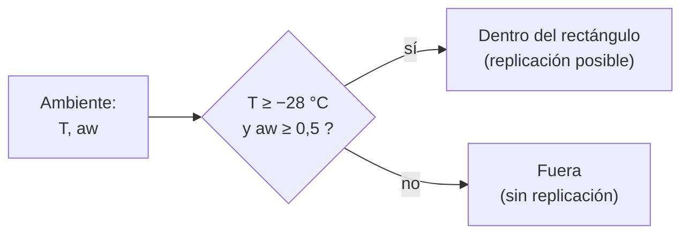

# B56-C05 — Extremófilos y límites ambientales

<!-- nav:top -->
[🏠 Programa](../../../../README.md) · [📚 Bloque B56](../../../tronco-comun/B56-astrobiologia-y-vida-extraterrestre.md) · [← Anterior: B56-C04 — Hipótesis de abiogénesis](../B56-C04-hipotesis-de-abiogenesis/CLASE.md) · [Siguiente: B56-C06 — Agua líquida y solventes alternativos →](../../../tronco-comun/B56-astrobiologia-y-vida-extraterrestre.md#b56-c06)
<!-- /nav -->

## 1. Ubicación, nivel y alcance

Clase 5 del bloque B56. Nivel N3. Tomas la temperatura ([B05-C13](../../B05/B05-C13-temperatura-y-energia-termica/CLASE.md)) y el ajuste lineal de [B12](../../../tronco-comun/B12-probabilidad-estadistica-e-incertidumbre.md) para delimitar **en qué condiciones puede replicarse la vida conocida**. Es una visión general; la radiotolerancia y otros límites se tratan en el bloque [B64](../../../tronco-comun/B64-extremofilos-y-limites-de-la-vida.md). El agua como solvente sigue en [C06](../B56-C06-agua-liquida-y-solventes-alternativos/CLASE.md).

## 2. Por qué esta clase existe

Decidir si un ambiente es habitable, o si una nave puede contaminarlo, exige umbrales de temperatura y de agua disponible. La decisión central: **dada la temperatura y la actividad del agua de un ambiente, ¿está dentro de los límites en que la vida terrestre puede replicarse?**

## 3. Lo que podrás hacer al terminar

1. Definir extremófilo, actividad del agua, temperatura cardinal y límite de replicación.
2. Ajustar un modelo de temperatura cardinal a datos y recuperar `T_min`.
3. Verificar el ajuste con dos métodos independientes.
4. Cotejar un ambiente con los límites de COSPAR (`aw ≥ 0,5`, `T ≥ −28 °C`).
5. Distinguir sobrevivir, metabolizar y replicarse.
6. Nombrar qué deja fuera un umbral único.

La evidencia es la **ficha de un ambiente frente a los límites** del ejercicio 12 (sección 20).

## 4. Con qué llegas y cómo comprobarlo

1. ¿Cómo se convierte °C en K?
2. ¿Qué es la actividad del agua `aw` (de 0 a 1)?
3. ¿Qué hace un ajuste de mínimos cuadrados?
4. ¿Qué es la raíz cuadrada de una tasa?
5. ¿Qué es un microorganismo mesófilo?

<details>
<summary>Ver respuestas</summary>

1. `K = °C + 273,15`. 2. La presión de vapor del medio relativa a la del agua pura; 1 es agua pura. 3. Elige la recta que minimiza la suma de cuadrados de los residuos. 4. Una transformación que linealiza la rama fría de la curva de crecimiento. 5. Uno que crece a temperaturas moderadas.
</details>

Con cuatro o cinco aciertos, sigue; si no, repasa B05-C13 y B12.

## 5. Un caso real: los límites de la política COSPAR

La política COSPAR de 2026 fija, para la replicación de microorganismos terrestres, una **actividad del agua mínima de 0,5** y una **temperatura mínima de −28 °C**, e indica que ambos límites incluyen márgenes por debajo de los límites reportados de la biología terrestre (S1, consultada el 2026-11-09). Son el **ejemplo conductor**. Los ambientes que probamos son **sintéticos**.

## 6. Vocabulario

Un **extremófilo** es un organismo que prospera o se replica en condiciones extremas para la mayoría. La **actividad del agua** `aw` mide cuánta agua está disponible para los organismos. La **temperatura cardinal** son las tres temperaturas del crecimiento: mínima `T_min`, óptima `T_opt` y máxima `T_max`. Un **límite de replicación** es el valor de una variable por debajo (o encima) del cual no hay división celular. **Sobrevivir** es conservar la viabilidad sin dividirse; **replicarse** es dividirse y propagarse.

## 7. Modelo mental: un ambiente es un punto en un plano

Cada ambiente es un punto en el plano (temperatura, actividad del agua); los límites forman un rectángulo. Dentro, la replicación es posible según el modelo; fuera, no.



*Descripción textual:* se compara cada ambiente con los dos umbrales; solo los que cumplen ambos están dentro.

Analogía: un salón con un horario y un aforo. Su límite: un organismo concreto tiene sus propios umbrales, más estrechos que los de la política.

## 8. La explicación, paso a paso

### 8.1 Modelo de temperatura cardinal

En la rama fría, `√r = b (T − T_min)` con `r` la tasa de crecimiento. Si se grafica `√r` contra `T`, se obtiene una recta que corta el eje en `T_min`.

### 8.2 Ajuste por mínimos cuadrados

Dos métodos independientes: fórmulas cerradas (`b = (nΣxy − ΣxΣy)/(nΣx² − (Σx)²`) y ecuaciones normales resueltas por Cramer. Deben coincidir a `10⁻⁹`.

### 8.3 Datos sintéticos

Se generan con `b = 0,05`, `T_min = −10 °C` y ruido gaussiano de `0,002` (semilla 7). El ajuste recupera `b = 0,0500` y `T_min = −9,99 °C`.

### 8.4 Cotejo con COSPAR

Cuatro ambientes sintéticos: salmuera fría (−20 °C, `aw = 0,60`) dentro; suelo polar seco (−40 °C, 0,30) fuera; fuente termal (70 °C, 0,98) dentro; sal casi seca (20 °C, 0,40) fuera por falta de agua, aunque la temperatura sea agradable.

### 8.5 Lo que el umbral deja fuera

Los límites son márgenes de política, no de un organismo concreto. Tampoco consideran radiación, pH, presión ni nutrientes. El límite superior de temperatura de la vida conocida no se trata aquí porque su fuente primaria **no se consultó**.

## 9. Magnitudes, símbolos y unidades

| Símbolo | Qué es | Unidad | Valor / nota |
|---|---|---|---|
| `T` | temperatura | °C o K | −28 °C (límite COSPAR) |
| `aw` | actividad del agua | adimensional | 0,5 (límite COSPAR) |
| `r` | tasa de crecimiento | h⁻¹ (sintética) | `r = (√r)²` |
| `b` | pendiente | `(h⁻¹)^{1/2} °C⁻¹` | 0,0500 |
| `T_min` | temperatura mínima | °C | −9,99 |

## 10. Convenciones y referencias

Temperatura en °C en la tabla y K en cálculos físicos. Datos de crecimiento **sintéticos** (semilla 7). Los ambientes de 8.4 son **sintéticos**.

## 11. De dónde sale lo que afirmamos

| ID | Fuente | Localizador | Respalda | Estado |
|---|---|---|---|---|
| S1 | COSPAR, *COSPAR Policy on Planetary Protection*, Space Research Today n.º 224, enero de 2026 | https://cosparhq.cnes.fr/assets/uploads/2026/01/SRT_224_Editorial_PPP-Nov-2025.pdf (doi 10.60970/012026SRT224/PPP) | `aw ≥ 0,5` y `T ≥ −28 °C` (sección 4.2) | Texto completo extraído con PyMuPDF el 2026-11-09 |
| S2 | Rekadwad et al., revisión de adaptaciones de extremófilos, 3 Biotech 2023 | https://doi.org/10.1007/s13205-023-03733-6 | Contexto: existe una literatura de revisión sobre adaptaciones | Solo la descripción de Europe PMC (sin resumen leído), 2026-11-09 |

Límites: el modelo de Ratkowsky se aplica a datos sintéticos como derivación propia; no se consultó ninguna fuente sobre temperaturas máximas de crecimiento; S2 se cita solo como existencia de una revisión.

## 12. Cómo ver el rectángulo

Equivalente accesible a un diagrama de dispersión:

| Ambiente (sintético) | `T` (°C) | `aw` | Veredicto |
|---|---|---|---|
| Salmuera fría | −20 | 0,60 | dentro |
| Suelo polar seco | −40 | 0,30 | fuera |
| Fuente termal | 70 | 0,98 | dentro |
| Sal casi seca | 20 | 0,40 | fuera |

Descripción larga: un ambiente puede fallar por frío, por sequedad o por ambos; la temperatura agradable no compensa la falta de agua.

## 13. Ejemplo trabajado: ¿está dentro un ambiente a −25 °C y `aw = 0,55`?

**Paso 1 · Datos.** `T = −25 °C`, `aw = 0,55` (sintéticos).

**Paso 2 · Temperatura.** `−25 ≥ −28`: cumple.

**Paso 3 · Agua.** `0,55 ≥ 0,5`: cumple.

**Paso 4 · Sentido.** Está dentro por márgenes pequeños (3 °C y 0,05); la política incluye márgenes, así que «dentro» es «no se puede descartar replicación», no «hay vida».

## 14. Distintos criterios de habitabilidad

**Umbrales de política (esta clase):** simples y conservadores. **Modelos por organismo:** cardinales, más finos. **Experimentos de cultivo:** miden la tasa real, pero no se tratan aquí. Para proteger otros mundos sirve el umbral conservador.

## 15. Práctica guiada

**Ejercicio 1 · con los pasos indicados.** Convierte −28 °C a K. *Pasos:* suma 273,15.

<details><summary>Solución comentada</summary>

`245,15 K` (sección 4).
</details>

**Ejercicio 2 · con una pista.** Con `√r = 0,05(T + 10)`, calcula `r` a 10 °C. *Pista:* eleva al cuadrado.

<details><summary>Solución comentada</summary>

`√r = 1,0`, `r = 1,0 h⁻¹` (8.1).
</details>

**Ejercicio 3 · casi autónomo.** ¿Está dentro un ambiente a −30 °C y `aw = 0,9`?

<details><summary>Solución comentada</summary>

No: −30 < −28 (8.4).
</details>

## 16. Práctica autónoma, transferencia e integrador

**Ejercicio 4.** ¿Por qué se grafica `√r` y no `r`?

<details><summary>Solución comentada</summary>

Porque `√r` es lineal en `T` en la rama fría; con ello se ajusta una recta (8.1).
</details>

**Ejercicio 5.** Dados los puntos (0, 0,5) y (10, 1,0) de `√r`, halla `b` y `T_min`.

<details><summary>Solución comentada</summary>

`b = 0,5/10 = 0,05`; `T_min = 0 − 0,5/0,05 = −10 °C` (8.1).
</details>

**Ejercicio 6.** ¿Qué diferencia hay entre sobrevivir y replicarse en un ambiente a −40 °C?

<details><summary>Solución comentada</summary>

A −40 °C una célula puede conservarse viable congelada sin dividirse; la política trata solo la replicación (6).
</details>

**Ejercicio 7.** ¿Por qué los límites de COSPAR incluyen márgenes?

<details><summary>Solución comentada</summary>

Para proteger de errores y de organismos aún no cultivados; el texto lo dice (sección 5).
</details>

**Ejercicio 8.** Comprueba que los dos métodos de ajuste coinciden con dos puntos.

<details><summary>Solución comentada</summary>

Con dos puntos ambos dan la recta exacta que los une; el resultado coincide (8.2).
</details>

**Ejercicio 9 · transferencia.** Un compañero dice: «Marte es habitable porque hay microbios a −20 °C en la Tierra». Respóndele.

<details><summary>Solución comentada</summary>

La temperatura es una de las condiciones; también hacen falta agua disponible, nutrientes y baja radiación. La clase no evalúa Marte aquí (se verá en [C08](../B56-C08-habitabilidad-de-marte/CLASE.md)).
</details>

**Ejercicio 10 · transferencia.** Una muestra de suelo tiene `aw = 0,45` a 15 °C. ¿Qué concluyes?

<details><summary>Solución comentada</summary>

Está fuera por agua (0,45 < 0,5), aunque la temperatura sea cómoda (8.4).
</details>

**Ejercicio 11 · transferencia.** Un laboratorio mide `T_min = −12 °C` para un organismo. ¿Contradice el límite de −28 °C?

<details><summary>Solución comentada</summary>

No: el límite de la política es más bajo con margen; no contradice, protege (sección 5).
</details>

**Ejercicio 12 · integrador.** Elabora tu *ficha de un ambiente frente a los límites*: elige un ambiente hipotético, indica `T` y `aw` (sintéticos), decide si está dentro, estima el margen y di qué otras variables habría que medir.

<details><summary>Solución modelo</summary>

Por ejemplo lago subglaciar a −2 °C y `aw = 0,99`: dentro con margen de 26 °C y 0,49. Habría que medir pH, salinidad, nutrientes y radiación. Todo rotulado como sintético.
</details>

## 17. Laboratorio: temperatura cardinal y límites

El script [temperatura_cardinal.py](temperatura_cardinal.py) genera datos sintéticos, ajusta `√r = b(T − T_min)` con dos métodos, **comprueba** que coinciden a `10⁻⁹` y que `T_min` queda a menos de 1 K del verdadero, y coteja cuatro ambientes con los límites de COSPAR.

**Datos:** sintéticos; límites de S1. **Predice antes de ejecutar:** ¿qué `T_min` recupera el ajuste? (cerca de −10 °C.) **Ejecución del 2026-11-09 (Python 3.12.9):**

```text
Python 3.12.9 (biblioteca estandar)
Ajuste: b = 0.0500 ; T_min = -9.99 C (verdadero: 0.0500 y -10.00)
Salmuera hipersalina fria (sintetico)    T= -20.0 C, aw=0.60 -> dentro
Suelo seco polar (sintetico)             T= -40.0 C, aw=0.30 -> fuera
Fuente termal (sintetico)                T=  70.0 C, aw=0.98 -> dentro
Sal casi seca (sintetico)                T=  20.0 C, aw=0.40 -> fuera
Pruebas superadas.
```

```bash
python programa/clases/B56/B56-C05-extremofilos-y-limites-ambientales/temperatura_cardinal.py
```

**Límites:** rama fría solamente, ruido gaussiano pequeño, datos sintéticos; no es la curva de un organismo real.

## 18. Errores frecuentes y cómo corregirlos

**Confundir sobrevivir con replicarse.** Se corrige con el ejercicio 6.

**Olvidar el agua.** Se corrige con el ejercicio 10.

**Mezclar °C y K.** Se corrige con el ejercicio 1.

**Tomar el umbral de política como el de un organismo.** Se corrige con el ejercicio 11.

**Extrapolar fuera de la rama fría.** Se corrige con la sección 8.5.

## 19. Cómo sabrás que vas bien

Tras 8.2: ¿puedes ajustar una recta? Ejercicio 5. Tras 8.4: ¿qué falla en la sal casi seca? Ejercicio 10. Tras el laboratorio: ¿qué comprueba la coincidencia de los dos ajustes? (que el cálculo es correcto algebraicamente).

## 20. Qué entregas y cómo se evalúa

El producto es tu **ficha de un ambiente frente a los límites** (ejercicio 12).

| Criterio | Inicial | En desarrollo | Logrado | Destacado |
|---|---|---|---|---|
| Conceptos | Los confunde | Parciales | Límite, `aw`, cardinal claros | Distingue sobrevivir y replicar |
| Ajuste | Sin unidades | Con errores | `b` y `T_min` correctos | Dos métodos |
| Decisión | Sin comparar | Sin razón | Dentro/fuera con margen | Lista variables ausentes |
| Rótulos | Sin rotular | Parciales | Sintético rotulado | Declara márgenes de política |
| Fuentes | Sin fuente | Sin fecha | S1 con fecha | Declara lo no consultado |

**Condiciones críticas (no se compensan con promedio):** rotular lo sintético; no afirmar que un ambiente «dentro» tiene vida; citar solo lo consultado.

## 21. Ética, seguridad y límites

La clase es educativa y no da métodos de cultivo de microorganismos. Accesibilidad: tablas equivalentes a las gráficas, fórmulas en texto, ejercicios sin conexión.

## 22. Para cerrar y seguir

La replicación terrestre exige agua disponible y una temperatura mínima; la política COSPAR fija `aw ≥ 0,5` y `T ≥ −28 °C` con márgenes, y un ambiente puede fallar por cualquiera. Queda una pregunta: ¿cuándo el agua es líquida y qué podría reemplazarla?

**Glosario español–inglés.** extremófilo · *extremophile*; actividad del agua · *water activity*; temperatura cardinal · *cardinal temperature*; límite de replicación · *replication limit*; mesófilo · *mesophile*.

**Continuidad.** [B56-C06](../B56-C06-agua-liquida-y-solventes-alternativos/CLASE.md) estudia las fases del agua y los solventes alternativos.

**Referencias:** ver sección 11.

<!-- nav:bottom -->
---

[← Anterior: B56-C04 — Hipótesis de abiogénesis](../B56-C04-hipotesis-de-abiogenesis/CLASE.md) · [📚 Bloque B56](../../../tronco-comun/B56-astrobiologia-y-vida-extraterrestre.md) · [Siguiente: B56-C06 — Agua líquida y solventes alternativos →](../../../tronco-comun/B56-astrobiologia-y-vida-extraterrestre.md#b56-c06)
<!-- /nav -->
