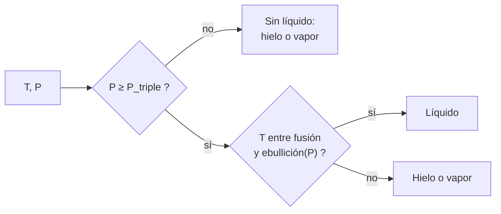

# B56-C06 — Agua líquida y solventes alternativos

<!-- nav:top -->
[🏠 Programa](../../../../README.md) · [📚 Bloque B56](../../../tronco-comun/B56-astrobiologia-y-vida-extraterrestre.md) · [← Anterior: B56-C05 — Extremófilos y límites ambientales](../B56-C05-extremofilos-y-limites-ambientales/CLASE.md) · [Siguiente: B56-C07 — Energía química para la vida →](../B56-C07-energia-quimica-para-la-vida/CLASE.md)
<!-- /nav -->

## 1. Ubicación, nivel y alcance

Clase 6 del bloque B56. Nivel N3. Tomas los diagramas de fase ([B06-C11](../../B06/B06-C11-diagramas-de-fase/CLASE.md)) y los gases ([B05-C14](../../B05/B05-C14-gases-y-presion/CLASE.md)) para decidir **cuándo el agua puede ser líquida** en un ambiente y qué cambia si el solvente es otro. Usas la ecuación de Clausius–Clapeyron con calor latente constante. No tratas aún la química de ningún mundo concreto (siguen en C08–C11).

## 2. Por qué esta clase existe

«Sigue el agua» es una consigna de la exploración, pero tener hielo o vapor no es tener un líquido. La presión y la temperatura mandan. La decisión central: **dados `T` y `P` de un ambiente, ¿el agua es hielo, líquido o vapor?**

## 3. Lo que podrás hacer al terminar

1. Definir punto triple, presión de vapor, temperatura de ebullición y calor latente.
2. Calcular la presión de vapor con Clausius–Clapeyron y verificarla integrando la ecuación diferencial.
3. Hallar la temperatura de ebullición a una presión dada.
4. Decidir la fase del agua en cuatro ambientes.
5. Aplicar el mismo método a un solvente alternativo, el metano.
6. Nombrar qué deja fuera el modelo (solutos, calor latente variable).

La evidencia es la **decisión de fase en cuatro ambientes** del ejercicio 12 (sección 20).

## 4. Con qué llegas y cómo comprobarlo

1. ¿Qué es una fase?
2. ¿Qué es `ln` y cómo se invierte?
3. ¿Qué es la presión de vapor?
4. ¿Cuántos pascales tiene un bar?
5. ¿Qué es un calor latente?

<details>
<summary>Ver respuestas</summary>

1. Un estado de la materia con propiedades uniformes (sólido, líquido, gas). 2. Con `exp`. 3. La presión a la que un líquido y su vapor coexisten a una `T`. 4. `10⁵ Pa`. 5. La energía por kilogramo para cambiar de fase sin cambiar la temperatura.
</details>

Con cuatro o cinco aciertos, sigue; si no, repasa B06-C11 y B05-C14.

## 5. Un caso real: la presión de Marte y el punto triple

La hoja de datos de Marte de la NASA da una presión media en superficie de `6,36 mb` (636 Pa) y una temperatura media de `214 K` (S1, consultada el 2026-11-09). El punto triple del agua está en torno a `611,657 Pa` y `273,16 K` (valores de libro **no consultados**, ilustrativos). La presión media de Marte queda **apenas por encima** del punto triple, pero la temperatura media queda muy por debajo: el agua es hielo. Es el **ejemplo conductor**.

## 6. Vocabulario

El **punto triple** es el par (T, P) donde coexisten hielo, líquido y vapor. La **presión de vapor** `P_v(T)` es la presión de equilibrio líquido–vapor. La **temperatura de ebullición** a una presión `P` es la `T` con `P_v(T) = P`. El **calor latente de vaporización** `L` es la energía por kilogramo para evaporar. **Clausius–Clapeyron** relaciona `P_v` con `T` mediante `dP/dT = P L M/(R T²)`, con `M` la masa molar y `R` la constante de los gases. Un **solvente** es el medio líquido en que se disuelven y reaccionan las moléculas.

## 7. Modelo mental: un mapa con tres países

El plano (T, P) se divide en hielo, líquido y vapor. El líquido es una cuña estrecha que arranca en el punto triple.



*Descripción textual:* si la presión no llega al punto triple no hay líquido; si llega, el líquido existe entre la fusión y la ebullición a esa presión.

Analogía: un valle entre dos montañas. Su límite: los bordes cambian con solutos.

## 8. La explicación, paso a paso

### 8.1 Clausius–Clapeyron

Con calor latente constante: `P_v(T) = P₀ exp[−(L M/R)(1/T − 1/T₀)]`. Con `L = 2,50 × 10⁶ J/kg`, `M = 0,018015 kg/mol` y el punto triple como referencia, `P_v(300 K) = 3605,8 Pa`. El laboratorio integra la ecuación diferencial con RK4 y obtiene lo mismo.

### 8.2 Temperatura de ebullición

Despejando: `T_b(P) = [1/T₀ − (R/(L M)) ln(P/P₀)]⁻¹`. A 101 325 Pa da `368,0 K` frente a 373,15 K de referencia (error de 5 K porque `L` no es constante).

### 8.3 Fusión

La temperatura de fusión baja ligeramente con la presión: `T_f = 273,16 K − 7,4 × 10⁻⁸ K/Pa (P − P_t)` hasta `2 × 10⁸ Pa` (pendiente de libro, **no consultada**, ilustrativa).

### 8.4 Cuatro ambientes

Marte medio (214 K, 636 Pa): hielo. Marte, tarde cálida sintética (290 K, 636 Pa): `T_b(636 Pa) = 273,7 K`, así que a 290 K es **vapor**. Tierra a nivel del mar (288 K, 101 325 Pa): líquido. Fondo de un océano de Europa sintético (272 K, `10⁸ Pa`): `T_f = 265,8 K` y `T_b` mucho mayor: líquido.

### 8.5 Solventes alternativos y límites

El metano líquido es un candidato en Titán: con `L = 8,19 kJ/mol` y `T_b = 111,7 K` (valores **no consultados**), `P_v(94 K) ≈ 0,19 bar`. Que un solvente sea líquido no implica que sustente una química comparable; eso es hipótesis. El modelo ignora solutos (sales bajan el punto de congelación) y la variación de `L` con `T`.

## 9. Magnitudes, símbolos y unidades

| Símbolo | Qué es | Unidad | Valor / nota |
|---|---|---|---|
| `R` | constante molar de los gases | `J mol⁻¹ K⁻¹` | `8,314 462 618` (S2) |
| `L` | calor latente de vaporización | `J kg⁻¹` | `2,50 × 10⁶` (ilustrativo) |
| `M` | masa molar del agua | `kg mol⁻¹` | `0,018015` |
| `P_t`, `T_t` | punto triple | Pa; K | `611,657`; `273,16` (no consultados) |
| `P_Marte` | presión media en Marte | Pa | `636` (S1) |

## 10. Convenciones y referencias

Calor latente constante; fusión con pendiente lineal hasta `2 × 10⁸ Pa`; ambientes de Europa y Titán **sintéticos**. Temperaturas en K.

## 11. De dónde sale lo que afirmamos

| ID | Fuente | Localizador | Respalda | Estado |
|---|---|---|---|---|
| S1 | NASA/NSSDC, *Mars Fact Sheet* (actualizada 2025-05-19) | https://nssdc.gsfc.nasa.gov/planetary/factsheet/marsfact.html | 636 Pa (6,36 mb) y 214 K | Consultada el 2026-11-09 |
| S2 | NIST, *Fundamental Physical Constants — Complete Listing* (CODATA 2022) | https://physics.nist.gov/cuu/Constants/Table/allascii.txt | `R` | Consultada el 2026-11-09 |

Límites: el punto triple, los calores latentes, la pendiente de fusión y los datos del metano **no se consultaron**; son valores de libro recordados y se rotulan ilustrativos. La ecuación de Clausius–Clapeyron es un resultado estándar verificado numéricamente.

## 12. Cómo ver las fases

Equivalente accesible a un diagrama de fases:

| Ambiente | `T` (K) | `P` (Pa) | Fase |
|---|---|---|---|
| Marte, medio (NASA) | 214 | 636 | hielo |
| Marte, tarde cálida (sintético) | 290 | 636 | vapor |
| Tierra, nivel del mar (sintético) | 288 | 101 325 | líquido |
| Fondo de Europa (sintético) | 272 | `10⁸` | líquido |

Descripción larga: solo los ambientes con presión suficiente y temperatura intermedia admiten líquido; Marte queda a un lado por frío o por vapor.

## 13. Ejemplo trabajado: ¿puede haber agua líquida en Marte a 280 K?

**Paso 1 · Datos.** `T = 280 K`, `P = 636 Pa` (la presión es de S1).

**Paso 2 · Presión mínima.** `636 > 611,657`: está sobre el punto triple.

**Paso 3 · Ebullición.** `T_b(636) = 273,7 K`; `280 > 273,7`: el agua pura hierve.

**Paso 4 · Sentido.** Aunque la temperatura sea «cálida», a 636 Pa el líquido no es estable; la ventana entre 273,16 y 273,7 K es muy estrecha. Es un resultado del modelo con valores ilustrativos.

## 14. Distintas formas de decidir

**Clausius–Clapeyron con `L` constante (esta clase):** sencillo, error de pocos K. **Ecuación de Antoine o tablas:** más exactas, requieren constantes. **Diagrama completo con equilibrio multifase:** el más realista. Para un primer filtro sirve la primera.

## 15. Práctica guiada

**Ejercicio 1 · con los pasos indicados.** Calcula `R/(L M)` para el agua. *Pasos:* `L M = 2,5 × 10⁶ × 0,018015`.

<details><summary>Solución comentada</summary>

`L M = 45 037,5 J/mol`; `R/(L M) = 1,846 × 10⁻⁴ K⁻¹` (8.2).
</details>

**Ejercicio 2 · con una pista.** Calcula `T_b(3000 Pa)`. *Pista:* `ln(3000/611,657)`.

<details><summary>Solución comentada</summary>

`ln = 1,590`; `1/T_b = 3,6609 × 10⁻³ − 1,846 × 10⁻⁴ × 1,590 = 3,3674 × 10⁻³`; `T_b = 297,0 K` (8.2).
</details>

**Ejercicio 3 · casi autónomo.** ¿Cuál es la fase de 250 K y 600 Pa?

<details><summary>Solución comentada</summary>

`600 < 611,657`: no hay líquido; a 250 K es hielo/vapor (8.4).
</details>

## 16. Práctica autónoma, transferencia e integrador

**Ejercicio 4.** ¿Por qué `T_b` baja al bajar `P`?

<details><summary>Solución comentada</summary>

Porque hierve cuando `P_v(T) = P`; con menos presión externa, `P_v` la iguala a menor `T` (8.2).
</details>

**Ejercicio 5.** Calcula `P_v(293 K)` con `L = 2,5 × 10⁶`.

<details><summary>Solución comentada</summary>

`L M/R = 5417 K`; `1/293 − 1/273,16 = −2,479 × 10⁻⁴`; el exponente vale `5417 × 2,479 × 10⁻⁴ = 1,343`; `P_v = 611,657 e^{1,343} = 2343 Pa`.
</details>

**Ejercicio 6.** ¿Qué papel tiene la sal en el fondo de un océano frío?

<details><summary>Solución comentada</summary>

Baja la temperatura de congelación del agua; el modelo de la clase lo ignora (8.5).
</details>

**Ejercicio 7.** ¿Por qué el metano líquido en Titán no equivale al agua en la Tierra?

<details><summary>Solución comentada</summary>

Es un solvente apolar a unos 94 K; las reacciones y las moléculas que disuelve son distintas. Que sea líquido es solo la primera condición (8.5).
</details>

**Ejercicio 8.** Verifica el error de `T_b(1 atm)` frente a 373,15 K.

<details><summary>Solución comentada</summary>

`(373,15 − 368,0)/373,15 = 1,4 %` (8.2).
</details>

**Ejercicio 9 · transferencia.** Un titular dice «hay agua en Marte, luego hay océanos posibles». Respóndele.

<details><summary>Solución comentada</summary>

Hielo o vapor no son un líquido estable; a la presión media de Marte la ventana líquida es de apenas 0,5 K (13).
</details>

**Ejercicio 10 · transferencia.** Un asteroide sin atmósfera tiene `P ≈ 0`. ¿Puede haber agua líquida en su superficie?

<details><summary>Solución comentada</summary>

No: `P < P_t`. El hielo se sublima (8.4).
</details>

**Ejercicio 11 · transferencia.** ¿Qué presión necesita el agua para ser líquida a 330 K?

<details><summary>Solución comentada</summary>

Debe superar `P_v(330 K)`: `611,657 e^{5417(1/273,16 − 1/330)} = 611,657 e^{3,416} ≈ 1,86 × 10⁴ Pa`.
</details>

**Ejercicio 12 · integrador.** Elabora tu *decisión de fase en cuatro ambientes*: elige cuatro pares (T, P) sintéticos, decide la fase del agua, calcula `T_b` donde importe y señala cuál sería sensible a solutos.

<details><summary>Solución modelo</summary>

Por ejemplo 260 K/`10⁵` Pa hielo; 330 K/`10⁵` Pa líquido; 330 K/500 Pa vapor; 270 K/`5 × 10⁷` Pa líquido (fusión 269,5 K). El segundo y el cuarto cambian con sales. Todo rotulado como sintético.
</details>

## 17. Laboratorio: Clausius–Clapeyron y decisión de fase

El script [fases_del_agua.py](fases_del_agua.py) calcula `P_v` y `T_b`, **comprueba** que RK4 coincide con la forma cerrada (tolerancia `10⁻⁶`), que `T_b(1 atm)` difiere menos de 2 % de 373,15 K y decide la fase en cinco ambientes.

**Datos:** `R` de NIST; 636 Pa y 214 K de la NASA; el resto, **ilustrativo** o **sintético**. **Predice antes de ejecutar:** ¿qué fase tiene Marte a 290 K y 636 Pa? (vapor.) **Ejecución del 2026-11-09 (Python 3.12.9):**

```text
Python 3.12.9 (biblioteca estandar)
T_ebullicion(101325 Pa) desde el punto triple = 368.0 K (referencia ilustrativa 373,15 K)
P_vap(300 K): cerrada = 3605.8 Pa ; RK4 = 3605.8 Pa
Marte, media (NASA)                  T= 214.0 K P=      636.0 Pa -> hielo
Marte, tarde calida sintetica        T= 290.0 K P=      636.0 Pa -> vapor
Tierra, nivel del mar sintetico      T= 288.0 K P=   101325.0 Pa -> liquido
Fondo de oceano de Europa sintetico  T= 272.0 K P=100000000.0 Pa -> liquido
Titan, superficie sintetica          T=  94.0 K P=   150000.0 Pa -> hielo
Metano: presion de vapor a 94 K ~ 0.19 bar (ilustrativo)
Pruebas superadas.
```

```bash
python programa/clases/B56/B56-C06-agua-liquida-y-solventes-alternativos/fases_del_agua.py
```

**Límites:** agua pura, `L` constante, pendiente de fusión de libro; el caso del metano no valida un solvente biológico.

## 18. Errores frecuentes y cómo corregirlos

**Confundir hielo o vapor con líquido.** Se corrige con el ejercicio 9.

**Olvidar el punto triple.** Se corrige con el ejercicio 10.

**Usar °C en la fórmula.** Se corrige con el ejercicio 1.

**Ignorar los solutos.** Se corrige con el ejercicio 6.

**Tomar un solvente líquido como habitable.** Se corrige con el ejercicio 7.

## 19. Cómo sabrás que vas bien

Tras 8.2: ¿puedes hallar una temperatura de ebullición? Ejercicio 2. Tras 8.4: ¿por qué Marte a 290 K no tiene líquido? Ejercicio 9. Tras el laboratorio: ¿qué prueba RK4? (que la forma cerrada resuelve la ecuación diferencial).

## 20. Qué entregas y cómo se evalúa

El producto es tu **decisión de fase en cuatro ambientes** (ejercicio 12).

| Criterio | Inicial | En desarrollo | Logrado | Destacado |
|---|---|---|---|---|
| Conceptos | Los confunde | Parciales | Triple, ebullición, fusión | Discute solutos |
| Cálculo | Sin unidades | Con errores | `P_v`, `T_b` correctos | Dos vías |
| Decisión | Sin razón | Parcial | Fase justificada en 4 casos | Con margen y sensibilidad |
| Rótulos | Sin rotular | Parciales | Ilustrativo y sintético rotulados | Declara lo no consultado |
| Fuentes | Sin fuente | Sin fecha | S1–S2 con fecha | Distingue dato y valor de libro |

**Condiciones críticas (no se compensan con promedio):** rotular lo no consultado como ilustrativo; no afirmar que un ambiente tiene agua líquida sin comprobar `T` y `P`; citar solo lo consultado.

## 21. Ética, seguridad y límites

La clase es educativa y no afirma que haya agua líquida en ningún mundo. Accesibilidad: tablas equivalentes a las gráficas, fórmulas en texto, ejercicios sin conexión.

## 22. Para cerrar y seguir

El agua líquida exige a la vez una presión por encima del punto triple y una temperatura entre la fusión y la ebullición; en Marte la ventana es casi inexistente. Queda una pregunta: ¿con qué energía se sostendría una química en ese líquido?

**Glosario español–inglés.** punto triple · *triple point*; presión de vapor · *vapor pressure*; calor latente · *latent heat*; temperatura de ebullición · *boiling point*; solvente · *solvent*.

**Continuidad.** [B56-C07](../B56-C07-energia-quimica-para-la-vida/CLASE.md) calcula la energía que una reacción química ofrece a la vida.

**Referencias:** ver sección 11.

<!-- nav:bottom -->
---

[← Anterior: B56-C05 — Extremófilos y límites ambientales](../B56-C05-extremofilos-y-limites-ambientales/CLASE.md) · [📚 Bloque B56](../../../tronco-comun/B56-astrobiologia-y-vida-extraterrestre.md) · [Siguiente: B56-C07 — Energía química para la vida →](../B56-C07-energia-quimica-para-la-vida/CLASE.md)
<!-- /nav -->
