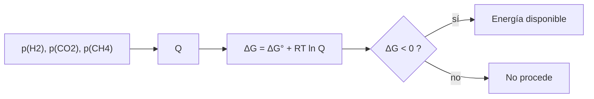

# B56-C07 — Energía química para la vida

<!-- nav:top -->
[🏠 Programa](../../../../README.md) · [📚 Bloque B56](../../../tronco-comun/B56-astrobiologia-y-vida-extraterrestre.md) · [← Anterior: B56-C06 — Agua líquida y solventes alternativos](../B56-C06-agua-liquida-y-solventes-alternativos/CLASE.md) · [Siguiente: B56-C08 — Habitabilidad de Marte →](../B56-C08-habitabilidad-de-marte/CLASE.md)
<!-- /nav -->

## 1. Ubicación, nivel y alcance

Clase 7 del bloque B56. Nivel N3. Tomas la termoquímica ([B06-C12](../../B06/B06-C12-termoquimica-y-energia-de-reaccion/CLASE.md)) y el equilibrio ([B06-C13](../../B06/B06-C13-equilibrio-quimico/CLASE.md)) para calcular **cuánta energía ofrece una reacción según las concentraciones** y si alcanza para mantener una célula. Es la pieza que une el agua líquida de [C06](../B56-C06-agua-liquida-y-solventes-alternativos/CLASE.md) con los mundos de [C08–C11](../B56-C08-habitabilidad-de-marte/CLASE.md). El caso de estudio es la metanogénesis con hidrógeno.

## 2. Por qué esta clase existe

Un ambiente con agua pero sin fuente de energía química es un desierto para la vida. En un océano sin luz, la energía viene de reacciones entre compuestos reducidos y oxidados. La decisión central: **dadas las presiones parciales, ¿la reacción libera energía y cuánta, y cuántas moléculas hacen falta para sostener una célula?**

## 3. Lo que podrás hacer al terminar

1. Definir energía libre de reacción, cociente de reacción, constante de equilibrio y potencia de mantenimiento.
2. Calcular `ΔG = ΔG° + RT ln Q` para una reacción con gases.
3. Hallar la presión de H₂ de equilibrio de dos formas.
4. Interpretar el signo de `ΔG` al variar la concentración.
5. Estimar el flujo de moléculas necesario para una potencia dada.
6. Nombrar qué deja fuera el cálculo.

La evidencia es el **presupuesto energético de un metabolismo** del ejercicio 12 (sección 20).

## 4. Con qué llegas y cómo comprobarlo

1. ¿Qué dice `ΔG = ΔG° + RT ln Q`?
2. ¿Qué es `Q` frente a `K`?
3. ¿Qué es un vatio en julios por segundo?
4. ¿Cómo se convierte J/mol en moléculas?
5. ¿Qué es una bisección?

<details>
<summary>Ver respuestas</summary>

1. `ΔG` depende de `ΔG°` y de las concentraciones a través de `Q`. 2. `Q` con las concentraciones actuales; `K` con las de equilibrio. 3. `1 W = 1 J/s`. 4. Se multiplica por `N_A`. 5. Un método que halla una raíz dividiendo el intervalo a la mitad.
</details>

Con cuatro o cinco aciertos, sigue; si no, repasa B06-C12 y B06-C13.

## 5. Un caso real: metano a partir de hidrógeno y CO₂

La reacción `4 H₂ + CO₂ → CH₄ + 2 H₂O` es una fuente de energía para microorganismos metanógenos en la Tierra. La página de la NASA sobre Encélado informa de CO₂, metano y silicatos en el penacho (S1, consultada el 2026-11-09), pero **no** menciona hidrógeno, y no se consultó el artículo primario del hidrógeno (Waite et al., 2017); aquí el H₂ es una variable **sintética**. Ejemplo conductor: `p(CO₂) = p(CH₄) = 10⁻³ bar` y `p(H₂)` variable, a 298,15 K.

## 6. Vocabulario

La **energía libre de reacción** `ΔG` es la energía disponible por mol de reacción; `ΔG < 0` indica que puede proceder. El **cociente de reacción** `Q` es el cociente de productos y reactivos con las actividades actuales. La **constante de equilibrio** `K = exp(−ΔG°/RT)`. La **potencia de mantenimiento** es la energía por segundo que una célula necesita solo para sobrevivir. Un **quimiolitótrofo** obtiene energía de reacciones inorgánicas.

## 7. Modelo mental: una cascada y su altura

`ΔG°` es la altura de la cascada con todo a 1 bar; las concentraciones cambian la altura efectiva. Con mucho H₂ la cascada es alta; con poco, se aplana y a una concentración crítica el agua deja de caer.



*Descripción textual:* con las presiones parciales se calcula `Q`, luego `ΔG`; si es negativa, la reacción ofrece energía.

Analogía: una presa cuya altura depende del nivel del lago. Su límite: la energía debe además acoplarse a una maquinaria celular, lo que el cálculo no cubre.

## 8. La explicación, paso a paso

### 8.1 Energía libre estándar

`ΔG° = [ΔG_f°(CH₄) + 2ΔG_f°(H₂O)] − [4ΔG_f°(H₂) + ΔG_f°(CO₂)]`. Con CH₄ (−50,72), H₂O(l) (−237,13) y CO₂ (−394,36) kJ/mol (**ilustrativos, no consultados**): `ΔG° = −130,62 kJ/mol`.

### 8.2 Efecto de la concentración

`Q = p(CH₄)/(p(H₂)⁴ p(CO₂))`, con presiones en bar. `ΔG = ΔG° + RT ln Q`. Con `p(H₂) = 10⁻⁴ bar`: `ΔG = −39,3 kJ/mol`; con `10⁻⁶`: `+6,4`; con `10⁻⁸`: `+52,0`.

### 8.3 Presión de equilibrio

`ΔG = 0` en `p(H₂)_eq = [p(CH₄)/(p(CO₂) K)]^{1/4}` con `K = e^{−ΔG°/RT}`. Da `1,901 × 10⁻⁶ bar`. Por bisección en logaritmos se obtiene el mismo valor (tolerancia `10⁻⁹`).

### 8.4 Presupuesto por célula

Con una potencia de mantenimiento de `10⁻¹⁹ W` (valor **ilustrativo no consultado**) y `39,3 kJ/mol`, hacen falta `10⁻¹⁹/39 300 = 2,5 × 10⁻²⁴ mol/s`, unas **2 moléculas de CH₄ por segundo**. Cifra de un ejemplo, no de un organismo.

### 8.5 Lo que el cálculo deja fuera

La energía debe superar un umbral mínimo para poder acoplarse a la síntesis de ATP; no se modela. Tampoco el pH, la fuerza iónica, la solubilidad de los gases ni la cinética.

## 9. Magnitudes, símbolos y unidades

| Símbolo | Qué es | Unidad | Valor / nota |
|---|---|---|---|
| `R` | constante molar de los gases | `J mol⁻¹ K⁻¹` | `8,314 462 618` (S2) |
| `N_A` | constante de Avogadro | `mol⁻¹` | `6,022 140 76 × 10²³` (S2) |
| `ΔG°` | energía libre estándar | `kJ mol⁻¹` | `−130,62` (ilustrativa) |
| `p(H₂)` | presión parcial de hidrógeno | bar | variable (sintética) |
| `P_m` | potencia de mantenimiento | W | `10⁻¹⁹` (ilustrativa) |

## 10. Convenciones y referencias

298,15 K; gases ideales; actividad del agua 1; presiones en bar. `ΔG_f°` de tabla **no consultados**. Presiones parciales y potencia **sintéticas**.

## 11. De dónde sale lo que afirmamos

| ID | Fuente | Localizador | Respalda | Estado |
|---|---|---|---|---|
| S1 | NASA, *Enceladus* | https://science.nasa.gov/saturn/moons/enceladus/ | El penacho contiene CO₂, metano, sales y sílice; no se menciona hidrógeno | Consultada el 2026-11-09 |
| S2 | NIST, *Fundamental Physical Constants — Complete Listing* (CODATA 2022) | https://physics.nist.gov/cuu/Constants/Table/allascii.txt | `R`, `N_A` | Consultada el 2026-11-09 |
| S3 | MacKenzie et al., *The Enceladus Orbilander Mission Concept*… (objetivos para buscar vida en Encélado), Astrobiology 2022 | https://doi.org/10.1089/ast.2020.2425 | Contexto: existen objetivos científicos para buscar vida en el penacho | Solo resumen (Europe PMC), consultado el 2026-11-09 |

Límites: la hoja de datos termodinámicos y la potencia de mantenimiento no se consultaron; el H₂ del penacho (Waite et al., 2017) **no se consultó**; la reacción se usa por su valor didáctico, sin afirmar que ocurra en Encélado. La relación `ΔG = ΔG° + RT ln Q` es un resultado estándar que aquí se verifica numéricamente.

## 12. Cómo ver la energía

Equivalente accesible a una gráfica de `ΔG` contra `p(H₂)`:

| `p(H₂)` (bar) | `ΔG` (kJ/mol de CH₄) |
|---|---|
| `10⁻²` | −85,0 |
| `10⁻⁴` | −39,3 |
| `10⁻⁶` | +6,4 |
| `10⁻⁸` | +52,0 |

Descripción larga: cada reducción de cien veces en `p(H₂)` suma unos 45,7 kJ/mol; la reacción deja de ofrecer energía cerca de `1,9 × 10⁻⁶ bar`.

## 13. Ejemplo trabajado: ¿ofrece energía con `p(H₂) = 10⁻⁵ bar`?

**Paso 1 · Datos.** `p(CO₂) = p(CH₄) = 10⁻³ bar`, `T = 298,15 K`, `p(H₂) = 10⁻⁵ bar` (sintéticos).

**Paso 2 · `Q`.** `Q = 10⁻³/(10⁻²⁰ × 10⁻³) = 10²⁰`.

**Paso 3 · `ΔG`.** `RT ln Q = 8,3145 × 298,15 × 46,05/1000 = 114,2 kJ/mol`; `ΔG = −130,62 + 114,2 = −16,5 kJ/mol`.

**Paso 4 · Sentido.** Es negativo: hay energía, pero poca; puede estar bajo el umbral de acoplamiento. Resultado del modelo con valores ilustrativos.

## 14. Distintas formas de calcular

**Presiones parciales (esta clase):** directo para gases. **Concentraciones molares con coeficientes de actividad:** necesario en agua real. **Modelos de especiación completa:** incluyen pH y sales. Para un primer orden sirve la primera.

## 15. Práctica guiada

**Ejercicio 1 · con los pasos indicados.** Calcula `K` para `ΔG° = −130,62 kJ/mol`. *Pasos:* `K = exp(130 620/(8,3145 × 298,15))`.

<details><summary>Solución comentada</summary>

Exponente `52,69`; `K ≈ 7,6 × 10²²`.
</details>

**Ejercicio 2 · con una pista.** Calcula `Q` si `p(H₂) = 10⁻⁴`, `p(CO₂) = p(CH₄) = 10⁻³`. *Pista:* el hidrógeno está a la cuarta.

<details><summary>Solución comentada</summary>

`Q = 10⁻³/(10⁻¹⁶ × 10⁻³) = 10¹⁶` (8.2).
</details>

**Ejercicio 3 · casi autónomo.** Calcula `ΔG` en ese caso.

<details><summary>Solución comentada</summary>

`RT ln Q = 2,4789 × 36,84 = 91,3 kJ/mol`; `ΔG = −39,3 kJ/mol` (8.2).
</details>

## 16. Práctica autónoma, transferencia e integrador

**Ejercicio 4.** ¿Qué pasa con `ΔG` si `p(CH₄)` sube 10 veces?

<details><summary>Solución comentada</summary>

`Q` crece 10 veces y `ΔG` sube `RT ln 10 = 5,7 kJ/mol`.
</details>

**Ejercicio 5.** Halla `p(H₂)_eq` si `p(CH₄) = 10⁻²` y `p(CO₂) = 10⁻³` bar.

<details><summary>Solución comentada</summary>

`(10⁻²/(10⁻³ × 7,6 × 10²²))^{1/4} = (1,3 × 10⁻²²)^{0,25} ≈ 3,4 × 10⁻⁶ bar` (8.3).
</details>

**Ejercicio 6.** ¿Qué significa que la bisección use logaritmos?

<details><summary>Solución comentada</summary>

La raíz abarca muchos órdenes de magnitud; bisecar en `log p` converge más uniformemente.
</details>

**Ejercicio 7.** Con `ΔG = −16,5 kJ/mol` y `10⁻¹⁹ W`, ¿cuántas moléculas por segundo?

<details><summary>Solución comentada</summary>

`10⁻¹⁹/16 500 = 6,1 × 10⁻²⁴ mol/s`; `× N_A = 3,6` moléculas/s (8.4).
</details>

**Ejercicio 8.** ¿Por qué un `ΔG` apenas negativo puede no bastar para una célula?

<details><summary>Solución comentada</summary>

La célula necesita una cantidad mínima por evento de acoplamiento; la clase no la modela (8.5).
</details>

**Ejercicio 9 · transferencia.** Un titular dice: «la reacción libera energía, así que Encélado tiene metanógenos». Respóndele.

<details><summary>Solución comentada</summary>

Que sea posible no prueba que ocurra: el H₂ del penacho no se consultó aquí, y hace falta además un mecanismo y un organismo (sección 5).
</details>

**Ejercicio 10 · transferencia.** ¿Por qué se usa bar en `Q` y no pascales?

<details><summary>Solución comentada</summary>

Porque `ΔG°` se define con estado estándar de 1 bar; las unidades deben coincidir.
</details>

**Ejercicio 11 · transferencia.** Si la temperatura baja a 275 K, ¿sube o baja `RT`?

<details><summary>Solución comentada</summary>

Baja `RT` (de 2,479 a 2,286 kJ/mol), pero también cambia `ΔG°`; el cálculo requeriría `ΔG°(T)`.
</details>

**Ejercicio 12 · integrador.** Elabora tu *presupuesto energético de un metabolismo*: elige `p(H₂)`, `p(CO₂)` y `p(CH₄)` (sintéticos), calcula `Q`, `ΔG`, `p(H₂)_eq` y las moléculas por segundo para `10⁻¹⁹ W`, y señala dos supuestos que cambian el resultado.

<details><summary>Solución modelo</summary>

Para `p(H₂) = 10⁻⁵`, `10⁻³`, `10⁻³`: `Q = 10²⁰`, `ΔG = −16,5 kJ/mol`, `p(H₂)_eq = 1,9 × 10⁻⁶`, 3,6 moléculas/s. Cambian el pH (actividades) y el umbral de acoplamiento. Rotulado como sintético.
</details>

## 17. Laboratorio: energía libre de la metanogénesis

El script [energia_libre.py](energia_libre.py) calcula `ΔG° `, `ΔG(p(H₂))`, la presión de equilibrio por forma cerrada y por bisección (tolerancia `10⁻⁹`) y el flujo de moléculas para `10⁻¹⁹ W`.

**Datos:** `R`, `N_A` de NIST; `ΔG_f°` **ilustrativos**; presiones **sintéticas**. **Predice antes de ejecutar:** ¿a qué `p(H₂)` cambia el signo? (cerca de `2 × 10⁻⁶ bar`.) **Ejecución del 2026-11-09 (Python 3.12.9):**

```text
Python 3.12.9 (biblioteca estandar)
Delta G0 = -130.62 kJ/mol de CH4 (T = 298.15 K)
p(H2) de equilibrio = 1.901e-06 bar ; Delta G ahi = 0.00e+00 kJ/mol
p(H2) =   1e-02 bar -> Delta G =   -84.96 kJ/mol de CH4
p(H2) =   1e-04 bar -> Delta G =   -39.29 kJ/mol de CH4
p(H2) =   1e-06 bar -> Delta G =     6.37 kJ/mol de CH4
p(H2) =   1e-08 bar -> Delta G =    52.04 kJ/mol de CH4
Con 39.3 kJ/mol, mantener 1e-19 W exige 2 moleculas de CH4 por segundo
Pruebas superadas.
```

```bash
python programa/clases/B56/B56-C07-energia-quimica-para-la-vida/energia_libre.py
```

**Límites:** gas ideal, 298,15 K, sin pH; no demuestra la presencia de metanógenos en ningún mundo.

## 18. Errores frecuentes y cómo corregirlos

**Usar `ΔG°` en vez de `ΔG`.** Se corrige con los ejercicios 3 y 4.

**Olvidar la cuarta potencia del H₂.** Se corrige con el ejercicio 2.

**Mezclar bar y pascales.** Se corrige con el ejercicio 10.

**Concluir vida de un `ΔG` negativo.** Se corrige con el ejercicio 9.

**Presentar la potencia de mantenimiento como dato.** Se corrige con la sección 10.

## 19. Cómo sabrás que vas bien

Tras 8.2: ¿sabes cómo cambia `ΔG` con `p(H₂)`? Ejercicios 3 y 4. Tras 8.3: ¿qué es la presión de equilibrio? Ejercicio 5. Tras el laboratorio: ¿qué prueba la bisección? (que la forma cerrada es correcta).

## 20. Qué entregas y cómo se evalúa

El producto es tu **presupuesto energético de un metabolismo** (ejercicio 12).

| Criterio | Inicial | En desarrollo | Logrado | Destacado |
|---|---|---|---|---|
| Conceptos | Los confunde | Parciales | `Q`, `K`, `ΔG` correctos | Discute el umbral de acoplamiento |
| Cálculo | Sin unidades | Con errores | `ΔG`, `p_eq`, flujo correctos | Dos vías |
| Interpretación | Sin lectura | Parcial | Energía suficiente o no | Cuestiona supuestos |
| Rótulos | Sin rotular | Parciales | Sintético e ilustrativo rotulados | Declara lo no consultado |
| Fuentes | Sin fuente | Sin fecha | S1–S3 con fecha | Declara el hidrógeno no consultado |

**Condiciones críticas (no se compensan con promedio):** rotular el H₂ y la potencia como sintéticos; no afirmar que hay metanógenos en un mundo; citar solo lo consultado.

## 21. Ética, seguridad y límites

La clase es educativa y no da procedimientos de cultivo de microorganismos. Accesibilidad: tablas equivalentes a las gráficas, fórmulas en texto, ejercicios sin conexión.

## 22. Para cerrar y seguir

La energía que una reacción ofrece depende de las concentraciones: la metanogénesis libera unos 39 kJ/mol con `p(H₂) = 10⁻⁴ bar` y deja de hacerlo cerca de `2 × 10⁻⁶ bar`. Queda una pregunta: ¿qué mundos reúnen agua, energía y condiciones? Empezamos por Marte.

**Glosario español–inglés.** energía libre · *free energy*; cociente de reacción · *reaction quotient*; constante de equilibrio · *equilibrium constant*; potencia de mantenimiento · *maintenance power*; quimiolitótrofo · *chemolithotroph*; metanogénesis · *methanogenesis*.

**Continuidad.** [B56-C08](../B56-C08-habitabilidad-de-marte/CLASE.md) contrasta los datos de Marte con los límites de replicación.

**Referencias:** ver sección 11.

<!-- nav:bottom -->
---

[← Anterior: B56-C06 — Agua líquida y solventes alternativos](../B56-C06-agua-liquida-y-solventes-alternativos/CLASE.md) · [📚 Bloque B56](../../../tronco-comun/B56-astrobiologia-y-vida-extraterrestre.md) · [Siguiente: B56-C08 — Habitabilidad de Marte →](../B56-C08-habitabilidad-de-marte/CLASE.md)
<!-- /nav -->
