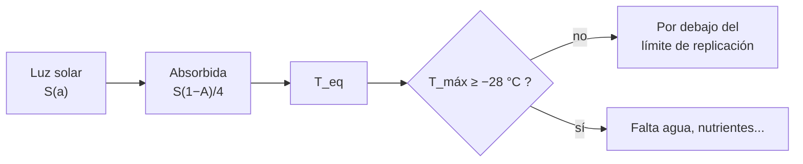

# B56-C08 — Habitabilidad de Marte

<!-- nav:top -->
[🏠 Programa](../../../../README.md) · [📚 Bloque B56](../../../tronco-comun/B56-astrobiologia-y-vida-extraterrestre.md) · [← Anterior: B56-C07 — Energía química para la vida](../B56-C07-energia-quimica-para-la-vida/CLASE.md) · [Siguiente: B56-C09 — Océanos de Europa →](../B56-C09-oceanos-de-europa/CLASE.md)
<!-- /nav -->

## 1. Ubicación, nivel y alcance

Clase 8 del bloque B56 y primera de los cuatro mundos del Sistema Solar. Nivel N3. Tomas la gravitación ([B05-C10](../../B05/B05-C10-gravitacion-universal/CLASE.md)) y los límites de replicación de [C05](../B56-C05-extremofilos-y-limites-ambientales/CLASE.md) para comparar **los datos publicados de Marte con las condiciones que necesita la replicación de microorganismos terrestres**. No tratas la geología ni la atmósfera en detalle (bloques [B53](../../../tronco-comun/B53-astrogeologia-y-geodesia-planetaria.md) y [B54](../../../tronco-comun/B54-atmosferas-y-climatologia-planetaria.md)) y no decides si Marte tuvo o tiene vida.

## 2. Por qué esta clase existe

Marte es el destino más estudiado en la búsqueda de vida y el que más afecta a las reglas de protección planetaria. Para entender por qué, hace falta ver con números cuánta distancia hay entre su superficie actual y las condiciones de replicación. La decisión central: **con la masa, el radio, la presión y las temperaturas publicadas, ¿cuánto se acerca la superficie de Marte a los límites de replicación y qué retiene su atmósfera?**

## 3. Lo que podrás hacer al terminar

1. Definir gravedad superficial, velocidad de escape, temperatura de equilibrio y columna atmosférica.
2. Calcular `g` y `v_esc` desde masa y radio y compararlos con la hoja de datos.
3. Calcular la irradiancia solar en Marte por dos vías.
4. Estimar la temperatura de equilibrio con un albedo ilustrativo y compararla con la media publicada.
5. Contrastar el máximo de temperatura de un sitio con el límite de −28 °C.
6. Nombrar qué deja fuera la ficha (agua subsuperficial, salmueras, radiación).

La evidencia es la **ficha de habitabilidad de Marte** del ejercicio 12 (sección 20).

## 4. Con qué llegas y cómo comprobarlo

1. ¿Qué dice la ley de Stefan–Boltzmann?
2. ¿Cómo se calcula `g = GM/R²`?
3. ¿Qué es el albedo?
4. ¿Qué es una unidad astronómica?
5. ¿Qué es la velocidad de escape?

<details>
<summary>Ver respuestas</summary>

1. La potencia radiada por área es `σT⁴`. 2. Con la masa y el radio del cuerpo. 3. La fracción de luz solar que refleja. 4. Unos `1,496 × 10¹¹ m`, la distancia media Tierra–Sol. 5. La rapidez mínima para escapar sin propulsión: `√(2GM/R)`.
</details>

Con cuatro o cinco aciertos, sigue; si no, repasa B05-C10 y B05-C18.

## 5. Un caso real: la hoja de datos de Marte

La hoja de datos de Marte de la NASA/NSSDC (actualizada el 2025-05-19, consultada el 2026-11-09, S1) da: masa `0,64169 × 10²⁴ kg`, radio medio volumétrico `3389,5 km`, gravedad media `3,73 m/s²`, velocidad de escape `5,03 km/s`, presión media `6,36 mb`, temperatura media `214 K` y, en el sitio del Viking 1, un rango diurno de `184 a 242 K`. La composición atmosférica es 95,1 % CO₂, 2,59 % N₂, 1,94 % Ar, 0,16 % O₂ y 210 ppm de vapor de agua. Este es el **ejemplo conductor**.

## 6. Vocabulario

La **gravedad superficial** es `g = GM/R²`. La **velocidad de escape** es `v_esc = √(2GM/R)`. La **irradiancia** es la potencia solar por área en la distancia de Marte. El **albedo de Bond** es la fracción de la luz solar incidente que se refleja. La **temperatura de equilibrio** `T_eq = [S(1 − A)/(4σ)]^{1/4}` es la de un cuerpo sin atmósfera y sin calor interno. La **columna atmosférica** es la masa de aire por m²: `P/g`.

## 7. Modelo mental: una balanza de luz y calor

El planeta recibe luz, refleja una parte, reemite el resto como calor. La temperatura sale de igualar lo que entra con lo que sale. La atmósfera delgada de Marte casi no cambia esa cuenta.



*Descripción textual:* se calcula la luz absorbida, se obtiene la temperatura de equilibrio y se compara el máximo observado con el límite de replicación.

Analogía: una taza de café que se enfría. Su límite: Marte tiene atmósfera y subsuelo que modifican el balance.

## 8. La explicación, paso a paso

### 8.1 Gravedad y escape

Con `G = 6,674 30 × 10⁻¹¹` (S2), `g = 3,728 m/s²` y `v_esc = 5,027 km/s`: ambos coinciden con la hoja a menos de 1 %.

### 8.2 Irradiancia

Con la luminosidad solar nominal `3,828 × 10²⁶ W` y el semieje `227,956 × 10⁶ km` (S3, S1): `586,2 W/m²`. Con la irradiancia nominal de `1361 W/m²` en 1 UA escalada por `(1 UA/a)²`: `586,1 W/m²`. Coinciden a menos de 0,2 %. La UA (149 597 870 700 m) es un valor estándar **no consultado**.

### 8.3 Temperatura de equilibrio

Con albedo `0,25` (ilustrativo): `T_eq = 209,8 K`, frente a la media publicada de 214 K. La diferencia de 4 K muestra el orden de magnitud del modelo y del albedo elegido.

### 8.4 Contra el límite de −28 °C

El límite es `245,15 K`. El máximo de Viking 1 es `242 K` (−31,1 °C): `T_max − LLT = −3,15 K`. El sitio **no alcanza** el límite en el rango publicado; no se afirma nada de otros lugares ni estaciones.

### 8.5 Atmósfera y lo que falta

La columna `P/g = 636/3,728 = 171 kg/m²` frente a unos `10⁴ kg/m²` de la Tierra (valor ilustrativo): la presión es menos del 1 % y, como vimos en [C06](../B56-C06-agua-liquida-y-solventes-alternativos/CLASE.md), el agua líquida casi no es estable. La ficha no cubre agua subsuperficial, salmueras ni radiación; esas variables se estudian en otras clases.

## 9. Magnitudes, símbolos y unidades

| Símbolo | Qué es | Unidad | Valor / nota |
|---|---|---|---|
| `M`, `R` | masa y radio de Marte | kg; m | `0,64169 × 10²⁴`; `3389,5 × 10³` (S1) |
| `G` | constante de gravitación | `m³ kg⁻¹ s⁻²` | `6,674 30 × 10⁻¹¹` (S2) |
| `σ` | constante de Stefan–Boltzmann | `W m⁻² K⁻⁴` | `5,670 374 419 × 10⁻⁸` (S2) |
| `S` | irradiancia en Marte | `W m⁻²` | `586,1` |
| `T_eq` | temperatura de equilibrio | K | `209,8` (A = 0,25 ilustrativo) |
| LLT | límite de temperatura | K | `245,15` (S4) |

## 10. Convenciones y referencias

Esfera de radio medio volumétrico; sin efecto invernadero; albedo `0,25` **ilustrativo**; UA estándar no consultada. Temperaturas en K.

## 11. De dónde sale lo que afirmamos

| ID | Fuente | Localizador | Respalda | Estado |
|---|---|---|---|---|
| S1 | NASA/NSSDC, *Mars Fact Sheet* (actualizada 2025-05-19) | https://nssdc.gsfc.nasa.gov/planetary/factsheet/marsfact.html | Masa, radio, gravedad, escape, presión, temperaturas, composición, semieje | Consultada el 2026-11-09 |
| S2 | NIST, *Fundamental Physical Constants — Complete Listing* (CODATA 2022) | https://physics.nist.gov/cuu/Constants/Table/allascii.txt | `G`, `σ` | Consultada el 2026-11-09 |
| S3 | Mamajek et al., *IAU 2015 Resolution B3*, arXiv:1510.07674 | https://arxiv.org/abs/1510.07674 | Irradiancia nominal 1361 W/m² y luminosidad 3,828 × 10²⁶ W | Texto del PDF extraído el 2026-11-09 |
| S4 | COSPAR, *COSPAR Policy on Planetary Protection*, Space Research Today n.º 224, 2026 | https://cosparhq.cnes.fr/assets/uploads/2026/01/SRT_224_Editorial_PPP-Nov-2025.pdf | Límite de replicación −28 °C | Texto completo extraído el 2026-11-09 |

Límites: el albedo y la UA no se consultaron; el rango de 184 a 242 K corresponde a un sitio, no a todo Marte; no se afirma habitabilidad ni su ausencia.

## 12. Cómo ver la ficha

Equivalente accesible a una tabla comparativa:

| Magnitud | Calculado | Publicado (S1) |
|---|---|---|
| `g` | 3,728 m/s² | 3,73 m/s² |
| `v_esc` | 5,027 km/s | 5,03 km/s |
| `T_eq` (A = 0,25) | 209,8 K | 214 K (media) |
| `T_max` | — | 242 K (Viking 1) |

Descripción larga: las tres cantidades derivadas coinciden con las publicadas; el máximo de Viking 1 queda 3,15 K por debajo del límite de replicación.

## 13. Ejemplo trabajado: ¿qué albedo daría 214 K?

**Paso 1 · Datos.** `S = 586,1 W/m²`, `T = 214 K` (S1).

**Paso 2 · Despeje.** `1 − A = 4σT⁴/S`.

**Paso 3 · Cálculo.** `4 × 5,670 × 10⁻⁸ × 214⁴ = 4 × 5,670 × 10⁻⁸ × 2,097 × 10⁹ = 475,6`; `475,6/586,1 = 0,811`; `A = 0,189`.

**Paso 4 · Sentido.** Un albedo de 0,19 reproduciría la media. Es un ajuste, no una medición del albedo; sirve para ver la sensibilidad (ilustrativo).

## 14. Distintas formas de estimar la temperatura

**Equilibrio sin atmósfera (esta clase):** orden de magnitud. **Balance energético con atmósfera y ciclo diurno:** más fiel. **Mediciones in situ:** la referencia. Para una primera ficha sirve la primera.

## 15. Práctica guiada

**Ejercicio 1 · con los pasos indicados.** Calcula `g` con `M = 0,64169 × 10²⁴ kg` y `R = 3389,5 km`. *Pasos:* `GM = 4,2828 × 10¹³`; `R² = 1,1488 × 10¹³`.

<details><summary>Solución comentada</summary>

`g = 4,2828 × 10¹³/1,1488 × 10¹³ = 3,728 m/s²` (8.1).
</details>

**Ejercicio 2 · con una pista.** Convierte 242 K a °C. *Pista:* resta 273,15.

<details><summary>Solución comentada</summary>

`−31,15 °C` (8.4).
</details>

**Ejercicio 3 · casi autónomo.** Calcula cuántos kelvin faltan para que el máximo de 242 K alcance el límite de −28 °C.

<details><summary>Solución comentada</summary>

Faltan `245,15 − 242 = 3,15 K` (8.4).
</details>

## 16. Práctica autónoma, transferencia e integrador

**Ejercicio 4.** Calcula `v_esc` con los valores del ejercicio 1.

<details><summary>Solución comentada</summary>

`√(2 × 4,2828 × 10¹³/3,3895 × 10⁶) = √(2,527 × 10⁷) = 5027 m/s` (8.1).
</details>

**Ejercicio 5.** ¿Por qué la irradiancia en Marte es menor que en la Tierra?

<details><summary>Solución comentada</summary>

Disminuye con el cuadrado de la distancia: `(1/1,524)² = 0,43` del valor en 1 UA, `586 W/m²` (8.2).
</details>

**Ejercicio 6.** Si el albedo fuera 0,15, ¿cuánto vale `T_eq`?

<details><summary>Solución comentada</summary>

`T_eq = 209,8 × (0,85/0,75)^{1/4} = 209,8 × 1,0319 = 216,5 K`.
</details>

**Ejercicio 7.** Interpreta la columna de 171 kg/m².

<details><summary>Solución comentada</summary>

Es el peso de la atmósfera por m² dividido por `g`; unas 60 veces menos que en la Tierra con el valor ilustrativo de 10⁴ kg/m² (8.5).
</details>

**Ejercicio 8.** ¿Qué dice el rango 184–242 K del sitio sobre el resto del planeta?

<details><summary>Solución comentada</summary>

Nada: es un sitio y una época. Otras latitudes y estaciones pueden diferir (11).
</details>

**Ejercicio 9 · transferencia.** Un titular afirma «Marte alcanza temperaturas agradables, luego es habitable». Respóndele.

<details><summary>Solución comentada</summary>

La temperatura es una variable; falta el agua líquida (C06), la presión, la radiación y los nutrientes. Los datos del sitio publicado no alcanzan el límite de −28 °C (8.4).
</details>

**Ejercicio 10 · transferencia.** ¿Por qué la protección planetaria trata a Marte con cuidado aunque su superficie sea fría?

<details><summary>Solución comentada</summary>

Porque puede haber regiones especiales o subsuelo con condiciones distintas, y porque la política es conservadora con márgenes (S4; ver [C18](../B56-C18-proteccion-planetaria-cospar/CLASE.md)).
</details>

**Ejercicio 11 · transferencia.** Un colega mide `g` con una sonda y obtiene 3,9 m/s². ¿Qué haces?

<details><summary>Solución comentada</summary>

Compara con 3,728 y 3,73: difiere un 4,6 %. Revisas unidades, altitud y la precisión del instrumento antes de concluir nada.
</details>

**Ejercicio 12 · integrador.** Elabora tu *ficha de habitabilidad de Marte*: calcula `g`, `v_esc`, `S`, `T_eq` con un albedo elegido (ilustrativo), compara `T_max` con −28 °C y lista tres variables que la ficha no cubre.

<details><summary>Solución modelo</summary>

`g = 3,73`; `v_esc = 5,03 km/s`; `S = 586 W/m²`; `T_eq = 209,8 K` (A = 0,25); `T_max = 242 K` queda 3,15 K bajo el límite; faltan agua subsuperficial, salmueras y radiación. Rotulado como ilustrativo donde corresponde.
</details>

## 17. Laboratorio: ficha física de Marte

El script [ficha_de_marte.py](ficha_de_marte.py) calcula `g`, `v_esc`, el flujo solar por dos vías, `T_eq`, la comparación con −28 °C y la columna atmosférica, y **comprueba** `g` y `v_esc` con la hoja (< 1 %) y el flujo por `L` y por `S` (< 0,2 %).

**Datos:** S1–S4; albedo y UA **no consultados**. **Predice antes de ejecutar:** ¿`T_eq` queda por encima o por debajo de 214 K con A = 0,25? (por debajo, 209,8 K.) **Ejecución del 2026-11-09 (Python 3.12.9):**

```text
Python 3.12.9 (biblioteca estandar)
g = 3.728 m/s2 (hoja: 3,73) ; v_esc = 5.027 km/s (hoja: 5,03)
Flujo solar en Marte: 586.2 W/m2 (por L) ; 586.1 W/m2 (por S)
T_eq (albedo 0.25, ilustrativo) = 209.8 K ; hoja: media 214 K
Maximo en Viking 1: 242.0 K = -31.1 C ; limite -28 C = 245.15 K ; T_max - LLT = -3.15 K
Masa de atmosfera por m2 = P/g = 171 kg/m2 (Tierra ~ 1,03e4, ilustrativo)
Pruebas superadas.
```

```bash
python programa/clases/B56/B56-C08-habitabilidad-de-marte/ficha_de_marte.py
```

**Límites:** esfera, sin atmósfera en el balance térmico, albedo ilustrativo; no evalúa agua ni radiación.

## 18. Errores frecuentes y cómo corregirlos

**Tomar el rango de un sitio como el de todo el planeta.** Se corrige con el ejercicio 8.

**Mezclar °C y K.** Se corrige con el ejercicio 2.

**Concluir habitabilidad de una sola variable.** Se corrige con el ejercicio 9.

**Presentar el albedo como medido.** Se corrige con el ejemplo 13.

**Olvidar que `S` baja con el cuadrado de la distancia.** Se corrige con el ejercicio 5.

## 19. Cómo sabrás que vas bien

Tras 8.1: ¿puedes obtener `g` y `v_esc`? Ejercicios 1 y 4. Tras 8.4: ¿qué distancia hay al límite? Ejercicio 3. Tras el laboratorio: ¿qué comprueba la coincidencia de flujos? (que dos datos nominales de la IAU son consistentes con el semieje de la NASA).

## 20. Qué entregas y cómo se evalúa

El producto es tu **ficha de habitabilidad de Marte** (ejercicio 12).

| Criterio | Inicial | En desarrollo | Logrado | Destacado |
|---|---|---|---|---|
| Conceptos | Los confunde | Parciales | `g`, `v_esc`, `T_eq` claros | Discute sensibilidad al albedo |
| Cálculo | Sin unidades | Con errores | Valores y unidades correctos | Dos vías |
| Comparación | Sin límite | Sin margen | Margen respecto de −28 °C | Distingue sitio y planeta |
| Rótulos | Sin rotular | Parciales | Ilustrativo rotulado | No afirma habitabilidad |
| Fuentes | Sin fuente | Sin fecha | S1–S4 con fecha | Declara albedo y UA no consultados |

**Condiciones críticas (no se compensan con promedio):** rotular el albedo como ilustrativo; no afirmar que Marte es o no habitable; citar solo lo consultado.

## 21. Ética, seguridad y límites

La clase es educativa y no concluye sobre vida en Marte. Los datos de un sitio no representan al planeta. Accesibilidad: tablas equivalentes a las gráficas, fórmulas en texto, ejercicios sin conexión.

## 22. Para cerrar y seguir

Con masa y radio se reproducen la gravedad y el escape de Marte; con la distancia al Sol, su temperatura de equilibrio; y el máximo publicado en el sitio de Viking 1 queda 3,15 K bajo el límite de −28 °C. Queda una pregunta: ¿qué pasa en mundos cuyo océano está bajo el hielo? Empezamos por Europa.

**Glosario español–inglés.** gravedad superficial · *surface gravity*; velocidad de escape · *escape velocity*; albedo · *albedo*; temperatura de equilibrio · *equilibrium temperature*; irradiancia · *irradiance*.

**Continuidad.** [B56-C09](../B56-C09-oceanos-de-europa/CLASE.md) estima la profundidad del océano de Europa desde su volumen.

**Referencias:** ver sección 11.

<!-- nav:bottom -->
---

[← Anterior: B56-C07 — Energía química para la vida](../B56-C07-energia-quimica-para-la-vida/CLASE.md) · [📚 Bloque B56](../../../tronco-comun/B56-astrobiologia-y-vida-extraterrestre.md) · [Siguiente: B56-C09 — Océanos de Europa →](../B56-C09-oceanos-de-europa/CLASE.md)
<!-- /nav -->
