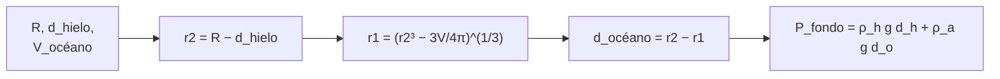

# B56-C09 — Océanos de Europa

<!-- nav:top -->
[🏠 Programa](../../../../README.md) · [📚 Bloque B56](../../../tronco-comun/B56-astrobiologia-y-vida-extraterrestre.md) · [← Anterior: B56-C08 — Habitabilidad de Marte](../B56-C08-habitabilidad-de-marte/CLASE.md) · [Siguiente: B56-C10 — Océanos de Encélado →](../B56-C10-oceanos-de-encelado/CLASE.md)
<!-- /nav -->

## 1. Ubicación, nivel y alcance

Clase 9 del bloque B56. Nivel N3. Tomas la gravitación ([B05-C10](../../B05/B05-C10-gravitacion-universal/CLASE.md)) y la presión ([B05-C14](../../B05/B05-C14-gases-y-presion/CLASE.md)) para dimensionar **un océano bajo el hielo**. Europa es un satélite de Júpiter; usas su masa y radio publicados y la afirmación de la NASA sobre la cantidad de agua de su océano. No decides si hay vida: calculas profundidades y presiones. La química del fondo y la misión Europa Clipper no se detallan.

## 2. Por qué esta clase existe

Un océano global bajo el hielo es un candidato a hábitat, protegido de la radiación y del vacío. Saber cuán profundo es y qué presión soporta fija qué sondas podrían llegar y qué ambientes existen. La decisión central: **dado un volumen de agua y un espesor de hielo, ¿qué profundidad tiene el océano y cuánta presión hay en el fondo?**

## 3. Lo que podrás hacer al terminar

1. Definir océano subsuperficial, cascarón esférico y presión hidrostática.
2. Calcular la densidad media y comprobar que reproduce la hoja de datos.
3. Hallar la profundidad de un océano de volumen conocido en una cáscara esférica, de forma cerrada y por bisección.
4. Estimar la presión en el fondo.
5. Comparar con la aproximación de cáscara fina.
6. Nombrar qué supuestos hay que declarar (espesor del hielo, densidades).

La evidencia es la **ficha del océano de Europa** del ejercicio 12 (sección 20).

## 4. Con qué llegas y cómo comprobarlo

1. ¿Cuál es el volumen de una esfera?
2. ¿Qué es la presión hidrostática `ρ g h`?
3. ¿Qué es una bisección?
4. ¿Cómo se convierte km³ a m³?
5. ¿Qué es la densidad media?

<details>
<summary>Ver respuestas</summary>

1. `4πr³/3`. 2. La presión que ejerce una columna de fluido de altura `h`. 3. Un método que halla una raíz dividiendo el intervalo a la mitad. 4. Se multiplica por `10⁹`. 5. Masa dividida entre volumen.
</details>

Con cuatro o cinco aciertos, sigue; si no, repasa B05-C14 y B09.

## 5. Un caso real: lo que dicen la NASA y la hoja de datos

La hoja de los satélites galileanos (S1, consultada el 2026-11-09) da para Europa: masa `48,0 × 10²¹ kg`, radio medio `1561 km`, densidad `3010 kg/m³`, gravedad `1,31 m/s²` y temperatura media de superficie de unos −170 °C. La página de la NASA sobre Europa afirma que los científicos creen que hay un océano de agua salada bajo la corteza de hielo, con **el doble de agua que el océano global de la Tierra** (S2). La página no da el espesor del hielo. **Ejemplo conductor:** océano de volumen `2 V_Tierra` bajo un hielo de 15 km (supuesto **ilustrativo**).

## 6. Vocabulario

Un **océano subsuperficial** es agua líquida bajo una capa de hielo. Un **cascarón esférico** es la región entre dos esferas concéntricas. El **espesor del hielo** `d_h` es la profundidad de la capa sólida. La **profundidad del océano** `d_o` es la del agua. La **presión hidrostática** en el fondo es `P = ρ_h g d_h + ρ_a g d_o`. Una **aproximación de cáscara fina** supone `d_o ≪ R` y vale `V ≈ 4πr²d_o`.

## 7. Modelo mental: una cebolla

Europa es una cebolla: un núcleo, una capa de agua y una cáscara de hielo. Conocido el volumen de la capa de agua y dónde empieza, se halla cuán gruesa es.



*Descripción textual:* se parte del radio exterior del agua, se despeja el radio interior del volumen y se obtiene la profundidad y la presión.

Analogía: pelar una cebolla midiendo cuánto jugo hay entre capas. Su límite: aquí las capas son perfectamente esféricas y el interior real no lo es.

## 8. La explicación, paso a paso

### 8.1 Coherencia de los datos

Con `M = 48,0 × 10²¹ kg` y `R = 1561 km`: densidad `3013 kg/m³` (hoja: 3010) y `g = 1,315 m/s²` (hoja: 1,31). El laboratorio exige menos de 1 % de diferencia.

### 8.2 Volumen de referencia

El volumen del océano terrestre (`1,335 × 10⁹ km³`, valor **ilustrativo no consultado**) se duplica: `2,67 × 10⁹ km³`.

### 8.3 Profundidad

El volumen de la cáscara es `V = (4π/3)(r₂³ − r₁³)` con `r₂ = R − d_h` y `r₁ = r₂ − d_o`. Despejando: `d_o = r₂ − (r₂³ − 3V/4π)^{1/3}`. Para `d_h = 15 km`: `d_o = 94,6 km`. La bisección da lo mismo a `10⁻⁹`. La cáscara fina da `88,9 km` (6 % menos).

### 8.4 Presión en el fondo

Con `ρ_h = 920` y `ρ_a = 1030 kg/m³` (ilustrativas) y `g = 1,31 m/s²` constante: `P = 145,7 MPa` para `d_h = 15 km`. El `g` constante sobrestima algo la presión.

### 8.5 Sensibilidad al espesor

Con `d_h = 5, 15, 30 km`, la profundidad del océano sale `93,2; 94,6; 96,6 km` y la presión `131,8; 145,7; 166,5 MPa`. El volumen fija casi todo; el espesor del hielo pesa menos en la profundidad y más en la presión.

## 9. Magnitudes, símbolos y unidades

| Símbolo | Qué es | Unidad | Valor / nota |
|---|---|---|---|
| `M`, `R` | masa y radio de Europa | kg; m | `48,0 × 10²¹`; `1,561 × 10⁶` (S1) |
| `V_E` | volumen del océano terrestre | m³ | `1,335 × 10¹⁸` (ilustrativo) |
| `d_h`, `d_o` | espesores del hielo y del océano | m | 15 000; 94 600 |
| `ρ_h`, `ρ_a` | densidades del hielo y del agua salada | kg/m³ | 920; 1030 (ilustrativas) |
| `P` | presión en el fondo | Pa | `1,457 × 10⁸` |

## 10. Convenciones y referencias

Cascarón esférico concéntrico; `g` constante e igual al de superficie; densidades y espesores del hielo **ilustrativos**. Distancias en m en los cálculos.

## 11. De dónde sale lo que afirmamos

| ID | Fuente | Localizador | Respalda | Estado |
|---|---|---|---|---|
| S1 | NASA/NSSDC, *Galilean Satellite Fact Sheet* | https://nssdc.gsfc.nasa.gov/planetary/factsheet/galileanfact_table.html | Masa, radio, densidad, gravedad, temperatura | Consultada el 2026-11-09 |
| S2 | NASA, *Europa* | https://science.nasa.gov/jupiter/moons/europa/ | Océano con el doble de agua que el de la Tierra; Europa Clipper lanzada el 2024-10-14 | Consultada el 2026-11-09 |
| S3 | NIST, *Fundamental Physical Constants — Complete Listing* (CODATA 2022) | https://physics.nist.gov/cuu/Constants/Table/allascii.txt | `G` | Consultada el 2026-11-09 |

Límites: el volumen del océano terrestre, las densidades y el espesor del hielo **no se consultaron**; la página de la NASA no da cifra de espesor; la llegada y los instrumentos de Europa Clipper no figuran en la página consultada.

## 12. Cómo ver el océano

Equivalente accesible a una sección transversal (agua `2 V_Tierra`):

| `d_h` (km) | `d_o` (km) | `P` fondo (MPa) |
|---|---|---|
| 5 | 93,2 | 131,8 |
| 15 | 94,6 | 145,7 |
| 30 | 96,6 | 166,5 |

Descripción larga: la profundidad del océano casi no depende del espesor del hielo; la presión sí, porque suma la columna de hielo.

## 13. Ejemplo trabajado: profundidad con hielo de 10 km

**Paso 1 · Datos.** `R = 1561 km`, `d_h = 10 km`, `V = 2,67 × 10⁹ km³` (ilustrativos).

**Paso 2 · `r₂`.** `r₂ = 1551 km`; `r₂³ = 3,731 × 10⁹ km³`.

**Paso 3 · `r₁`.** `3V/4π = 6,374 × 10⁸ km³`; `r₁³ = 3,094 × 10⁹`; `r₁ = 1457,1 km`.

**Paso 4 · Sentido.** `d_o = 93,9 km`. Es un cálculo ilustrativo; una Europa real no es perfectamente esférica ni uniforme.

## 14. Distintos enfoques

**Cascarón exacto (esta clase):** simple y correcto. **Cáscara fina:** más rápida, error del 6 %. **Modelos de interior con densidad variable:** realistas, con `g(r)`. Para una ficha sirve el primero.

## 15. Práctica guiada

**Ejercicio 1 · con los pasos indicados.** Calcula la densidad media con `M` y `R`. *Pasos:* volumen `4πR³/3`.

<details><summary>Solución comentada</summary>

`V = 1,593 × 10¹⁶ m³`; `ρ = 48,0 × 10²¹/1,593 × 10¹⁶ = 3013 kg/m³` (8.1).
</details>

**Ejercicio 2 · con una pista.** Calcula el área de la superficie de Europa. *Pista:* `4πR²`.

<details><summary>Solución comentada</summary>

`4π(1,561 × 10⁶)² = 3,062 × 10¹³ m² = 3,06 × 10⁷ km²`.
</details>

**Ejercicio 3 · casi autónomo.** Con la cáscara fina, ¿qué espesor tiene un océano de `2,67 × 10⁹ km³` sobre `r₂ = 1546 km`?

<details><summary>Solución comentada</summary>

`d ≈ V/(4πr₂²) = 2,67 × 10⁹/(4π × 2,39 × 10⁶) = 88,9 km` (8.3).
</details>

## 16. Práctica autónoma, transferencia e integrador

**Ejercicio 4.** Calcula la presión de la columna de hielo de 15 km.

<details><summary>Solución comentada</summary>

`920 × 1,31 × 15 000 = 1,81 × 10⁷ Pa = 18,1 MPa` (8.4).
</details>

**Ejercicio 5.** ¿Cuánto vale la presión de la columna de agua de 94,6 km?

<details><summary>Solución comentada</summary>

`1030 × 1,31 × 94 600 = 1,276 × 10⁸ Pa = 127,6 MPa`; suma total `145,7 MPa` (8.4).
</details>

**Ejercicio 6.** ¿Por qué el `g` constante sobrestima la presión?

<details><summary>Solución comentada</summary>

Porque `g` disminuye con la profundidad al haber menos masa interior; usar el de superficie exagera (8.4).
</details>

**Ejercicio 7.** Si el océano tuviera la mitad de agua que la afirmada, ¿qué profundidad aproximada?

<details><summary>Solución comentada</summary>

Con cáscara fina, proporcional al volumen: unos 47 km con `d_h = 15 km`.
</details>

**Ejercicio 8.** ¿Qué papel tiene la bisección frente a la forma cerrada?

<details><summary>Solución comentada</summary>

Es una comprobación independiente; ambas deben coincidir (laboratorio).
</details>

**Ejercicio 9 · transferencia.** Un titular dice: «Europa tiene el doble de océano que la Tierra, luego tiene vida». Respóndele.

<details><summary>Solución comentada</summary>

La cantidad de agua no es evidencia de vida. Faltan energía, química y condiciones; y la afirmación de la NASA habla de lo que los científicos *creen* (S2).
</details>

**Ejercicio 10 · transferencia.** ¿Qué dato necesitarías para decidir el espesor del hielo?

<details><summary>Solución comentada</summary>

Mediciones geofísicas (gravedad, radar, magnetometría); la página consultada no da cifra, por eso la clase lo trata como supuesto.
</details>

**Ejercicio 11 · transferencia.** ¿Resiste una sonda de 100 MPa el fondo?

<details><summary>Solución comentada</summary>

No si el fondo es de unos 146 MPa; el diseño debe superarlo con margen. Es un ejemplo ilustrativo de un requisito.
</details>

**Ejercicio 12 · integrador.** Elabora tu *ficha del océano de Europa*: elige tres espesores del hielo (ilustrativos), calcula `d_o` y `P`, indica el que consideras más razonable y justifica por qué no puede decidirse con estos datos.

<details><summary>Solución modelo</summary>

Con 5, 15 y 30 km: `93,2; 94,6; 96,6 km` y `131,8; 145,7; 166,5 MPa`. No puede decidirse porque la fuente no da el espesor; se rotula como supuesto.
</details>

## 17. Laboratorio: cascarón de un océano

El script [oceano_de_europa.py](oceano_de_europa.py) calcula la profundidad por forma cerrada, por bisección y por cáscara fina, y la presión en el fondo, y **comprueba** que cerrada y bisección coinciden (`10⁻⁹`) y que la densidad calculada coincide con la hoja (< 1 %).

**Datos:** S1–S3; supuestos **ilustrativos**. **Predice antes de ejecutar:** ¿la cáscara fina sobrestima o subestima la profundidad? (subestima, 6 %.) **Ejecución del 2026-11-09 (Python 3.12.9):**

```text
Python 3.12.9 (biblioteca estandar)
Densidad media = 3013 kg/m3 (hoja: 3010) ; g = 1.315 m/s2 (hoja: 1,31)
hielo    5 km -> oceano   93.2 km (cascara fina:   87.8 km) ; P fondo =  131.8 MPa
hielo   15 km -> oceano   94.6 km (cascara fina:   88.9 km) ; P fondo =  145.7 MPa
hielo   30 km -> oceano   96.6 km (cascara fina:   90.6 km) ; P fondo =  166.5 MPa
Pruebas superadas.
```

```bash
python programa/clases/B56/B56-C09-oceanos-de-europa/oceano_de_europa.py
```

**Límites:** esfera uniforme, `g` constante, densidades ilustrativas; no representa el interior real de Europa.

## 18. Errores frecuentes y cómo corregirlos

**Confundir cantidad de agua con evidencia de vida.** Se corrige con el ejercicio 9.

**Usar km y m a la vez.** Se corrige con el ejemplo 13.

**Olvidar sumar la columna de hielo.** Se corrige con los ejercicios 4 y 5.

**Presentar el espesor del hielo como dato.** Se corrige con el ejercicio 10.

**Usar cáscara fina sin declarar el error.** Se corrige con la sección 8.3.

## 19. Cómo sabrás que vas bien

Tras 8.3: ¿sabes despejar `r₁`? Ejercicio 3. Tras 8.4: ¿cómo se suma la presión? Ejercicios 4 y 5. Tras el laboratorio: ¿qué prueba la bisección? (que la forma cerrada es correcta).

## 20. Qué entregas y cómo se evalúa

El producto es tu **ficha del océano de Europa** (ejercicio 12).

| Criterio | Inicial | En desarrollo | Logrado | Destacado |
|---|---|---|---|---|
| Conceptos | Los confunde | Parciales | Cascarón y presión claros | Compara con cáscara fina |
| Cálculo | Sin unidades | Con errores | `d_o` y `P` correctos | Dos vías |
| Supuestos | Ocultos | Parciales | Espesor y densidades declarados | Barrido de sensibilidad |
| Rótulos | Sin rotular | Parciales | Ilustrativo rotulado | No afirma vida |
| Fuentes | Sin fuente | Sin fecha | S1–S3 con fecha | Declara lo que la fuente no da |

**Condiciones críticas (no se compensan con promedio):** rotular el espesor del hielo como supuesto; no afirmar que el océano alberga vida; citar solo lo consultado.

## 21. Ética, seguridad y límites

La clase es educativa y no concluye sobre la existencia de vida en Europa. La afirmación sobre el océano es la de la NASA («los científicos creen»). Accesibilidad: tablas equivalentes a las gráficas, fórmulas en texto, ejercicios sin conexión.

## 22. Para cerrar y seguir

Un océano con el doble de agua que el terrestre bajo un hielo de unos 15 km tendría cerca de 95 km de profundidad y unos 146 MPa en el fondo, bajo supuestos que la fuente no fija. Queda una pregunta: ¿qué escapa de un océano así y se puede muestrear desde fuera? Veamos Encélado.

**Glosario español–inglés.** océano subsuperficial · *subsurface ocean*; cascarón esférico · *spherical shell*; presión hidrostática · *hydrostatic pressure*; espesor del hielo · *ice thickness*.

**Continuidad.** [B56-C10](../B56-C10-oceanos-de-encelado/CLASE.md) estudia el penacho de Encélado.

**Referencias:** ver sección 11.

<!-- nav:bottom -->
---

[← Anterior: B56-C08 — Habitabilidad de Marte](../B56-C08-habitabilidad-de-marte/CLASE.md) · [📚 Bloque B56](../../../tronco-comun/B56-astrobiologia-y-vida-extraterrestre.md) · [Siguiente: B56-C10 — Océanos de Encélado →](../B56-C10-oceanos-de-encelado/CLASE.md)
<!-- /nav -->
